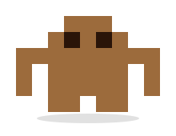
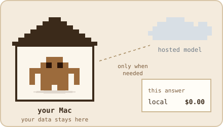
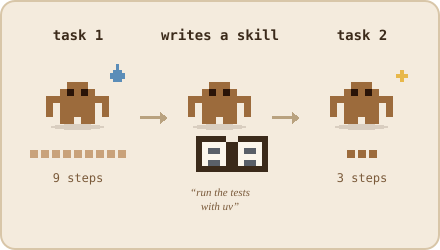
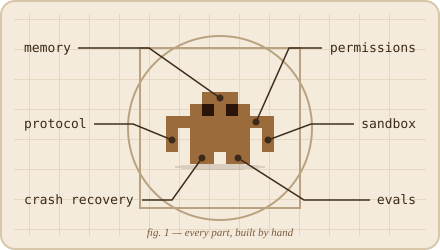
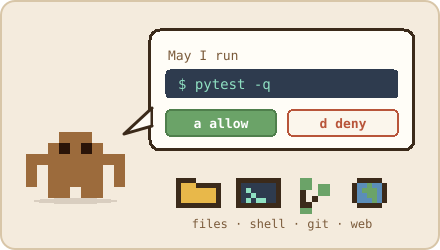

<p align="center">
  
</p>

<h1 align="center">golem</h1>

<p align="center">
  <b>Your own AI agent, living on your Mac.</b><br>
  Local models first. Hosted ones when the task needs them. Your data stays home.
</p>

<p align="center">
  <picture>
    <source media="(prefers-color-scheme: dark)" srcset="docs/images/legend-dark.svg">
    
  </picture>
</p>

<p align="center">
  <a href="https://github.com/MilanPavel/golem/releases/latest"></a>
  <a href="https://github.com/MilanPavel/golem/actions/workflows/ci.yml"></a>
  
</p>

<p align="center">
  
</p>

---

## Why golem

<table>
<tr>
<td width="50%" valign="top">

<h3>Local models first</h3>
Most agent tools assume a huge hosted model. Golem gets real work out of the model on your laptop, and calls a hosted one only when the task needs it. You always see what each answer costs.
</td>
<td width="50%" valign="top">

<h3>Learns as it goes</h3>
Memory and skills the agent writes for itself, so each task makes the next one easier. Golem is also a lab for context compaction, routing between models, and stepping up when a small model struggles.
</td>
</tr>
<tr>
<td width="50%" valign="top">

<h3>Built from scratch</h3>
Golem builds the hard parts itself, to learn what a reliable agent really needs: it survives a crash, asks before risky steps, runs commands in a safe shell, and tests its own answers.
</td>
<td width="50%" valign="top">

<h3>Asks before it acts</h3>
Files, the shell, git, and the web are built in. Every tool call passes one permission layer, so golem asks before it does anything that matters.
</td>
</tr>
</table>

Much of this is still the road ahead. [docs/plan.md](docs/plan.md) lists what comes next, step by step.

## Get started

You need an Apple Silicon Mac and [Homebrew](https://brew.sh).

```bash
brew install milanpavel/golem/golem   # install
golem                                 # open the chat, in any project folder
golem web                             # or open the same chats in your browser
```

The first time, golem asks to start its background service. Press Enter, then pick a model: a local one downloads right there, and a hosted one asks for your API key. [Install](https://milanpavel.github.io/golem/install) walks through every step, plus upgrading and removing.

## 📖 Documentation

Everything else is in **[the documentation](https://milanpavel.github.io/golem/)**:

- [First chat](https://milanpavel.github.io/golem/guide/first-chat): a model, a first question, and a first approval
- [Models and API keys](https://milanpavel.github.io/golem/guide/models), [Commands](https://milanpavel.github.io/golem/guide/commands), [Tools and permissions](https://milanpavel.github.io/golem/guide/permissions), [MCP servers](https://milanpavel.github.io/golem/guide/mcp), [Skills](https://milanpavel.github.io/golem/guide/skills), and [the web UI](https://milanpavel.github.io/golem/guide/web)
- [Architecture](https://milanpavel.github.io/golem/architecture) and [the decisions](https://milanpavel.github.io/golem/adr/README) behind it

## Contributing

[Hacking on golem](https://milanpavel.github.io/golem/contributing/hacking) sets up a checkout in one command, and [CONTRIBUTING.md](CONTRIBUTING.md) says how a change gets to `main`.

<p align="center"><br></p>
