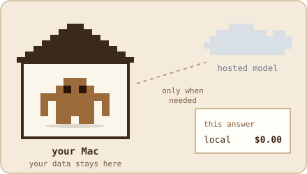
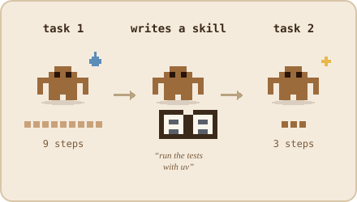
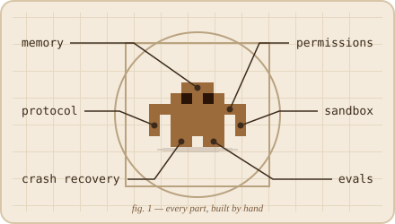
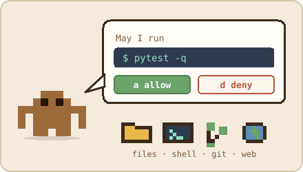
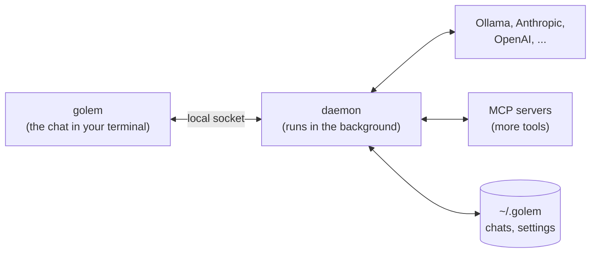

<p align="center">
  
</p>

<h1 align="center">golem</h1>

<p align="center">
  <b>Your own AI agent, living on your Mac.</b><br>
  Local models first. Hosted ones when the task needs them. Your data stays home.
</p>

<p align="center">
  <picture>
    <source media="(prefers-color-scheme: dark)" srcset="docs/images/legend-dark.svg">
    
  </picture>
</p>

<p align="center">
  <a href="https://github.com/MilanPavel/golem/releases/latest"></a>
  <a href="https://github.com/MilanPavel/golem/actions/workflows/ci.yml"></a>
  
</p>

<p align="center">
  
</p>

---

## Why golem

<table>
<tr>
<td width="50%" valign="top">

<h3>Local models first</h3>
Most agent tools assume a huge hosted model. Golem gets real work out of the model on your laptop, and calls a hosted one only when the task needs it. You always see what each answer costs.
</td>
<td width="50%" valign="top">

<h3>Learns as it goes</h3>
Memory and skills the agent writes for itself, so each task makes the next one easier. Golem is also a lab for context compaction, routing between models, and stepping up when a small model struggles.
</td>
</tr>
<tr>
<td width="50%" valign="top">

<h3>Built from scratch</h3>
Golem builds the hard parts itself, to learn what a reliable agent really needs: it survives a crash, asks before risky steps, runs commands in a safe shell, and tests its own answers.
</td>
<td width="50%" valign="top">

<h3>Asks before it acts</h3>
Files, the shell, git, and the web are built in. Every tool call passes one permission layer, so golem asks before it does anything that matters.
</td>
</tr>
</table>

Much of this is still the road ahead. [docs/plan.md](docs/plan.md) lists what comes next, step by step.

## Get started

You need an Apple Silicon Mac and [Homebrew](https://brew.sh).

```bash
brew install milanpavel/golem/golem   # install
golem daemon install                  # start golem's background service, now and at every login
```

Give it a brain, local or hosted. A local model needs nothing here: golem installs Ollama when you pick one. A hosted one needs your API key:

```bash
golem auth set anthropic                            # paste your API key
```

Then open the chat in any project folder:

```bash
cd ~/my-project
golem
```

On the first start, golem lets you pick a model. A local one downloads right there, with a progress bar. That's it.

New to the terminal? [docs/install.md](docs/install.md) walks through every step, plus upgrading and removing.

<details>
<summary><b>Upgrade or remove</b></summary>

```bash
brew upgrade golem && golem daemon restart        # upgrade; chats and settings carry over

golem daemon uninstall && brew uninstall golem    # remove, in this order; ~/.golem stays
```

</details>

## Choose a model

The easiest way is inside the chat: type **`/model`**.

- The picker lists your Ollama models, popular ones to download (with their size, and whether they fit in your Mac's memory), and every hosted model you have a key for.
- **Enter** switches the current chat. **`d`** also makes it the default for new chats. **`x`** removes a downloaded model.
- `/model ollama/qwen3:8b` switches directly. `/model pull <name>` downloads any Ollama model.

Hosted models need an API key. Golem keeps it in the macOS Keychain, never in a file:

```bash
golem auth set anthropic     # prompts for the key; nothing is echoed
golem auth list              # which providers have a key
```

In the chat, `/login anthropic` does the same.

| Provider | What you need |
|---|---|
| `ollama`, `lmstudio` | The app running on your Mac. No key |
| `anthropic`, `openai` | An API key |
| `openrouter`, `groq`, `together` | An API key, for hosted open models |

<details>
<summary><b>Short names for models, and other settings</b></summary>

Golem reads `~/.golem/config.toml`, and picks up model changes without a restart. A profile gives a model a short name:

```toml
default_model = "qwen"             # what new chats start on

[models.qwen]
model = "ollama/qwen3:8b"
ctx = 32768                        # optional context size for Ollama

[models.sonnet]
model = "anthropic/<model-id>"
```

Any OpenAI-compatible server works too:

```toml
[providers.vllm]
base_url = "http://127.0.0.1:8000/v1"
api_key_env = "VLLM_API_KEY"       # optional
```

| Setting | Default | Meaning |
|---|---|---|
| `default_model` | picked on first start | A profile name, or a `provider/model-id` |
| `[models.<name>]` | none | `model`, optional `ctx`, optional `price = { input = 3.0, output = 15.0 }` in USD per million tokens |
| `[providers.<name>]` | built-in | `kind` (`anthropic`, `openai`, `ollama`, `openai_compat`), `base_url`, `api_key_env` |
| `[ollama]` | | `start = true` lets golem start a local Ollama, `idle_stop_minutes = 30` stops the one it started (0 never) |
| `session_titles` | `true` | Name each chat after its first answer, with one extra model call |
| `log_level` | `INFO` | `DEBUG`, `INFO`, `WARNING`, or `ERROR` |
| `[shell]` | | `network = false`, `writable = []`, `timeout_seconds = 120` |
| `[web]` | | `allow_private = false`, `max_bytes = 5000000`, `timeout_seconds = 20` |

Every setting can also come from an environment variable: `GOLEM_` plus the name in capitals, for example `GOLEM_LOG_LEVEL`. An environment variable such as `ANTHROPIC_API_KEY` wins over the Keychain. Apart from the model settings, restart the daemon after a change with `golem daemon restart`.

Tool rules (allow, ask, or deny a tool by name or path) live in the same file, or in a project's `.golem/policy.toml`. `golem config show` lists them, and `/permissions` in the chat edits them.

</details>

## Add tools with MCP

Any [MCP](https://modelcontextprotocol.io) server gives golem new tools. Add one to `~/.golem/config.toml`:

```toml
[mcp.git]
command = "uvx"
args = ["mcp-server-git", "--repository", "/path/to/your/repo"]
```

Golem notices the change and starts it. Type **`/mcp`** in the chat to manage your servers: see which are running, what their tools cost in each prompt, open one to view its tools, reconnect it, or turn it off. The model sees them as `mcp__git__<tool>`. Golem asks before every call, because only the server knows what a tool really does. A rule can allow the ones you trust:

```toml
[[rule]]
tool = "mcp__git__git_status"
action = "allow"
```

**Only when you need it.** Every server's tools go into every prompt, which costs tokens and confuses small local models. Set `enabled = "on_demand"`, and a server stays out until you type `/mcp enable git` in a chat. Only that chat gets it, and it stays on after a restart.

**Servers on the web, with a token.** Golem never keeps a token in the file. Name it, then store it in the Keychain:

```toml
[mcp.github]
url = "https://api.githubcopilot.com/mcp/"
headers = { Authorization = "Bearer keychain:mcp/github" }
```

```bash
golem auth set mcp/github     # prompts for the token
```

**Per project.** A project's `.golem/config.toml` can add servers for chats in that folder, once you list the folder in `trusted_projects`. A server that crashes or stops answering starts again on its own, and the status line shows `mcp ✗ <name>` in red while it is down.

<details>
<summary><b>Server settings</b></summary>

| Setting | Default | Meaning |
|---|---|---|
| `command` | | A program to run, on your `PATH` or as a full path. Homebrew's folders and `~/.local/bin` are searched too |
| `args` | `[]` | Its arguments |
| `env` | `{}` | Extra environment variables. A server sees only these, plus `HOME`, `PATH`, and a few basics |
| `cwd` | your home, or the project | Where the server runs |
| `url` | | An HTTP server's address, instead of `command` |
| `headers` | `{}` | Headers sent with every request to `url` |
| `enabled` | `true` | `"on_demand"` for chats that run `/mcp enable`, or `false` to keep the settings without starting it |
| `timeout_seconds` | `120` | The longest one tool call may take |

A value in `env` or `headers` can name a Keychain secret, `keychain:mcp/<name>`, alone or inside the text. A name that looks like a secret, such as `GITHUB_TOKEN`, must. A server name may use letters, digits, and `-`. `golem doctor` checks that each server's command is found and its secrets are stored.

</details>

## Use skills

A **skill** teaches golem one job, such as "open a pull request the way this project likes it". It is a folder with a `SKILL.md`: a short header that says what it is for, then the instructions, in plain markdown. Scripts and notes can sit next to it.

```markdown
---
name: release-notes
description: Write release notes from the merged pull requests. Use when the user asks for release notes or a changelog entry.
---

# Write release notes

1. List the pull requests merged since the last tag.
2. Group them into Features and Fixes, one line each.
```

Golem uses the same format as Claude Code and other agents ([agentskills.io](https://agentskills.io)), so the skills you already have work unchanged. It finds them in these folders, the project's first:

| Where | Folders |
|---|---|
| The project you chat in | `.golem/skills/`, `.agents/skills/`, `.claude/skills/` |
| Yours, on this machine | `~/.golem/skills/`, `~/.agents/skills/`, `~/.claude/skills/` |

Put each skill in its own folder, named like the skill: `~/.golem/skills/release-notes/SKILL.md`. Type **`/skills`** in the chat to see every skill golem found, and why one is not used: it is broken, turned off, or a skill of the same name in the project hides it. Save a change and the list follows within two seconds, with no restart.

```bash
golem skills                                  # the same list, in a shell
golem skills check ~/.golem/skills/release-notes   # find mistakes before you share one
```

**Run one by name.** Type `/release-notes v0.5` and the model gets that skill's instructions, with `v0.5` filled in where the skill asks for its arguments. Skills show in the `/` suggestions with their argument hint. A command such as `/help` keeps its name, so `/skill run help` runs a skill of that name. A skill with `user-invocable: false` is left out. The transcript shows the line you typed, marked `◆ skill`. Ctrl-O shows the instructions the model got. Once a chat runs a skill, the model may read the files in that skill's folder, and its commands may run the skill's scripts. Nothing writes there.

**Keep one on.** `/skill pin terse` puts that skill's instructions in front of every message to the model, for the rest of the chat. `/skill unpin terse` turns it off, and `/skill` alone lists what is pinned. The status line shows `skills: terse`. A pin survives a restart of golem, and `/fork` keeps it. Skills with `user-invocable: false` can be pinned too. Edit the skill and the next message uses the new version. If you delete or break it, golem says so once, shows `terse (skipped)`, and goes on without it. It stays pinned, so fixing the file brings it back. A pinned skill's own files, such as `references/`, are readable while it is pinned.

**What works today, and what is next.** Golem finds, checks, lists, runs, and pins skills, shows a skill you ran as one short line, and lets it read its own files. Letting the model pick one when the task fits is the next step of [Phase 2](docs/plan.md#phase-2--skills). How it works inside, with an animation, is in [architecture.md](docs/architecture.md#skills).

<details>
<summary><b>Skill settings</b></summary>

In `~/.golem/config.toml`:

```toml
[skills]
disabled = ["release-notes"]   # listed, but never used
claude_dirs = true             # read .claude/skills folders (the default)
extra_dirs = ["~/team-skills"] # more folders of skills, after your own
```

A header field golem does not know yet is kept and shown as a warning, never an error. The fields it reads are `name`, `description`, `argument-hint`, `disable-model-invocation`, `user-invocable`, `allowed-tools`, and `model`.

</details>

## How it works



- **The daemon** talks to the model, runs the tools, and stores every chat in `~/.golem`. macOS keeps it running and restarts it after a crash.
- **The chat** connects to it. Close it mid-answer and nothing is lost: open it again and the answer is still streaming. Open it in several terminals at once if you like.
- **Golem asks first.** Before it changes a file, runs a command, or fetches a page, you see exactly what it wants to do: allow it once, for the session, always, or deny it. File changes show as a diff.

## Using golem

<details>
<summary><b>Commands</b></summary>

| Command | What it does |
|---|---|
| `golem` | Opens the chat |
| `golem status` | Is the daemon up? Prints its pid, version, and uptime |
| `golem doctor` | Checks the whole install and says how to fix each problem |
| `golem daemon install` / `uninstall` | Sets up or removes the background service. `~/.golem` stays |
| `golem daemon start` / `stop` / `restart` | Controls the daemon. `restart` after an upgrade |
| `golem daemon logs` | Follows the daemon's log |
| `golem web` | Serves the chat in your browser on 127.0.0.1 until Ctrl-C. `--no-open` prints the link instead |
| `golem auth set` / `remove` / `list` | Manages API keys, and MCP tokens (`mcp/<name>`), in the Keychain |
| `golem models` | Every model you can use or download, with size, price, and context |
| `golem config show` | The settings and tool rules in effect for this folder |
| `golem skills` | The skills this folder sees, and why one is not used |
| `golem skills check <path>` | Checks a skill, its `SKILL.md`, or a folder of skills. Needs no daemon |

</details>

<details>
<summary><b>Slash commands in the chat</b></summary>

Type `/` and suggestions appear. `/help` lists everything.

| Command | What it does |
|---|---|
| `/model` | Pick, download, or remove a model |
| `/sessions` | Switch between chats |
| `/new`, `/fork`, `/close` | Start a new chat, copy this one, or close it |
| `/title <name>` | Rename this chat |
| `/copy`, `/copy code` | Copy the last answer, or its last code block |
| `/export [path]` | Save this chat as markdown |
| `/artifact` | Open the full output of the last long tool call in your pager |
| `/permissions` | Review and change tool rules |
| `/skills` | See the skills this folder has, and open one to see why it is or is not used |
| `/<skill> [args]`, `/skill run <name> [args]` | Run a skill once. The second form reaches a skill named like a command |
| `/skill pin <name>`, `/skill unpin <name>`, `/skill` | Keep a skill on for the whole chat, turn it off, or list the pinned ones |
| `/mcp` | Manage MCP servers: view tools, reconnect, turn on or off. `/mcp enable <name>` and `/mcp disable <name>` are shortcuts |
| `/login`, `/logout <provider>` | Save or remove an API key |
| `/todos`, `/time` | Show or hide the agent's todo list, or message times |
| `/debug` | Look under the hood: protocol messages, and what the model sees |

</details>

<details>
<summary><b>Keys</b></summary>

| Key | What it does |
|---|---|
| Enter / Shift-Enter | Send / new line |
| Up on an empty line | Recall a message you sent |
| Ctrl-C | Stop the answer. Twice quits |
| Ctrl-O | Show what each tool returned, and the instructions of each skill you ran |
| Ctrl-G | Edit the message in `$EDITOR` |
| Page Up / Page Down, End | Scroll, and jump back to the newest line |
| `?` on an empty line, or F1 | All keys |

</details>

<details>
<summary><b>Where things live</b></summary>

| Path | What |
|---|---|
| `~/.golem/config.toml` | Your settings |
| `~/.golem/golem.db`, `checkpoints.db` | Your chats, and what the model remembers of them |
| `~/.golem/*.db.bak-<version>` | Copies taken before an upgrade changed a database |
| `~/.golem/logs/` | The daemon's log |
| `~/.golem/skills/` | Your own skills |
| `~/.golem/exports/` | Chats saved with `/export` |

Set `GOLEM_HOME` to use another folder, for example a throwaway one for experiments.

</details>

<details>
<summary><b>When something is wrong</b></summary>

Start with `golem doctor`. It checks the service, the running daemon's version, your settings, each model's server or API key, and disk space, and prints a fix under each problem.

| What you see | What to do |
|---|---|
| The chat says `reconnecting` | Run `golem status`, then `golem daemon start` |
| `needs key` in red | `/login <provider>`, or `golem auth set <provider>` |
| A local model doesn't answer | `golem doctor`. golem starts Ollama itself, and logs it in `~/.golem/logs/ollama.log` |
| An unknown model or provider | Check `~/.golem/config.toml` |
| Anything else | `golem daemon logs` |

</details>

## Hacking on golem

<p align="center">
  
</p>

Golem is a Python daemon and a TypeScript terminal app in one repository. From a checkout, `just golem` runs the same CLI as `golem`.

### What you need

| Tool | Install |
|---|---|
| [uv](https://docs.astral.sh/uv/) | `brew install uv`. It also installs Python 3.12 |
| Node.js 24 | `brew install node` |
| [bun](https://bun.sh) 1.3 | `brew install oven-sh/bun/bun` |
| pnpm 10 | `corepack enable` |
| [just](https://just.systems) | `brew install just` |
| [gh](https://cli.github.com) | `brew install gh`. Only to open pull requests and to release |

### Get the code

```bash
git clone https://github.com/MilanPavel/golem.git && cd golem
claude
> /setup
```

`/setup` checks your tools against the versions CI uses, and tells you how to fix anything missing. It asks before it installs anything. Then it installs the packages and the git hooks, and can run `just check` at the end. You can run it again at any time; it only does what is missing.

The skills are in `.agents/skills/`, so other coding agents that read Agent Skills find them too. [AGENTS.md](AGENTS.md) lists them.

#### Without an agent

The skill runs a plain script, so you get the same result without it:

```bash
scripts/setup.sh            # check the tools, install the packages and the hooks
scripts/setup.sh --install  # also brew install the tools that are missing
scripts/setup.sh --check    # also run just check at the end
```

#### By hand

The script does these steps once the tools are in place:

```bash
uv sync --all-packages      # Python packages and dev tools
pnpm install                # TypeScript packages
just hooks                  # check commit messages before each commit
just check                  # lint, typecheck, and tests
```

### Run it

Run the daemon in a terminal with `uv run python -m golem serve`, or in the background with `just golem daemon install`. Only one daemon runs at a time, so uninstall a Homebrew one first. Then open the chat with `just golem`.

From a checkout, the Keychain trusts uv's shared Python rather than golem itself, so macOS asks once to allow it. A Homebrew golem is signed, so its trust carries over across upgrades.

### Everyday commands

| Command | What it does |
|---|---|
| `just` | Lists all recipes |
| `just check` | Lint, typecheck, and tests. This is what CI runs |
| `just test` | Just the tests |
| `just gen` | Regenerates the TypeScript protocol types from Python |
| `just dist` | Builds a standalone golem into `dist/` |
| `just smoke-dist` | Starts that build against a fake model and checks one chat |

### Ship a change

In Claude Code, `/ship` takes your changes to a pull request:

1. It reviews the diff and runs `just check`.
2. It writes the commit message and fills in the PR template.
3. It asks you before it commits and pushes.

It stops at the PR link. You review and merge it on GitHub. Without an agent, follow [CONTRIBUTING.md](CONTRIBUTING.md).

## Learn more

- [docs/install.md](docs/install.md): installing with Homebrew, step by step
- [docs/architecture.md](docs/architecture.md): how the daemon, the protocol, and the chat fit together
- [docs/plan.md](docs/plan.md): what comes next
- [docs/sre.md](docs/sre.md): building, releasing, signing, and running golem
- [docs/monorepo.md](docs/monorepo.md): the Python and TypeScript workspace
- [docs/adr/](docs/adr/README.md): why things are built the way they are

<p align="center"><br></p>
