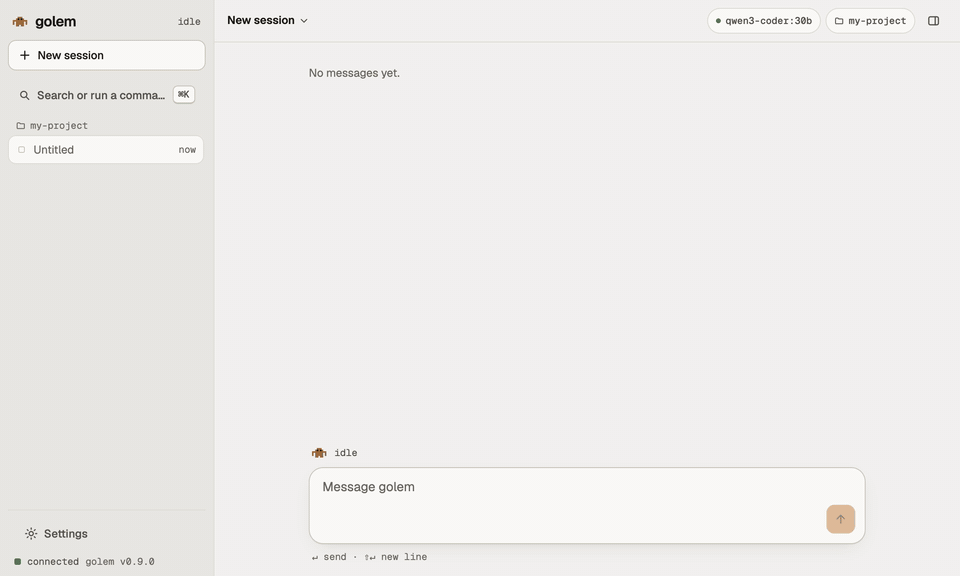

<p align="center">
  
</p>

<h1 align="center">golem</h1>

<p align="center">
  <b>Your own AI agent, living on your Mac.</b><br>
  Local models first. Hosted ones when the task needs them. Your data stays home.
</p>

<p align="center">
  <picture>
    <source media="(prefers-color-scheme: dark)" srcset="docs/images/legend-dark.svg">
    
  </picture>
</p>

<p align="center">
  <a href="https://github.com/MilanPavel/golem/releases/latest"></a>
  <a href="https://github.com/MilanPavel/golem/actions/workflows/ci.yml"></a>
  
</p>

<p align="center">
  <b>In the terminal</b><br>
  
</p>

<p align="center">
  <b>In the browser</b><br>
  
</p>

## Get started

You need an Apple Silicon Mac and [Homebrew](https://brew.sh).

```bash
brew install milanpavel/golem/golem   # install
golem                                 # open golem in your browser
golem tui                             # or chat in the terminal, in any project folder
```

The first time, golem asks to start its background service. Press Enter, then pick a model: a local one downloads right there, and a hosted one asks for your API key. [Install](https://milanpavel.github.io/golem/install) walks through every step, plus upgrading and removing.

## 📖 Documentation

Everything else is in **[the documentation](https://milanpavel.github.io/golem/)**:

- [First chat](https://milanpavel.github.io/golem/guide/first-chat): a model, a first question, and a first approval
- [Models and API keys](https://milanpavel.github.io/golem/guide/models), [Commands](https://milanpavel.github.io/golem/guide/commands), [Tools and permissions](https://milanpavel.github.io/golem/guide/permissions), [MCP servers](https://milanpavel.github.io/golem/guide/mcp), [Skills](https://milanpavel.github.io/golem/guide/skills), and [the web UI](https://milanpavel.github.io/golem/guide/web)
- [Architecture](https://milanpavel.github.io/golem/architecture) and [the decisions](https://milanpavel.github.io/golem/adr/README) behind it
- [Vision](docs/vision.md): where golem is going, and [the roadmap](docs/roadmap.md): the next steps

## Contributing

[Hacking on golem](https://milanpavel.github.io/golem/contributing/hacking) sets up a checkout in one command, and [CONTRIBUTING.md](CONTRIBUTING.md) says how a change gets to `main`.

<p align="center"><br></p>
