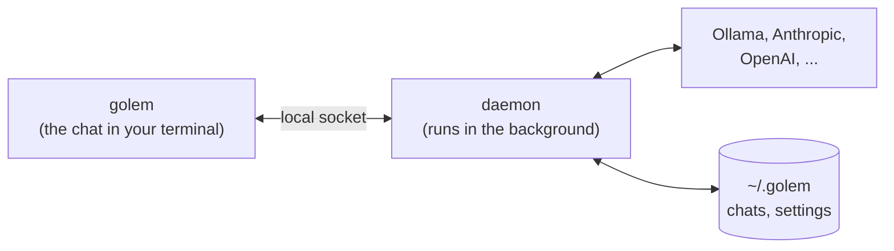

<p align="center">
  
</p>

<h1 align="center">golem</h1>

<p align="center">
  <b>Your own AI agent, living on your Mac.</b><br>
  Local models first. Hosted ones when the task needs them. Your data stays home.
</p>

<p align="center">
  <picture>
    <source media="(prefers-color-scheme: dark)" srcset="docs/images/legend-dark.svg">
    
  </picture>
</p>

<p align="center">
  <a href="https://github.com/MilanPavel/golem/releases/latest"></a>
  <a href="https://github.com/MilanPavel/golem/actions/workflows/ci.yml"></a>
  
</p>

<p align="center">
  
</p>

---

## Why golem

🏺 **Local models are first-class.** Most agent tools assume a huge hosted model. Golem is built to get real work out of a model running on your laptop, and to call a hosted one only when the task needs it. You always see what each answer costs.

🔬 **A lab for agent techniques.** Golem is where the interesting ideas get tried for real: context compaction, routing between models, escalating when a small model struggles, and memory and skills the agent writes for itself, so each task makes the next one easier.

🛠️ **Built, not wrapped.** The goal is to understand what makes an agent production quality by building each part: runs that survive a crash, approvals before anything risky, a sandboxed shell, a typed protocol, observability, and evals.

🔌 **Connected to your tools.** Files, the shell, git, and the web are built in. Every tool call passes one permission layer, so golem asks before it does something that matters.

Much of this is still the road ahead. [docs/plan.md](docs/plan.md) lists what comes next, step by step.

## Get started

You need an Apple Silicon Mac and [Homebrew](https://brew.sh).

```bash
brew install milanpavel/golem/golem   # install
golem daemon install                  # start golem's background service, now and at every login
```

Give it a brain, local or hosted:

```bash
brew install ollama && brew services start ollama   # a free, private model on your Mac
golem auth set anthropic                            # or a hosted one: paste your API key
```

Then open the chat in any project folder:

```bash
cd ~/my-project
golem
```

On the first start, golem lets you pick a model. A local one downloads right there, with a progress bar. That's it.

New to the terminal? [docs/install.md](docs/install.md) walks through every step, plus upgrading and removing.

<details>
<summary><b>Upgrade or remove</b></summary>

```bash
brew upgrade golem && golem daemon restart        # upgrade; chats and settings carry over

golem daemon uninstall && brew uninstall golem    # remove, in this order; ~/.golem stays
```

</details>

## Choose a model

The easiest way is inside the chat: type **`/model`**.

- The picker lists your Ollama models, popular ones to download (with their size, and whether they fit in your Mac's memory), and every hosted model you have a key for.
- **Enter** switches the current chat. **`d`** also makes it the default for new chats. **`x`** removes a downloaded model.
- `/model ollama/qwen3:8b` switches directly. `/model pull <name>` downloads any Ollama model.

Hosted models need an API key. Golem keeps it in the macOS Keychain, never in a file:

```bash
golem auth set anthropic     # prompts for the key; nothing is echoed
golem auth list              # which providers have a key
```

In the chat, `/login anthropic` does the same.

| Provider | What you need |
|---|---|
| `ollama`, `lmstudio` | The app running on your Mac. No key |
| `anthropic`, `openai` | An API key |
| `openrouter`, `groq`, `together` | An API key, for hosted open models |

<details>
<summary><b>Short names for models, and other settings</b></summary>

Golem reads `~/.golem/config.toml`, and picks up model changes without a restart. A profile gives a model a short name:

```toml
default_model = "qwen"             # what new chats start on

[models.qwen]
model = "ollama/qwen3:8b"
ctx = 32768                        # optional context size for Ollama

[models.sonnet]
model = "anthropic/<model-id>"
```

Any OpenAI-compatible server works too:

```toml
[providers.vllm]
base_url = "http://127.0.0.1:8000/v1"
api_key_env = "VLLM_API_KEY"       # optional
```

| Setting | Default | Meaning |
|---|---|---|
| `default_model` | picked on first start | A profile name, or a `provider/model-id` |
| `[models.<name>]` | none | `model`, optional `ctx`, optional `price = { input = 3.0, output = 15.0 }` in USD per million tokens |
| `[providers.<name>]` | built-in | `kind` (`anthropic`, `openai`, `ollama`, `openai_compat`), `base_url`, `api_key_env` |
| `session_titles` | `true` | Name each chat after its first answer, with one extra model call |
| `log_level` | `INFO` | `DEBUG`, `INFO`, `WARNING`, or `ERROR` |
| `[shell]` | | `network = false`, `writable = []`, `timeout_seconds = 120` |
| `[web]` | | `allow_private = false`, `max_bytes = 5000000`, `timeout_seconds = 20` |

Every setting can also come from an environment variable: `GOLEM_` plus the name in capitals, for example `GOLEM_LOG_LEVEL`. An environment variable such as `ANTHROPIC_API_KEY` wins over the Keychain. Apart from the model settings, restart the daemon after a change with `golem daemon restart`.

Tool rules (allow, ask, or deny a tool by name or path) live in the same file, or in a project's `.golem/policy.toml`. `golem config show` lists them, and `/permissions` in the chat edits them.

</details>

## How it works



- **The daemon** talks to the model, runs the tools, and stores every chat in `~/.golem`. macOS keeps it running and restarts it after a crash.
- **The chat** connects to it. Close it mid-answer and nothing is lost: open it again and the answer is still streaming. Open it in several terminals at once if you like.
- **Golem asks first.** Before it changes a file, runs a command, or fetches a page, you see exactly what it wants to do: allow it once, for the session, always, or deny it. File changes show as a diff.

## Using golem

<details>
<summary><b>Commands</b></summary>

| Command | What it does |
|---|---|
| `golem` | Opens the chat |
| `golem status` | Is the daemon up? Prints its pid, version, and uptime |
| `golem daemon install` / `uninstall` | Sets up or removes the background service. `~/.golem` stays |
| `golem daemon start` / `stop` / `restart` | Controls the daemon. `restart` after an upgrade |
| `golem daemon logs` | Follows the daemon's log |
| `golem auth set` / `remove` / `list` | Manages API keys in the Keychain |
| `golem models` | Every model you can use or download, with size, price, and context |
| `golem config show` | The settings and tool rules in effect for this folder |

</details>

<details>
<summary><b>Slash commands in the chat</b></summary>

Type `/` and suggestions appear. `/help` lists everything.

| Command | What it does |
|---|---|
| `/model` | Pick, download, or remove a model |
| `/sessions` | Switch between chats |
| `/new`, `/fork`, `/close` | Start a new chat, copy this one, or close it |
| `/title <name>` | Rename this chat |
| `/copy`, `/copy code` | Copy the last answer, or its last code block |
| `/export [path]` | Save this chat as markdown |
| `/artifact` | Open the full output of the last long tool call in your pager |
| `/permissions` | Review and change tool rules |
| `/login`, `/logout <provider>` | Save or remove an API key |
| `/todos`, `/time` | Show or hide the agent's todo list, or message times |
| `/debug` | Look under the hood: protocol messages, and what the model sees |

</details>

<details>
<summary><b>Keys</b></summary>

| Key | What it does |
|---|---|
| Enter / Shift-Enter | Send / new line |
| Up on an empty line | Recall a message you sent |
| Ctrl-C | Stop the answer. Twice quits |
| Ctrl-O | Show what each tool returned |
| Ctrl-G | Edit the message in `$EDITOR` |
| Page Up / Page Down, End | Scroll, and jump back to the newest line |
| `?` on an empty line, or F1 | All keys |

</details>

<details>
<summary><b>Where things live</b></summary>

| Path | What |
|---|---|
| `~/.golem/config.toml` | Your settings |
| `~/.golem/golem.db`, `checkpoints.db` | Your chats, and what the model remembers of them |
| `~/.golem/*.db.bak-<version>` | Copies taken before an upgrade changed a database |
| `~/.golem/logs/` | The daemon's log |
| `~/.golem/exports/` | Chats saved with `/export` |

Set `GOLEM_HOME` to use another folder, for example a throwaway one for experiments.

</details>

<details>
<summary><b>When something is wrong</b></summary>

| What you see | What to do |
|---|---|
| The chat says `reconnecting` | Run `golem status`, then `golem daemon start` |
| `needs key` in red | `/login <provider>`, or `golem auth set <provider>` |
| A local model doesn't answer | Is Ollama running? `brew services start ollama` |
| An unknown model or provider | Check `~/.golem/config.toml` |
| Anything else | `golem daemon logs` |

</details>

## Hacking on golem

Golem is a Python daemon and a TypeScript terminal app in one repository. From a checkout, `just golem` runs the same CLI as `golem`.

<details>
<summary><b>Set up a checkout</b></summary>

| Tool | Install |
|---|---|
| [uv](https://docs.astral.sh/uv/) | `brew install uv`. It also installs Python 3.12 |
| Node.js 24 | `brew install node` |
| [bun](https://bun.sh) 1.3 | `brew install oven-sh/bun/bun` |
| pnpm 10 | `corepack enable` |
| [just](https://just.systems) | `brew install just` |

```bash
git clone https://github.com/MilanPavel/golem.git && cd golem
uv sync --all-packages      # Python packages and dev tools
pnpm install                # TypeScript packages
just check                  # lint, typecheck, and tests
```

Run the daemon in a terminal with `uv run python -m golem serve`, or in the background with `just golem daemon install`. Only one daemon runs at a time, so uninstall a Homebrew one first. Then open the chat with `just golem`.

From a checkout, the Keychain trusts uv's shared Python rather than golem itself, so macOS asks once to allow it. A Homebrew golem is signed, so its trust carries over across upgrades.

| Command | What it does |
|---|---|
| `just` | Lists all recipes |
| `just check` | Lint, typecheck, and tests. This is what CI runs |
| `just test` | Just the tests |
| `just gen` | Regenerates the TypeScript protocol types from Python |
| `just dist` | Builds a standalone golem into `dist/` |
| `just smoke-dist` | Starts that build against a fake model and checks one chat |

</details>

## Learn more

- [docs/install.md](docs/install.md): installing with Homebrew, step by step
- [docs/architecture.md](docs/architecture.md): how the daemon, the protocol, and the chat fit together
- [docs/plan.md](docs/plan.md): what comes next
- [docs/sre.md](docs/sre.md): building, releasing, signing, and running golem
- [docs/monorepo.md](docs/monorepo.md): the Python and TypeScript workspace
- [docs/adr/](docs/adr/README.md): why things are built the way they are

<p align="center"><br></p>
