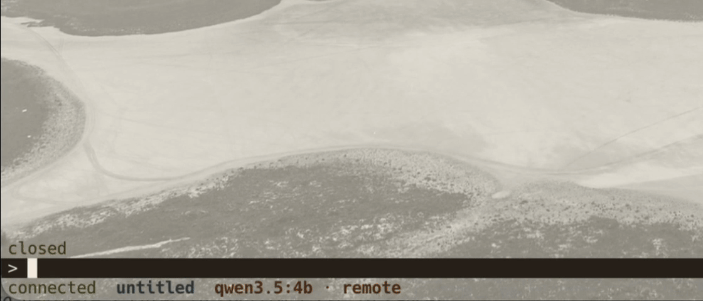

# golem

<p align="center">
  
</p>

Golem is a personal AI agent that runs on your own machine. It is built first for local models (through Ollama), and it can use hosted ones from Anthropic or OpenAI as well.

The name comes from the Prague legend. A clay servant, brought to life to work on its maker's behalf.

<p align="center">
  
</p>

## Why golem

- **Local models as first-class citizens.** Most agent tools assume a large hosted model. Golem is built to get real work out of a model running on a laptop, and to call a hosted model only when the task needs it. Your data stays on your machine by default, and the cost of each answer stays visible.
- **A lab for advanced agent techniques.** Golem is a place to experiment with what makes agents good over long, real tasks:
  - Context optimization: compaction, choosing which tools and skills enter the prompt, and token budgets.
  - Routing between models, with escalation when a small model fails.
  - Self-learning: memory, and skills the agent writes for itself, so each task makes the next one easier.
- **Learning by building.** The goal is to understand what it takes to make an agent production quality, by building each part instead of hiding it behind a framework. That covers durable runs that survive a crash, permissions and approvals before any side effect, sandboxing, a typed protocol between the agent and its screens, observability, and evals.
- **Connected to your tools.** Golem works with files, the shell, and git through built-in tools, and with anything else through MCP servers. Every tool call passes one permission layer, and golem asks before it does something that matters.

Most of this is the direction, not the current state. [What works today](#what-works-today) lists what is built. [docs/plan.md](docs/plan.md) lists what comes next, in order.

## How it works

Golem has two parts:

- **The daemon** is a Python process that talks to the model and stores every session in `~/.golem`. Run it from a terminal, or let launchd keep it running in the background.
- **The TUI** is the chat screen in your terminal. It connects to the daemon over a local socket. Closing it does not stop an answer. Open it again and you see the text so far, plus the rest as it arrives.

### What works today

- Streaming chat with one model: Anthropic, OpenAI, or a local model through Ollama.
- Sessions that survive a daemon restart or a crash.
- Closing the TUI and coming back, from any number of terminals at once.
- Cancelling an answer with Ctrl-C, which keeps what it said so far.
- Automatic titles, a session switcher, new sessions, renaming, and forking.

Golem cannot use tools yet. It cannot read files or run commands. That is the next large step. See [docs/plan.md](docs/plan.md).

Golem runs on macOS only, from a checkout of this repository. There is no installer yet.

## Set up

### Requirements

| Tool | Version | Install |
|---|---|---|
| macOS | any recent | Needed for the launchd background service |
| [uv](https://docs.astral.sh/uv/) | latest | `brew install uv`. It also installs Python 3.12, pinned in `.python-version` |
| Node.js | 24 | `brew install node` |
| pnpm | 10 (pinned in `package.json`) | `corepack enable` |
| [just](https://just.systems) | latest | `brew install just` |
| [Ollama](https://ollama.com) | optional | `brew install ollama`. Needed only for local models |

### After cloning

```bash
git clone <repo-url> golem && cd golem
uv sync --all-packages     # Python packages and dev tools into .venv
pnpm install               # TypeScript packages
just check                 # optional: lint, typecheck, and tests should pass
```

## Choose a model

The daemon reads `~/.golem/config.toml`. Create it with one of the options below.

**A local model through Ollama** needs no API key, so it is the easiest way to start:

```bash
ollama pull qwen3:8b       # or any model you like
```

```toml
# ~/.golem/config.toml
model_provider = "openai_compat"
model_name = "qwen3:8b"
# model_base_url = "http://127.0.0.1:11434/v1"   # the default, for Ollama
```

**Anthropic or OpenAI:**

```toml
# ~/.golem/config.toml
model_provider = "anthropic"   # or "openai"
model_name = "<model-id>"
```

The API key is read from `ANTHROPIC_API_KEY` or `OPENAI_API_KEY`, never from the config file. When you [run the daemon from the command line](#from-the-command-line), export the key in that shell and you are done.

The launchd job does not see your shell's environment, so for the background service give the key to launchd:

```bash
launchctl setenv ANTHROPIC_API_KEY "$ANTHROPIC_API_KEY"
```

Run this again after each reboot, then run `just golem daemon start`. Storing keys in the Keychain is planned.

### All settings

| Setting | Default | Meaning |
|---|---|---|
| `model_provider` | none | `anthropic`, `openai`, or `openai_compat` (Ollama, LM Studio, or any OpenAI-compatible server) |
| `model_name` | none | The provider's model id |
| `model_base_url` | Ollama's address | The server address for `openai_compat` |
| `model_profile` | `remote` | The name shown in the TUI next to the model |
| `session_titles` | `true` | Name each session after its first answer. This costs one extra model call |
| `log_level` | `INFO` | `DEBUG`, `INFO`, `WARNING`, or `ERROR` |

Each setting can also be set with an environment variable named `GOLEM_` plus the setting in capitals, for example `GOLEM_MODEL_NAME`. The environment wins over the file. The daemon reads its settings only when it starts, so restart it after a change: Ctrl-C and run it again from the command line, or `just golem daemon start` under launchd.

## Run the daemon

There are two ways. Pick one, because only one daemon can run at a time.

### From the command line

The simplest way to start. The daemon runs in that terminal, and Ctrl-C stops it.

```bash
uv run python -m golem serve
```

It sees your shell's environment, so an exported `ANTHROPIC_API_KEY` or `OPENAI_API_KEY` just works. Settings work the same way, for example `GOLEM_LOG_LEVEL=DEBUG uv run python -m golem serve`. Open the TUI in a second terminal. Nothing restarts the daemon if it crashes or you close the terminal.

### In the background with launchd

For daily use. launchd starts the daemon at every login and restarts it after a crash.

```bash
just golem daemon install    # write the launchd job and start it; run once
just golem status            # is it up? prints pid, version, protocol, uptime
```

`install` records this checkout's virtualenv, so run it again if you move the repository. To switch back to the command line, run `just golem daemon stop` first.

### Daemon commands

| Command | What it does |
|---|---|
| `just golem --version` | Prints the CLI version. When the daemon is up, prints its version on the next line |
| `just golem status` | Prints pid, version, protocol, and uptime. Exits 1 if nothing is listening |
| `just golem daemon install` | Writes `~/Library/LaunchAgents/dev.golem.daemon.plist` and loads it |
| `just golem daemon start` | Starts the daemon, or restarts it if it is running |
| `just golem daemon stop` | Unloads the job. The daemon stays down until the next `start` |
| `just golem daemon logs` | Shows the last log lines and follows them. `--no-follow` prints and exits |

## Chat

```bash
just tui
```

The TUI opens your newest session, or a new one if there is none. Type and press Enter.

The header shows which golem this is. The status line shows the session title, how many messages it holds, and how long the daemon has been up. A narrow window hides uptime first, then the message count, then the folder. The terminal tab is named `golem — <title>`.

### Slash commands

| Command | What it does |
|---|---|
| `/help` | Lists every command, with its arguments |
| `/sessions` | Opens the session switcher, with live status |
| `/new` | Starts a new session |
| `/title` | Shows the current session's title |
| `/title <name>` | Renames the current session |
| `/fork` | Copies the session, up to its newest finished message, into a new session |
| `/debug` | Opens or closes the debug panel |
| `/debug wire` / `/debug model` | Shows the protocol messages, or the conversation the model sees |
| `/debug hold` | Holds back the next message so you can inspect it before sending |
| `/debug go` | Sends the held message |
| `//text` | Sends `/text` as a message, not a command |

Anything else that starts with `/` stays on screen: `unknown command — /help lists them`.

Type `/` and matching commands appear above the composer. Typing narrows them, prefix first. Up and Down move, Tab fills in the selected row, and Enter fills in a partial name. Esc closes the list and leaves what you typed. `/debug w` offers `wire`. A line starting with `//` keeps the list closed.

### Keys

| Key | What it does |
|---|---|
| Enter | Sends the message. Shift-Enter or Alt-Enter inserts a line |
| Left, Right | Move the cursor. Alt-Left and Alt-Right move by word |
| Ctrl-A, Ctrl-E | Jump to the start or end of the line |
| Backspace, Delete, Ctrl-W, Ctrl-U, Ctrl-K | Delete around the cursor |
| Ctrl-G | Opens the draft in `$EDITOR`, or `vi` |
| `?` | On an empty line, shows every key. `?` or Esc closes the list |
| F1 | Shows or hides the key list |
| Ctrl-C | Cancels the answer in progress. A second Ctrl-C quits |
| Page Up, Page Down, Home, End, mouse wheel | Scroll the chat. The same keys scroll the key list while it is open |
| Up, Down | Move through command suggestions while that list is open |
| Tab | Fills in the selected command or argument. Also switches the debug tab |
| Up, Down, Enter, `n`, Esc | Move through the session switcher, open a session, start a new one, close the switcher |
| Tab | Switches the debug tab |
| Esc | Closes suggestions, then the command list, then the debug panel |

## Where things live

| Path | What |
|---|---|
| `~/.golem/config.toml` | Your settings |
| `~/.golem/golem.db` | Sessions, runs, and every event |
| `~/.golem/checkpoints.db` | What the model remembers of each conversation |
| `~/.golem/logs/golem.jsonl` | The daemon log. launchd's own output is next to it |
| `~/.golem/run/golem.sock` | The socket the TUI connects to |

Set `GOLEM_HOME` to use another folder, for example a throwaway one for experiments. Both the daemon and the TUI respect it. A daemon started by launchd keeps the folder it was installed with.

## When something is wrong

| Symptom | Check |
|---|---|
| The status line says `reconnecting` | Is the daemon up? Run `just golem status`. Then start it from the command line, or with `just golem daemon start` |
| `daemon already running (pid N)` | The launchd copy is up. Run `just golem daemon stop` before running it from the command line |
| A red error mentions `model_provider` or an API key | Check `~/.golem/config.toml`. For a remote model, check the `launchctl setenv` step above |
| A local model does not answer | Is Ollama running (`ollama serve`), and is the model pulled? |
| Anything else | Run `just golem daemon logs` |

To see the restart for yourself: run `just tui`, then kill the pid from `just golem status`. The status line switches to `reconnecting`, launchd starts the daemon again, and the line returns to `connected`. Do not use `stop` for this. It unloads the job, so launchd does not bring the daemon back.

## Development

| Command | What it does |
|---|---|
| `just` | Lists all recipes |
| `just check` | Regenerates the protocol types, then runs lint, typecheck, and tests. This is what CI runs |
| `just test` | pytest and the TypeScript tests |
| `just fmt` | Formats the Python code |
| `just gen` | Regenerates the TypeScript types from the Python protocol models |

## Documentation

- [docs/architecture.md](docs/architecture.md) explains how the daemon, the protocol, and the TUI fit together.
- [docs/plan.md](docs/plan.md) is what comes next, step by step.
- [docs/monorepo.md](docs/monorepo.md) explains the Python and TypeScript workspace setup.
- [docs/adr/](docs/adr/README.md) records why things are built the way they are.
