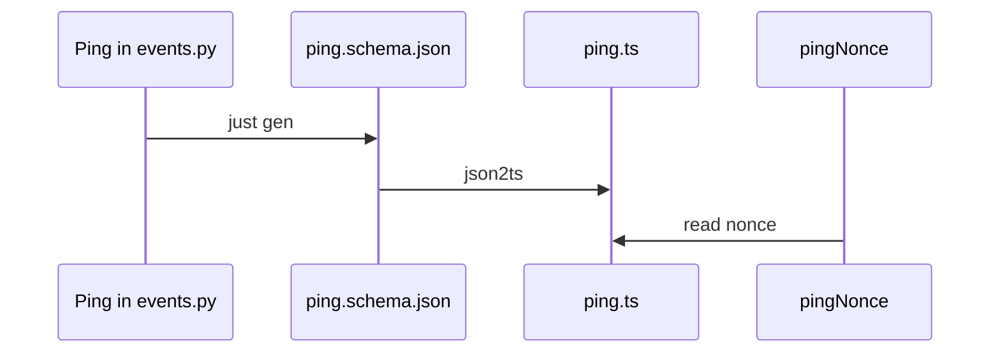

# ADR-003: One Python model, generated TypeScript

**Date**: 2026-10-05
**Status**: accepted

## The idea

The daemon and the TUI have to agree on message shapes. Those shapes are written once, in Python. TypeScript is generated. A hand edit to the TypeScript would be overwritten, and `just check` would fail if someone forgot to regenerate.

On the wire, once a socket exists, each line is one JSON-RPC 2.0 object. Events go from the daemon to the client. Commands go from the client to the daemon.

An event is a fact that already happened. The client builds its screen by reading the facts in order. It does not keep a second, private copy of the session.

The walk with the real model is in [architecture.md](../architecture.md).

## What the code does today

The daemon speaks these models. `just gen` writes a JSON Schema and a TypeScript file for each one, plus `version.ts` from `PROTOCOL_MAJOR` and `PROTOCOL_MINOR`.

| Model | Role |
|---|---|
| `HelloParams`, `HelloResult` | `hello`. The major number must match. Any minor on that major is accepted. |
| `DaemonStatus` | Result of `daemon.status`: pid, version, protocol, uptime, `running` or `draining`, and the configured `model_profile`, `model_provider`, and `model_name`. Provider and name are null when unset. |
| `PingParams`, `Ping` | `ping`. The daemon echoes `nonce` on a `system.ping` result. |
| `SessionCreateParams`, `SessionCreateResult` | `session.create`. Returns `session_id`. Does not attach the caller. |
| `SessionAttachParams`, `SessionAttachResult` | `session.attach`. Replays stored events after `after_seq`, then streams. Returns `last_seq`. |
| `SessionDetachParams`, `SessionDetachResult` | `session.detach`. Stops live events for one session on this connection. |
| `SessionListParams`, `SessionSummary`, `SessionListResult` | `session.list`. Newest activity first, with `status`, `title`, and `last_seq`. With `watch`, the connection also gets `session.summary`. |
| `SessionForkParams`, `SessionForkResult` | `session.fork`. A new session with the history up to `at_message_id`. An unknown message is `-32007`. |
| `SessionRenameParams`, `SessionRenameResult` | `session.rename`. Sets the title by hand and returns it cleaned. A blank title is `-32602`. |
| `SessionSummaryNotification` | `session.summary`: one session's `SessionSummary` after it changed, sent to watchers. Not a `ChatEvent`. |
| `MessageSendParams`, `MessageSendResult` | `message.send`. Returns `run_id` while the run continues. The events go to attached connections. |
| `SessionInspectParams`, `InspectMessage`, `SessionInspectResult` | `session.inspect`. Checkpoint messages as role and text, plus the profile, provider, name, and count. |
| `ChatEvent` | One of `session.created`, `message.started`, `message.delta`, `message.completed`, `run.started`, `run.completed`, `run.failed`, `run.cancelled`, `session.updated`, `session.closed`. `session.created` carries `model_profile`, and `model_provider` and `model_name` when that profile is the configured one. |
| `RpcRequest`, `RpcSuccess`, `RpcFailure` | One JSON-RPC 2.0 object per line. A request has an `id`. |
| `RpcNotification` | Method `event`, params `ChatEvent`, no `id`. |

`PROTOCOL_MAJOR` is `2` and `PROTOCOL_MINOR` is `6`. Minor 6 adds `auth.set`, `auth.remove`, and `auth.list` for provider API keys in the OS credential store, and error `-32008` when that store cannot be used. Minor 5 adds `session.close`, the `session.closed` event, and `closed` on a session summary. Minor 4 adds `session.fork`, `forked_from` on `SessionCreatedData`, and error `-32007` for a message that cannot be forked at ([ADR-010](010-fork.md)). Minor 3 adds `session.rename`. Minor 2 adds `watch` on `session.list`, the `session.summary` notification, and the `session.updated` event that carries a title ([ADR-009](009-session-list.md)). Minor 1 adds `run.cancel`, the `run.cancelled` event, and error `-32006` for an unknown run ([ADR-008](008-cancellation.md)). Major 2 sends a session's events only to connections attached to it, and adds `session.attach`, `session.detach`, and `session.list` ([ADR-007](007-attach-and-fan-out.md)). Before that, on major 1, minor 4 adds `interrupted` on `message.completed`, true when the run stopped before the model finished. Minor 3 adds `session.inspect`. Minor 2 adds the optional model fields on `DaemonStatus` and `SessionCreatedData`. The chat commands and the event notification arrived in minor 1. `hello` runs before the other commands. A different major number is error `-32001`, and the client stops reconnecting. A missing session is `-32003`, a second send while a run is open is `-32004`, and a model with no provider, name, or key is `-32005`. `@golem/client` imports the generated types and dispatches `event` lines to listeners. It attaches again after a reconnect and drops events it has already delivered. Those lines do not settle a pending `ping`. `pingNonce` in the TUI still reads a `Ping` nonce. The screen is the full-terminal frame described in [ADR-005](005-client-package.md).

## Other shapes that lost

Sending the graph library's own chunks to the TUI would make the screen depend on that library's classes.

Writing the TypeScript by hand would let the two sides drift. The bug would show up as a wrong screen. Here it shows up as a failed `just check`.

Using AG-UI or ACP as the native message format is not decided. This record does not pick either one.

## What it costs

`json-schema-to-typescript` is locked in `pnpm-lock.yaml`. Two machines generate the same TypeScript.

A breaking change to a model bumps `PROTOCOL_MAJOR`. `hello` refuses a client on the wrong major number.

`golem/graphs/adapter.py` turns a graph stream into `message.delta` and `message.completed`. The session manager emits the user `message.completed`, `message.started`, and the `run.*` events. The socket carries `hello`, `daemon.status`, `ping`, `session.create`, `session.attach`, `session.detach`, `session.list`, `session.rename`, `session.fork`, `message.send`, `run.cancel`, `session.inspect`, `event` notifications, and `session.summary` for watchers. A person's answer during a paused step is not in the tree yet.
