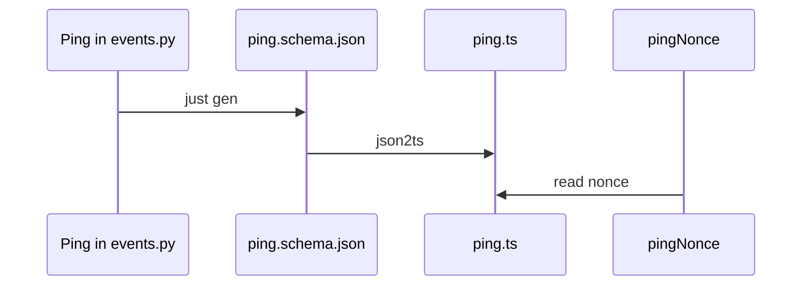

# ADR-003: One Python model, generated TypeScript

**Date**: 2026-10-05
**Status**: accepted

## The idea

The daemon and the TUI have to agree on message shapes. Those shapes are written once, in Python. TypeScript is generated. A hand edit to the TypeScript would be overwritten, and `just check` would fail if someone forgot to regenerate.

On the wire, once a socket exists, each line is one JSON-RPC 2.0 object. Events go from the daemon to the client. Commands go from the client to the daemon.

An event is a fact that already happened. The client builds its screen by reading the facts in order. It does not keep a second, private copy of the session.

The walk with the real model is in [architecture.md](../architecture.md).

## What the code does today

The daemon speaks these models. `just gen` writes a JSON Schema and a TypeScript file for each one, plus `version.ts` from `PROTOCOL_MAJOR` and `PROTOCOL_MINOR`.

| Model | Role |
|---|---|
| `HelloParams`, `HelloResult` | `hello`. The major number must match. Any minor on that major is accepted. |
| `DaemonStatus` | Result of `daemon.status`: pid, version, protocol, uptime, `running` or `draining`, and the configured `model_profile`, `model_provider`, and `model_name`. Provider and name are null when unset. |
| `PingParams`, `Ping` | `ping`. The daemon echoes `nonce` on a `system.ping` result. |
| `SessionCreateParams`, `SessionCreateResult` | `session.create`, with an optional absolute `cwd` for the project folder. Returns `session_id`. Does not attach the caller. |
| `SessionAttachParams`, `SessionAttachResult` | `session.attach`. Replays stored events after `after_seq`, then streams. Returns `last_seq`. |
| `SessionDetachParams`, `SessionDetachResult` | `session.detach`. Stops live events for one session on this connection. |
| `SessionListParams`, `SessionSummary`, `SessionListResult` | `session.list`. Newest activity first, with `status`, `title`, and `last_seq`. With `watch`, the connection also gets `session.summary`. |
| `SessionForkParams`, `SessionForkResult` | `session.fork`. A new session with the history up to `at_message_id`. An unknown message is `-32007`. |
| `SessionRenameParams`, `SessionRenameResult` | `session.rename`. Sets the title by hand and returns it cleaned. A blank title is `-32602`. |
| `SessionSummaryNotification` | `session.summary`: one session's `SessionSummary` after it changed, sent to watchers. Not a `ChatEvent`. |
| `MessageSendParams`, `MessageSendResult` | `message.send`. Returns `run_id` while the run continues. The events go to attached connections. |
| `SessionInspectParams`, `InspectMessage`, `SessionInspectResult` | `session.inspect`. Checkpoint messages as role and text, plus the profile, provider, name, and count. |
| `ChatEvent` | One of `session.created`, `model.selected`, `message.started`, `message.delta`, `message.completed`, `tool.requested`, `tool.started`, `tool.output`, `tool.completed`, `tool.failed`, `approval.needed`, `approval.resolved`, `todos.updated`, `run.started`, `run.completed`, `run.failed`, `run.cancelled`, `session.updated`, `session.closed`. `session.created` carries `model_profile`, `model_provider` and `model_name` when they resolve, and `cwd`. |
| `ToolRequestedData`, `ToolStartedData`, `ToolOutputData`, `ToolCompletedData`, `ToolFailedData` | One tool call, by `call_id`: what the model asked for (`message_id`, `name`, `args`), that it runs, its `summary` and output `preview` and, for long output, its `artifact_id`, or why it failed. |
| `ArtifactReadParams`, `ArtifactReadResult` | `artifact.read`: a page (`text`, `offset`, `size`) of one of a session's artifacts. `-32012` for an artifact the session does not have. |
| `Todo`, `TodosUpdatedData` | The agent's todo list: each item's `id`, `text`, and `status` (`pending`, `in_progress`, `done`), and the `call_id` that wrote it. |
| `ApprovalRespondParams`, `ApprovalRespondResult` | `approval.respond`: `allow`, `allow_session`, `allow_always`, or `deny` for the call a session's run waits on, and with `allow` optional edited `args`. Returns the run. `-32010` when no run waits on that call, `-32011` when the edited arguments are refused. |
| `ApprovalNeededData`, `ApprovalResolvedData` | The call a run waits on, with the rule that asked (`source`) and, for a file change, its `diff`, and the answer. |
| `ConfigGetParams`, `ConfigRule`, `ConfigAllowance`, `ConfigGetResult` | `config.get`. Settings without keys, `trusted_projects`, the project's `policy.toml` and whether it is trusted, every tool rule with its `source`, why it is `ignored`, and its `file` and `index`, and with a `session_id` what that session allows. |
| `PolicyUpdateParams`, `PolicyRemoveParams`, `PolicyEditResult` | `policy.update` sets a rule's action and `policy.remove` deletes it, in the user's `config.toml` or the project's `policy.toml`, by number. |
| `SessionRevokeParams`, `SessionRevokeResult` | `session.revoke` stops allowing a tool and subject for the rest of a session, stored as `session.updated` with the list that is left. |
| `RpcRequest`, `RpcSuccess`, `RpcFailure` | One JSON-RPC 2.0 object per line. A request has an `id`. |
| `McpListParams`, `McpServer`, `McpListResult` | `mcp.list`: the MCP servers, sorted by name, with `state` (`idle`, `starting`, `running`, `failed`, `disabled`), `command` (or URL), the `tools` the model sees, `schema_tokens`, `error`, and `retry_seconds`. With `session_id`, also the session's trusted project servers (`project`), and `enabled` for that session. |
| `McpServerParams`, `McpToolInfo`, `McpToolsResult` | `mcp.tools` lists a running server's tools with their descriptions, and `mcp.restart` starts a server again and returns its `McpServer`. `session_id` picks that session's project server of the name. |
| `McpSetEnabledParams` | `mcp.set_enabled`: `true`, `"on_demand"`, or `false`, written into the server's `config.toml` with its comments kept, and applied at once. Returns the server. |
| `McpToggleParams`, `McpToggleResult` | `mcp.enable` and `mcp.disable`: an on-demand server, for one session. Returns the servers the session has on. `-32602` for a server that is not on demand. |
| `McpServerStatusNotification` | `mcp.server.status`: one `McpServer` after it changed, sent to every connection. Not stored. |
| `SkillListParams`, `ListedSkill`, `SkillListResult` | `skill.list`: every skill a session in `cwd` sees (only the user's without it), highest source first. Each has `source` (`project`, `user`, `bundled`), `path`, `usable`, `shadowed_by`, `disabled`, `errors`, `warnings`, and its frontmatter flags. `-32602` for a relative `cwd`. |
| `SkillRegistryChanged`, `SkillRegistryChangedNotification` | `skill.registry.changed`: skills changed on disk, sent to every connection. `root` is the session folder whose project skills changed, or `null` when the user's skills or `[skills]` changed. Not stored. |
| `RpcNotification` | Method `event`, params `ChatEvent`, no `id`. |

`PROTOCOL_MAJOR` is `2` and `PROTOCOL_MINOR` is `23`. Minor 23 adds `code`, `provider`, and `hint` on `run.failed`, with `model_unreachable` when the model's server did not answer and the fix in `hint`. Minor 22 adds `skill.list`, the skills a session folder sees with the ones that lost or are broken, and `skill.registry.changed`, sent to every connection when a skill or `[skills]` changes on disk ([ADR-025](025-skill-sources.md)). Minor 21 adds `mcp.tools`, `mcp.restart`, and `mcp.set_enabled`, which writes `enabled` into the file that names a server, and `config` on a listed server ([ADR-023](023-mcp-client.md)). Minor 20 adds `mcp.enable` and `mcp.disable` for an on-demand MCP server in one session, `mcp_servers` on `session.updated`, `session_id` on `mcp.list`, the `idle` state, and `project`, `on_demand`, `enabled`, `schema_tokens`, and `retry_seconds` on a listed server ([ADR-023](023-mcp-client.md)). Minor 19 adds `mcp.list`, which returns each MCP server from `config.toml` with its state, command, tools, and error, and the `mcp.server.status` notification to every connection when one changes (not stored) ([ADR-023](023-mcp-client.md)). Minor 18 adds the `todos.updated` event, the agent's whole todo list after `todo_write`, and a fork's copied list without a run ([ADR-018](018-tool-state-updates.md)). Minor 17 adds `artifact_id` on `tool.completed`, the `artifact.read` command, and error `-32012` for an artifact the session does not have ([ADR-016](016-artifacts.md)). Minor 16 adds `args` on `approval.respond`, the call's arguments as the user edited them, only with `allow`, the same `args` on `approval.resolved`, and error `-32011` for edited arguments the tool refuses or a rule denies ([ADR-015](015-write-tools.md)). Minor 15 adds `diff` on `approval.needed`, the change a file tool would make ([ADR-015](015-write-tools.md)). Minor 14 adds `allow_always` as an approval answer, `subject` on `approval.needed` and `approval.resolved` and `rule` on the latter, `allowed_tools` on `session.updated`, `file`, `index`, and `session_allowed` in `config.get` (which takes `session_id`), and the `policy.update`, `policy.remove`, and `session.revoke` commands. Minor 13 adds the `tool.output` event, the text a running tool call printed, stored only until the call ends ([ADR-014](014-shell-sandbox.md)). Minor 12 adds `approval.respond`, the `approval.needed` and `approval.resolved` events, `waiting` as a session summary status, and error `-32010` for an answer no run waits on ([ADR-013](013-approvals.md)). Minor 11 adds `config.get`, which returns the resolved settings and the tool rules for a folder in the order they are checked ([ADR-012](012-permission-rules.md)). Minor 10 adds `cwd` on `session.create`, `session.created`, and `message.send`, `cwd` on `session.updated` (whose `title` becomes optional, and at least one of the two is set), and the `tool.requested`, `tool.started`, `tool.completed`, and `tool.failed` events ([ADR-011](011-tools.md)). Minor 9 adds `model.probe`, `model.pull`, `model.pull_cancel`, `model.delete`, the `model.pull.progress` and `model.pull.done` notifications to every connection (not stored), `pulling` and `progress` on a listed model, and error `-32009` for a download or removal that cannot start. Minor 8 adds `session.set_model`, `model.set_default`, and the `model.selected` event. Minor 7 adds `model.list`. Minor 6 adds `auth.set`, `auth.remove`, and `auth.list` for provider API keys in the OS credential store, and error `-32008` when that store cannot be used. Minor 5 adds `session.close`, the `session.closed` event, and `closed` on a session summary. Minor 4 adds `session.fork`, `forked_from` on `SessionCreatedData`, and error `-32007` for a message that cannot be forked at ([ADR-010](010-fork.md)). Minor 3 adds `session.rename`. Minor 2 adds `watch` on `session.list`, the `session.summary` notification, and the `session.updated` event that carries a title ([ADR-009](009-session-list.md)). Minor 1 adds `run.cancel`, the `run.cancelled` event, and error `-32006` for an unknown run ([ADR-008](008-cancellation.md)). Major 2 sends a session's events only to connections attached to it, and adds `session.attach`, `session.detach`, and `session.list` ([ADR-007](007-attach-and-fan-out.md)). Before that, on major 1, minor 4 adds `interrupted` on `message.completed`, true when the run stopped before the model finished. Minor 3 adds `session.inspect`. Minor 2 adds the optional model fields on `DaemonStatus` and `SessionCreatedData`. The chat commands and the event notification arrived in minor 1. `hello` runs before the other commands. A different major number is error `-32001`, and the client stops reconnecting. A missing session is `-32003`, a second send while a run is open is `-32004`, and a model with no provider, name, or key is `-32005`. `@golem/client` imports the generated types and dispatches `event` lines to listeners. It attaches again after a reconnect and drops events it has already delivered. Those lines do not settle a pending `ping`. `pingNonce` in the TUI still reads a `Ping` nonce. The screen is the full-terminal frame described in [ADR-005](005-client-package.md).

## Other shapes that lost

Sending the graph library's own chunks to the TUI would make the screen depend on that library's classes.

Writing the TypeScript by hand would let the two sides drift. The bug would show up as a wrong screen. Here it shows up as a failed `just check`.

Using AG-UI or ACP as the native message format is not decided. This record does not pick either one.

## What it costs

`json-schema-to-typescript` is locked in `pnpm-lock.yaml`. Two machines generate the same TypeScript.

A breaking change to a model bumps `PROTOCOL_MAJOR`. `hello` refuses a client on the wrong major number.

`golem/graphs/adapter.py` turns a graph stream into facts. The runner emits them as `message.started`, `message.delta`, `message.completed`, and the `tool.*` events, plus the user `message.completed` and the `run.*` events. The socket carries `hello`, `daemon.status`, `ping`, `session.create`, `session.attach`, `session.detach`, `session.list`, `session.rename`, `session.fork`, `message.send`, `run.cancel`, `session.inspect`, `event` notifications, and `session.summary` for watchers. A person's answer during a paused step is not in the tree yet.
