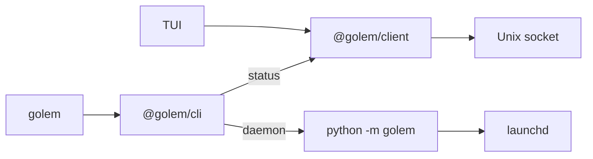

# ADR-005: One TypeScript client, and that client owns the golem command

**Date**: 2026-10-06
**Status**: accepted

## The idea

The TUI and `golem status` speak to the daemon through one library, `@golem/client`. A second implementation would drift, and the bug would show up as a status line that lies.

Process control stays in Python. launchd has to run an absolute interpreter: `python -m golem serve`. The command a person types is still `golem`. That binary is TypeScript. `golem status` uses the client. `golem daemon install|start|stop|logs` starts `uv run python -m golem daemon …`.

## What the code does today

`@golem/client` connects, sends `hello`, and pings every 5 seconds. A missed ping drops the socket. The TUI reconnects with backoff from 200 ms up to 5 s. `golem status` tries once and exits 1 if nothing is listening. A protocol major mismatch stops the retries.

The TUI is Ink 8 and React 19. It takes the alternate screen and draws a frame the height of the terminal, one column short, so a full-width bar does not wrap an extra row. The header is a clay mark, the version, and the selected model. The version is the TUI package version. When the daemon version differs it is shown in yellow as `tui X · daemon Y`, and the connection stays up. The transcript is a function of the chat events. It scrolls only when the laid-out lines are taller than the body. Page Up, Page Down, Home, End, and the wheel move that window, and they move the debug panel instead while it is open. User questions are full-width bars, in the transcript and in the composer. The status line is a list of segments: connection, session title, model, folder, message count, and daemon uptime. The lowest priority drops first, and the connection segment stays. The terminal tab follows the session title. The model comes from `daemon.status` until `session.created` arrives, and the session value wins. A meter is mounted only while a run is busy: `thinking` before the first token, then `writing` with the characters received and the seconds since `run.started`. A line that starts with `/debug` opens a panel under the transcript. The same command, or Escape, closes it. Lines in the panel wrap to its width. One tab lists recent socket lines. The other shows the checkpoint messages. `/debug hold` shows the next line there before `message.send`. [ADR-006](006-checkpoint-continuity.md) is what survives a restart. `ink-testing-library` does not support this Ink, so the tests check those functions. They do not render a frame.

## Other shapes that lost

A Python client for `golem status` would be a second reader of the same JSON. The TUI would not use it.

A Python console script also named `golem` would fight the TypeScript bin on `PATH`.

Ink 5 with `ink-testing-library` would pin the TUI to React 18. The status line does not need that, and the chat view in a later phase would have to migrate.

## What it costs

`golem daemon install` records the current virtualenv interpreter in the plist. Moving the checkout means running install again. The daemon subcommands need `uv` on `PATH`.

The status line is tested without drawing Ink. A later phase can render components when a test library matches the Ink version.
