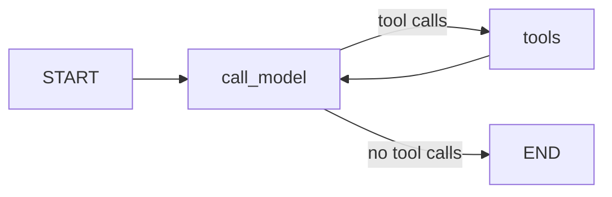

# ADR-011: Tools run in golem's own node, inside the session folder

**Date**: 2026-10-19
**Status**: accepted

## The idea

The model can ask for tools. A tool is a plain Python function with a Pydantic model of its arguments. It knows nothing about LangChain or any provider. The graph turns the registry into tool schemas for the model, and its own `tools` node runs the calls.

Every tool works inside one folder, the session's project folder. The client sends it with `session.create`, and the session keeps it for life. A path is resolved against that folder with symlinks followed, and anything that lands outside is refused. The permission rules ([ADR-012](012-permission-rules.md)) are checked in the same node, before the folder check, and an approval pauses the run there ([ADR-013](013-approvals.md)).

A failed call never ends the run. The model reads why it failed as the tool's result, and the screen gets the same reason in `tool.failed`.

## What the code does today

- **Tools.** `golem/tools/registry.py` holds `Tool`, `ToolRegistry`, `ToolContext`, `ToolResult`, and `ToolError`. `golem/tools/fs.py` has `read_file`, `list_dir`, `glob`, and `grep`. `golem/tools/paths.py` keeps paths inside the folder. The model gets at most 100 000 characters from one call.
- **The node.** `golem/graphs/tools_node.py` runs each call of the last reply through the registry. It writes `tool.started` and `tool.completed` or `tool.failed` to the custom stream, and returns one `ToolMessage` per call with the full output. Its id is `t_<call id>`.
- **Messages.** Each model call is its own assistant message. The first keeps the id the turn chose, so a turn without tools looks as it did before. `call_model` gives each later call a new id and writes `model.started` with it to the custom stream. A tool call without an id gets one.
- **Events.** The runner emits `tool.requested` for each call after its reply's `message.completed`, then the node's `tool.started` and its end. The full output stays in the checkpoint. The event carries a one-line summary and the first 4 KB.
- **Unanswered calls.** A run stopped between a reply and its results leaves calls without a result, and providers refuse that history. Before each turn, `ChatRuntime.answer_dangling` adds a cancelled result for each one. On cancel and on crash recovery, each open call also gets `tool.failed`.
- **Limits.** 25 model calls per run (`recursion_limit` 50). A run that goes past it fails with a short message.
- **Models without tools.** A model class without `bind_tools` gets none. A server that answers "does not support tools" is asked again without them, and that profile is not offered tools again in this process.
- **The folder** is in `sessions.cwd` and `session.created`, and a fork copies it. It goes to the graph in `configurable`, not in state, so it is not checkpointed. A session from before this has no folder. The first `message.send` that carries a `cwd` gives it one, stored as `session.updated`, and later sends do not change it. Until then its file tools say it has no folder.

## Other shapes that lost

**LangGraph's prebuilt `ToolNode` with LangChain `@tool` functions.** It runs the call directly. The permission check, the events, and later the approval interrupt and artifact storage would have to wrap it from outside, or live inside every tool. It also makes the tools LangChain objects, against [ADR-002](002-langgraph-boundary.md).

**One assistant message per turn, with tool calls inside it.** The checkpoint holds one `AIMessage` per model call, and fork, cancel, and recovery all name messages by id. Keeping one event id for several checkpoint messages would break those lookups.

**The folder in graph state.** It would ride in every checkpoint, and changing how a session finds its folder would mean rewriting old checkpoints. The session row already has it.

**Repairing unanswered calls only on cancel.** A crash, a fork at a tool-calling reply, or the step limit leaves the same history. Checking before each turn covers all of them in one place.

## What it costs

A tool result lives in the checkpoint in full until artifacts arrive (plan step 1.6), so a large read grows `checkpoints.db`.

A model that switches mid-session must read tool calls from another provider. LangChain's message formats carry them across. A test converts a stored tool history for Anthropic, OpenAI, and Ollama.

Detecting "does not support tools" reads the error text. A provider that words it differently fails the run, and its profile needs a model with tool support.
