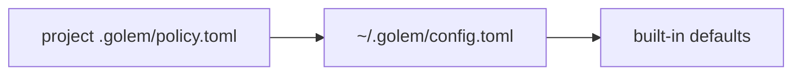

# ADR-012: Tool rules: first match wins, and a project cannot allow itself

**Date**: 2026-10-19
**Status**: accepted

## The idea

Before a tool call runs, one function decides: `allow`, `ask`, or `deny`. It reads a list of rules and stops at the first one that matches. A rule names a tool, and optionally a subject (`match`) and a path (`path`), and every field it sets has to match.

```toml
[[rule]]
tool = "grep"
match = "*password*|*secret*"
action = "deny"

[[rule]]
tool = "read_file"
path = "**/.env"
action = "deny"
```

The list is built in one order:



The project comes first, so a repository can say "never read `secrets/`" for everyone who works in it. The defaults come last: read-only tools are allowed, and everything else asks.

A project file can tighten what you allow. It cannot loosen it. Its `allow` rules count only when you list the folder in `trusted_projects` in your own config. Without that, a cloned repository could ship `tool = "*"`, `action = "allow"` and give itself a shell the moment one exists.

## What the code does today

- **The engine** is `golem/permissions/engine.py`, and it does no I/O. `check(call, rules)` returns a `Decision` with the action and the rule's `source`, such as `~/.golem/config.toml rule 2`. `tool` and `match` are `fnmatch` globs. `match` takes `|` between alternatives. `path` is a glob on the resolved absolute path: `*` stays inside one folder, `**` crosses folders, `dir/**` matches `dir` too, `~` is the home folder, and a relative glob is relative to the session folder. The part before the first wildcard is resolved, so a symlinked folder matches the real path a call resolves to.
- **The tools** say what a rule can see. Each `Tool` has `read_only`, `path_arg`, and `match_arg`. `read_file` and `list_dir` expose `path`, and `glob` and `grep` expose `path` and `pattern`.
- **The files.** `golem/permissions/policy.py` reads `[[rule]]` and `trusted_projects` from `config.toml`, and `[[rule]]` from `<session folder>/.golem/policy.toml`. Each file is read again when its modification time or size changes. A user file that stops validating keeps its last good rules. A project file that does not validate becomes one rule, `*` asks, so a typo in a deny rule never lets the call through.
- **Where it runs.** The `tools` node checks every call before `tool.started` ([ADR-011](011-tools.md)). A refused call goes straight from `tool.requested` to `tool.failed`, and the model reads the same reason, such as `read_file is denied by ~/app/.golem/policy.toml rule 1`. An `ask` pauses the run for the user's answer ([ADR-013](013-approvals.md)).
- **Seeing the rules.** `config.get` returns them in check order, with each rule's source and why it is ignored. `golem config show` prints them for the folder it runs in.

## Other shapes that lost

**The most specific rule wins.** "Specific" is hard to define across tool, subject, and path, and it is hard to predict. First match is the order you read in the file.

**The user's rules first.** Then a project could not deny anything the user allows. The project's `deny` and `ask` rules are the useful part of a project file.

**Trust the project file as written.** That is the cloned-repository risk above. Asking once per project, as an editor does, needs approvals first. `trusted_projects` is the same choice, written down by hand.

**`ask` by default for every tool, reads included.** Every file read would stop for an answer, and reads change nothing outside golem.

## What it costs

A rule's `match` only means something for a tool that names a `match_arg`. Every new tool has to pick its subject and its path, or rules can only match it by name.

A path glob is matched against the resolved path, so a rule written with a symlinked path matches only through its resolved prefix. Wildcards inside a symlinked part are not resolved.

Trusting a project is all or nothing: once a folder is in `trusted_projects`, every `allow` in its file counts.
