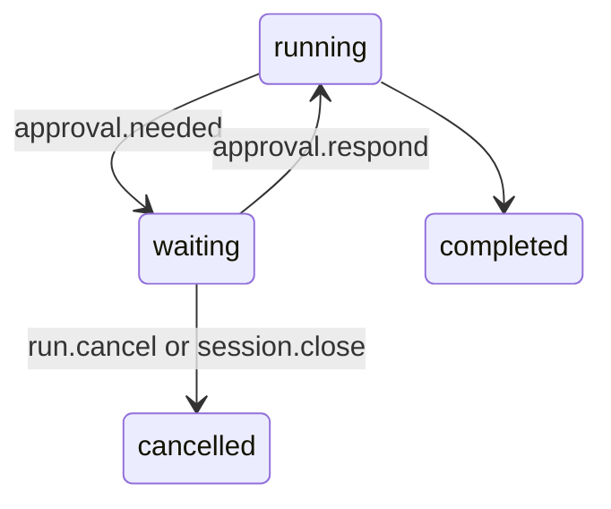

# ADR-013: An approval is an interrupt, and the waiting run has no task

**Date**: 2026-10-19
**Status**: accepted

## The idea

When a rule says `ask` about a tool call ([ADR-012](012-permission-rules.md)), the run stops and waits for you. It waits in the checkpoint and the event log, not in memory, so it can wait for days, across closing the TUI and restarting the daemon.

The `tools` node calls LangGraph's `interrupt()`, and the graph run ends there. The daemon stores `approval.needed`, marks the run `waiting`, and the run's task ends. When you answer, the daemon stores `approval.resolved` and starts a new task that resumes the graph with `Command(resume=answer)`.

A resumed node runs again from its first line, and that is the trap. If the node had run call 1 before asking about call 2, the resume would run call 1 again. So the node works in two passes. First it decides about every call of the reply, with one `interrupt()` for each call that asks. LangGraph hands earlier answers back on each pass, and the next unanswered call pauses again. Only after the last answer does the second pass run the allowed calls and write their events. Nothing has run or been reported before that, so starting over repeats nothing.

## What the code does today

- **The node** is `golem/graphs/tools_node.py`. `_decide` runs the policy. `allow` runs the call. `deny` fails it with the rule's reason. A tool already allowed for the session runs. Anything else interrupts with the call id, tool name, arguments, the asking message, and the rule (`source`). The answer is `allow`, `allow_session`, `allow_always`, or `deny`. `allow_session` covers later calls of the same tool and subject in that pass, and the session after it. `allow_always` runs the call after the daemon has written an allow rule for it.
- **Events.** The adapter turns the `__interrupt__` update into `approval.needed`. The runner stops after it, without `run.completed`. `approval.respond` is answered with the run id once `approval.resolved` is stored. `resume_turn` then streams the rest of the run through the same event handling as a new turn.
- **Store.** The projection marks the run `waiting` on `approval.needed` and `running` again on `approval.resolved`. `allow_session` adds the tool to `sessions.allowed_tools`, and the next turn passes that list to the graph in `configurable`. Recovery at startup closes only `running` runs, so a waiting run survives. A daemon stopping cancels running tasks, and a waiting run has none.
- **The pending call** is read from the run's events each time (`golem/sessions/approvals.py`): the newest `approval.needed` without an `approval.resolved`, the calls still open, and the prompt for a title once the run completes. An answer for any other call is `-32010`.
- **While it waits.** `message.send` is `SESSION_BUSY`. Cancelling fails every open call with `cancelled before it was approved` and stores `run.cancelled`. The checkpoint keeps the reply's unanswered calls, and the next turn gives them cancelled results before it streams ([ADR-011](011-tools.md)).
- **A quick answer.** `approval.needed` is stored a moment before the paused task has finished closing its stream. An answer that arrives in that moment waits for the task to end, rather than being refused as busy.
- **The TUI** draws a three-row band where command suggestions go: `Allow read_file notes.txt?`, the rule that asked, and the keys. `a` or Enter allows once, `s` allows the same call for the session, `w` writes a rule and allows it always, `d` or Esc denies, and Ctrl-C cancels the run. The tool line shows `?`, the meter says `waiting for your approval`, and the switcher marks the session with a yellow `?`.

## Other shapes that lost

**Run each call as soon as it is decided, and record executed call ids in state** (the plan's first sketch). A crash between the call and the checkpoint would still run it twice, and the stream items written before the interrupt would be sent again on resume. Deciding everything first avoids both, without adding to graph state.

**Keep the run's task alive and await an answer.** A daemon restart would lose the question, and every waiting run would hold a task and a graph stream open.

**Allow for the session in graph state.** It would ride in every checkpoint and in a fork. The session row already holds per-session facts, and the event log rebuilds it.

**A modal over the transcript.** The band keeps the conversation and the tool line visible while you decide, and needs no new layout mode.

## What it costs

Answers are matched to interrupts by their order. A rule written or changed while a run waits must not shift that order, so the resume passes the ids of the calls already asked about, and an earlier call that would now ask out of turn is refused (`the rules changed while the run waited`). Refusing is the safe side: rerunning the turn asks again.

A reply that asks about several calls asks one at a time. You cannot answer them all at once.

Answers are not shown in the log as a separate approval list. To see what was allowed in a session, read its `approval.resolved` events or its `allowed_tools`.
