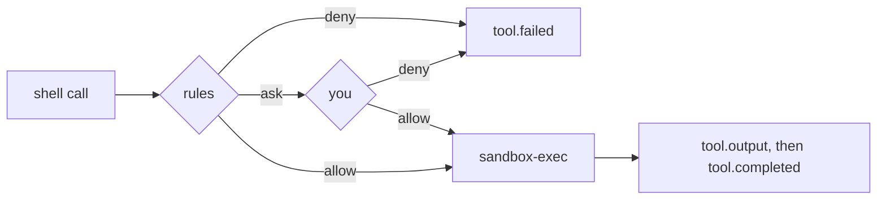

# ADR-014: The shell runs under sandbox-exec, or not at all

**Date**: 2026-10-19
**Status**: accepted

## The idea

A `shell` command is the widest tool golem has. Approvals decide whether a command runs ([ADR-013](013-approvals.md)), and a sandbox limits what an approved command can do. A command you allowed by mistake, or one that does more than its name says, still cannot write outside the project, reach the network, or read your keys.

On macOS that sandbox is `sandbox-exec` with a profile golem writes for each command. Apple marks the tool deprecated, but it ships with every release, and the alternatives (a container, a VM) need software you may not have. When no sandbox can be applied, the shell does not run. It never falls back to an unsandboxed command.

## What the code does today

- **The profile** is built in `golem/tools/sandbox.py`. It allows everything, then:
  - denies every file write except to the session folder, `/private/tmp`, `/private/var/folders` (macOS temp), the usual caches (`~/.cache`, `~/Library/Caches`, `~/.npm`, `~/Library/pnpm`, `~/.cargo/registry`), and `[shell] writable`;
  - denies the network except local Unix sockets, unless `[shell] network = true`;
  - denies reads of `~/.ssh`, `~/.gnupg`, `~/.aws`, `~/.azure`, `~/.kube`, `~/.docker`, `~/.netrc`, `~/.config/gh`, `~/.config/gcloud`, `~/.golem`, and `~/Library/Keychains`.
  - Paths are resolved first, because the profile matches real paths (`/tmp` is `/private/tmp`).
- **The process** is `$SHELL -lc <command>`, so the user's PATH applies. It runs in the session folder, in a new session (its own process group), with stdin closed. Variables whose names look like credentials are removed from its environment. `TERM=dumb`, `NO_COLOR=1`, and the pagers set to `cat` keep the output plain.
- **Output** is read in 4 KB chunks, stdout and stderr together. It streams as `tool.output` in batches of up to 2 KB or 0.2 s, up to 64 KB per call. Those rows leave the log when the call ends, as `message.delta` rows do. The model gets the first 20 000 and the last 78 000 characters, then `[exit code N]`. The tail is the part a failing test prints last.
- **Stopping.** A timeout (`[shell] timeout_seconds`, default 120, or a smaller `timeout_seconds` in the call) or a cancelled run sends SIGTERM to the process group, then SIGKILL after 2 seconds.
- **Availability** is probed once per process by applying an empty profile. It fails off macOS, and inside another sandbox, where `sandbox_apply` is not permitted. That is also why the sandbox tests skip when golem's own test suite runs under the shell.
- **Git.** `git_status`, `git_diff`, and `git_log` run git without a shell, in the same sandbox, with the network off and `core.fsmonitor`, hooks, external diff drivers, and text conversion switched off. A cloned repository's `.git/config` cannot run code through them, so they are read-only and the default policy allows them.
- **Settings.** `[shell]` is read only from the user's `config.toml`, through the same reader as the tool rules ([ADR-012](012-permission-rules.md)). A project file cannot widen it.

## Other shapes that lost

**No sandbox, and approvals only.** One careless "allow for session" would then give the model everything your user can do.

**Deny all reads outside the folder.** Compilers, package managers, and your shell's own startup files read from all over the home folder. Denying the folders that hold credentials keeps most of the value at a fraction of the breakage.

**A container per command.** It needs Docker or a VM on every machine, starts slowly, and sees a different toolchain than yours.

**Run unsandboxed where no sandbox exists, but ask every time.** One approval of a wrong command would be unrecoverable. Phase 3 can add Linux sandboxing (for example `bubblewrap`) behind the same check.

## What it costs

`sandbox-exec` is deprecated. If Apple removes it, the shell stops working until another sandbox replaces it.

Reads are allowed outside the denied folders, so an approved command can still read and print other files in the home folder to the model.

Tools that need the network (`pnpm install`, `uv sync` with new packages) fail until you set `[shell] network = true`, and that setting applies to every command.

"Allow for session" on `shell` allows every command until step 1.4b keys it on the command.
