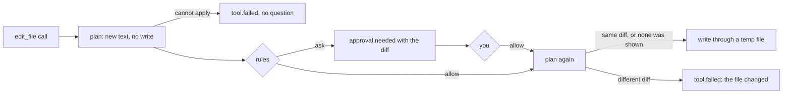

# ADR-015: A file change is planned, shown as a diff, and applied only as shown

**Date**: 2026-10-20
**Status**: accepted

## The idea

`write_file` and `edit_file` let the model change files. Each call is first a plan: the text the file would have, worked out without writing anything. The plan is the diff you see in the approval, and approving the call approves that diff and nothing else. When the call runs it plans again, and writes only if the new plan makes the same diff.

## What the code does today

- **The tools** are in `golem/tools/write.py`. `write_file` creates a file, with its folders, or replaces all of it. `edit_file` replaces exact text, and fails when the text is not in the file, or is in it more than once without `replace_all`. Errors say what to do next, so the model can retry.
- **Where.** The path resolves inside the session folder with symlinks followed (`inside`, [ADR-011](011-tools.md)), and `writable` refuses anything under a `.golem/` or `.git/` folder, at any depth. The project's rules and its history are the user's alone.
- **Outside the sandbox.** The tools run in the daemon, not under `sandbox-exec` ([ADR-014](014-shell-sandbox.md)). They do one thing, to one path that has already been checked, so the path check is the guard.
- **Planning.** `plan_write` and `plan_edit` read the file and return a `Change` (path, text before, text after). Files over 5 MB, binary files, and files that are not UTF-8 are refused. Line endings and the file mode are kept, and the write is a temp file in the same folder and a rename.
- **The preview.** A tool can have a `preview`. The `tools` node calls it for every call of a reply, before the decision, and puts the diff into the interrupt payload, so it reaches `approval.needed` as `diff`. A diff over 64 000 characters is cut, and the cut ends with the length and SHA-256 of the whole diff, so two changes that differ only past the cut are still told apart. A preview that fails, such as an `old_string` that is not in the file, ends the call in `tool.failed` without asking.
- **One reply, one file, several edits.** The node keeps the planned text of each path for the calls after it (`ToolContext.planned`), so the second edit of a file is previewed on top of the first.
- **Only the change shown.** `approval.respond` does not carry the diff. The daemon reads it from the stored `approval.needed` and puts it into the resume answer. The call runs with `ToolContext.approved_diff`, and the tool applies its plan only when the plan's diff is the one shown. Otherwise the call fails with `<path> changed after the user approved this change`, and the file is untouched.
- **Deny still wins.** A `deny` rule written while the call waited refuses it even after you allowed it.
- **Safe to show.** Diff rows are shown with control characters replaced (`␛` for an escape), so a file's content cannot move the cursor or redraw the question.
- **Policy.** Neither tool is read-only, so every change asks by default. The subject is the path relative to the folder (`Tool.subject`), so "allow for this session" covers one file. "Always allow" writes a rule with that file's exact resolved `path`, not a `match`.
- **Result.** `tool.completed` has `+N -M <path>` as its summary and the diff as its preview, so Ctrl-O shows it.
- **The screen.** The approval band shows the diff between the question and the rule, coloured by line, with at most half the screen. Up and Down move it a line and Page Up and Page Down a page.

## Edited arguments

Any approval, not only a file change, can be answered with edited arguments. `e` in the approval band opens the call's arguments as JSON in the composer's place. Enter sends `approval.respond` with `decision: "allow"` and `args`; Esc goes back to the question.

- **Only a real edit counts.** Arguments sent back unchanged are not an edit: the TUI does not send them, and the daemon drops them, so the diff check stays.
- **Once only.** `args` goes only with `allow`. An edited call is not one you have seen before, so it does not become a session allowance or a rule.
- **Checked before the run goes on.** The daemon validates the arguments against the tool's model, keeps them as the tool reads them, and checks the rules again with them. The folder checks run when the call does, because an earlier call of the same reply may create the file this one edits. Invalid arguments, or a rule that denies the edited call, are error `-32011` with the reason, and the run keeps waiting, so the editor stays open with the message.
- **What ran is on record.** `approval.resolved` carries `args`, so a replay shows the edited call. The model's own reply keeps the arguments it asked for, so its tool result starts with `note: the user edited the arguments before it ran: {...}`.
- **No diff check.** You approved the arguments you typed, not the diff shown for the old ones, so an edited file change is applied as planned when it runs. A later edit of the same file in the same reply is planned on top of the edited one.

## Other shapes that lost

**Show the arguments, not a diff.** An `edit_file` call's `old_string` and `new_string` do not say where in the file the change lands, or whether `replace_all` touches ten places.

**Apply what the call asks for, whatever the file holds now.** An approval can wait for hours. A file edited in that time would get a change you never saw.

**Hash the file instead of comparing diffs.** It would refuse a second edit of a file in the same reply, because the first one changed it. Comparing the diff against the planned text of the earlier calls lets both run.

**Edit arguments in `$EDITOR`.** Ctrl-G already opens a draft there, but an approval is a small fix to a short JSON object, and leaving the screen for it loses the question and its diff.

**Write tools inside the sandbox.** The sandbox exists to contain a shell command. A write tool's only effect is one checked path, and a `sandbox-exec` process per edit would add a dependency for no gain.

## What it costs

A diff over 64 000 characters is shown cut. Its digest covers the rest, but you approve a change you could not read to the end.

The diff is stored in `approval.needed` and sent again on every replay of the session.

Two edits of one file in one reply, where you deny the first, make the second fail: it was planned on top of the first.
