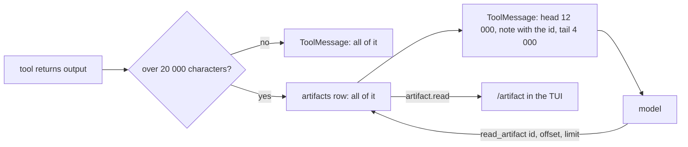

# ADR-016: Big tool output is an artifact in golem.db, and the model reads it in pages

**Date**: 2026-10-20
**Status**: accepted

## The idea

A tool result is a `ToolMessage` in the checkpoint, and the checkpoint is written every step ([ADR-006](006-checkpoint-continuity.md)). A 5 MB test log in it would make every later step of the session write and send 5 MB. So output over a limit is stored once, in an `artifacts` table, and the message keeps its head, its tail, and the artifact's id. The model reads more with `read_artifact` when it needs to, and you open all of it with `/artifact`.

## What the code does today

- **The table** is migration 5 in `golem/store/migrations.py`: `artifact_id`, `session_id`, `call_id`, `kind` (`tool_output`), `size` in characters, `created_at`, and the text. `ArtifactStore` (`golem/store/artifacts.py`) puts one and reads a page with SQL `substr`, always by session and id together.
- **The cut** happens in the `tools` node's run phase, after every approval, so nothing is stored twice on a resume. Output up to 20 000 characters goes to the model whole. Longer output is stored, and the model gets the first 12 000 characters, a note with the id and the total, and the last 4 000, where a failing command prints its summary.
- **`read_artifact`** is read-only and needs no approval. It reads up to 20 000 characters from an offset, only from the session's own artifacts.
- **On the wire**, `tool.completed` carries `artifact_id`, and `artifact.read` returns a page (`text`, `offset`, `size`) of a session's artifact, `-32012` for an unknown one. The TUI shows `all of it: /artifact <id>` under an expanded block, and `/artifact` (the newest one, or an id) opens the text in `$PAGER`.
- **Limits.** One call returns at most 5 MB, and `shell` now captures up to 5 MB (the first 1 MB and the last 4 MB) instead of about 100 000 characters. Without an artifact store, as in some tests, output is cut at 100 000 characters as before.

## Other shapes that lost

**Files under `~/.golem/artifacts/`.** They would need their own cleanup and their own crash story. A row in `golem.db` is written in one transaction, goes with the session's events in a backup, and is one query to page through.

**Keep the full output in the checkpoint.** Every later step would carry it, and the model would read all of it on every call.

**Cut the output and drop the rest.** The model could not look further, and you could not see what a long command printed.

**Store every result as an artifact.** Most results are short, and a model reads them better inline.

## What it costs

Artifacts are kept as long as the session's events. Nothing deletes them yet.

A run cancelled after a tool returned but before its result was checkpointed leaves an artifact nothing points to.

The model sees only the head and tail of a long output until it asks for more, so it can miss the middle.
