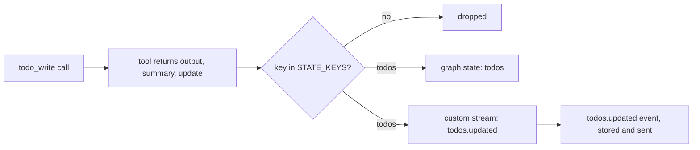

# ADR-018: A tool returns a state update, and the node applies only the keys it allows

**Date**: 2026-10-20
**Status**: accepted

## The idea

`todo_write` changes graph state: the agent's todo list. Tools stay plain Python with no view of the graph ([ADR-011](011-tools.md)), so a tool does not write state itself. It returns `ToolResult.update`, and the `tools` node merges the keys on its allow-list, `STATE_KEYS`, into what the node returns. Today that list holds one key, `todos`. A tool that returns anything else is ignored, so no tool can change the messages, the model, or the session.

## What the code does today

- **The tool** is `golem/tools/todos.py`. `todo_write` takes the whole list: up to 30 items, each with an `id`, `text`, and `status` (`pending`, `in_progress`, or `done`), unique ids, and at most one `in_progress`. Its output is the list as a checklist, so the model sees it in its history too.
- **No approval.** It is `internal`: it changes only golem's own state. The built-in rules allow read-only and internal tools (`ToolRegistry.default_allowed`). A user rule can still make it ask.
- **State.** `AgentState.todos` is `NotRequired`, so checkpoints from before it load unchanged and `SCHEMA_VERSION` stays 1. It is replaced whole by each call.
- **Events.** For a `todos` update the node writes a `todos.updated` item to the custom stream. The adapter turns it into a fact, and the runner stores and sends `todos.updated` with `call_id` and the whole list. A client derives the list from the newest one, so reattaching rebuilds it from the log.
- **Fork.** A fork copies the checkpoint, todos included. Its log gets one `todos.updated` with the copied list, without a run or a call, so the fork's screen shows it too.

## Other shapes that lost

**Give tools the graph state.** Every tool could then read or change anything, and the tools would depend on LangGraph types.

**Keep the list only in the event log.** The model would not see it after a fork or a restart unless the log was replayed into the prompt, and graph state is where the model's memory already lives ([ADR-006](006-checkpoint-continuity.md)).

**A separate `todos` table.** One more projection to keep in step, for a list that is small and belongs to the thread.

## What it costs

A new piece of tool-owned state needs its key added to `STATE_KEYS` and its own event.

The list is in every checkpoint of the session, which is fine while it stays small (30 items of at most 300 characters).
