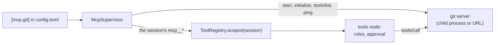

# ADR-023: MCP servers run under golem's own small client, and their tools ask first

**Date**: 2026-10-23
**Status**: accepted

## The idea

An MCP server is a program that offers tools. Golem starts each server from `[mcp.<name>]` in `config.toml`, or reaches it over HTTP, and turns each of its tools into a golem tool. From there a server's tool is like any other: the `tools` node runs it ([ADR-011](011-tools.md)), the rules decide ([ADR-012](012-permission-rules.md)), and an approval can pause the run ([ADR-013](013-approvals.md)).

The client is golem's own. MCP is JSON-RPC 2.0, and golem needs five messages of it: `initialize`, `notifications/initialized`, `tools/list`, `tools/call`, and `ping`. A transport carries them: a child process's stdin and stdout, one message per line, or Streamable HTTP.

Which tools a session sees depends on the session. A server is on for every session, on demand for the sessions that turn it on, or off. A trusted project can add servers for the sessions in its folder.

## What the code does today

- **The client** (`golem/mcp/client.py`) sends `initialize` with protocol `2025-06-18` and no client capabilities, and lists tools across pages. A request the server sends gets "method not found", except `ping`. A call that takes longer than `timeout_seconds` gets `notifications/cancelled` and fails.
- **Transports** (`golem/mcp/transport.py`):
  - **stdio** starts the server in its own process group. Its stderr goes to the daemon log, and its last line explains an exit. Stopping closes stdin, then sends SIGTERM, then SIGKILL, to the whole group, so a server started through `npx` takes its `node` with it.
  - **HTTP** posts each message to the server's URL. An answer comes back as JSON or as an event stream that may carry the server's own requests first. The `Mcp-Session-Id` the server gives, and the protocol version, go with every later message. An HTTP error fails that call. A 404 on a session, or a server that cannot be reached, closes the transport, and the supervisor starts over. Golem does not open the optional GET stream, so a server's own notifications reach it only inside an answer.
- **The tools** (`golem/mcp/tools.py`) are named `mcp__<server>__<tool>`. Providers allow only letters, digits, `_`, and `-` in a tool name, at most 64 of them, so the server's name for the tool is cleaned to fit, and the call goes out under the original. A server name has no `_`, so the name splits back without guessing. A tool's JSON Schema goes to the model as it is, minus `$schema`. The server checks the arguments.
- **Trust.** A server's tool is never `read_only`, whatever it says about itself, so the built-in rules ask before every call. The subject a rule sees is the arguments as one line of JSON, so "always allow" covers that exact call, and a rule on `tool = "mcp__git__*"` covers a whole server. The output reaches the model inside `<mcp_output server=… tool=…>`, after a note that it is data, the same way a web page is marked ([ADR-017](017-web-fetch.md)). Images and other binary items are named, not inlined.
- **Scoping.** `ToolRegistry` holds golem's own tools. Each model call and each tool call asks it for `scoped(ToolScope(root, enabled))`, the session's folder and the on-demand servers it turned on, and the supervisor answers with those servers' tools.
  - `enabled = true` servers start with the daemon and reach every session. `"on_demand"` ones start when a session first runs `/mcp enable <name>` (`mcp.enable`), and reach only sessions that did. The list is stored as `session.updated` with `mcp_servers`, projected into `sessions.mcp_servers` (schema 7), and survives a restart. `false` ones never start.
  - A project's `.golem/config.toml` adds `[mcp.*]` servers for sessions in that folder, only when it is in `trusted_projects`: a project names programs to run. Its server takes the place of the user's server of the same name there, and runs in the project folder.
  - The tools node refuses a call to a tool the session does not have, before the rules, with a message that names `/mcp enable`. An old reply that asks for a server since turned off does not run it.
- **The supervisor** (`golem/mcp/supervisor.py`) starts servers in the background, so the daemon answers in under a second while `npx` downloads one. A model call waits up to 10 seconds for a server its session needs that is still starting.
  - **Health:** each running server answers `ping` every 30 seconds. One that exits or stops answering is `failed`, and starts again after 1 second, then 2, 4, up to a minute between tries, back to 1 after a minute of running.
  - **Reload:** it reads `config.toml` and each project's file again when they change. A changed server restarts, a new one starts, and a removed one stops. A file that does not validate keeps the last good servers.
  - A server that says `notifications/tools/list_changed` is listed again.
- **Environment and secrets** (`golem/mcp/launch.py`). launchd gives the daemon a short `PATH`, so a command is also looked for in `/opt/homebrew/bin`, `/usr/local/bin`, and `~/.local/bin`. A stdio server gets `HOME`, `PATH`, `USER`, `LOGNAME`, `SHELL`, `TERM`, `LANG`, and `TMPDIR`, plus its own `env`, and nothing else from the daemon's environment.
  - A value in `env` or `headers` can name `keychain:mcp/<name>`, alone or inside the text (`Bearer keychain:mcp/github`), and the secret replaces it when the server starts. `golem auth set mcp/<name>` or `/login mcp/<name>` stores it, restarts the servers that use it, and `golem auth list` shows whether each one is stored.
  - A variable or header whose name looks like a secret must name one, and a reference outside `mcp/` does not load, so a project's server can never be handed a model provider's key.
- **On the wire** (protocol minors 19 to 21): `mcp.list` returns each server with its state (`idle`, `starting`, `running`, `failed`, `disabled`), command line or URL, tool names, rough schema tokens, error, and seconds until the next try. With `session_id` it adds the session's project servers and whether each is on for it. `mcp.enable` and `mcp.disable` turn an on-demand server on or off for a session. `mcp.tools` lists a server's tools with their descriptions, `mcp.restart` starts it again, and `mcp.set_enabled` writes `enabled` into the file that names it (`golem/config_edit.py`, which keeps comments) and applies it at once. `mcp.server.status` goes to every connection when a server changes, like `model.pull.progress`, and is not stored.
- **In the TUI**, `/mcp` opens a manager (`mcp-manager.ts`): the servers grouped by the file that names them, then one server's status, command, file, tools, and token cost, with View tools, Turn on or off for this chat, Reconnect, and Disable everywhere (or Enable, for a disabled one). `/mcp enable|disable <name>` stays as a shortcut, and the status line shows `mcp ✗ <name>` in red while a server the session uses is down. **`golem doctor`** checks each server that may start: its command is found, and its secrets are stored.

## Other shapes that lost

**The `mcp` Python SDK.** It is the reference client. It also brings a server stack the daemon never uses (Starlette, Uvicorn, SSE), which PyInstaller would pack into every release, and `pywin32` on Windows. A company proxy that blocks one of those packages blocks the whole install. Golem's client covers the five messages it uses, over both transports, and is tested against a fake stdio server and a fake HTTP one.

**`langchain-mcp-adapters`.** It returns LangChain `BaseTool`s that call the server themselves. The tools node would have to wrap them from outside for the rules, the approval, the output marking, and the artifact store, and the tools would be LangChain objects, against [ADR-002](002-langgraph-boundary.md).

**`mcp.<server>.<tool>` names.** They read better. OpenAI and Anthropic refuse a dot in a tool name.

**Trusting `readOnlyHint`.** A server can mark a tool read-only, and golem could allow those without asking. The hint is the server's own word, and a wrong one runs a tool nobody approved. A rule the user writes says the same thing, and the user chose to trust it.

**One global tool list, filtered when the model is offered tools.** Two projects can both name a server `git`, and a project's server can replace the user's. A global list keyed by tool name cannot hold both. A scoped registry also lets the rules, "always allow", and edited arguments see exactly the tools of the session they belong to.

**Project servers in every folder.** A repository would run whatever its `.golem/config.toml` names as soon as golem opens a session there. `trusted_projects` already decides whether a project may allow tools ([ADR-012](012-permission-rules.md)), and it decides this too.

**Starting servers before the socket listens.** The daemon would wait for the slowest server before any client could connect. A slow `npx` download would look like a daemon that does not start.

## What it costs

A model call can wait up to 10 seconds for a server its session needs. A server that never comes up costs that wait on every call until it does, or until the session turns it off.

`schema_tokens` is the length of the tool schemas divided by four, not a real token count. It is enough to see which server is expensive.

A project server keeps running after the last session in that folder ends, until the daemon restarts or the file changes.

Golem's client follows one protocol version. A server that answers with another is used anyway, and a later MCP change that breaks the five messages above needs a change here.
