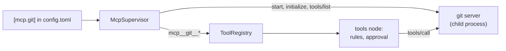

# ADR-023: MCP servers run under golem's own small client, and their tools ask first

**Date**: 2026-10-23
**Status**: accepted

## The idea

An MCP server is a program that offers tools. Golem starts each server from `[mcp.<name>]` in `~/.golem/config.toml`, speaks MCP to it over its stdin and stdout, and turns each of its tools into a golem tool. From there a server's tool is like any other: the `tools` node runs it ([ADR-011](011-tools.md)), the rules decide ([ADR-012](012-permission-rules.md)), and an approval can pause the run ([ADR-013](013-approvals.md)).

The client is golem's own, about 300 lines. MCP over stdio is JSON-RPC 2.0 with one message per line, and golem needs four messages of it: `initialize`, `notifications/initialized`, `tools/list`, and `tools/call`.

## What the code does today

- **The client** (`golem/mcp/client.py`) starts the server in its own process group, sends `initialize` with protocol `2025-06-18` and no client capabilities, and lists tools across pages. A request the server sends gets "method not found", except `ping`. A call that takes longer than `timeout_seconds` gets `notifications/cancelled` and fails. The server's stderr goes to the daemon log, and its last line explains an exit. Stopping closes stdin, then sends SIGTERM, then SIGKILL, to the whole group, so a server started through `npx` takes its `node` with it.
- **The tools** (`golem/mcp/tools.py`) are named `mcp__<server>__<tool>`. Providers allow only letters, digits, `_`, and `-` in a tool name, at most 64 of them, so the server's name for the tool is cleaned to fit, and the call goes out under the original. A server name has no `_`, so the name splits back without guessing. A tool's JSON Schema goes to the model as it is, minus `$schema`. The server checks the arguments.
- **Trust.** A server's tool is never `read_only`, whatever it says about itself, so the built-in rules ask before every call. The subject a rule sees is the arguments as one line of JSON, so "always allow" covers that exact call, and a rule on `tool = "mcp__git__*"` covers a whole server. The output reaches the model inside `<mcp_output server=… tool=…>`, after a note that it is data, the same way a web page is marked ([ADR-017](017-web-fetch.md)). Images and other binary items are named, not inlined.
- **The supervisor** (`golem/mcp/supervisor.py`) starts every enabled server after the socket is listening, in the background, so the daemon still answers in under a second while `npx` downloads a server. A running server's tools join the next model call: `ToolRegistry` asks the supervisor each time instead of keeping a list. A server that says `notifications/tools/list_changed` is listed again. One that exits stays `failed`, with the reason, until the daemon restarts.
- **Environment.** launchd gives the daemon a short `PATH`, so a server's command is also looked for in `/opt/homebrew/bin`, `/usr/local/bin`, and `~/.local/bin`. A server gets `HOME`, `PATH`, `USER`, `LOGNAME`, `SHELL`, `TERM`, `LANG`, and `TMPDIR`, plus its own `env`, and nothing else from the daemon's environment. A variable in `env` whose name looks like a secret does not load, like any secret in a config file.
- **On the wire** (protocol minor 19): `mcp.list` returns every configured server with its state (`starting`, `running`, `failed`, `disabled`), its command line, its tool names, and its error. `mcp.server.status` goes to every connection when one changes, like `model.pull.progress`, and is not stored. `/mcp` in the TUI shows the list and keeps it current.

## Other shapes that lost

**The `mcp` Python SDK.** It is the reference client, and step 1.1 of the plan named it. It also brings a server stack the daemon never uses (Starlette, Uvicorn, SSE), which PyInstaller would pack into every release, and `pywin32` on Windows. A company proxy that blocks one of those packages blocks the whole install. Golem's client covers the four messages it uses and is tested against a fake server. HTTP transport (plan step 1.3) is a second transport under the same client, over `httpx`, which the daemon already has.

**`langchain-mcp-adapters`.** It returns LangChain `BaseTool`s that call the server themselves. The tools node would have to wrap them from outside for the rules, the approval, the output marking, and the artifact store, and the tools would be LangChain objects, against [ADR-002](002-langgraph-boundary.md).

**`mcp.<server>.<tool>` names.** They read better, and the plan used them. OpenAI and Anthropic refuse a dot in a tool name.

**Trusting `readOnlyHint`.** A server can mark a tool read-only, and golem could allow those without asking. The hint is the server's own word, and a wrong one runs a tool nobody approved. A rule the user writes says the same thing, and the user chose to trust it.

**Starting servers before the socket listens.** The daemon would wait for the slowest server before any client could connect. A slow `npx` download would look like a daemon that does not start.

## What it costs

A server's tools reach every session. Turning a server on for one session or one project is plan step 1.2.

A server that crashes stays down until `golem daemon restart`, and so does a change to `[mcp.*]`. Restarting with backoff, and HTTP servers, are plan step 1.3.

A server that needs a token cannot get one from the Keychain yet. `keychain:mcp/<server>` is the namespace for it ([secrets.py](../../packages/daemon/golem/secrets.py)), and step 1.3 adds it.

Golem's client follows one protocol version. A server that answers with another is used anyway, and a later MCP change that breaks the four messages above needs a change here.
