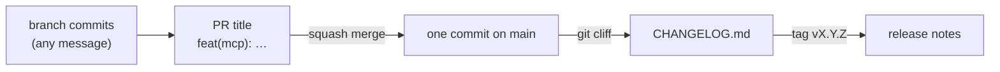

# ADR-024: Conventional commits reach main as squashed pull requests, and git-cliff turns them into the release notes

**Date**: 2026-10-23
**Status**: accepted

## The idea

Every commit on `main` has a first line a tool can read: `<type>(<scope>): <what changed>`, from [Conventional Commits](https://www.conventionalcommits.org/en/v1.0.0/). A change reaches `main` only as a pull request, and it merges as one squashed commit whose message is the PR title. So one pull request becomes one line in the changelog, and only the title has to be right. The commits on a branch can be anything.

[git-cliff](https://git-cliff.org) reads those lines and writes `CHANGELOG.md`, and the release workflow publishes the tag's section of it as the release notes. The git tag stays the version ([scripts/version.sh](../../scripts/version.sh)), and a person still pushes it.

## What the code does today

`.githooks/commit-msg` checks the first line of a message: a known type, an optional known scope, an optional `!`, a colon and a space, and at most 100 characters. Merge, revert, `fixup!`, `squash!`, and `amend!` messages pass as git writes them. `just hooks` points `core.hooksPath` at `.githooks/`. The script is the one list of types and scopes, and [CONTRIBUTING.md](../../CONTRIBUTING.md) explains them.

The `pr-title` job (`.github/workflows/pr.yml`) runs the same script on a pull request's title with `--title`, which refuses `Merge …` and `fixup! …` titles too. `scripts/github_ruleset.json` is the ruleset on `main`, and `just protect` applies it with the repository's merge settings ([sre.md](../sre.md), section 5). The squashed commit has the PR title and an empty body, so the template's checklist stays on the pull request and out of `git log`.

`cliff.toml` says how a commit becomes a line in the notes. git-cliff is a Python dev dependency, pinned in `uv.lock`, so CI and every checkout run the same version. `scripts/changelog.sh add` writes the commits since the last stable tag as a new section above the newest one, and `notes` prints one section back. `just release` runs `add` on a `release/vX.Y.Z` branch and opens the PR. After it merges, `just tag` tags that commit. `release.yml` stops before building when the tag has no section, and uses the section as the release's notes ([sre.md](../sre.md), section 5).

Each section is written once and then left alone. git-cliff could regenerate the whole file from git every time, but then an edit made in a release PR would be lost at the next release. Only stable tags count as releases for git-cliff, so a prerelease does not split the notes of the stable version after it.

## Other shapes that lost

**release-please.** It keeps a release pull request open and tags when it merges, so nobody has to run anything. But a tag pushed with the workflow's own `GITHUB_TOKEN` does not start another workflow, so `release.yml` would need a personal token or a GitHub App. That is one more long-lived secret ([ADR-022](022-homebrew-tap.md) already has one), and the tag would no longer be a human decision.

**commitizen.** It is Python, so it fits `uv`, and it lints, bumps, and writes a changelog. Its bump writes the version into a file, and golem has no version file on purpose: the tag is the version.

**semantic-release.** It releases on every merge to `main`. Golem's releases are signed and smoke-tested on a Mac, and they should be cut on purpose.

**Rebase or merge commits instead of squash.** Every branch commit would land on `main`, so every commit would need a good message, and the changelog would list work in progress.

**A hook framework (husky, lefthook, pre-commit).** It is one more tool to install for one regex. A POSIX `sh` script runs everywhere git does.

**Release notes on the GitHub release page only, with no `CHANGELOG.md`.** Releasing would be just a tag, with no release PR. But the history would live only on GitHub, and the notes could not be reviewed and edited like code before they are published.

**Use the old `Scope - text` style.** It is close, but it has no type, so a tool cannot tell a feature from a fix.

## What it costs

The hook is opt-in per clone (`just hooks`), so a message can still slip through locally. CI checking the PR title is what holds the line. Squashing loses the branch's individual commits on `main`, though the pull request keeps them. Commits before this ADR use the old style. git-cliff maps them with a pattern, and the few that do not match land under "Other". v0.1.0's section was written by hand. A release takes two steps, a PR and then a tag, and a commit merged in between makes `just tag` refuse until you choose a version again.
