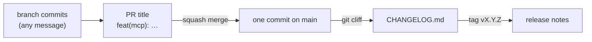

# ADR-024: Conventional commits reach main as squashed pull requests, and git-cliff turns them into the release notes

**Date**: 2026-10-23
**Status**: accepted

## The idea

Every commit on `main` has a first line a tool can read: `<type>(<scope>): <what changed>`, from [Conventional Commits](https://www.conventionalcommits.org/en/v1.0.0/). A change reaches `main` only as a pull request, and it merges as one squashed commit whose message is the PR title. So one pull request becomes one line in the changelog, and only the title has to be right. The commits on a branch can be anything.

[git-cliff](https://git-cliff.org) reads those lines and writes `CHANGELOG.md`, and the release workflow publishes the tag's section of it as the release notes. The git tag stays the version ([scripts/version.sh](../../scripts/version.sh)), and a person still pushes it.

## What the code does today

`.githooks/commit-msg` checks the first line of a message: a known type, an optional known scope, an optional `!`, a colon and a space, and at most 100 characters. Merge, revert, `fixup!`, `squash!`, and `amend!` messages pass as git writes them. `just hooks` points `core.hooksPath` at `.githooks/`. The script is the one list of types and scopes, and [CONTRIBUTING.md](../../CONTRIBUTING.md) explains them.

Plan steps 1.2 and 1.3 add the rest: the PR title check in CI (the same script, run on the title), the ruleset on `main`, `cliff.toml`, and the release notes.

## Other shapes that lost

**release-please.** It keeps a release pull request open and tags when it merges, so nobody has to run anything. But a tag pushed with the workflow's own `GITHUB_TOKEN` does not start another workflow, so `release.yml` would need a personal token or a GitHub App. That is one more long-lived secret ([ADR-022](022-homebrew-tap.md) already has one), and the tag would no longer be a human decision.

**commitizen.** It is Python, so it fits `uv`, and it lints, bumps, and writes a changelog. Its bump writes the version into a file, and golem has no version file on purpose: the tag is the version.

**semantic-release.** It releases on every merge to `main`. Golem's releases are signed and smoke-tested on a Mac, and they should be cut on purpose.

**Rebase or merge commits instead of squash.** Every branch commit would land on `main`, so every commit would need a good message, and the changelog would list work in progress.

**A hook framework (husky, lefthook, pre-commit).** It is one more tool to install for one regex. A POSIX `sh` script runs everywhere git does.

**Use the old `Scope - text` style.** It is close, but it has no type, so a tool cannot tell a feature from a fix.

## What it costs

The hook is opt-in per clone (`just hooks`), so a message can still slip through locally. CI checking the PR title is what holds the line. Squashing loses the branch's individual commits on `main`, though the pull request keeps them. Commits before this ADR use the old style. git-cliff maps them with a pattern, and the few that do not match land under "Other".
