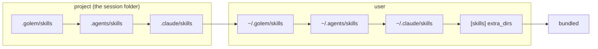

# ADR-025: Skills come from the project, then the user, then golem, and a broken one never wins a name

**Date**: 2026-10-25
**Status**: accepted

## The idea

A skill is a folder with a `SKILL.md`. golem reads the same folders Claude Code and other Agent Skills tools read, so a skill written for them works in golem unchanged. A session sees the skills of its own folder plus the user's, and when two skills share a name, the one closer to the work wins.

## What the code does today

- **Parsing** (`golem/skills/parse.py`). Only the frontmatter is read when listing, up to 64 KB, and the body is read when the skill is used. A problem never raises: the skill is kept with `errors` (it is never used) or `warnings` (it is). The Agent Skills spec sets the rules for `name` and `description`. Where Claude Code is looser, golem follows Claude Code: `name` may be left out, a missing `description` falls back to the first paragraph of the body, and a file may have no frontmatter at all.
- **Sources** (`golem/skills/registry.py`), highest first: the three project folders under the session folder, the three user folders, `[skills] extra_dirs`, then the skills that ship with golem. `[skills] claude_dirs = false` skips both `.claude/skills` folders. Each source is read one level deep: a folder inside it with a `SKILL.md` is a skill, and a name that starts with `.` or `_` is skipped (so `.git` and the drafts in `_proposed` never list).
- **A view per folder.** The daemon serves every session, and project skills depend on the session's folder, so `SkillRegistry.view(root)` builds the list for one folder, the way `ToolScope` does for MCP servers ([ADR-023](023-mcp-client.md)). The view keeps every skill found, not only the winners, so `/skills` can show what lost and why.
- **Who wins a name.** The first valid skill of a name, in source order. The others are listed with `shadowed_by` naming the winner's folder. A skill with errors never wins, so a broken project copy does not hide the user's working one. `[skills] disabled` names skills that are listed but never used.
- **Symlinks** are followed. `~/.claude/skills` is often a folder of links, and this repository links `.claude/skills` to `.agents/skills`. A skill's real path is compared, so one folder reached twice is listed once, under the first path that reached it.
- **Reload.** A parsed skill is kept until its `SKILL.md` stamp (mtime and size, through symlinks) changes, so a view reads only what moved. Every 2 seconds, `SkillRegistry.check` compares each watched set of folders with what it saw last: the user's and golem's folders, and the project folders of every session folder a view was asked for. It also reads `[skills]` again when `config.toml` changes, and a file that does not validate keeps the last good settings. Each change sends `skill.registry.changed` to every connection, with `root` set to the session folder, or left out when the user's skills or the settings changed. Like `mcp.server.status`, it is not stored. Other files in a skill folder, such as `references/`, do not count: only `SKILL.md` is listed.
- **Trust** plays no part in what is listed. A project's skills are listed and used even when the project is not in `trusted_projects`. A skill is text the model reads, like a file in the project. What a skill may do without asking is a separate decision (step 2.6).

## Other shapes that lost

**User skills over project skills.** It is the order for settings files, where the user's own choice should hold. A skill is closer to code: a project's `release` skill describes that project's release, and the user's general one is the wrong one there. Claude Code gives project skills precedence too.

**Only golem's own folders.** `~/.golem/skills` alone would be simpler, but every skill already written lives in `.claude/skills` or `.agents/skills`, and copying them would leave two copies that drift.

**A broken skill still winning its name.** It would follow the order to the letter, but the name would then mean nothing usable, and the working copy would vanish without a word. Listing the broken one with its errors says what happened.

**One list for the whole daemon.** Two projects can each have a `release` skill. A list keyed by name cannot hold both, and a project's skill would leak into sessions in other folders.

**`watchfiles` for reload.** It reports a change at once, where polling waits up to 2 seconds. It is one more native dependency for the frozen build, it needs a watch per folder and per symlink target, and the rules, the models, and MCP servers already reload by polling a stamp. Skills reload the same way, and a 2 second delay after saving a skill is not noticed.

**Searching parent folders and nested packages** (`packages/x/.agents/skills`). Useful in a monorepo, but it makes the list depend on where in the tree a session started, and no skill here needs it yet. It can be added as another source.
