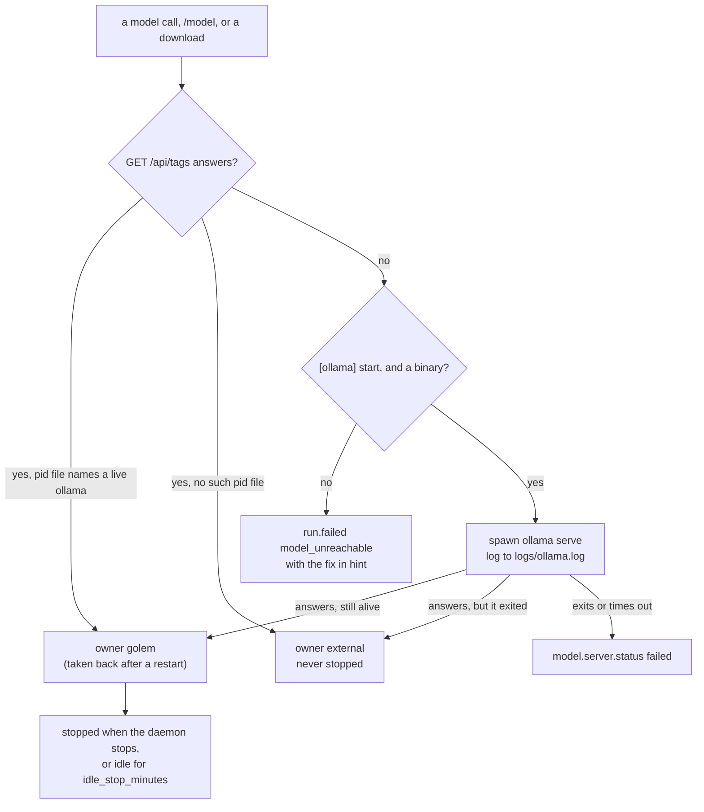

# ADR-026: golem starts a local Ollama when it needs one, and stops only the one it started

**Date**: 2026-10-27
**Status**: accepted

## The idea

A local model needs `ollama serve`. Before this, a stopped Ollama meant a failed run and a fix to type by hand. Now the daemon starts the server the first time something needs it: a model call, the model list in `/model`, or a download.

Who stops it is the hard part. Ollama may already run from `brew services` or the Ollama app, and the user expects it to keep running after golem stops. So golem keeps one rule: it owns only a server it started, and it never stops any other.

## What the code does today

- **`LocalServer`** (`golem/models/ollama.py`) is one local base URL. `ensure_running()` asks `GET /api/tags`. When nothing answers, `[ollama] start` is on, and an `ollama` binary is on `PATH` or at a known install path (launchd gives the daemon no `PATH` of the user's), it spawns `ollama serve` with `OLLAMA_HOST` set to that host and port, and waits up to 15 s for an answer. The server's output goes to `~/.golem/logs/ollama.log`. The start is shielded, so a caller that goes away mid-start does not leave a server nobody owns. `LocalServers` keeps one per base URL that `is_local`. A remote base URL is never started.
- **The pid file.** A server golem started has its pid in `~/.golem/run/ollama-<port>.pid`. A daemon that restarts and finds a server answering reads that file. If the pid is still an `ollama` process, the server is golem's again. Otherwise the file is removed and the server is `external`. The process check matters because the system reuses pids ([ADR-004](004-pid-lock.md) has the same problem).
- **The idle stop.** A model call, a listing, and a download hold the server while they run. Every 60 s the daemon stops a server golem started that nothing has held for `[ollama] idle_stop_minutes` (default 30, 0 keeps it running). Ollama unloads a model after 5 minutes idle anyway, so the stop frees the rest: the server process and its port. The daemon stops its server when it shuts down too: SIGTERM, then SIGKILL after 5 s.
- **What clients see.** `model.server.status` goes to every connection when a server is `starting`, `ready`, `failed` (with a `message`), or `stopped`. The TUI's meter says `starting ollama`. `daemon.status` lists each server with its owner, and for one golem started its pid and memory ([ADR-003](003-protocol.md), minor 24). A start that fails ends the run with `model_unreachable` and `see ~/.golem/logs/ollama.log` as the hint.
- **`golem doctor`** says an installed local Ollama that does not answer is ok, because golem starts it. Not installed, a remote server, or `start = false` is still a failure with a fix.

## Other shapes that lost

**A lock file between daemons.** Two daemons from two homes can need the same port. The port already is the lock: the second `ollama serve` cannot bind it and exits. Its daemon then sees the first server answering and calls it `external`. A lock file would add a second thing to clean up after a crash, and would still not cover an `ollama serve` started by hand.

**Starting Ollama with `brew services start`.** It would survive the daemon and need no pid file. It also changes the user's login items without asking, it needs Homebrew, and golem could no longer tell its own server from the user's. Stopping it would be a guess.

**Stopping any server when idle.** It saves the most memory. It also kills the Ollama app's server under the user, or one another program is using.

**Never stopping.** A server golem started would stay after the daemon stops, and nothing would own it. Without the idle stop it would also hold memory all day after one question.

## What it costs

- The first local message after a reboot waits a few seconds for the start and the model load. The meter says why.
- A server golem started stops when the daemon stops, including `golem daemon restart`. The next message starts it again. A user who wants Ollama always on runs `brew services start ollama`, and golem leaves that one alone.
- A crash of the daemon leaves its server running. The next daemon takes it back through the pid file, so it is still stopped later.
- `ollama.log` grows: each start appends a `--- golem started … serve at …` line and the server's output, and nothing rotates it yet.
