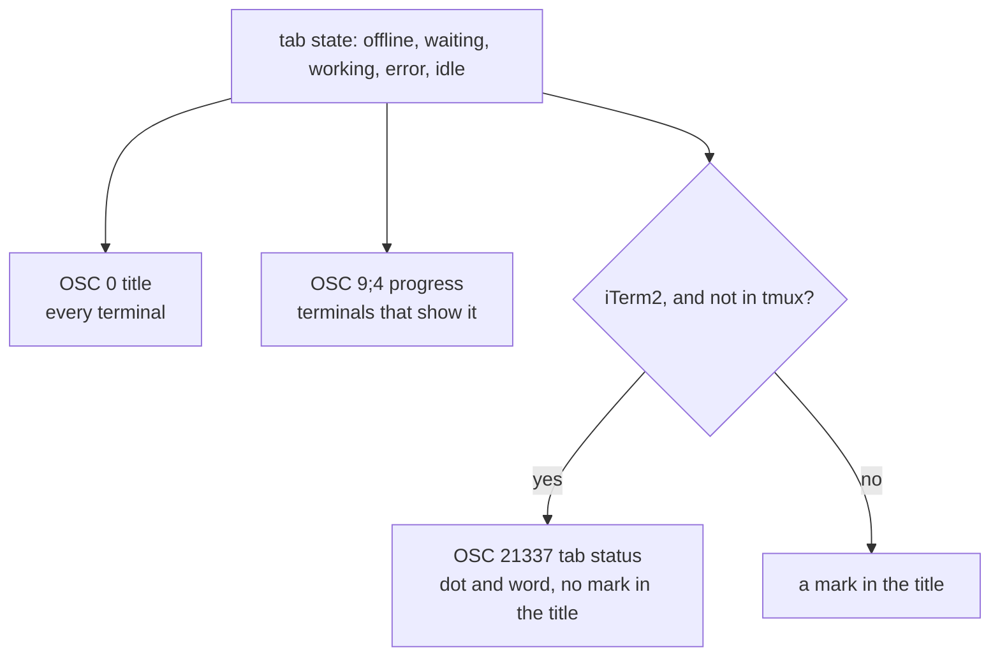

# ADR-027: The tab shows golem's state with escape sequences, and iTerm2 gets its own

**Date**: 2026-10-28
**Status**: accepted

## The idea

You should see from another tab whether golem is working or waits for you. Terminals show that in different ways, and no one sequence works everywhere. So golem writes three, each one only where it helps, and a terminal that does not know a sequence ignores it.

## What golem writes

- **The title (OSC 0)**, in every terminal: `<mark> <session title> (golem)`. The mark is `✳` idle, a spinner while a run works, `!` for an approval, `✗` after an error, and `○` without the daemon. The spinner changes once a second, so the tab does not flicker. The old title is pushed on start and popped on exit.
- **Progress (OSC `9;4`)**: busy (`3`) while a run works, paused (`4`) while it waits for an approval, and cleared (`0`) when it ends and on exit. Terminals that show progress put it on the tab or the dock.
- **iTerm2's tab status (OSC `21337`)**: `indicator=#rrggbb;status=<word>;status-color=#rrggbb`. A green dot and `idle`, orange `working`, blue `waiting for you`, red `failed`, and grey `disconnected`. Empty values clear it on exit. It is sent only when `TERM_PROGRAM=iTerm.app` or `LC_TERMINAL=iTerm2`, and not inside tmux. With it, the title has no mark, because the dot already shows the state.

All of it is in `packages/tui/src/window-title.ts`. Each sequence is written only when its value changes, not on every frame.

## Why not the other ways

- **`it2 session set-status`.** iTerm2's own command line tool sets the same status, and iTerm2's Claude Code hook uses it. It is a second process for each change, it talks to iTerm2 over its API socket, and it is only there when iTerm2's utilities are installed. The escape sequence goes out on the terminal golem already writes to.
- **Sending OSC `21337` everywhere.** Terminal.app ignored it in a test, but another terminal could print it. Sending it only to iTerm2 keeps that risk at zero.
- **One sequence for all terminals.** There is none. The title is the only one every terminal shows, so it carries the state, and the others add to it.

## Consequences

- Terminal.app shows only the title, with the mark. It builds its window title from its own parts too, such as the folder and the process, and its settings choose which.
- Inside tmux, iTerm2 gets the title with a mark, not the dot. tmux would need `allow-passthrough` and a wrapped sequence, which golem does not write yet.
- OSC `21337` is iTerm2's own sequence. If iTerm2 changes it, only `TAB_STATUS` and `oscTabStatus` change.
- 8.1 moves `hasTabStatus` behind the platform seam with the rest of the terminal checks.
