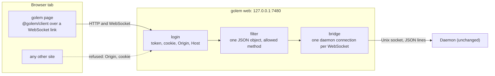
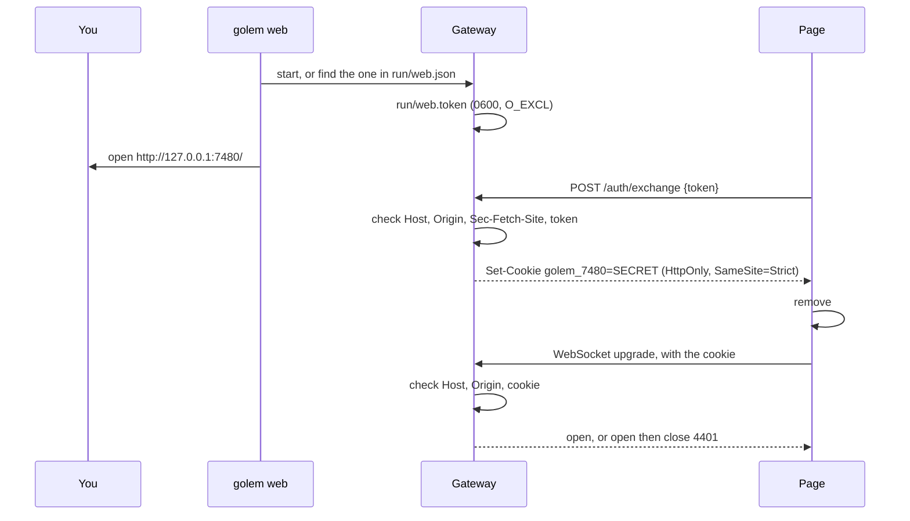

# ADR-028: A browser reaches the daemon only through a strict gateway in the golem binary

**Date**: 2026-10-31
**Status**: accepted

## The idea

The web UI ([vision, chapter 1](../vision.md#1-web-ui)) is the first client that is not a program you started in your own terminal. It is a page in a browser, and the browser also runs every other website you have open. Any of those sites can try to open a WebSocket to `127.0.0.1`. The daemon's rule so far, "the socket file's mode is the login", does not reach into a browser.

So the daemon stays as it is, listening only on its Unix socket, and a **gateway** stands in front of it. The gateway is part of the `golem` bun binary ([ADR-019](019-single-binary.md)), started by `golem web`. It has three jobs:

1. It lets in only the page that `golem web` opened.
2. It passes protocol lines between that page and the daemon, one connection each, without changing them.
3. It refuses anything a browser should never send.

All network security lives in this one program. The daemon has no port, no TLS, no cookies, and no login code.



Steps 10.3 and 10.5 build this ([#10](https://github.com/MilanPavel/golem/issues/10)). This record says how it must work, so both steps start from the same rules.

## How it works

### Login



- **The token file is the root of trust.**
  - `golem web` writes `~/.golem/run/web.token` with a random 32-byte value, mode `0600`, opened with `O_EXCL` so no other file can be in its place.
  - The gateway refuses to start when `run/` can be written by anyone but the user.
  - A new token is written each time a gateway starts, and the gateway deletes it when it stops. The token travels only in the address the CLI opens, in the fragment after `#`, which a browser never sends in a request line or a `Referer`, and in the body of `/auth/exchange`.
- **The page trades the token for a cookie.**
  - `POST /auth/exchange` takes the token in its body and compares it in constant time.
  - It sets a cookie with a fresh random secret, not the token. A cookie can leak more ways than a file can: another local server on another port receives it too, because cookies on `127.0.0.1` are shared by every port. So the cookie is worth nothing outside this gateway's memory, and its name carries the port (`golem_7480`), so two gateways never overwrite each other's.
  - Flags: `HttpOnly`, `SameSite=Strict`, `Path=/`, and `Max-Age` of 30 days. Secrets live only in the gateway's memory, so a gateway that restarts forgets them all, and the page asks for a fresh link.
- **Every request and every upgrade is checked:**
  - **`Host`** must be exactly `127.0.0.1:<port>`. This stops DNS rebinding, where an outside name later resolves to `127.0.0.1`.
  - **`Origin`** must be exactly `http://127.0.0.1:<port>`. `localhost` is a different origin and is refused, so the CLI always opens `127.0.0.1`. On an upgrade or a `POST`, a missing `Origin` is refused too. Browsers always send it there, so only a program that is not a browser leaves it out, and such a program can use the socket.
  - **`Sec-Fetch-Site`**, when present, must be `same-origin` or `none`.
  - **The cookie** must name a live secret. The static page and its assets are served without it, so the page can load and run the exchange, but nothing on them is private.
- **A refused upgrade is accepted, then closed with code 4401.** A browser reports a refused upgrade only as a generic failure (close code 1006), the same as a network error, and the client would retry forever. Code 4401 lets the client stop and show "Run `golem web` for a fresh link". The 4401 close is sent before any protocol line passes.

### One gateway per user

- `run/web.json` holds `pid`, `port`, and `started_at`. `golem web` reads it first. If that pid is a live `golem` process and `/healthz` answers, it reuses that gateway: it reads `web.token` and opens the same kind of link. The token stays valid while its gateway runs, so no second door is needed to ask for a fresh one. The page removes `#t=` with `history.replaceState`, so the token does not stay in the browser's history. Otherwise it removes the stale file and starts a new gateway. This is the single-owner rule of [ADR-020](020-safe-upgrades.md), and the launchd job of step 10.14 relies on it.
- **The port is stable: 7480 by default,** or `--port N`. A random port would change the origin on each start, and with it the cookie, the theme the page remembers, and an installed PWA. A port that is taken fails with a message that names `--port`. The gateway does not read `config.toml`. It is a TypeScript program, and one flag is simpler than a second TOML reader.
- `golem web --json` prints `{url, port, pid}` and opens nothing, for golem desktop later.

### Framing

The daemon reads JSON lines and splits on `\n` ([ADR-003](003-protocol.md)). A browser sends whole WebSocket messages. The gateway joins the two without ever building a line the page did not send.

- **Browser to daemon: one WebSocket text message is exactly one JSON object.**
  - It is refused when:
    - it is binary
    - it is larger than 1 MiB, the daemon's `MAX_LINE_BYTES` (also set as Bun's `maxPayloadLength`)
    - it contains `\n` or `\r`
    - `JSON.parse` fails
    - the value is not a plain object (an array, a number, or `null`)
    - `method` is not a string
  - The `\n` rule matters most. Without it, `{"method":"ping"}\n{"method":"auth.set",…}` would pass the method check as `ping` and reach the daemon as two commands.
  - The gateway appends the one `\n` itself, and forwards the original text unchanged. It never forwards a re-serialized copy, so what the daemon reads is exactly what the page sent.
- **Daemon to browser: one line is one WebSocket message.**
  - The gateway decodes the socket's bytes with a streaming UTF-8 decoder, so a character split across two reads stays whole. It then splits on `\n` and sends each line as one text message, without the newline.
  - The daemon's lines are trusted. They are not parsed.
- **Refusals:**
  - A message that breaks framing means the page has a bug, or is not the page. The gateway closes the WebSocket with 1008 (policy violation), and the daemon connection with it.
  - A well-formed request for a method that is not allowed gets a JSON-RPC error with the request's `id`, code `-32020`, and the message `not allowed from the browser`. The connection stays open.
- **The gateway never speaks the protocol itself.** It sends no `hello` and no `ping` on a bridged connection. Request ids belong to the page alone, so they cannot collide.

### Which methods a browser may call

- Each command in `golem_protocol` declares whether a browser may call it. `just gen` writes the list to `packages/protocol/gen/browser-methods.ts`, which the gateway imports. **A test fails when a method the daemon answers (`standard_methods()` in `golem/server/handlers.py`) has no declaration,** so a new command such as `daemon.shutdown`, `skill.trust`, or `flow.start` is never let through by accident. Someone has to decide it.
- **Denied today:**
  - `auth.set`: the API key would pass through the page's memory, its devtools, and its wire view.
  - `auth.remove`: key management stays in the terminal, where the Keychain prompt is.
- **Allowed, with reasons, because these are easy to get wrong:**
  - `auth.list` never returns a key, only where each one is stored.
  - `policy.update`, `approval.respond`, and `message.send` are allowed. They are the point of the web UI. Together they can make golem run code on the Mac, which is why the threat below is cross-site scripting (XSS), not secrets.

### Liveness and load

- **The heartbeat is end to end.** The client core in the page keeps its `ping` every 5 s and its 10 s timeout, through the gateway, to the daemon. It is the only check that notices a link that died while the laptop slept. When a tab becomes visible again, the client pings at once, because browsers slow the timers of a hidden tab to about once a minute.
- **Between the browser and the gateway,** Bun's `idleTimeout` and `sendPings` close a dead WebSocket.
- **A close on either side closes the other.** A daemon that restarts closes the WebSocket. The page reconnects, says `hello`, and re-attaches from its last `seq` ([ADR-007](007-attach-and-fan-out.md)).
- **Backpressure.**
  - When the browser falls behind, `ws.getBufferedAmount()` grows. Above 4 MiB the gateway stops reading the daemon socket, and resumes on `drain`.
  - The daemon's queue for that connection then fills. At `MAX_PENDING_FRAMES` (20 000, `golem/server/connection.py`) the daemon drops the connection, and the page re-attaches from `after_seq`.
  - This reuses the recovery that already exists, and the gateway never buffers without a limit.
- **At most 16 WebSockets at once.** The 17th upgrade gets 503. One person has a handful of tabs, so more than that means something is wrong.

### Headers

| Header | Value | Why |
|---|---|---|
| `Content-Security-Policy` | `default-src 'self'; script-src 'self'; style-src 'self' 'unsafe-inline'; img-src 'self' data:; font-src 'self'; connect-src 'self'; frame-ancestors 'none'; base-uri 'none'; form-action 'self'` | No script from anywhere else and no inline script. `'unsafe-inline'` for styles only, because Radix's scroll lock injects a `<style>`. `connect-src 'self'` covers the WebSocket in current browsers |
| `X-Content-Type-Options` | `nosniff` | |
| `Referrer-Policy` | `no-referrer` | |
| `Cache-Control` | `no-cache` on `index.html`, `public, max-age=31536000, immutable` on hashed assets | After `brew upgrade`, the next load is the new page |
| `Cross-Origin-Opener-Policy` | `same-origin` | Another window cannot reach into the page |

There is no service worker that caches the page. One would show an old page, speaking an old protocol, after an upgrade.

### Development

`vite dev` serves the page on its own port, so the browser's `Origin` is Vite's. The Vite proxy for `/ws` and `/auth` **rewrites `Origin` to the gateway's own origin**, so the gateway runs with the same checks in development as in a release. There is no `--dev` flag that loosens them.

### The transport seam in @golem/client

The page and the TUI use the same client core: hello, heartbeat, backoff, request ids, re-attach from `seq`, and dropping repeats. Only the way bytes move differs, so that part becomes an interface. The core asks for a new link on every reconnect:

```ts
type Dial = () => Link;

interface Link {
  send(line: string): void;          // one protocol line, without "\n"
  close(error?: Error): void;
  onOpen(listener: () => void): void;
  onLine(listener: (line: string) => void): void;
  onClose(listener: (error?: Error, code?: number) => void): void;
}
```

- `unixDial(path)` lives in `@golem/client/node`. `wsDial(url)` lives in `@golem/client`, which has no `node:` import and is typechecked without Node's types.
- A close with code 4401 sets the new connection state `unauthorized`, and retries stop, as they do for `rejected` today.

## Threat model

| Threat | What stops it |
|---|---|
| A website you visit opens a WebSocket to `127.0.0.1:7480` | `Origin` is checked exactly, and it has no cookie |
| DNS rebinding: an outside name resolves to `127.0.0.1` | `Host` is checked exactly |
| Another local server, on another port, reads the cookie | The cookie is a secret held only in the gateway's memory, and is useless without a matching `Origin`. The token itself never leaves the file and the address |
| A program run as you reads `web.token` | Out of scope. It can already use the socket. The file mode is the login, as it always was |
| Another user on the Mac | The token file is `0600`, `run/` is checked, and the gateway listens only on loopback |
| One message smuggles a second command | One object per message, no `\n` or `\r` |
| A new privileged command reaches the browser by default | A generated allowlist, and a test that fails for any method nobody declared |
| XSS from model output, a tool's output, or a file's content | Markdown is sanitized (DOMPurify: no `style`, SVG, `javascript:` or `data:` links, or remote images), a strict CSP, and no `dangerouslySetInnerHTML` outside the sanitizer (the web stack ADR, ticket 10.1.2) |
| Clickjacking the approval card | `frame-ancestors 'none'` |
| A slow or stuck tab fills memory | The 4 MiB pause, then the daemon's drop and a re-attach |
| An old page after an upgrade | `index.html` is `no-cache`, there is no service worker, and `hello` refuses a different protocol major |

## Tests this record asks for

The gateway's core is plain functions over the standard `Request` and strings (`checkRequest`, `checkUpgrade`, `exchangeToken`, `filterMessage`, `splitLines`), tested with `node:test`. The thin `Bun.serve` adapter is covered with `bun test` and `just smoke-dist`.

- **Framing:**
  - two objects joined by `\n`
  - a lone `\r`
  - 1 MiB plus one byte
  - a binary message
  - not JSON
  - `NaN`
  - an array
  - `null`
  - a duplicate `method` key, where `JSON.parse` keeps the last one and the check reads that same value
  - `"auth.set"`, which parses to `auth.set` and is refused
  - an unknown method
  - a method with no declaration, which fails `just check`
- **Origin and Host:**
  - `Origin` missing on an upgrade
  - `Origin: null`
  - another port
  - `http://localhost:7480`
  - upper-case letters
  - a trailing slash
  - `Host: 127.0.0.1.nip.io:7480`
  - `Host` without the port
  - `Sec-Fetch-Site: cross-site`
- **Login:**
  - no cookie
  - a wrong cookie
  - a secret from before a restart
  - the file token sent as the cookie
  - a wrong token on `/auth/exchange`
  - a token file whose mode is not `0600`
  - `run/` writable by the group
  - a stale `run/web.json` whose pid is dead or not golem's
- **Lifecycle:**
  - a slow reader pauses the daemon socket, and reading resumes on `drain`
  - a close on either side closes the other
  - the daemon is down at the upgrade
  - the daemon restarts mid-stream
  - the 17th WebSocket gets 503
  - a refused upgrade closes with 4401 before any line passes
- **Content,** in step 10.8:
  - an XSS corpus through the sanitizer
  - in Playwright, any `securitypolicyviolation` event or console error fails the test

## Other shapes that lost

**The daemon serves the page and the WebSocket.** This removes a hop. It also puts a web server, a port, and login code into the frozen process that holds the state, far from the TypeScript client that has to agree with it. The vision decided against it. The way back stays small: a WebSocket listener that reuses `Connection` in `golem/server/connection.py`.

**HTTP and server-sent events, like opencode.** A second API shape to keep in step with the protocol. The page would need two channels, and `after_seq` replay would have to be built again. The app API of serve mode can be HTTP and SSE later, behind this same gateway.

**A denylist.** It is shorter today. Every new privileged command would be open to the browser on the day it lands, until someone remembers.

**Using the token as the cookie.** One value fewer. But cookies on `127.0.0.1` are shared by every port, so any local dev server you run could read it, then replay it from a page it serves.

**A random port each time.** Nothing to collide with. But the origin changes on every start, and the cookie, the remembered theme, and an installed PWA go with it.

**Refusing a bad upgrade with HTTP 401.** It is the usual HTTP answer. A browser shows it only as a failed connection, and the client cannot tell it from the daemon being down.

**Parsing and re-serializing every message.** It would make framing trivial. It also means the daemon reads something the page did not write, and a subtle encoding difference becomes a bug in the security boundary.

## What it costs

- One more process when you use the web UI, and one more hop, which costs microseconds.
- The first open after a gateway restart needs a fresh link from `golem web`, because the secrets lived in memory. Step 10.14's launchd job makes restarts rare.
- Port 7480 can be taken by something else. `--port` is the way out, and the new origin starts with no cookie.
- Each new command needs a browser declaration before `just check` passes.
- `'unsafe-inline'` for styles is a small hole: injected CSS cannot run script, but it can restyle the page. The sanitizer forbids `style` in model output, which is the main way CSS could get in.
