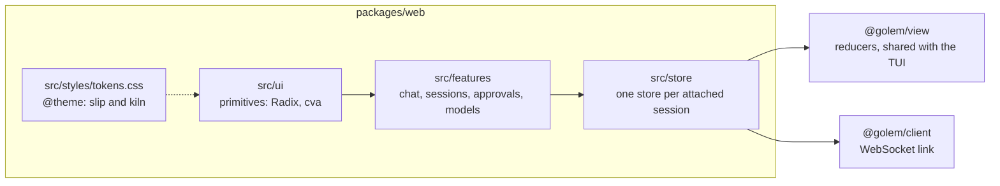
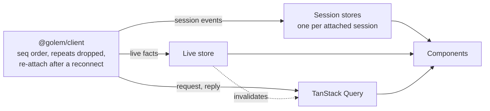

# ADR-029: The web UI is React and Vite, styled only through golem's own Tailwind tokens

**Date**: 2026-10-31
**Status**: accepted

## The idea

The web UI ([vision, chapter 1](../vision.md#1-web-ui)) is a second screen for the same events the TUI draws. It is written almost entirely with a model's help, by one person, and it has to keep a look of its own: golem's clay, its pixel figure, and two themes. Three choices follow:

1. **Use well-known tools,** so the code a model writes is ordinary code: React 19, Vite, TypeScript, Tailwind v4, Radix, TanStack Query.
2. **Make golem's look a set of tokens, and make everything else impossible.** Tailwind's own colours and sizes are removed, so a component can only use golem's.
3. **Treat everything golem shows as untrusted.** Model output, tool output, and file contents are rendered as data, never as markup or script.

The gateway that serves the page and checks who opens it is [ADR-028](028-web-gateway.md). This record covers what runs inside the page. Steps 10.6 to 10.13 build it ([#150](https://github.com/MilanPavel/golem/issues/150)).



## The stack

| Part | Choice | Why |
|---|---|---|
| UI library | React 19 | The TUI is React (Ink), so the habits and the hooks carry over |
| Build | Vite, through `@vitejs/plugin-react` | The vision names it. Best known, fast, and it writes hashed assets that `bun build --compile` embeds ([ADR-028](028-web-gateway.md)) |
| Language | TypeScript, as strict as the other packages (`strict`, `noUncheckedIndexedAccess`, `verbatimModuleSyntax`) | One set of rules across the repo |
| Styles | Tailwind v4 through `@tailwindcss/vite`, with golem's tokens only | See below |
| Primitives | Radix (dialog, popover, menu, tooltip, tabs, scroll area) | Keyboard and screen-reader behaviour that is hard to get right by hand. Its `data-state` attributes are styled with Tailwind's `data-[state=open]:` variants |
| Component variants | `cva` with `tailwind-merge` | One place for a button's sizes and kinds, and later classes win cleanly |
| State | Events pushed by the daemon are folded by the `@golem/view` reducer into small stores of our own. Answers to requests live in TanStack Query. See [State](#state) | Pushed facts and pulled answers behave differently, and each gets the tool built for it |
| Routing | A small history router of our own: `/`, `/s/:id`, `/settings/*` | Three routes do not need a library |
| Markdown | `marked`, then DOMPurify | `marked` already renders the TUI's markdown. DOMPurify is the one widely reviewed HTML sanitizer |
| Code highlighting | Shiki through `shiki/core`, with its JavaScript regex engine and a fixed list of languages, loaded only when a code block appears | Its default engine is WASM, which the CSP forbids. A fixed list keeps the bundle small |
| Fonts | Geist (the interface), Literata (golem's answers), Geist Mono (code, tools, labels), self-hosted and subset | The page works offline, and no font request leaves the Mac |
| Tests | Vitest, Testing Library, and axe for components. Playwright for end to end | Vite's own test runner, so there is no second build setup |

### Styling through tokens

Golem's look is a short list of named values. `src/styles/tokens.css` is the only place that defines them:

```css
@import "tailwindcss";

@theme {
  --color-*: initial;          /* no Tailwind colours */
  --font-*: initial;
  --color-bg: #F3F2EF;         /* slip: limestone */
  --color-surface: #FBFAF8;
  --color-ink: #1D1A17;
  --color-clay: #C4783A;
  --color-allow: #3F7342;
  /* … */
  --font-ui: "Geist", ui-sans-serif, system-ui, sans-serif;
  --font-prose: "Literata", Georgia, serif;
  --font-mono: "Geist Mono", ui-monospace, monospace;
}

[data-theme="kiln"] {
  --color-bg: #15120F;
  --color-surface: #1D1915;
  /* … the same names, darker values */
}
```

- **Names say what a colour is for,** not what it looks like: `surface`, `ink`, `muted`, `line`, `clay`, `slip`, `allow`, `deny`, `wait`. A component writes `bg-surface text-ink`, and the kiln theme changes it without a `dark:` variant anywhere.
- **The theme** is `data-theme` on `<html>`. It follows the system until you pick one, and the page remembers your pick in `localStorage`.
- **Arbitrary values are refused.** A check in `just check` fails on a class such as `bg-[#123456]`, `p-[13px]`, or `text-[15px]`. A one-off value either becomes a token or does not ship. This is what keeps the look from drifting as the code grows.
- **Plain CSS is used only where a class cannot reach:**
  - the markdown in an answer, which `marked` writes without classes, in `prose.css`
  - the pixel golem's eyes and their animations
  - keyframes
  - the faint grid behind the empty screen
- **Contrast is checked.** A script reads `tokens.css` and checks every text-on-surface pair in both themes: 4.5:1 for text, 3:1 for borders, focus rings, and status dots ([WCAG 2.2](https://www.w3.org/TR/WCAG22/)). It runs in `just check`. Every state the pixel golem shows also has a word next to it, because colour alone is not enough.

The values themselves are in `docs/design/web.md`, from the prototype approved in 10.2.

### State

The page holds four kinds of state. They arrive differently, so they live in different places.

| Kind | Examples | How it arrives | Where it lives |
|---|---|---|---|
| **A session's events** | The transcript, streaming text, tool calls, the waiting approval, todos | Pushed by the daemon, in `seq` order, and replayed after a reconnect | A session store, folded by `reduceChat` from `@golem/view` |
| **Live facts** | The connection, the session list (`session.list` with `watch`), downloads, MCP and model server status | Pushed to every connection, and never stored by the daemon | The live store |
| **Answers to a request** | `model.list`, `config.get`, `mcp.list`, `mcp.tools`, `skill.list`, `artifact.read`, `session.inspect`, `daemon.status` | Pulled: a request, then a reply | TanStack Query |
| **Screen-only state** | The draft, an open drawer, the theme, the palette | Made by the page | React state, a context, and `localStorage` for the theme |



**Session stores.**
- **The store.** `createStore(reduce, initial)` is about 80 lines in `src/store`. It holds a snapshot and its listeners. Components read a slice with `useSession(id, selector)`, built on `useSyncExternalStoreWithSelector` (from the React team's `use-sync-external-store` package), so a component renders again only when its slice changes.
- **One store per session.** The page keeps a `Map` from session id to store, created on `session.attach` and dropped on `session.detach` when you leave the session. A session you are not looking at costs nothing.
- **Deltas land once per frame.** `message.delta` events wait in a buffer and are folded once per animation frame, as the TUI folds them every 16 ms. Any other event first flushes the buffer, then applies at once. So the approval card, the tab title, and the favicon are right even in a hidden tab, where animation frames do not run.
- **Unchanged messages keep their identity.** `reduceChat` returns the same object for every message an event did not touch. A memoized message row then does not render again while another message streams. A test in `@golem/view` checks it.
- **The client does the ordering.** Order by `seq`, dropping repeats, and re-attaching from the last `seq` already happen in `@golem/client` ([ADR-007](007-attach-and-fan-out.md)). The store only folds what it is given.

**The live store** is the same small store, with one for the connection. The sidebar's dots come from the session list, so a session does not need to be attached to show that it runs or waits.

**TanStack Query** holds the answers to requests.
- Each query calls the client, such as `client.listModels()`. Keys are the method and its parameters.
- **Pushed events keep the cache honest,** so it does not refetch on a timer:

  | Event | Refetches |
  |---|---|
  | `skill.registry.changed` | `skill.list` |
  | `mcp.server.status` | `mcp.list`, `mcp.tools` |
  | `model.pull.done` | `model.list` |
  | `session.updated` | that session's `session.inspect` |
  | a reconnect | everything |

  `staleTime` is long, and refetching when the window gets focus is off.
- **Commands are mutations without optimistic updates.** `message.send`, `approval.respond`, `run.cancel`, and `policy.update` use `useMutation` only for their pending and error state. The result arrives as events, the same as in the TUI. Your line appears with `message.completed`, and the approval card closes with `approval.resolved`. The events stay the one source of truth.

**Screen-only state** stays in components. The draft is kept per session, so switching away and back keeps what you typed.

**Dev tools.** In dev mode, each store reports the events it folded to the Redux DevTools extension through its plain browser API, with no Redux in the bundle. The wire view (10.11) shows the same lines in the page.

### Code layout and the rules between parts

```
packages/web/src/
  ui/          primitives: button, input, dialog, menu, the pixel golem, …
  features/    chat, sessions, approvals, models, settings: screens and their hooks
  store/       session stores, the live store, the query client, the router
  styles/      tokens.css, prose.css
  main.tsx
```

ESLint enforces the direction:
- `ui` imports nothing from `features` or `store`.
- `features` never imports `@golem/client` directly. They read and act through `store`.

`@golem/view` and the core of `@golem/client` import no React, DOM, or Node API, and are typechecked without Node's types.

### Untrusted content

Everything golem shows can come from a model, a tool, a web page, or a file someone else wrote. So:

- **DOMPurify is the only way HTML enters the page.**
  - It is configured to forbid `style`, `<svg>`, `<math>`, forms, `javascript:` and `data:` links, and remote images.
  - Links open in a new tab with `rel="noopener noreferrer"`.
  - There is no `dangerouslySetInnerHTML` anywhere else, and a lint rule enforces that.
- **The CSP from ADR-028** backs the sanitizer up: no inline script, no script from another host, no `eval`, and no WASM.
- **Tool output and diffs** are text, rendered as text.

### Tests

- **Components** (Vitest, Testing Library, axe): each primitive in both themes, and each screen's states with a fake link.
- **End to end** (Playwright, `just e2e`, kept out of `just check`):
  - a temporary `GOLEM_HOME`, the daemon with a fake model, and the gateway
  - Chromium from 10.7. WebKit from 10.12, the engine golem desktop would use
  - any CSP violation or console error fails a test
- **Screenshots** in both themes, from 10.12, on macOS runners only, because font rendering differs on Linux.

## Other shapes that lost

**CSS Modules.** Plain CSS that you can read, with no build plugin. With a model writing most of the code, each new file tends to invent its own spacing, radius, and shade, and a custom look erodes one file at a time. Tailwind with a closed set of tokens makes the off-design value the one that fails `just check`.

**Tailwind with its default palette.** Faster to start. A component would then reach for `gray-500` or `orange-600`, and the design would slowly become Tailwind's.

**A component kit such as shadcn/ui or MUI.** Copying shadcn's components is the same Radix with someone else's look, which we would restyle line by line. MUI brings its own design system and a runtime styling engine.

**Solid, Svelte, or Vue.** All fine. React is what the TUI already uses, and what most models write best.

**Bun's own HTML bundler instead of Vite.** One tool fewer, and `Bun.serve` can bundle the page itself. It is newer, has fewer plugins (Tailwind, React refresh), and Vitest is built on Vite. This is worth revisiting if Vite ever gets in the way of embedding.

**Redux, with Redux Toolkit.** Its shape fits: `reduceChat` is a Redux reducer, and the events are its actions. But the reducer has to live in `@golem/view`, because the TUI uses it without Redux, so Redux would only wrap a function we already have. Sessions come and go as you open and leave them, which is simpler as small stores than as slices added to one global store. Middleware has nothing to do, because side effects are protocol commands. RTK Query overlaps TanStack Query. The DevTools are the one real gain, and we get them in dev mode through the extension's API. The daemon's event log is already the action log: replaying it rebuilds the screen. Worth a new look if the page grows many views that join several sessions.

**TanStack Query for everything, sessions too.** It is built around pulling: fetch, cache, mark stale, fetch again. A session is pushed. Its truth is "every event after `seq` N", folded in order with repeats dropped, and deltas come up to hundreds of times a second. Writing each event with `setQueryData` would rebuild the reducer inside cache updates, and wake every subscriber on every delta.

**zustand.** Close to our own store, and it would save about 40 lines. It is still one more dependency, and the per-frame batching of deltas would be ours either way.

**Optimistic updates for commands.** Your line would appear a moment sooner. But then the page could show something the daemon never stored, and would have to undo it when a send fails. The TUI waits for the event, and so does the page.

**A hosted font or icon service.** Simpler to set up. It also sends a request outside the Mac every time the page opens, and fails offline.

## What it costs

- TanStack Query is one more dependency, and every pushed event that changes a pulled answer needs its line in the invalidation table. A missing line shows as a stale list until the next reconnect.
- The session store is our own code, with its own tests: per-frame batching, flushing before other events, and stable message identity.
- A Tailwind build step and two small libraries (`cva`, `tailwind-merge`). Long class lists in JSX are harder to read than one class name. Primitives in `ui/` hide most of them.
- New colours and sizes have to go through `tokens.css` and the contrast check, which takes a minute longer than writing a hex value.
- Shiki highlights only the languages on the list. Others show as plain code until they are added.
- The fonts add about 300 KB to the binary, after subsetting.
- React 19, Radix, and Tailwind are three more dependencies to keep up to date. Their updates go through the same `just check` and e2e runs as any other.
