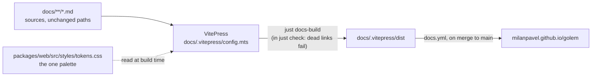

# ADR-034: The docs are a VitePress site over `docs/`, published to GitHub Pages

**Date**: 2026-11-01
**Status**: accepted

## The idea

golem's docs are good, but GitHub shows them one file at a time. The README is 461 lines, because it is the front door, the user guide, and the contributor guide at once. Phase 11 ([#264](https://github.com/MilanPavel/golem/issues/264)) turns `docs/` into a site with a side menu, search, and both themes, in golem's own look. Four choices follow:

1. **VitePress builds the site from `docs/` as it is.** No file moves, so every link to a doc keeps working.
2. **GitHub Pages hosts it,** published by a workflow on each merge to `main`. A pull request builds the site but does not publish it.
3. **A broken link fails `just check`,** like a type error.
4. **The site looks like the web UI,** because it reads the same tokens. It never copies them.

## Decision

### VitePress, with `docs/` as its source folder

- The site is a workspace package, `@golem/docs`, in `docs/package.json`. Its config and theme live in `docs/.vitepress/`.
- Every `.md` file in `docs/` is a page at the path it has today. `docs/architecture.md` is `/golem/architecture`, and `docs/adr/012-permission-rules.md` is `/golem/adr/012-permission-rules`.
- New pages go in new folders: `docs/guide/`, `docs/concepts/`, and `docs/contributing/`. When a page should have a nicer URL than its file name, `rewrites` in the config maps it. The file does not move, so the links in AGENTS.md, the skills, code comments, and issues keep working.
- `srcExclude` leaves out what is not a page: `design/prototype.html` and `adr/template.md`.
- A link that leaves `docs/` (to `../README.md`, `../CONTRIBUTING.md`, or `packages/…`) becomes a full GitHub URL. A file the site should show, such as `CONTRIBUTING.md`, is pulled in with `<!--@include: ../CONTRIBUTING.md-->`, so it still has one source.
- Mermaid is rendered by `vitepress-plugin-mermaid`. The plan, the architecture, and nine ADRs already use it.
- Search is VitePress's local search. It is built into the site, so there is no service and no key.

### Published to GitHub Pages by a workflow

- `.github/workflows/docs.yml` runs on a push to `main` that touches `docs/**` or `README.md`, and on demand. It builds with `vitepress build docs` and publishes with `actions/upload-pages-artifact` and `actions/deploy-pages`.
- Pages is set to "GitHub Actions" in the repo settings, once. The site lives at `https://milanpavel.github.io/golem/`, so `base` is `/golem/`.
- A pull request does not publish anything. `just check` in CI builds the whole site, so a page that breaks the build cannot merge.
- The site describes `main`, not a release. A page about a feature that is not released yet says so.

### A broken link fails the check

- `just docs` runs the dev server. `just docs-build` builds the site, and `just check` runs it.
- VitePress fails the build on a dead internal link, and the config leaves that on. The only exceptions are listed in `ignoreDeadLinks`, each with a comment saying why.

### The look comes from the web UI's tokens

The approved design is [docs/design/web.md](../design/web.md), and [ADR-029](029-web-stack.md) makes `packages/web/src/styles/tokens.css` the one place golem's colours are defined. The docs use the same palette, in slip and kiln:

- `tokens.css` is a Tailwind `@theme` block, which VitePress cannot import. `config.mts` reads the file at build time, takes each `--color-*` line, and serves them as plain custom properties through a virtual CSS module. The theme maps them onto VitePress's variables: `--vp-c-brand-1` comes from `clay-ink`, `--vp-c-bg` from `bg`, a tip from `allow`, and so on. A token that the map names but the file does not have fails the build.
- The values are `light-dark(slip, kiln)`. The theme sets `color-scheme: light` on `:root`, and `dark` on `html.dark`, the class VitePress's toggle sets, so the same values follow the switch.
- Fonts are self-hosted from the same `@fontsource-variable` packages the web UI uses: Geist, Literata, and Geist Mono. The pixel labels use `@fontsource/silkscreen`. No font request leaves the site.
- The pixel golem is drawn from the grid in `packages/tui/src/logo.ts`. The legend and `why-*` SVGs in `docs/images/` are used as they are.

## Alternatives considered

### Starlight (Astro)

- **Pros**: the most polished default look. It is TypeScript and fits the pnpm workspace.
- **Cons**: its pages must live in `src/content/docs/`. Every doc moves, and every link to one breaks or needs a redirect.
- **Why not**: VitePress reads `docs/` where it is, and golem's own theme replaces most of the default look either way.

### MkDocs Material, or Zensical

- **Pros**: a rich theme, and Python, like the daemon.
- **Cons**: MkDocs Material is in maintenance mode. Zensical, its successor, is young. Neither can read the web UI's tokens or run its Vite tooling, so the look would be copied by hand.
- **Why not**: the look must come from one source, and that source lives in the TypeScript workspace.

### The GitHub wiki

- **Pros**: nothing to build, and a sidebar through `_Sidebar.md`.
- **Cons**: a separate git repository with no pull requests, no review, and no CI. A plain look that cannot be themed.
- **Why not**: docs change with the code, so they must go through the same review.

### Only better Markdown in the repo

- **Pros**: no tooling. GitHub renders Mermaid and shows a table of contents per file.
- **Cons**: no side menu across files, no search, no home page, and no theme.
- **Why not**: it does not give what Phase 11 is for.

## Consequences

### Positive

- One URL for everything a user or contributor needs, with a side menu and search.
- No doc moves. Old links keep working, and `docs/*.md` still reads well on GitHub.
- The docs and the web UI look like one product. A palette change in `tokens.css` reaches both.
- A broken link is caught in the pull request, not by a reader.

### Negative

- A new package, `@golem/docs`, with VitePress and Mermaid as dev dependencies. `just check` takes a little longer.
- VitePress brings its own Vite, older than the web UI's. pnpm keeps them apart, but there are two in the lockfile.
- Markdown that renders on GitHub but not in VitePress, or the other way round, needs care. A raw HTML block, a relative link out of `docs/`, and an image path are the usual cases.

### Risks

- **Reading `tokens.css` with a regex.** If its format changes, the docs lose their colours. The build fails on a missing token, so this shows up in CI, not on the site.
- **Pages settings live outside the repo.** If Pages is switched off or set to a branch, the workflow fails visibly. `docs/sre.md` notes the setting.
- **The site runs ahead of releases.** It is built from `main`, so it can describe a feature not yet in Homebrew. A page marks such a feature, and a versioned site can come later if it is needed.
