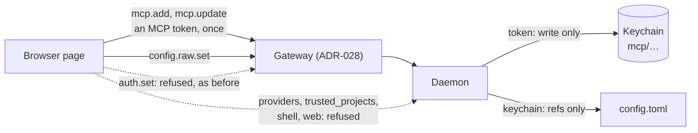

# ADR-037: The browser manages MCP servers and `config.toml`, but cannot move a secret or widen trust

**Date**: 2026-11-05
**Status**: accepted

## The idea

[ADR-028](028-web-gateway.md) kept two things out of the browser: `auth.set` and `auth.remove`. A model provider's API key would pass through the page's memory, its devtools, and its wire view, so key management stayed in the terminal.

Step 1.12 ([#245](https://github.com/MilanPavel/golem/issues/245)) makes MCP a thing you set up, not a file you edit. A hosted server such as GitHub needs a token. With the old rule, the page could only show a command to copy for every such server, and every edit of a server was a trip to the terminal. That is the experience 1.12 exists to remove.

So the browser may now manage MCP servers and edit `config.toml`, and it may send an **MCP token**. The browser still never sends a model provider's key, and two checks in the daemon make sure that what it *can* send cannot be turned against the keys and the trust that already exist.

## Decision

### What the browser may call

These methods are declared `"browser"` in `golem_protocol/methods.py`:

| Method | What it does |
|---|---|
| `mcp.add`, `mcp.update`, `mcp.remove` | Write, replace, or delete one `[mcp.<name>]` table, in the user's file or a trusted project's |
| `mcp.get` | One server's whole config, with a `stored` flag for each secret |
| `mcp.test`, `mcp.logs`, `mcp.call` | Start a server without saving it, read its log, call one of its tools from a form |
| `mcp.catalog`, `mcp.import.scan`, `mcp.import.apply` | The catalog, and servers found in other apps' files |
| `mcp.login`, `mcp.logout` | OAuth for a hosted server. No secret passes through the page |
| `runtime.install`, `runtime.install_cancel` | Install Node or uv with Homebrew. Only those two names are accepted |
| `config.raw.get`, `config.raw.set` | The text of `config.toml`, and a checked write of it |

An MCP token may travel from the page to the daemon inside `mcp.add` and `mcp.update`. It goes in `secrets` as a `SecretStr`, is stored in the Keychain as `mcp/<…>` before the file is written, and is not kept anywhere else.

### What stays as it is

- **Model provider keys** (`auth.set`, `auth.remove`) stay local-only. A hosted model's key is worth more than one service's token, and it is the one secret that also needs the Keychain prompt in a terminal.
- **The daemon never echoes a token.** `mcp.get` says `stored: true` or `false`. A form shows a secret field empty and a `stored` badge, and a field left empty on save means "keep".
- **`config.raw.get` returns `keychain:` references, never their values.**
- **The wire view redacts** the `token` and `secrets` fields, as the TUI's does.
- **`config.raw.set` cannot write a literal secret.** `_no_inline_secrets` in `config.py` refuses one, so pasting a token into the editor fails with a line number and a hint to use the server's form.

### What the daemon checks, for the browser's sake

The browser has no new power over the machine. It can already run code, because `message.send` with `approval.respond` can ([ADR-028](028-web-gateway.md)). It could, however, get a new power over *secrets and trust* by editing, if nothing checked the edit. Two rules close that.

**1. A browser edit cannot widen what golem trusts or where a key goes.**

`config.raw.set` (a `"browser"` method) refuses any change inside these parts of the file, and names the part in its error:

| Part | Why it is protected |
|---|---|
| `providers`, `model_base_url`, `model_provider`, `model_name`, `model_profile` | A provider's `base_url` is where the daemon sends that provider's key. Pointing it at another host would send the key there |
| `trusted_projects` | A project in this list may allow tools and add MCP servers that run programs |
| `shell` | `network` and `writable` are the sandbox's walls |
| `web` | `allow_private` is `web_fetch`'s wall against local addresses |
| `skills.extra_dirs`, `skills.claude_dirs` | They add folders the model may read |

A second method, `config.raw.set_protected`, is `"local"`. It has the same parameters and the same checks, without this list, and the terminal's `/config` and `golem mcp config edit` use it. The list is one constant in `config.py`, and a test fails when a `GolemSettings` field is in neither the protected list nor the browser-editable one, so a new setting is decided when it lands.

`rule`, `default_model`, `models`, `ollama`, `session_titles`, `log_level`, `skills.disabled`, and `mcp` stay editable. `policy.update` already lets the browser change `rule`, so protecting it would add friction and no safety.

**2. A stored secret is sent only where it was meant to go.**

- A server may name only its own secrets: `mcp/<name>` and `mcp/<name>-…`. A reference to another server's secret, such as a new server at an unknown URL naming `keychain:mcp/github`, is refused.
- When `mcp.update`, or a raw edit, changes a server's `url`, `command`, `args`, or `cwd`, and the server names a stored secret, the request must carry that secret again in `secrets`. The page does not hold it, so an edit that only redirects an existing server fails: "You changed the address. Paste the token again."

Both rules apply to every client, not only the browser, because the daemon cannot tell which client a line came from and the gateway does not speak the protocol. A person editing the file by hand is not affected, because a file edit does not go through the daemon.

### `mcp.test` and `mcp.call` need no approval

- `mcp.test` starts a server the page just described, which is the same power as `mcp.add`, and stores nothing.
- `mcp.call` runs one tool of a connected server, with arguments typed into a form. It happens only when someone presses Run, so the press is the approval, as a click on Allow is for a run's tool call. It is not recorded in any session and the model never sees it.

Neither is a new kind of power for the browser. `approval.respond` can already allow any tool call a model makes.

### Why this is acceptable

The threat ADR-028 accepts is cross-site scripting (XSS): script running in the golem page. Such a script can already call `message.send` and `approval.respond`, which together run code as you. The strict CSP, the sanitizer, and `frame-ancestors 'none'` are what stand against it.

What it could do with this ADR that it could not before is bounded:

- **Add or edit an MCP server.** That runs a program as you, which it could already do by asking the model for a shell command and approving it itself.
- **Send an MCP token.** Only one it holds. It does not hold any of the stored ones, and rule 2 stops it redirecting them. A token it sends is scoped to one service.
- **Edit `config.toml`.** Rule 1 keeps it away from provider keys, the sandbox, and trust.

## Alternatives Considered

**A token-free `mcp.add` from the browser.** It keeps ADR-028 word for word. It also means a copied command for every hosted server, in a window the user has to leave, and the add dialog's test could not run before saving. The experience would be worse than the TUI's by design.

**Local-only editing, with a "Open in terminal" button.** Simple, and it leaves the web UI half a settings view. The plan's goal is that nobody has to open a file or a terminal.

**Trust the browser for the whole `config.toml`.** It is less code. An XSS could then edit `base_url` and read an API key from the next request, or add its own folder to `trusted_projects`. Rule 1 is two small tables and one extra method.

**Let the gateway enforce rule 1.** It would have to parse TOML, and ADR-028 says the gateway never reads what it passes on beyond `method`. The daemon owns the settings model, so it owns the list.

**A `"browser"` flag on the connection, set by the gateway.** The daemon could then tell where a line came from. It needs the gateway to speak the protocol, which ADR-028 rejects. Two methods and one rule that holds for every client are simpler to test.

## Consequences

### Positive

- Everything MCP can be done in the browser, with nothing copied to a terminal, and a token typed once.
- No new class of power for a script in the page: provider keys, trust, and the sandbox stay out of its reach.
- The daemon's own checks hold for the TUI and the CLI as well.

### Negative

- Editing `providers`, `trusted_projects`, `shell`, or `web` is still a terminal job, and the web editor must say so when it refuses.
- Redirecting a server with a stored token needs the token again. That is a small cost for a real protection.
- Each new daemon method needs a decision in `METHOD_ACCESS`, and each new setting needs one in the protected list.

### Risks

- The protected list can be wrong the other way: a setting added later that decides where a secret goes, and is put on the editable side. The test forces a choice, not the right one, so a reviewer must check it.
- `mcp.call` lets a script in the page call a tool of a connected server without an approval card. A server with a dangerous tool is already one approval click away from the same call.
