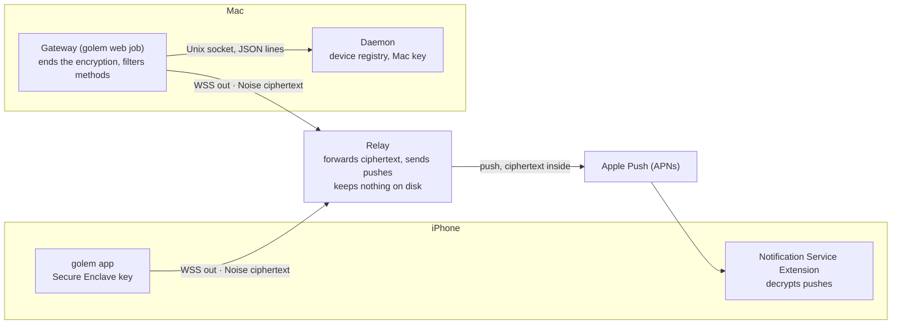
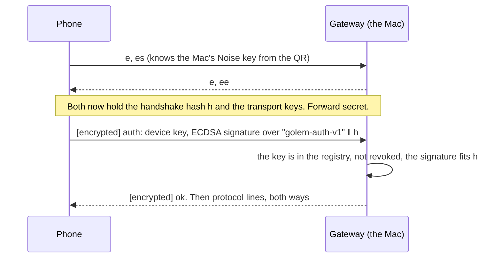
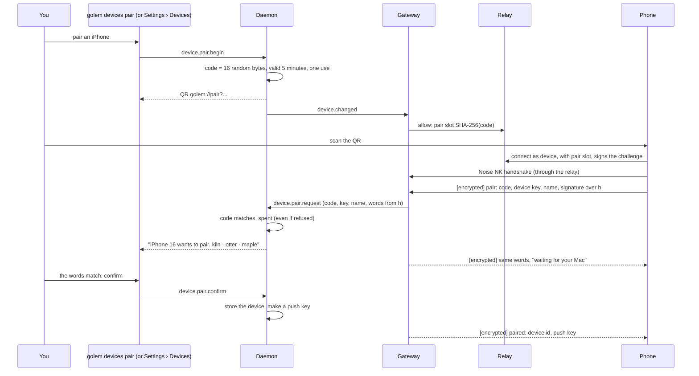

# ADR-051: A phone reaches the Mac through a relay that sees only ciphertext

**Date**: 2026-11-13
**Status**: accepted

## The idea

A phone on 5G cannot open a connection to a Mac at home. The Mac is behind a router (NAT) with no public address, and iOS freezes a background app, so the phone cannot hold a connection open either. Only a push notification wakes it ([Phase 14](https://github.com/MilanPavel/golem/issues/745)).

So both sides connect **out** to a small public service, the **relay**, which pairs the two connections and passes bytes between them. Everything the phone and the Mac say to each other is encrypted end to end. The relay sees who talks to whom, when, and how much, never what. It also holds the APNs key and sends the pushes, because a Mac at home should not hold it.

The relay is not the gateway's replacement. It is a second network door, and the gateway ([ADR-028](028-web-gateway.md)) is still the only program that faces a network on the Mac. The gateway opens one more outgoing connection (to the relay), ends the encryption, and applies the same framing and method checks it applies to the browser. The daemon keeps its Unix socket and gains no network code.



This record answers every open question of Phase 14 except the Face ID policy, which is ADR-052 (ticket 14.1.2). It says how the keys, the pairing, the relay protocol, the device registry, and the push work, so steps 14.2, 14.3, 14.4, and 14.6 start from the same rules.

## Context

- **Why a relay at all.** Both ends are behind NAT and neither may accept connections, and the phone sleeps. Two out-going connections to a third party are the one shape that works on every home router, hotel network, and mobile carrier.
- **Why not Tailscale.** It needs a second app and a second account on both devices, and iOS allows one VPN at a time, so it fights with the VPN the user already runs. It also does nothing for push, which needs a server with the APNs key anyway. A user who already has it can still use the same-Wi-Fi path later (14.3.3).
- **Why not a port forward or a tunnel** (Cloudflare Tunnel, ngrok). Both put a public door on the Mac, in front of a program that can run code. Port forwards also fail behind carrier-grade NAT. This is the opposite of ADR-028, where the only door is loopback.
- **The phone is not a browser.** It may save "Always allow" (decided in Phase 14), a thief may hold it, and the daemon must know which device answered.

## Threat model

What we protect: the commands that can run code on the Mac (`approval.respond`, `message.send`), the text of prompts, outputs, and approvals, and the list of paired devices.

| Who | What they can do | What stops it |
|---|---|---|
| **The relay operator, or someone who breaks into the relay** (honest-but-curious, or fully active) | Sees the Mac's room (a hash of its key), each device's id, connection times, frame sizes and rates, IP addresses, APNs tokens in transit, and the coarse push class (alert or Live Activity). Can drop, delay, duplicate, reorder, or inject frames, stop revocation reaching its sockets, and send its own pushes | It never holds a key that opens a frame. The phone checks the Mac's static key from the QR code, so it cannot be the Mac. The Mac checks a signature of the Secure Enclave key over the handshake, so it cannot be the phone. Injected or replayed frames fail the AEAD check or the nonce counter. Everything it can still do is **availability** (the link stops) or **spam** (see the push rows). It is not trusted for access control: the Mac enforces its own registry |
| **A network attacker** (café Wi-Fi, a carrier) | The same as a passive relay, plus the TLS layer | TLS to the relay, and then the end-to-end layer on top of it. A TLS-breaking attacker is a relay operator |
| **Apple** | Sees the APNs token, push times and sizes | The text is ciphertext. The Live Activity carries no private text ([below](#push)) |
| **Someone who sees or photographs the QR code** (shoulder surfer, a screenshot in a chat) | Can pair a device of their own if they use it in the 5 minutes before the owner | The code works once. The Mac shows three words that only the real phone shows too, and **the owner must confirm on the Mac**. A device that won the race shows words the owner's phone does not |
| **Someone who knows the relay address** | Can open connections | Each side proves it holds a key before the relay passes a byte. Unknown keys are cut off in 5 s and rate limited |
| **A thief with the unlocked phone** | Can use the app, so can answer what the app lets it answer | Revoke at once. What the app asks Face ID for is ADR-052. Note: **the Mac cannot see Face ID.** The Secure Enclave key signs the connection, and the Mac trusts the app to ask |
| **A thief with a locked phone, or a backup, or malware that reads the app's files** | Cannot get the device key | It is a Secure Enclave key: not exportable. The push key is in the Keychain, `ThisDeviceOnly`, so not in a backup |
| **A paired device that goes wrong** | Calls what the Mac lets a device call | The `device` method set ([below](#what-a-device-may-call)). A device cannot pair another device, revoke another device, or edit config, and it can revoke only itself |
| **The Mac's gateway is compromised** | Reads and sends everything on its links | Out of scope for the link: the gateway already holds every client's traffic. The Mac's private key still stays in the daemon, so a stolen gateway cannot take it away to impersonate the Mac later |
| **A compromised Mac or phone** | Everything | Out of scope. This record is about the link between them |

What it does **not** hide, on purpose: who talks to whom and when, and message sizes. Pushes are padded to 256-byte steps; data frames are not, because padding costs battery and bandwidth on the link used most.

## Decision

### The two key types

| Key | Where | Type | Used for |
|---|---|---|---|
| **Mac signing key** | Keychain, by the daemon | ECDSA P-256 | Proves the Mac to the relay. Its SHA-256 is the Mac's **room id** (it is self-certifying: whoever proves the key owns the room) |
| **Mac Noise key** | Keychain, by the daemon | X25519 | The responder's static key of the handshake |
| **Device key** | Phone's **Secure Enclave** | ECDSA P-256, not exportable | Proves the phone to the relay and to the Mac. Its SHA-256, first 16 bytes, is the **device id** |
| **Ephemeral keys** | Memory, one handshake | X25519 | Forward secrecy |
| **Push key** | Keychain on both sides | 32 random bytes, rotated | Encrypts pushes ([below](#push)) |

- **Why the phone key is P-256 in the Secure Enclave, not X25519 in the Keychain.** The Secure Enclave holds only P-256, not X25519. A key that cannot be exported is what the security vision promises for a stolen phone: malware or a forensic copy of the file system gets nothing it could use from another machine. So the phone's long-term key is the Secure Enclave key, and it is used only to **sign**. It takes no part in the key agreement, so Noise needs nothing from it that Noise does not define.
- **Why ECDSA P-256 for the Mac too.** One signature algorithm means one verifier in the relay, the gateway, the daemon, and CryptoKit. WebCrypto in Bun and Cloudflare, Python's `cryptography`, and CryptoKit all have it natively, in the same raw 64-byte `r‖s` format.
- **The Mac's key is in the Keychain, held by the daemon.** The daemon's secret store (`golem/secrets.py`) gets a new namespace, `relay/<name>`: the Mac key pair is `relay/identity`, a push key is `relay/push-<device id>`. The gateway never reads the Keychain. The daemon exposes two methods for the gateway only (`local` in `METHOD_ACCESS`): `relay.sign(message)` and `relay.dh(public key)`. Each connection to the relay needs one signature, and each phone handshake needs one Diffie-Hellman with the Mac's Noise key, so the daemon does both and the private key never leaves it. This costs one Unix-socket round trip per new connection.
- **Python needs a primitives library** for P-256 and X25519. `cryptography` is not a dependency today. It is the usual choice, wheels exist for every golem platform, and 14.3.1 adds it.

### The encryption: Noise NK, with the device's signature over the handshake

**`Noise_NK_25519_ChaChaPoly_SHA256`**, the prologue `golem-noise-v1 ‖ room id`.



- **NK** means: the responder's static key is known to the initiator beforehand (the phone reads it in the QR code), and the initiator is anonymous in the handshake. Both sides use fresh ephemeral keys on every connection, so a later theft of either long-term key does not open a recorded session (**forward secrecy per connection**).
- **The phone authenticates inside the channel,** by signing the handshake hash `h` with its Secure Enclave key. `h` contains both ephemeral keys, so the signature cannot be replayed on another connection, and a relay that records message 1 cannot answer for the phone. The Mac looks the key up in its registry. An unknown or revoked key gets an encrypted error and the session ends.
- **The handshake takes one round trip,** like IK, and the phone needs no X25519 static key at all, so no software key exists that could be copied and used without the Secure Enclave.
- **A connection lives at most 24 hours.** Then the phone opens a new one, with a new handshake. Inside a connection, Noise's own nonce counter rejects a repeated or reordered frame.
- **Inside the channel** each Noise message holds `type (1 byte) ‖ flags (1 byte) ‖ body`. Type `0` is one protocol line, with the framing rules of ADR-028 (one JSON object, no `\n` or `\r`). Type `1` is a control message for the gateway (`auth`, `pair`, `push.register`, `unpair`), never forwarded to the daemon. Flag bit 0 means "more follows". A line may be up to 1 MiB (`MAX_LINE_BYTES`) and is cut into pieces that fit a relay frame.
- **Libraries.** On the Mac: `@noble/curves`, `@noble/ciphers`, and `@noble/hashes` (audited, pure TypeScript, no native code, already the usual pick in Bun) under a small Noise handshake in the gateway package, about 250 lines. On the phone: CryptoKit has every primitive this suite uses (`Curve25519`, `ChaChaPoly`, `SHA256`, `HKDF`, and `SecureEnclave.P256`), and no BLAKE2, which is why the hash is SHA-256. Whether the phone's handshake is written by hand or taken from a package is ADR-052's call. Either way **both implementations must pass the same Noise test vectors**, kept in `packages/protocol` and run by both test suites, and a test in which the Swift and the TypeScript side shake hands. Inventing or mis-writing a handshake is the real risk here, and the vectors are the gate.

### Pairing



**What the QR holds.** A `golem://pair` link, shown as a QR code in the terminal and in Settings › Devices, and never written to a log:

```
golem://pair?v=1&relay=wss://relay.golem.dev&mac=<base64url>&code=<base64url>&exp=<unix seconds>&name=<Mac name>
```

- `v` the pairing version. The phone refuses one it does not know.
- `relay` the relay's `wss://` address. A plain `ws://` is refused, except for a loopback address in a test. This is the relay the Mac is configured for (`[relay] url`), so a self-hosted relay needs no extra step on the phone.
- `mac` the Mac's signing key (33 bytes, compressed) followed by its Noise key (32 bytes), base64url. The phone pins both, and the Mac's room id is the hash of the first.
- `code` 16 random bytes: the one-time secret. It is never sent to the relay. The relay sees only `SHA-256(code)` as the **pair slot**, which lets one unknown device connect once, and cannot be turned back into the code.
- `exp` when the code ends, so the phone can say "this code has expired" without asking. The Mac decides.
- `name` the Mac's name, for the phone's screen. Untrusted text on the phone: it is cut to 64 characters and shown as plain text.

The link is about 200 characters, so the QR code stays scannable on a terminal.

**The code** ends after 5 minutes and works once. It is spent by the first handshake that presents it, **whether or not the owner then confirms**, so a leaked code gives an attacker one try, and a failed or refused pairing needs a new QR. A wrong code counts, and the Mac cancels the pairing after 3 wrong ones. Only one pairing is open at a time. The compare is constant-time.

**The confirmation** is three words from the 2048-word BIP-39 English list, taken from the first 33 bits of `HKDF-SHA256(ikm = h, info = "golem-pair-sas-v1")`. Both screens show them: the phone as soon as the handshake is done, the Mac as soon as the code checked out. **The Mac accepts the device only when the owner confirms there**: `golem devices pair` asks `Confirm only if your phone shows the same words`, and the web page has a button. The words come from `h`, so they depend on both ephemeral keys, and no one can choose them. Words, not six digits, because three words are easier to compare across a desk or aloud, and 33 bits is plenty against the single try an attacker gets. The confirmation window is 2 minutes.

**What pairing does not protect:** an owner who confirms without looking. The prompt says what to compare, and shows the device's name and its model, which is the phone's own claim.

**The device's name** comes from the phone (`UIDevice.current.name`, which is the plain "iPhone" on current iOS unless the app has an entitlement), is cut to 64 characters, stripped of control characters, and can be renamed on the Mac.

### The relay protocol

One WebSocket per side, both over TLS: `wss://<relay>/v1/mac` and `wss://<relay>/v1/device`. Text messages are JSON control messages; binary messages are data frames.

**Authentication** has no cookie or header, because the sides prove a key, not a login:

1. The relay sends `{"type":"challenge","v":1,"nonce":"<32 random bytes>"}`.
2. The client has 5 seconds to answer `{"type":"auth","key":"<P-256 public key>","sig":"<signature>", ...}`. The signature is ECDSA over `"golem-relay-v1\0" ‖ role ‖ relay host ‖ nonce`. **The relay's host name is in it**, so a malicious relay cannot pass a challenge it got from another relay to a client and use the answer there.
3. A Mac's `auth` is accepted for any key: its room id is the hash of the key, so whoever signs owns that room. A device's `auth` names the room (`"mac":"<room id>"`) and is accepted only when its key is on that Mac's **allow list**, or when it brings a valid pair slot.
4. Otherwise: close **4401**.

**The allow list.** After it authenticates, the Mac sends `{"type":"allow","seq":n,"devices":[{"key":"<public key>"}, ...],"pairs":[{"slot":"<SHA-256(code)>","exp":<unix seconds>}]}`. It is always the whole list, and a lower `seq` than the last is ignored. The list is not separately signed: the authenticated socket already carries the Mac's authority, and a signature would add nothing a replayed message could not already do. The relay keeps the list **in memory only**. A relay that restarts has no list until the Mac, which reconnects at once, sends it again.

The relay uses the list for **hygiene, not for trust**: it keeps strangers off the room and lets it close a revoked device's sockets at once. The Mac's registry is the real check, so a relay that ignores a revocation still cannot get a revoked device through.

**Frames.** Data frames are binary and at most **32 KiB**.

| Direction | Layout |
|---|---|
| device to relay | `0x01 ‖ sid (4 bytes) ‖ noise message` |
| relay to Mac | `0x01 ‖ device id (16 bytes) ‖ sid ‖ noise message` |
| Mac to relay | `0x01 ‖ device id ‖ sid ‖ noise message` |
| relay to device | `0x01 ‖ sid ‖ noise message` |

The relay adds or removes the device id and passes the rest unread. `sid` is chosen by the phone for each connection, so one Mac socket carries many phones and many connections. At most 2 live connections per device.

**Other control messages:**

- `{"type":"peer","state":"online"|"offline"}` goes to a device when the Mac connects or leaves, so the app can say "Mac unreachable" and stop retrying a handshake. It goes to the Mac with a device id when a device connects or leaves.
- `{"type":"push", ...}` from the Mac, answered by `{"type":"push_result","ok":true}` or `{"type":"push_result","ok":false,"reason":"token_gone"|"rate_limited"|"push_not_configured"|"too_big"}`. See [Push](#push).
- `{"type":"error","code":...}` before a close, when a reason helps the client.

**Close codes,** in the style of ADR-028:

| Code | Meaning | The client |
|---|---|---|
| 4400 | Bad frame or message (wrong layout, not JSON, unknown type, wrong `v`) | A bug. Do not retry at once |
| 4401 | Not authenticated: wrong signature, unknown key, no answer in 5 s | Stop. A device shows "pair again" |
| 4403 | Removed from the allow list (revoked) | Stop. Forget the Mac |
| 4408 | Idle for 60 s without a ping | Reconnect |
| 4409 | Replaced by a newer socket for the same Mac or device | Stop, since another instance is live |
| 4413 | Frame over 32 KiB | A bug |
| 4429 | Over a rate limit | Reconnect with backoff |
| 1013 | The relay is full or restarting | Reconnect with backoff |

The relay sends a WebSocket ping every 20 s. Clients also keep the end-to-end `ping` of ADR-028 (5 s, 10 s timeout), because only that one notices a link that died while the laptop slept.

**The queue.** The relay holds frames for a side that is not connected **in memory, for 60 seconds**, at most 64 frames and 512 KiB per direction per device, dropping the oldest. This covers a reconnect: the Mac's socket flaps just as the phone sends its handshake. It is **not** a mailbox. A frame in an old session is useless once the session ends, because its keys are gone, so holding it longer buys nothing. An answer typed while the Mac is asleep waits **on the phone**, in its own outbox, and goes out through a new session when the Mac is back ([Offline](#the-mac-asleep-and-answers-sent-late)).

**Rate limits.** The relay needs few, because a legitimate pair sends little. The numbers are starting values, set by environment variables:

| What | Limit | On excess |
|---|---|---|
| Unauthenticated connections per IP | 10 per minute, 20 open | 4429 |
| Time to answer the challenge | 5 s | 4401 |
| Sockets per Mac | 1 | the old one gets 4409 |
| Devices on one Mac's list | 16 | the Mac gets an `error`, the list is refused |
| Sockets per device | 2 | the oldest gets 4409 |
| Data frames per socket | 100 per second, burst 200 | 4429 |
| Bytes per socket | 1 MiB per second | 4429 |
| Pushes per Mac | 60 per hour, burst 10 | `rate_limited` |
| Pushes per APNs token | 30 per hour | `rate_limited` |
| Rooms and sockets in all | set by the memory budget | 1013 |

### What the relay stores

Nothing on disk, except its own TLS key (when it terminates TLS itself) and the APNs key it was given. The rooms, allow lists, queues, and rate counters are memory. Logs hold a time, a room id prefix, a device id prefix, a close code, a byte count, and a request id, and **never** ciphertext, an APNs token, a pair slot, or an IP address beyond what the host platform keeps. A test (14.2.1) runs two clients with real keys and fails when a log line holds a byte of a frame.

### The device registry: the daemon owns it

The registry lives in the **daemon**, in its database, as a `devices` table.

| Field | Note |
|---|---|
| `id` | The 16-byte device id, in hex |
| `name` | Shown in Settings › Devices and next to a rule. Editable |
| `public_key` | The device key |
| `paired_at`, `last_seen` | `last_seen` is written at each connection and at most once a minute after |
| `apns_token`, `apns_env` | The phone's push token and `production` or `sandbox`. The phone sends it in a `push.register` control message, and again when it changes |
| `revoked_at` | A revoked row stays, so the rules that came from the device can still name it. The key, the token, and the push key are deleted |

**Why the daemon, not the gateway.** The daemon is where the facts a device is attributed to live: the rules (`config.toml`, written through `policy.remember`), the events, the approvals. The daemon already has the Keychain code, the database, and the notifications that keep every client in step. A registry in the gateway would need a second store and a second Keychain path, and the daemon would then trust a string the gateway made up. It also costs nothing against ADR-028: the registry is data, and the network code stays in the gateway.

**How they work together.** The gateway asks the daemon, over its Unix socket, for `device.sync`: the relay URL, the allow list, and the pending pairing slots. The daemon sends a `device.changed` notification when any of them changes (a pairing starts, a device is renamed or revoked, `[relay] url` changes), and the gateway syncs again and sends the new `allow` message.

**Revoke.** `golem devices revoke <name>`, or Revoke in Settings › Devices, or the phone's own Unpair (which can revoke only itself):

1. The daemon sets `revoked_at` and deletes the key, the token, and the push key.
2. The daemon sends `device.changed`, and refuses any new `connection.identify` for that device. A live connection of that device stops answering: `approval.respond` and every other call check the registry, and the daemon closes the connection.
3. The gateway ends that device's sessions, and sends the new allow list.
4. The relay closes that device's sockets with 4403, at once.

Steps 1 and 2 are what count. If the relay is down or lying, the Mac still refuses the device. A relay that is unreachable at the moment of revoke gets the new list when it is back.

**Rules from a revoked device stay,** as the issue says, marked in Tool rules as "from a revoked device" so they can be reviewed. The daemon keeps the origin of a rule (device id, name, time) in its database, next to the rule, not in `config.toml`, so hand-edited files stay as they are.

### What a device may call

A new method access level, **`device`**, beside `browser` and `local` in `METHOD_ACCESS` (`packages/protocol/golem_protocol/methods.py`):

| Level | Who may call it |
|---|---|
| `device` | The browser and a paired phone |
| `browser` | The browser only |
| `local` | Nobody over a network. Only a client on the daemon's Unix socket |

- **A device gets the methods a person needs to watch, answer, and start work:** `hello`, `ping`, `daemon.status`, listing, attaching, creating, forking, renaming, and closing sessions, `message.send`, `approval.respond`, `run.cancel`, `artifact.read`, `session.inspect`, the trace reads, `model.list`, and later the routine and workflow methods of Phase 4 (read and "run now"). The exact table is written in 14.3.1, and the rest are `browser` until someone decides.
- **A device never gets:** `auth.*`, anything that edits `config.toml`, rules (`policy.update` and `policy.remove`), MCP servers, trust, or runtimes, `mcp.call`, `daemon.shutdown`, and **all `device.*`**. A phone saves "Always allow" only through `approval.respond`, where the daemon records the device.
- **It stays a generated allowlist,** as in ADR-028: `just gen` writes `gen/device-methods.ts` (and the Swift list for GolemKit), and a test fails for a method with no declaration. Existing `browser` methods do not become `device` by themselves.
- **The same framing checks apply to a device as to a browser:** one JSON object per message, no `\n`, at most 1 MiB, a method in the list, and the same `-32020` refusal.
- **New methods** for the gateway (`local`): `relay.sign`, `relay.dh`, `device.sync`, `connection.identify`, and the pairing pair `device.pair.request`. For the web Settings page (`browser`): `device.list`, `device.pair.begin`, `device.pair.confirm`, `device.rename`, `device.revoke`.

### How the daemon learns which device answered

The daemon cannot tell a phone from a browser: both come through the gateway. So, for a device connection, the gateway **names the device on the connection** before anything the phone sent reaches the daemon:

1. The Noise session passes the auth check ([above](#the-encryption-noise-nk-with-the-devices-signature-over-the-handshake)).
2. The gateway opens a daemon connection and sends `{"jsonrpc":"2.0","id":"gw:identify","method":"connection.identify","params":{"device":"<id>"}}`. This is the one place the gateway speaks the protocol itself, which ADR-028 said it never does, and the reply is not passed on.
3. The daemon sets `connection.device` if the device exists and is not revoked, and refuses otherwise.
4. A phone's request ids starting with `gw:` are refused by the filter, and `connection.identify` is `local`, so a phone cannot send it.

`approval.respond` then passes `ctx.connection.device` to the session manager, which writes it with the rule (`manager.py` `_remember`) and into the resolved event, so the Mac's web page and TUI can say "allowed from iPhone 16". An answer from a browser or a terminal has no device. The same field marks the audit trail for every call, not just "Always allow".

**Why not a `device` field in `hello`.** The phone writes `hello`, so it could write any device id. Rewriting the message in the gateway goes against ADR-028's rule that the daemon reads exactly what the page sent.

### Push

The relay holds the APNs key (token auth, a `.p8` file) and calls APNs. The Mac and the phone never do.

1. **At pairing,** the daemon makes a 32-byte **push key** and sends it to the phone inside the encrypted channel. **At each later connection,** the Mac sends a fresh one the same way, and keeps the last one for 7 days so a push in flight still opens. A phone that has not connected for longer gets only the generic text (point 4).
2. **To push,** the Mac encrypts the body with ChaCha20-Poly1305 under the push key: a random 12-byte nonce, and the key epoch, a kind, an id, and a timestamp as associated data. It sends `{"type":"push","device":"<id>","apns_token":..., "env":..., "class":"alert"|"liveactivity", "collapse_id":..., "ciphertext":..., "expires_in":...}`. The ciphertext is padded to a multiple of 256 bytes and at most about 2.5 KiB, to fit APNs' 4 KiB.
3. **The relay** checks that the device is on that Mac's allow list and that the rate limits hold, then calls APNs with `mutable-content: 1`, the fixed visible text `golem needs you`, `apns-collapse-id`, `apns-expiration` (the `expires_in`, one hour for an approval), and the ciphertext in a custom field. It keeps nothing. APNs answers 410 (token gone) become `token_gone`, and the Mac forgets the token.
4. **On the phone,** a Notification Service Extension decrypts the body, and sets the title, the text, and the category (which carries Allow and Deny). Whatever the visible text, **the extension overwrites it**: with the decrypted text, or with the fixed `golem needs you` if decryption fails. A relay (or an attacker who holds the APNs key) can therefore not put its own words on the lock screen; at worst it makes the phone say "golem needs you". The extension drops a push it has already seen (the id) or that is older than 1 hour, which covers replay by a relay or Apple.
5. **The kind of notice** (an approval, a finished run, a failure) is inside the ciphertext, not in the payload, so the relay and Apple see only `alert` or `liveactivity`. The collapse id is an opaque value derived from the push key, so it links two pushes but names nothing.

**Live Activity pushes carry no private text.** iOS shows a Live Activity push update directly, without calling the extension, so there is nothing that can decrypt it first. Its content state holds only an opaque run number, a phase (running, waiting, done, failed), a step count (`4 of 9`), and a time. It has no workflow, project, tool, or file name, and no command. The Activity's own fixed text (such as the routine's name) is set **locally by the app** when the app starts the activity, and never crosses the relay. A Live Activity that the Mac starts by push, with the app in the background, is therefore generic ("golem · running") in v1. 14.6.3 may try decrypting in the widget's own view, which is not documented to work, so it is not assumed here.

**Which push cannot be sent:** when the Mac holds no token for a device (the phone has never sent one, or revoked notifications), nothing is sent. The Mac never invents a token.

### Hosting and the relay's language

| | Fly.io, one container | Cloudflare Workers with Durable Objects |
|---|---|---|
| **Same code as self-hosting** | Yes, the same image | No. A second runtime and a second adapter to test |
| **A room's state** | One process, in memory | One object per Mac, with WebSocket hibernation |
| **Push to APNs** | HTTP/2 from a normal process | HTTP/2 to `api.push.apple.com` from a Worker needs a spike first |
| **Scale** | One VM carries thousands of idle sockets. More than one needs routing a room to its machine (`fly-replay` by room id) | Automatic and global |
| **Ops** | A VM to watch, deploys cut sockets for seconds | None |
| **Cost** | A few dollars a month | A few dollars a month |
| **If it dies** | The phone and the Mac wait and reconnect | Same |

**The default instance runs on Fly.io: one small VM, one container, the same image anyone can self-host,** with TLS ended by Fly at `relay.golem.dev`. Reasons:

- What we test is what runs, and what a self-hoster runs. A Workers relay would mean two implementations of every rule in this record, and the self-hoster would run the one that gets the least testing.
- It is a security path. Vendor features that decide where a room's state lives (Durable Objects, hibernation) are part of its behaviour, and the container's behaviour is plain.
- One VM is enough for this app's size. When it is not, routing by room id keeps a room on one machine, and the relay's rules do not change.
- The relay's core (framing, authentication, rooms, queue, rate limits) is plain TypeScript over web-standard APIs, so a Durable Objects adapter stays possible.

**The language is TypeScript on Bun, in `packages/relay/`,** like the gateway:

- The frame layout, the signature check, the close codes, and the test client are shared with the gateway, and the end-to-end tests run both in one process.
- The repo already has the toolchain, `bun build --compile`, and the `Bun.serve` WebSocket settings the gateway tested (`maxPayloadLength`, `idleTimeout`, backpressure with `getBufferedAmount` and `drain`).
- Go's one static binary is no gain here: `bun build --compile` makes one too, and the container is small either way.
- **The risk is Bun's HTTP/2 client**, which APNs needs. 14.2.3 starts with a spike against the APNs sandbox. If `node:http2` is not solid in Bun, the relay's code, which uses only Node-compatible APIs, runs on Node 22 in the same container, and nothing else in this record changes.

### Self-hosting

One container. `docker run -p 8080:8080 --env-file relay.env ghcr.io/milanpavel/golem-relay`, and `[relay] url = "wss://relay.example.com"` in `config.toml`.

| Variable | Meaning |
|---|---|
| `BIND` | Where to listen. Default `0.0.0.0:8080`, plain WebSocket |
| `APNS_KEY` | The `.p8` key, as text or as a file path |
| `APNS_KEY_ID`, `APNS_TEAM_ID` | From the Apple developer account |
| `APNS_TOPIC` | The app's bundle id |
| `TLS_CERT`, `TLS_KEY` | Optional. Without them, **put TLS in front**: Caddy, Fly, a Cloudflare Tunnel |

- **The app and the gateway take only `wss://`.**
- **Push needs your own Apple team and your own build of the app.** An APNs key works only for the app of the team that owns it, and only golem's account holds the key for the App Store app. So a self-hosted relay serves the App Store app **without push**: pairing, the live link, and answers all work while the app is open, and `push` returns `push_not_configured`, which the app says plainly. A self-hoster who builds the app under their own team (the source is in the repo, the bundle id is a setting) and gives the relay their key gets push too.
- **Why golem's relay does not forward pushes for others.** It would make golem's relay a push gateway for every self-hosted Mac, with its own abuse, cost, and trust questions: a self-hosted relay's operator could use it to push to any paired phone through golem's key. If people ask, it gets its own record.
- The relay has no secrets of its own that matter to users' data: a lost relay host means a lost APNs key (revoke it in Apple's account), not lost messages.

### The Mac asleep, and answers sent late

- **A sleeping Mac cannot answer and cannot push.** The gateway's relay socket drops, the relay tells the phone `peer: offline`, and the app says "Mac unreachable".
- **The phone keeps the outbox.** An approval answered while the Mac is unreachable waits in the phone's own storage, and goes out through a new session when the Mac is back. This is why the relay's queue can be 60 seconds. The answer names the approval by its `call_id`, so if the question was answered elsewhere first, the daemon refuses it with `approval not found` and the app says so (the daemon already behaves this way, `ApprovalNotFoundError`). Nothing is answered twice.
- **The Mac stays awake while a run works or waits.** While a run is running or waiting for an approval, the daemon holds an idle-sleep assertion (`caffeinate -i`, tied to the daemon's pid), so a Mac with the lid open finishes the work. It lets go when nothing runs or waits, **or when a run has waited for an answer for 4 hours**, so a forgotten approval does not keep a laptop awake all night. The display may still sleep, and **a closed lid still sleeps the Mac** unless it is on power with an external display. The app says so. It is a setting (`[power] keep_awake`, on by default).

## Alternatives Considered

### Alternative 1: Sealed boxes (libsodium style)

- **Pros**: One message, no handshake state, trivial to implement, works for a push with no session.
- **Cons**: No forward secrecy, since the long-term key opens every message ever recorded. An anonymous sealed box also does not authenticate the sender. Replays and reordering must be added by hand.
- **Why not**: Forward secrecy per connection is a requirement, and the link is chatty enough that a handshake per connection costs nothing. Pushes, which have no session, use a symmetric key that is rotated, with an honest, smaller bound ([above](#push)).

### Alternative 2: Noise IK, with a phone key in the Keychain

- **Pros**: One round trip, the phone is authenticated by the handshake itself, and the initiator's key is hidden from the relay.
- **Cons**: The phone needs an X25519 static key, which the Secure Enclave cannot hold. It would be a software key in the Keychain, which malware or a file-system-level attack can copy.
- **Why not**: Hardware-bound is the better answer for a stolen phone. NK plus a signature over `h` gets the same round trip and the Secure Enclave, and the relay can learn the device id anyway, since it needs it to route.

### Alternative 3: Noise XX

- **Pros**: Needs no key known beforehand.
- **Cons**: One and a half round trips, and an unauthenticated first message. Nothing to pin.
- **Why not**: The QR code gives the phone the Mac's key before the first byte, so the first step it needs is already there.

### Alternative 4: Noise with P-256 as the Diffie-Hellman, so the Secure Enclave key agreement does it all

- **Pros**: One phone key for everything.
- **Cons**: Noise defines only 25519 and 448. A P-256 `DH` is a custom function with no published test vectors, no library, and an extra Secure Enclave call on every handshake.
- **Why not**: Not worth leaving a published protocol with test vectors for something the signature over `h` already does.

### Alternative 5: TLS 1.3 with pinned keys, carried through the relay

- **Pros**: Standard, well-reviewed, built into Network.framework and Bun.
- **Cons**: Needs X.509 certificates for both ends, custom trust code on both, and a TLS stack tunneled over WebSocket frames. Pinning and the identity from a Secure Enclave key are each awkward.
- **Why not**: More moving parts than a 250-line handshake that has test vectors.

### Alternative 6: Tailscale, a port forward, or a tunnel instead of a relay

- **Why not**: See [Context](#context). An extra app and account, or a public door in front of a program that runs code. None of them sends pushes.

### Alternative 7: The gateway owns the registry and the Mac's key

- **Pros**: No new daemon methods, and the gateway would not call the daemon to sign.
- **Cons**: A second store and a second Keychain path, a network-facing process holding the long-term key, and the daemon unable to say which device answered without trusting a string from the gateway.
- **Why not**: The daemon owns the facts the device is attributed to.

### Alternative 8: A relay mailbox that holds answers for 24 hours

- **Pros**: A phone does not need an outbox, and the Mac gets the answer when it wakes.
- **Cons**: The relay must then keep something for a day, which breaks "stores nothing". And the Noise session that encrypted it is long gone, so the message could be opened only with a long-lived key, which is the forward secrecy we wanted.
- **Why not**: The phone's outbox plus idempotent `call_id` answers does the same and keeps the relay stateless.

### Alternative 9: Cloudflare Workers with Durable Objects, or Go

- **Why not**: See [Hosting](#hosting-and-the-relays-language).

## Consequences

### Positive

- One QR scan, and a phone works from anywhere. No VPN, no port, no account, and no certificate for the user to manage.
- A broken relay can stop the link, annoy, or spam a generic push. It cannot read or forge a message, and a revoked device cannot get through it.
- The phone's long-term key cannot be copied off the device.
- The daemon stays without a network port, and a device is attributed in the rules and the events.
- The relay is a plain container anyone can run.

### Negative

- Metadata is visible to the relay and to Apple: who, when, and how much.
- Two keys on the Mac and two signing paths (the daemon and the gateway) to keep right.
- A new handshake to write twice (Swift and TypeScript). The test vectors are the guard.
- Pushes have weaker forward secrecy than the link: a push key is good for a rotation period, and a phone not seen for 7 days gets only the generic text.
- A Live Activity started by push shows no private text.
- Self-hosters get no push unless they build the app.
- Face ID is the phone's own, not a fact the Mac can check.

### Risks

- **The handshake is written twice.** A mistake in either leaves a hole the tests may miss. The shared vectors and a cross-language test are required for each side to merge.
- **Bun's HTTP/2 to APNs.** If it fails, the relay runs on Node 22 (above).
- **One relay VM is a single point of failure for reaching the Mac.** Nothing is lost when it is down, but the phone cannot answer until it is back. The Mac and the event log are unaffected.
- **A leaked QR code within 5 minutes.** Bounded by the single use and the owner's confirmation on the Mac, and that last step is a person.
- **Rate-limit numbers are a first guess.** They are environment variables, so they can change without a release.
- **Apple's rules on the Notification Service Extension** (30 seconds, a decrypt that fails shows the generic text). The fallback is designed for it.
