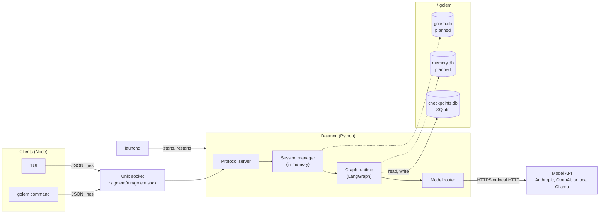
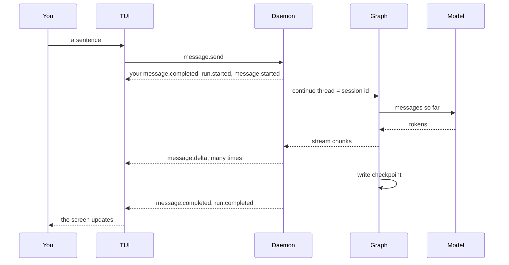
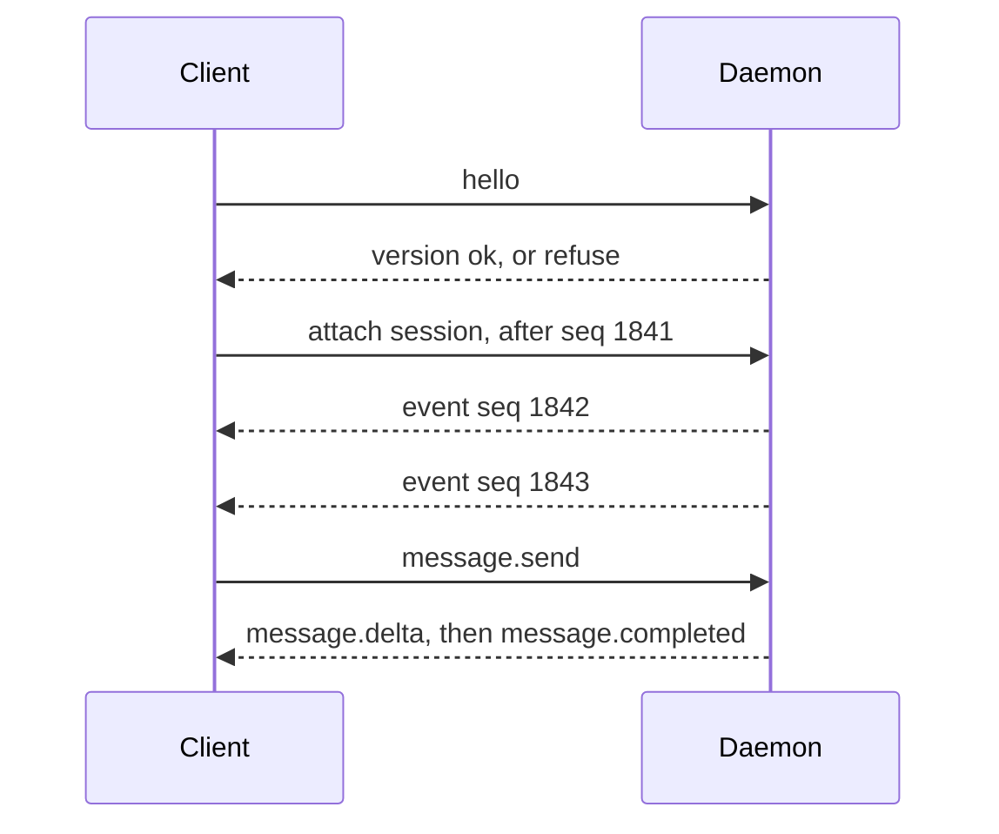

# Architecture

Golem is one long-running program, and several clients that attach to it. This file explains those pieces in plain words: the daemon, the clients, the protocol between them, and where the data lives.

The choice behind each piece is in [adr/](adr/README.md). How the Python and TypeScript trees share one repository is in [monorepo.md](monorepo.md).

## The short version

The **daemon** is the process that does the work. It keeps running after you close a terminal. Chats, tool calls, and long flows live there. The model is only ever called from the daemon.

A **client** attaches to that work. The TUI and the `golem` command are clients today. A timer or a file watch will be one later. A client connects, sends commands, and draws the events it receives. It does not hold the model's memory. How the TUI looks and which keys it takes is in [ADR-005](adr/005-client-package.md).

The **protocol** is the only language between them. The daemon is Python. The clients are TypeScript. They do not share objects. They share message shapes, written once and generated for both sides.

## Words used here

| Word | Meaning |
|---|---|
| Daemon | The one background Python process per user. It owns the files and runs the model. |
| Client | Any program that connects to the daemon's socket. It sends commands and reads events. |
| Session | One chat, or later one flow. It has an id. |
| Run | One answer inside a session: from the sentence you send until the model stops. |
| Command | A request from a client to the daemon, such as `message.send`. |
| Event | A fact the daemon reports back, such as `message.delta`. |
| Checkpoint | The model's saved memory for a session, stored after each step. |
| Graph | The agent loop. A LangGraph library call inside the daemon, not a separate service. |
| Flow | A graph whose steps our Python picks, and whose expensive steps are saved. Planned. |

## The system on one machine

Everything runs on your machine, except the model when you pick a remote provider. There are two kinds of process: one daemon, and any number of clients.

What talks to what, and how:

- **Client to daemon.** A Unix socket file. Each line is one JSON-RPC 2.0 object. No network port is opened.
- **Inside the daemon.** Ordinary Python calls in one asyncio process. A run is an asyncio task. The graph is a library the session manager calls. It is not a second process.
- **Daemon to model.** HTTPS to Anthropic or OpenAI, or plain HTTP to an OpenAI-compatible server on this machine, such as Ollama. The model router picks one from the settings.
- **Daemon to disk.** SQLite files under `~/.golem`. Today only `checkpoints.db` is written, through LangGraph's SQLite checkpointer.
- **Who starts what.** launchd starts the daemon at login and again after a crash. You start the clients.

## Built today, planned next

Built today:

- The daemon, its socket, the pid lock, and the launchd job.
- `@golem/client`, the TUI, and `golem status`.
- Chat sessions. Each one runs a single agent graph against one configured model.
- Checkpoints in `checkpoints.db`. They survive a daemon restart. [ADR-006](adr/006-checkpoint-continuity.md) is that choice.

Planned next:

- The event log in `golem.db`, and `attach`, so a client that reconnects can rebuild its screen from `seq`.
- A durable session list. Today it is in memory. After a restart, a session id still works if its checkpoint exists, but `seq` starts again at 1.
- Flows, tool permissions, skills, and long-term memory in `memory.db`.

Until the event log exists, the TUI keeps the messages it has shown, and only for as long as the TUI process runs.

## The daemon

*Like the golem of Prague, the daemon keeps working through the night while its master is away.*

One daemon per user. It starts when you log in, and launchd starts it again if it crashes. Closing the TUI does not stop it. That is the point: a chat can finish, or wait for your approval, while the TUI is closed.

Clients reach it through a Unix socket at `~/.golem/run/golem.sock`. The file mode is `0600`, so only your user can open it. That permission is the login check. There is no account and no password. `run/golem.pid` is the lock that lets a restart delete a socket left behind by a crash. [ADR-004](adr/004-pid-lock.md) is that lock.

 

### What the daemon owns

The socket is only the door. Behind it, these jobs sit in one process:

| Job | What it does | Status |
|---|---|---|
| Protocol server | Reads one JSON line at a time. Runs the command. Writes events back. | Built |
| Sessions | One chat or one flow run. Each has an id. | Built, list kept in memory |
| Graph runtime | The agent loop. Its memory is the checkpoint. | Built |
| Model router | Turns the configured profile into a chat model. | Built |
| Event log | The history. A client that reconnects reads it and rebuilds the screen. | Planned |

The graph does not own the rest of the product. It calls ordinary Python for three things that have to stay ours:

- **Which model** answers this step, and whether the budget allows it.
- **Whether a tool may run.** Every side effect, including ones from a flow or a skill, asks the same permission check. Planned.
- **Which skills** are active. A skill is a `SKILL.md` the model can be given. The registry lives in the daemon. Planned.

LangChain message objects stay inside the graph. The protocol server never sends them out. An adapter turns the graph's stream into protocol events first. [ADR-002](adr/002-langgraph-boundary.md) is that boundary.

### One turn

You type in the TUI. The daemon is the only place the model runs.

If you quit the TUI halfway through, the daemon still finishes the run and saves the checkpoint. The next message in that session continues from it.

There will be two kinds of graph, on purpose. In an **agent** session, the model picks the next step. In a **flow**, our Python picks the next step, and each expensive step is saved so a resume does not run it again.

A step that stops to ask you a question runs again from its first line when you answer. The side effect goes after that stop, or in its own step, so a resume does not do it twice.

### Files on disk

The daemon keeps its files under one home directory. `resolve_paths` picks it: a function argument, otherwise `GOLEM_HOME`, otherwise `~/.golem`.

| Path | Role | Status |
|---|---|---|
| `run/golem.sock` | The socket clients connect to | Built |
| `run/golem.pid` | The lockfile. The daemon holds a flock on it and writes its pid | Built |
| `checkpoints.db` | Model memory for a chat. The thread id is the session id. Separate so it can be wiped without deleting the event log | Built |
| `config.toml` | Settings for this user | Built |
| `logs/golem.jsonl` | The daemon's own log, one JSON object per line | Built |
| `golem.db` | Sessions, the event log, runs, costs | Planned |
| `memory.db` | Long-term memory | Planned |
| `skills/`, `flows/` | Skills and flows you added on this machine | Planned |

Settings come from three places. Each one overrides the one before it: `~/.golem/config.toml`, then `<project>/.golem/config.toml`, then `GOLEM_…` environment variables. An explicit `log_level` passed to `load_settings` wins over all three. The keys read today:

- `log_level`: `DEBUG`, `INFO`, `WARNING`, or `ERROR`. Environment: `GOLEM_LOG_LEVEL`.
- `model_profile`: default `remote`.
- `model_provider`: `anthropic`, `openai`, or `openai_compat`. Environment: `GOLEM_MODEL_PROVIDER`.
- `model_name`. Environment: `GOLEM_MODEL_NAME`.
- `model_base_url`: only for `openai_compat`. Empty means `http://127.0.0.1:11434/v1`. Environment: `GOLEM_MODEL_BASE_URL`.

API keys are never in the file. `anthropic` reads `ANTHROPIC_API_KEY`, and `openai` reads `OPENAI_API_KEY`. `openai_compat` needs no key.

Each log record is written twice: a short line on stderr, and a JSON line in `logs/golem.jsonl`.

## The protocol

*In the legend, the golem obeyed only what was written on the shem, the scroll in its chest. The daemon is the same: it acts only on messages in the agreed shape.*

The protocol exists so a client never has to understand the daemon's insides.

The graph library has its own message classes, and those classes change. If the TUI spoke those classes, every client would be tied to that library, and a reconnect would have no stable history to read. So the daemon translates. What crosses the socket is our messages only.

 

### Two directions

**Commands** go from client to daemon. They ask for something: open a session, send a sentence, approve a tool, cancel a run, list flows.

**Events** go from daemon to client. They report something that already happened: a token arrived, a tool finished, a model was chosen, a run stopped.

An event is a fact. The client builds the whole screen from the facts, in order. Once the event log exists, replay will not be a special mode. It is the same stream, read from the start or from the last number the client has. The diagram shows that planned shape. `attach` is not built yet.

`hello` is the first command. The client and the daemon compare protocol versions. A break in the shapes bumps the major number, and the daemon refuses the client. Any minor on the same major is accepted. The current numbers and what each minor added are in [ADR-003](adr/003-protocol.md).

Each event line is one JSON-RPC 2.0 notification. The fields that matter:

| Field | Meaning |
|---|---|
| `seq` | A rising number for this session. The client uses it to ask for "everything after here". |
| `session_id` | Which chat or flow |
| `run_id` | Which execution, when a session can have more than one |
| `type` | What happened, such as `message.delta` |
| `data` | The payload for that type |

`message.delta` is the live token stream. The planned copy in `golem.db` will keep `message.completed` instead, so the database does not store every fragment.

### What is on the wire today

| Commands | Events |
|---|---|
| `hello`, `ping`, `daemon.status`, `session.create`, `message.send`, `session.inspect` | `session.created`, `message.started`, `message.delta`, `message.completed`, `run.started`, `run.completed`, `run.failed` |

After `hello`, a client sends `ping` every few seconds so a half-open socket is noticed. `daemon.status` returns the pid, uptime, and configured model. A chat sends `session.create`, then `message.send`. `session.inspect` reads the saved checkpoint messages and does not call the model.

### Why a protocol package

Those shapes are written once, as Python classes in `golem_protocol`. `just gen` writes JSON Schema, then TypeScript, into `packages/protocol/gen/`. `@golem/client` imports the generated types, and the TUI and `golem status` both use that client. A hand-written TypeScript copy would drift, and the bug would show up as a wrong screen. Here `just check` fails if the generated files do not match the classes.

Adding a message is the same every time. Add a class, run `just gen`, and the client sees a typed payload.
