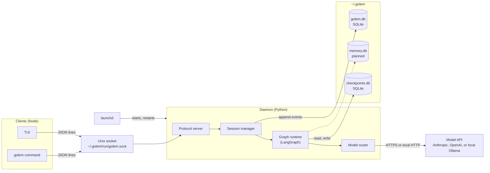
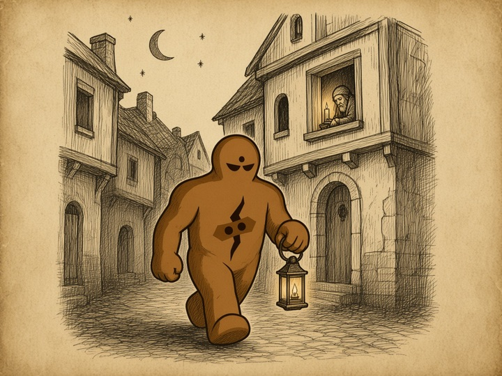
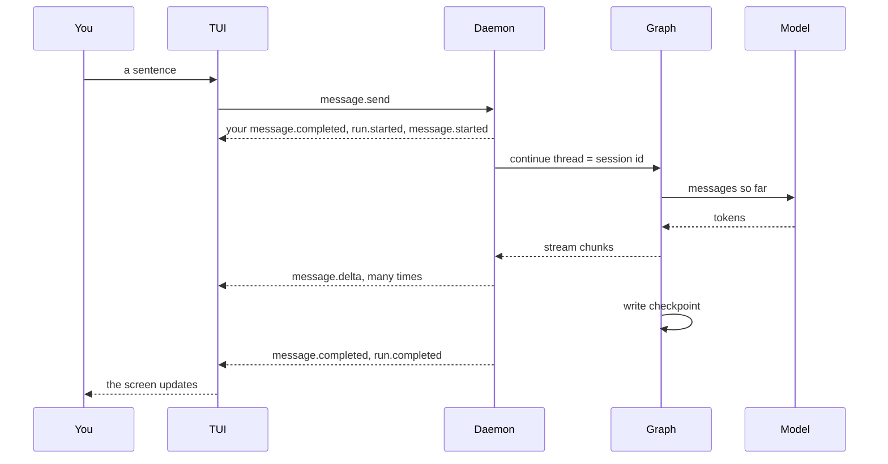
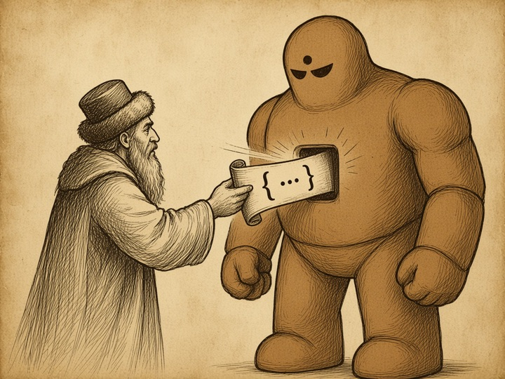
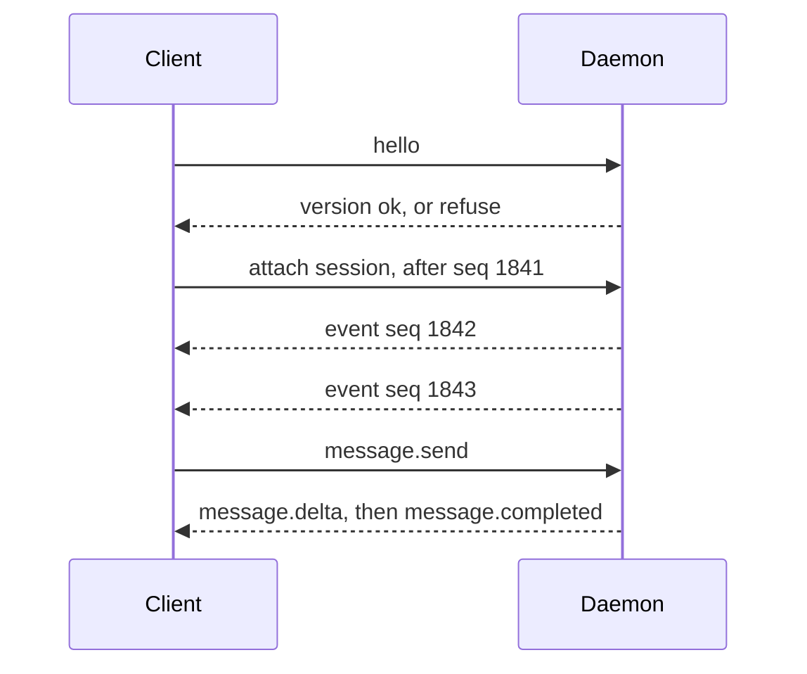
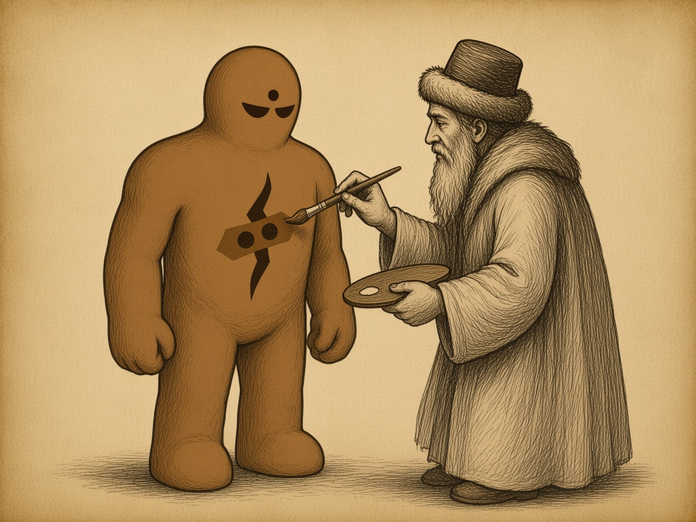
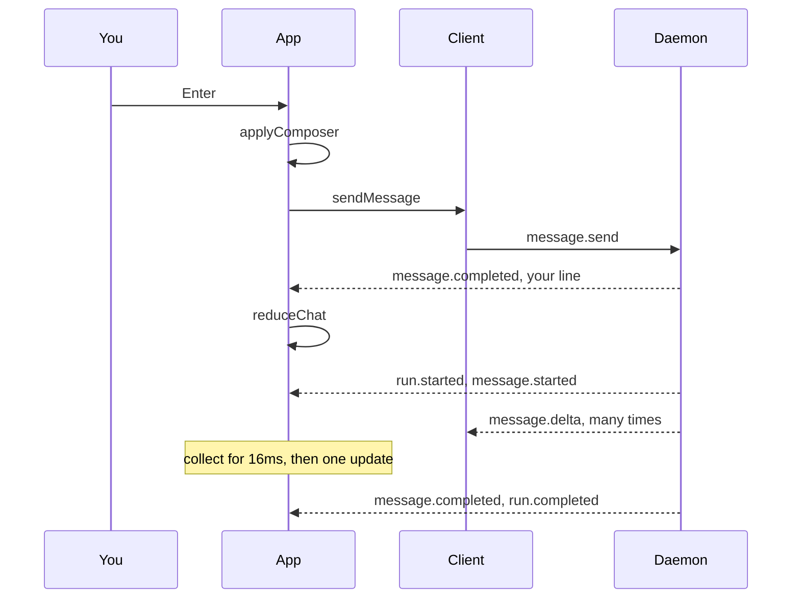
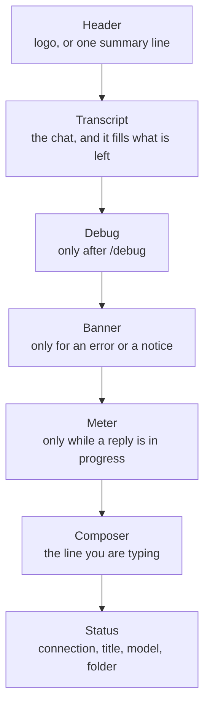
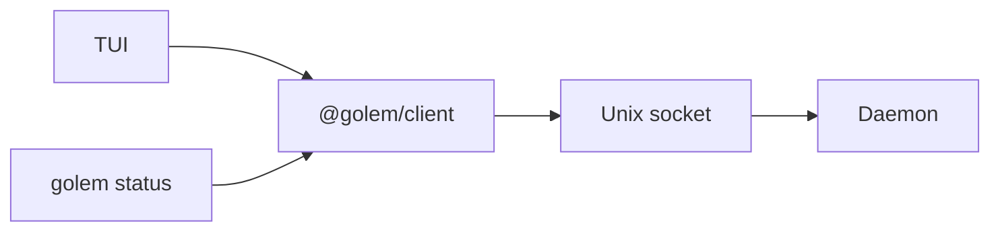

# Architecture

*First the body, set in a circle and a square. The street, the socket, and the screen are built around that figure.*

Golem is one long-running program, and several clients that attach to it. This file explains those pieces in plain words: the daemon, the clients, the protocol between them, the screen, and where the data lives.

The choice behind each piece is in [adr/](adr/README.md). How the Python and TypeScript trees share one repository is in [monorepo.md](monorepo.md).

 

## The short version

The **daemon** is the process that does the work. It keeps running after you close a terminal. Chats, tool calls, and long flows live there. The model is only ever called from the daemon.

A **client** attaches to that work. The TUI and the `golem` command are clients today. A timer or a file watch will be one later. A client connects, sends commands, and draws the events it receives. It does not hold the model's memory. The screen itself is [the last chapter](#the-tui). The choices behind it are in [ADR-005](adr/005-client-package.md).

The **protocol** is the only language between them. The daemon is Python. The clients are TypeScript. They do not share objects. They share message shapes, written once and generated for both sides.

## Words used here

| Word | Meaning |
|---|---|
| Daemon | The one background Python process per user. It owns the files and runs the model. |
| Client | Any program that connects to the daemon's socket. It sends commands and reads events. |
| Session | One chat, or later one flow. It has an id. |
| Run | One answer inside a session: from the sentence you send until the model stops. |
| Command | A request from a client to the daemon, such as `message.send`. |
| Event | A fact the daemon reports back, such as `message.delta`. |
| Checkpoint | The model's saved memory for a session, stored after each step. |
| Graph | The agent loop. A LangGraph library call inside the daemon, not a separate service. |
| Flow | A graph whose steps our Python picks, and whose expensive steps are saved. Planned. |

## The system on one machine

Everything runs on your machine, except the model when you pick a remote provider. There are two kinds of process: one daemon, and any number of clients.

What talks to what, and how:

- **Client to daemon.** A Unix socket file. Each line is one JSON-RPC 2.0 object. No network port is opened.
- **Inside the daemon.** Ordinary Python calls in one asyncio process. A run is an asyncio task. The graph is a library the session manager calls. It is not a second process.
- **Daemon to model.** HTTPS to Anthropic or OpenAI, or plain HTTP to an OpenAI-compatible server on this machine, such as Ollama. The model router picks one from the settings.
- **Daemon to disk.** SQLite files under `~/.golem`. `checkpoints.db` is written by LangGraph's SQLite checkpointer. `golem.db` is ours: the event log and the session and run tables, through one `aiosqlite` connection.
- **Who starts what.** launchd starts the daemon at login and again after a crash. You start the clients.

## Built today, planned next

Built today:

- The daemon, its socket, the pid lock, and the launchd job.
- `@golem/client`, the TUI, and `golem status`.
- Chat sessions. Each one runs a single agent graph against one configured model.
- Checkpoints in `checkpoints.db`. They survive a daemon restart. [ADR-006](adr/006-checkpoint-continuity.md) is that choice.
- The event log in `golem.db`. Every event is written there before it goes to the socket, so sessions, runs, and `seq` survive a restart. A run left open by a stopped daemon is closed at the next start.
- `session.attach`. A client gets the stored events after the last `seq` it saw, then the live ones. Any number of clients can follow one session. The TUI opens the newest session at startup. [ADR-007](adr/007-attach-and-fan-out.md) is that choice.
- `run.cancel`, and Ctrl-C in the TUI. A cancelled answer keeps what it said. [ADR-008](adr/008-cancellation.md).
- Titles, a live session list, and the TUI switcher (`/sessions`, `/new`, `/title`). [ADR-009](adr/009-session-list.md).
- `session.fork` and `/fork`. A new session with the history up to one message. [ADR-010](adr/010-fork.md).

Planned next:

- Flows, tool permissions, skills, and long-term memory in `memory.db`.

## The daemon

*Like the golem of Prague, the daemon keeps working through the night while its master is away.*

One daemon per user. It starts when you log in, and launchd starts it again if it crashes. Closing the TUI does not stop it. That is the point: a chat can finish, or wait for your approval, while the TUI is closed.

Clients reach it through a Unix socket at `~/.golem/run/golem.sock`. The file mode is `0600`, so only your user can open it. That permission is the login check. There is no account and no password. `run/golem.pid` is the lock that lets a restart delete a socket left behind by a crash. [ADR-004](adr/004-pid-lock.md) is that lock.

 

### What the daemon owns

The socket is only the door. Behind it, these jobs sit in one process:

| Job | What it does | Status |
|---|---|---|
| Protocol server | Reads one JSON line at a time. Runs the command. Queues the reply, and the events of attached sessions, for that connection. | Built |
| Sessions | One chat or one flow run. Each has an id and a row in `golem.db`. | Built |
| Graph runtime | The agent loop. Its memory is the checkpoint. | Built |
| Model router | Turns the configured profile into a chat model. | Built |
| Event log | The history. Every event, numbered by `seq`, written before it is sent. A client that reconnects will read it and rebuild the screen. | Written. Replay to clients planned |

The graph does not own the rest of the product. It calls ordinary Python for three things that have to stay ours:

- **Which model** answers this step, and whether the budget allows it.
- **Whether a tool may run.** Every side effect, including ones from a flow or a skill, asks the same permission check. Planned.
- **Which skills** are active. A skill is a `SKILL.md` the model can be given. The registry lives in the daemon. Planned.

LangChain message objects stay inside the graph. The protocol server never sends them out. An adapter turns the graph's stream into protocol events first. [ADR-002](adr/002-langgraph-boundary.md) is that boundary.

### One turn

You type in the TUI. The daemon is the only place the model runs.

Every event in that diagram is written to `golem.db` first, then sent. The checkpoint messages carry the same message ids as the events, so the two stores name the same sentence the same way.

If you quit the TUI halfway through, the daemon still finishes the run and saves the checkpoint. The next message in that session continues from it.

If you press Ctrl-C while the answer streams, the TUI sends `run.cancel`. The daemon cancels the run task. The answer gets a `message.completed` with the text streamed so far and `interrupted: true`, then `run.cancelled` with the reason `user`. The same partial text is written into the checkpoint, so "go on" continues from it ([ADR-008](adr/008-cancellation.md)). Stopping the daemon does the same for every open run, with the reason `shutdown`.

If the daemon dies halfway through, the run has no task left to finish it. At the next start the daemon closes it: the open answer gets a `message.completed` with the text streamed so far and `interrupted: true`, then `run.failed`. The same partial text is written into the checkpoint, so the model's next turn sees what the screen showed.

There will be two kinds of graph, on purpose. In an **agent** session, the model picks the next step. In a **flow**, our Python picks the next step, and each expensive step is saved so a resume does not run it again.

A step that stops to ask you a question runs again from its first line when you answer. The side effect goes after that stop, or in its own step, so a resume does not do it twice.

### Files on disk

The daemon keeps its files under one home directory. `resolve_paths` picks it: a function argument, otherwise `GOLEM_HOME`, otherwise `~/.golem`.

| Path | Role | Status |
|---|---|---|
| `run/golem.sock` | The socket clients connect to | Built |
| `run/golem.pid` | The lockfile. The daemon holds a flock on it and writes its pid | Built |
| `checkpoints.db` | Model memory for a chat. The thread id is the session id. Separate so it can be wiped without deleting the event log | Built |
| `config.toml` | Settings for this user | Built |
| `logs/golem.jsonl` | The daemon's own log, one JSON object per line | Built |
| `golem.db` | The event log, and the `sessions` and `runs` tables derived from it. Costs later | Built |
| `memory.db` | Long-term memory | Planned |
| `skills/`, `flows/` | Skills and flows you added on this machine | Planned |

In `golem.db`, `events` is the source. `sessions` and `runs` are written in the same transaction as the event they follow: `session.created` adds a session, `run.started` opens a run, and `run.completed`, `run.failed`, or `run.cancelled` closes it. `session.updated` sets the title. The schema version is SQLite's `user_version`. Each numbered migration in `golem/store/migrations.py` runs once, and a file from a newer daemon is refused.

Settings come from three places. Each one overrides the one before it: `~/.golem/config.toml`, then `<project>/.golem/config.toml`, then `GOLEM_…` environment variables. An explicit `log_level` passed to `load_settings` wins over all three. The keys read today:

- `log_level`: `DEBUG`, `INFO`, `WARNING`, or `ERROR`. Environment: `GOLEM_LOG_LEVEL`.
- `model_profile`: default `remote`.
- `model_provider`: `anthropic`, `openai`, or `openai_compat`. Environment: `GOLEM_MODEL_PROVIDER`.
- `model_name`. Environment: `GOLEM_MODEL_NAME`.
- `model_base_url`: only for `openai_compat`. Empty means `http://127.0.0.1:11434/v1`. Environment: `GOLEM_MODEL_BASE_URL`.
- `session_titles`: default `true`. Name each session after its first completed run with one model call. Environment: `GOLEM_SESSION_TITLES`.

API keys are never in the file. `anthropic` reads `ANTHROPIC_API_KEY`, and `openai` reads `OPENAI_API_KEY`. `openai_compat` needs no key.

Each log record is written twice: a short line on stderr, and a JSON line in `logs/golem.jsonl`.

## The protocol

*In the legend, the golem obeyed only what was written on the shem, the scroll in its chest. The daemon is the same: it acts only on messages in the agreed shape.*

The protocol exists so a client never has to understand the daemon's insides.

The graph library has its own message classes, and those classes change. If the TUI spoke those classes, every client would be tied to that library, and a reconnect would have no stable history to read. So the daemon translates. What crosses the socket is our messages only.

 

### Two directions

**Commands** go from client to daemon. They ask for something: open a session, send a sentence, approve a tool, cancel a run, list flows.

**Events** go from daemon to client. They report something that already happened: a token arrived, a tool finished, a model was chosen, a run stopped.

An event is a fact. The client builds the whole screen from the facts, in order. The daemon writes every fact to the event log first. Replay is not a special mode: it is the same stream, read from the start or from the last number the client has.

`hello` is the first command. The client and the daemon compare protocol versions. A break in the shapes bumps the major number, and the daemon refuses the client. Any minor on the same major is accepted. The current numbers and what each minor added are in [ADR-003](adr/003-protocol.md).

A connection gets a session's events only after `session.attach`. Several connections can attach to one session, and each gets every event. The daemon holds one lock per session while it reads the replay and subscribes the connection, so no event lands in between. Each connection has its own outbound queue, so a slow terminal does not slow a run. A client that falls 20 000 lines behind is dropped, and it attaches again from its last `seq`.

Each event line is one JSON-RPC 2.0 notification. The fields that matter:

| Field | Meaning |
|---|---|
| `seq` | A rising number for this session. It survives a restart and can skip numbers. The client uses it to ask for "everything after here". |
| `session_id` | Which chat or flow |
| `run_id` | Which execution, when a session can have more than one |
| `type` | What happened, such as `message.delta` |
| `data` | The payload for that type |

`message.delta` is the live token stream. `golem.db` keeps the deltas only while the message is open. Writing its `message.completed` deletes them in the same transaction, so the database does not keep every fragment, and a reader that comes in mid-answer can still see the text so far. That is why `seq` skips numbers.

`message.completed` has `interrupted: true` when the run stopped before the model finished. Its text is then what had streamed.

### What is on the wire today

| Commands | Events |
|---|---|
| `hello`, `ping`, `daemon.status`, `session.create`, `session.attach`, `session.detach`, `session.list`, `session.rename`, `session.fork`, `message.send`, `run.cancel`, `session.inspect` | `session.created`, `message.started`, `message.delta`, `message.completed`, `run.started`, `run.completed`, `run.failed`, `run.cancelled`, `session.updated`; `session.summary` to watchers |

After `hello`, a client sends `ping` every few seconds so a half-open socket is noticed. `daemon.status` returns the pid, uptime, and configured model. A new chat sends `session.create`, then `session.attach` with `after_seq` 0, then `message.send`. `session.list` returns sessions newest activity first, each with `idle` or `running`, its title, and its last `seq`. With `watch: true`, the connection also gets a `session.summary` after every change to any session, until it closes. `session.rename` sets a title by hand. `session.fork` copies a session's history up to one message into a new session, and the client attaches to it. `session.detach` stops one session's events. `session.inspect` reads the saved checkpoint messages and does not call the model.

### Why a protocol package

Those shapes are written once, as Python classes in `golem_protocol`. `just gen` writes JSON Schema, then TypeScript, into `packages/protocol/gen/`. `@golem/client` imports the generated types, and the TUI and `golem status` both use that client. A hand-written TypeScript copy would drift, and the bug would show up as a wrong screen. Here `just check` fails if the generated files do not match the classes.

Adding a message is the same every time. Add a class, run `just gen`, and the client sees a typed payload.

## The TUI

*The body is already standing. The brush is still laying on the mark.*

The TUI is `@golem/tui`. `main.tsx` opens one client, takes the alternate screen, and mounts `App`. The screen draws. It does not run the model, and it does not open the socket. `@golem/client` does that. `golem status` uses the same library, asks once, and exits. `golem --version` prints the CLI version, and the daemon version when the daemon is up. The TUI asks the client to reconnect.

The picture is rebuilt on every paint. `chrome.ts`, `layout-chat.ts`, and `debug-view.ts` turn memory into rows, and those rows are thrown away. What stays is the conversation, the draft, and a few facts about the link.

 

### A line, from the keys to the screen

Enter does not insert your sentence. `applyComposer` decides first. A line that starts with `/` is a local command. Anything else is text to send, and a line that starts with `//` is text too: the two slashes are stripped so a message can itself start with `/`.

`message.send` only answers that a run started. Your line appears when `message.completed` comes back, and the draft is already cleared. If the send fails, the draft returns and the banner turns red. If the code is `SESSION_NOT_FOUND` (`-32003`), the screen puts the draft back, then creates and attaches to a new session.

`/sessions` shows every session in place of the transcript: a green dot while a run is open, the title, and how long ago it was active. Up and down move, Enter attaches, `n` starts a new session, and Esc closes. `/new` starts a new session directly. `/title <name>` renames the current session, and `/title` alone shows its title. `/fork` copies this session up to its newest finished message into a new session and switches to it. The other session keeps running in the daemon. The slash commands are one table in `commands.ts`. `/help` prints that table in the transcript area. It is not sent and not stored. Any other `/word` says `unknown command — /help lists them`. Keys are one table in `keys.ts`. The input handler dispatches through it. `?` on an empty line, or F1 anywhere, opens the list, grouped by composer, transcript, switcher, and debug. Esc or `?` closes it.

`/debug` opens a panel. `/debug wire` and `/debug model` pick a tab. `/debug hold` keeps the next line on the screen and does not send it. `/debug go` sends that held line. Esc closes the panel. Tab swaps the tab.

### The screen, top to bottom

Read this from top to bottom. Each box is one horizontal band. A band that has nothing to show takes no rows. The transcript receives every row the others leave.

A window at least 20 rows tall and 42 columns wide gives the header the logo: 18 columns, 7 rows, because two pixel rows share one cell. Beside it sit the version, the model (`name · profile`), and the folder. The version is the TUI's own, taken from its package when it is built. When that matches the daemon, one number is shown. When it does not, the header shows `tui X · daemon Y` in yellow. The socket still connects: only a different protocol major is refused. A smaller window uses one line: `█ golem`, the version, the model, then the folder. No rows at all draws nothing.

The other bands ask for rows only when they are needed.

- The debug panel wants 7.
- The composer wants up to 5 for a long draft, or 1 while a reply is in progress. That one row is `…`, and typing is ignored.
- The meter wants 1 while a reply is in progress: `thinking`, then `writing · N chars · Ns`, with a small block that moves.
- An error wants 1 row in red. A notice wants 1 row in yellow.
- The status line wants 1. Left to right: the connection word, the session title (`untitled` until one arrives), the model, the folder, the message count, and how long the daemon has been up. A narrow window drops the lowest segment first: uptime, then the message count, then the folder. A long title is shortened so the session name stays. The connection word is never dropped. It is shortened only when it alone is wider than the window. The terminal tab is `golem — <title>`, and the previous title is put back on exit.

A 24×80 terminal becomes a frame 79 columns wide. One column is left unused, because a glyph in the last column would wrap and scroll the header away. With the logo, a one-line composer, and the status line, the chat has 15 rows.

If the window is short, bands give rows back until the chat still has one. In order: the debug panel shrinks toward 3 rows, the composer shrinks to one line, the meter goes away, the logo collapses to one line, the banner goes away, the debug panel goes away, the header goes away, the composer goes away, and last the status line.

Inside the transcript, messages are painted in order with a blank line between them. Each starts with a bold `you` or `golem`. Your lines sit on a clay background. While `streaming` is set, the text is wrapped as plain characters. When the answer is finished, the same text is drawn as markdown. If the laid-out lines are taller than the band, a scrollbar appears (`│`, with `█` as the thumb) and the text uses one fewer column.

Scroll is how many lines sit below the window. Zero means the newest line is on screen. Page Up, Page Down, Home, End, and the wheel move it. The wheel moves the debug panel instead while that panel is open. While the key list is open, those keys scroll the list.

The debug band keeps its first row for the title. The wire tab lists recent protocol lines and hides pings, though the title still counts them. The model tab lists the checkpoint from `session.inspect`. If the on-screen count and `message_count` differ, a yellow line says `screen N · model M`.

### What the screen keeps

`chat` is the conversation: a list of messages, plus four fields. Each message has an id, a role, the text so far, and `streaming`. `busy` is true while the model works. `error` is the red line. `notice` is the yellow line. `runStartedAt` is the timestamp the meter uses for seconds.

`reduceChat` folds one event at a time. It does not keep the events.

| Event | What the screen does |
|---|---|
| `message.completed` | Insert the message, or replace it when the id is already there. Streaming turns off. |
| `run.started` | `busy` on, error cleared, start time stored. |
| `message.started` | Append an empty assistant message, streaming on. |
| `message.delta` | Append text to that id. An unknown id changes nothing. |
| `run.completed` | `busy` off. |
| `run.failed` | `busy` off, and `error` is the daemon's message. |
| `run.cancelled` | `busy` off, and the notice says why: you cancelled it, or the daemon stopped. |

Deltas do not take that path one socket frame at a time. They wait in a small map, grouped by message id, for about 16 milliseconds, then land as one update. When the answer finishes, that map is emptied first, and `message.completed` replaces the text with the full answer. `session.created` does not change `chat`. The screen reads the model off that event on its own.

A replay is the same events, so the same table draws it. Stored deltas are already folded into their `message.completed`, so a finished answer arrives whole. An answer still in progress arrives as `message.started` and its deltas so far.

If the socket drops, `busy` stays as it was. The half-written answer stays, still marked streaming. After the reconnect the client attaches again, and the events it missed say whether the run finished. Events for any other session are ignored.

The draft is the composer text. Keystrokes add to it. Enter clears it only when the line is sent.

The link is remembered as `connection`: connecting, connected, reconnecting, closed, or rejected. The status line paints that word green, yellow, or red. The session title on that line follows `session.updated`. Until that event is replayed, the title already on the session list is used. Uptime comes from `daemon.status` and then advances on the clock. `sessionId` is this chat on the daemon. `use-session.ts` picks it: on the first connect, the newest session from `session.list`, or a new one when there is none. It is set before the attach, so the replay is drawn. Until it exists, and until the link is connected, typing does nothing. The header's model prefers the session's profile, provider, and name, and fills any hole from `daemon.status`.

`offset` is the transcript scroll. `debugOffset` is the same count inside the debug panel. `tick` increases ten times a second while `busy` is true. The screen never prints it. It exists so the meter block moves.

The debug panel remembers whether it is open, which tab is showing, whether hold is on, and the text held back from sending. `wire` is a copy of the client's last protocol lines, at most 50. `modelMessages` is a second copy of the conversation, loaded when the model tab opens, when hold turns on, and when a run finishes while the panel is open. It does not update on each token. A slow inspect is dropped when a newer one has already started.

Keystrokes and socket messages arrive in callbacks that cannot see the latest React values. The session id, the draft, the busy flag, the connection, and the debug panel are also kept in refs for those callbacks. There is still one conversation.

### The shared client

`main.tsx` calls `connectGolem` with the name `tui` and reconnect turned on. The socket is `~/.golem/run/golem.sock`, or under `GOLEM_HOME` when that is set. The first line is `hello`. After the daemon accepts the protocol version, the screen asks for `daemon.status`, watches the session list, and asks `session.list` for the newest session. It then attaches to the newest session, or runs `session.create` and attaches.

Every 5 seconds the client sends `ping` with a fresh nonce. If the matching reply does not arrive within 10 seconds, the socket is dropped. The first reconnect wait is at most 200 milliseconds. Later waits double, up to 5 seconds. A protocol major mismatch sets the state to `rejected` and stops the retries. `golem status` is the other way around: `reconnect: false`, one `daemon.status`, then `close()`.

The client remembers each attached session and the last `seq` it delivered. After a reconnect it sends `session.attach` for each one from that `seq`, before it reports `connected`. Events at or below that `seq` are dropped, because a replay can repeat them.

The client does not build the transcript. It hands each `event` line to `App`. It also keeps those last 50 lines, which the debug panel copies.
