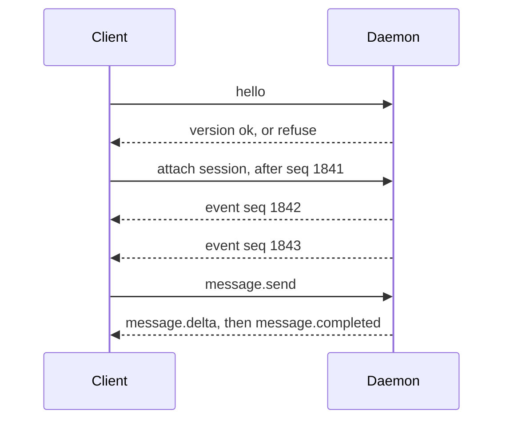
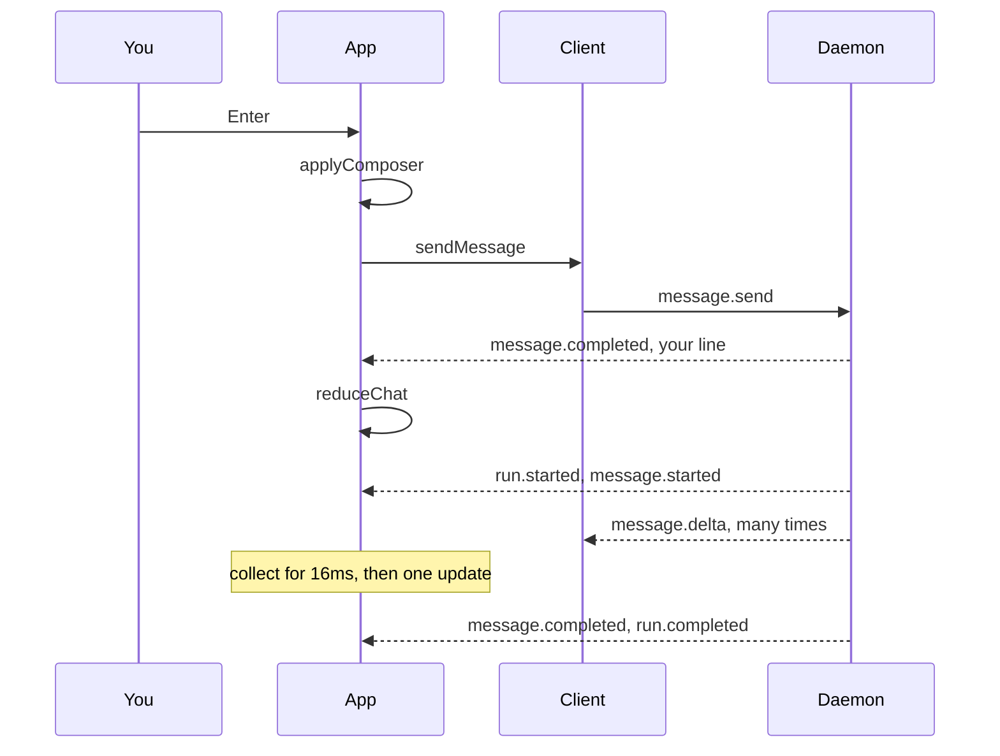
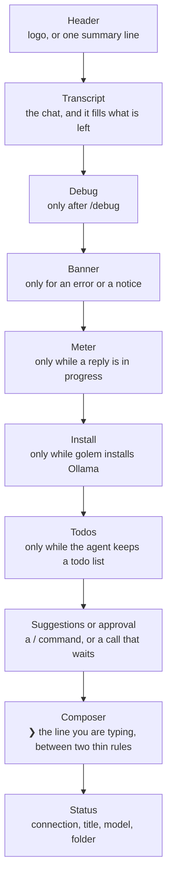
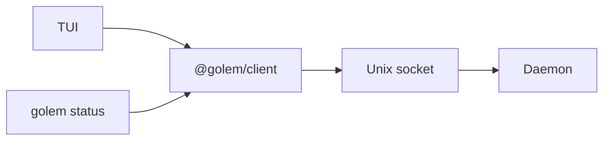

# Architecture

*First the body, set in a circle and a square. The street, the socket, and the screen are built around that figure.*

Golem is one long-running program, and several clients that attach to it. This file explains those pieces in plain words: the daemon, the clients, the protocol between them, the screen, and where the data lives.

The choice behind each piece is in [adr/](adr/README.md). How the Python and TypeScript trees share one repository is in [monorepo.md](monorepo.md).

This file is becoming the overview of "How golem works". Each part below moves to its own chapter in `docs/architecture/`: the idea in agents generally, how golem builds it, and these details. A part that has moved leaves a link here.

 

## The short version

The **daemon** is the process that does the work. It keeps running after you close a terminal. Chats, tool calls, and long flows live there. The model is only ever called from the daemon.

A **client** attaches to that work. The TUI and the `golem` command are clients today. A timer or a file watch will be one later. A client connects, sends commands, and draws the events it receives. It does not hold the model's memory. The screen itself is [the last chapter](#the-tui). The choices behind it are in [ADR-005](adr/005-client-package.md).

The **protocol** is the only language between them. The daemon is Python. The clients are TypeScript. They do not share objects. They share message shapes, written once and generated for both sides.

## The system on one machine

Everything runs on your machine, except the model when you pick a remote provider. There are two kinds of process: one daemon, and any number of clients.

<SystemMap />

What talks to what, and how:

- **Client to daemon.** A Unix socket file. Each line is one JSON-RPC 2.0 object. No network port is opened.
- **Inside the daemon.** Ordinary Python calls in one asyncio process. A run is an asyncio task. The graph is a library the session manager calls. It is not a second process.
- **Daemon to model.** HTTPS to Anthropic, OpenAI, or a hosted OpenAI-compatible API such as OpenRouter, or plain HTTP to Ollama's native API or a local OpenAI-compatible server. The model router resolves each session's model name to one of them.
- **Daemon to disk.** SQLite files under `~/.golem`. `checkpoints.db` is written by LangGraph's SQLite checkpointer. `golem.db` is ours: the event log and the session and run tables, through one `aiosqlite` connection.
- **Who starts what.** launchd starts the daemon at login and again after a crash. You start the clients. When no daemon answers and there is no launch agent, the TUI's setup window asks once whether to install it, or to run a daemon only while the terminal is open ([ADR-036](adr/036-setup-window-asks-for-the-service.md)). `golem web` asks the same in plain lines before it opens the browser ([ADR-033](adr/033-golem-offers-to-start-the-service.md)).

## The daemon

*Like the golem of Prague, the daemon keeps working through the night while its master is away.*

One daemon per user. It starts when you log in, and launchd starts it again if it crashes. Closing the TUI does not stop it. That is the point: a chat can finish, or wait for your approval, while the TUI is closed.

Clients reach it through a Unix socket at `~/.golem/run/golem.sock`. The file mode is `0600`, so only your user can open it. That permission is the login check. There is no account and no password. `run/golem.pid` is the lock that lets a restart delete a socket left behind by a crash. Every 5 s the daemon checks that the socket file is still the one it bound. If it is gone or replaced, as when `~/.golem` is deleted, the daemon stops, so launchd starts one that clients can reach. [ADR-004](adr/004-pid-lock.md) is that lock. A start that gives up on purpose (the lock is held, the socket path is too long, or `golem.db` is from a newer golem) writes the reason and the next step to `run/last-error` (`golem/server/start_error.py`). The lock case names the holder's pid and command line, which shows a checkout's path for a `uv run` daemon. While nothing answers, the TUI shows that file in its banner, and `golem status` prints it. With no such file and a launch agent installed, the banner says the service isn't answering, and `r` with an empty composer runs `golem daemon restart`.

 

### What the daemon owns

The socket is only the door. Behind it, these jobs sit in one process:

| Job | What it does | Status |
|---|---|---|
| Protocol server | Reads one JSON line at a time. Runs the command. Queues the reply, and the events of attached sessions, for that connection. | Built |
| Sessions | One chat or one flow run. Each has an id and a row in `golem.db`. | Built |
| Graph runtime | The agent loop. Its memory is the checkpoint. | Built |
| Model router | Resolves a profile name or `provider/model` ref to a chat model. | Built |
| Tools | Plain Python functions with a Pydantic argument model, in `golem/tools/`. The graph offers them to the model and runs them in its own `tools` node ([Tools](architecture/tools.md)). | Built: file reads and writes, `shell`, git, `web_fetch` |
| MCP servers | Child processes or HTTP endpoints from `[mcp.<name>]`, started in the background, watched with `ping`, and restarted with backoff. Each session's tools come from `ToolRegistry.scoped` (`golem/mcp/`, [MCP](architecture/mcp.md)). | Built |
| Permissions | Rules from the project, the user, and the defaults, checked in order before every tool call (`golem/permissions/`, [Permissions](architecture/permissions.md)). | Built |
| Skills | The `SKILL.md` folders a session's folder sees, and which one each name means (`golem/skills/`, [Skills](architecture/skills.md)). | Built: finding, listing, running by name, and pinning. The model picking one planned |
| Event log | The history. Every event, numbered by `seq`, written before it is sent. A client that reconnects will read it and rebuild the screen. | Written. Replay to clients planned |

What the graph owns, and what it calls instead, is in [The agent loop](architecture/agent-loop.md#what-the-graph-owns-and-what-it-calls).

### One turn

One turn, the graph, its messages, failures and the cap, the folder, and models without tools are in [The agent loop](architecture/agent-loop.md#the-details).

The system prompt, built for each call and never stored, is in [Context](architecture/context.md#the-system-prompt). Tool events, long output and artifacts, and todos are in [Tools](architecture/tools.md#the-details).

If you quit the TUI halfway through, the daemon still finishes the run and saves the checkpoint. The next message in that session continues from it.

If you press Ctrl-C while the answer streams, the TUI sends `run.cancel`. The daemon cancels the run task. Each tool call still open gets `tool.failed`. The answer gets a `message.completed` with the text streamed so far and `interrupted: true`, then `run.cancelled` with the reason `user`. The same partial text is written into the checkpoint, so "go on" continues from it ([ADR-008](adr/008-cancellation.md)). Stopping the daemon does the same for every open run, with the reason `shutdown`.

The shell sandbox, the git tools, and the file tools' folders are in [Sandboxes](architecture/sandboxes.md#the-details).

`write_file` and `edit_file`, `web_fetch`, and the shell's output and timeout are in [Tools](architecture/tools.md#the-details).

Approvals, from the pause to the resume, are in [Permissions](architecture/permissions.md#approvals).

A run stopped between a reply and its tool results leaves tool calls without a result in the checkpoint, and providers refuse that history. Before the next turn streams, each such call gets a result that says it was cancelled.

If the daemon dies halfway through, the run has no task left to finish it. At the next start the daemon closes it: each open tool call gets `tool.failed`, the open answer gets a `message.completed` with the text streamed so far and `interrupted: true`, then `run.failed`. The same partial text is written into the checkpoint, so the model's next turn sees what the screen showed.

A step that stops to ask you a question runs again from its first line when you answer. The side effect goes after that stop, or in its own step, so a resume does not do it twice.

### Files on disk

The daemon keeps its files under one home directory. `resolve_paths` picks it: a function argument, otherwise `GOLEM_HOME`, otherwise `~/.golem`.

| Path | Role | Status |
|---|---|---|
| `run/golem.sock` | The socket clients connect to | Built |
| `run/golem.pid` | The lockfile. The daemon holds a flock on it and writes its pid | Built |
| `run/last-error` | Why the last start failed, then the next step, on two lines. A start that listens removes it | Built |
| `checkpoints.db` | Model memory for a chat. The thread id is the session id. Separate so it can be wiped without deleting the event log | Built |
| `config.toml` | Settings for this user | Built |
| `logs/golem.jsonl` | The daemon's own log, one JSON object per line | Built |
| `cache/` | Hosted model lists (`models-<provider>.json`) and LiteLLM's prices (`litellm-prices.json`), each refreshed after a day. Safe to delete | Built |
| `golem.db` | The event log, the `sessions` and `runs` tables derived from it, and `artifacts`, the long tool output. Costs later | Built |
| `memory.db` | Long-term memory | Planned |
| `skills/` | Skills you added on this machine, one folder each | Built |
| `flows/` | Flows you added on this machine | Planned |

In `golem.db`, `events` is the source. `sessions` and `runs` are written in the same transaction as the event they follow: `session.created` adds a session with its project folder (`cwd`), `run.started` opens a run, `approval.needed` marks it `waiting` and `approval.resolved` marks it running again, and `run.completed`, `run.failed`, or `run.cancelled` closes it. An `approval.resolved` with `allow_session` adds the tool to `sessions.allowed_tools`. `session.updated` sets the title, or the folder of a session that had none. `session.closed` records `closed_at`, which hides the session from `session.list`; the events stay. `artifacts` is not derived from events: the `tools` node writes a row for each long tool output, by session. The schema version is SQLite's `user_version`. Each numbered migration in `golem/store/migrations.py` runs once, in its own transaction, with a row in `schema_version` (the schema, the golem version that applied it, and when). Before the first pending migration, `golem/store/backup.py` copies the file to `golem.db.bak-<schema>` with SQLite's backup API, under a temporary name until the copy is complete, with the original's permissions. A file from a newer daemon is refused and left as it is; the error names the golem version that `schema_version` says wrote it, and `golem.db.bak-<schema>` when this daemon's schema has a copy. `library_versions` holds the LangGraph package versions that last opened `checkpoints.db`. `golem/store/checkpoints.py` compares them at start and, when they differ, copies that file to `checkpoints.db.bak-<langgraph version>` and records the new versions before LangGraph's saver opens it.

Settings come from three places. Each one overrides the one before it: `~/.golem/config.toml`, then `<project>/.golem/config.toml`, then `GOLEM_…` environment variables. An explicit `log_level` passed to `load_settings` wins over all three. The keys read today:

- `log_level`: `DEBUG`, `INFO`, `WARNING`, or `ERROR`. Environment: `GOLEM_LOG_LEVEL`.
- `default_model`: a profile name or a `provider/model` ref. New sessions store it as their `model_profile`. Defaults to the flat settings' profile when those are set, and to none otherwise. A session made with none stores `remote` and uses the default once one is chosen. Sending with no model fails with `model_not_configured` and `no model chosen yet`.
- `[models.<name>]`: a profile with `model` (a ref) and optional `ctx`, which the `ollama` provider sends as `num_ctx`.
- `[providers.<name>]`: `kind`, `base_url`, and `api_key_env`. Built-in presets are `anthropic`, `openai`, `ollama` (native API), `openrouter`, `groq`, `together`, and `lmstudio`. A new name is `openai_compat` and needs `base_url`.
- `model_profile`, `model_provider`, `model_name`, `model_base_url`: the flat settings from before profiles. They load as one profile named `model_profile` (`remote` when unset), so stored sessions keep resolving. An empty or Ollama `model_base_url` maps to the `ollama` provider.
- `[ollama]`: `start` (default `true`) lets the daemon run `ollama serve` when a local model is needed and nothing answers. `idle_stop_minutes` (default 30, 0 never) stops a server it started after that long unused.
- `session_titles`: default `true`. Name each session after its first completed run with one model call. Environment: `GOLEM_SESSION_TITLES`.
- `[[rule]]`: a tool rule with `tool` (a glob on the tool name, default `*`), optional `match` (a glob on the tool's subject, such as a `grep` or `glob` pattern, with `|` between alternatives), optional `path` (a glob on the resolved path the call touches), and `action`: `allow`, `ask`, or `deny`.
- `trusted_projects`: folders whose `.golem/policy.toml` may allow tools.
- `[shell]`: `network` (default `false`) lets commands use the network, `writable` adds folders they may write to, and `timeout_seconds` (default 120) is the longest a command runs. Only the user's file sets these; a project file cannot.
- `[web]`: `allow_private` (default `false`) lets `web_fetch` reach loopback, private, and link-local addresses, `max_bytes` (default 5 000 000) is the most of a page it reads, and `timeout_seconds` (default 20) the longest a whole fetch takes. A redirect to another host is not followed: the model gets the new URL and asks again. Only the user's file sets these.
- `[skills]`: `disabled` (names listed but never used), `claude_dirs` (default `true`, read both `.claude/skills` folders), and `extra_dirs` (more folders of skills, after the user's own). Only the user's file sets these, and the daemon reads them again when the file changes ([ADR-025](adr/025-skill-sources.md)).
- `[mcp.<name>]`: an MCP server. A stdio one has `command`, optional `args`, `env`, and `cwd`. An HTTP one has `url` and optional `headers`. A value in `env` or `headers` may name `keychain:mcp/<name>`, and a name that looks like a secret must. `enabled` is `true` (default), `"on_demand"`, or `false`, and `timeout_seconds` (default 120) bounds one tool call. The name may use letters, digits, and `-`. The daemon reads the user's file and, for sessions in a folder in `trusted_projects`, the project's `.golem/config.toml`, again whenever they change ([ADR-023](adr/023-mcp-client.md)).

The order tool rules are checked in, and what a rule matches, are in [Permissions](architecture/permissions.md#the-details).

API keys, the Keychain, and how the router finds a key are in [Talking to models](architecture/models.md#the-router-and-keys).

Each log record is written twice: a short line on stderr, and a JSON line in `logs/golem.jsonl`.

## Skills

Skills, from finding and listing them to running one by name, are in [Skills](architecture/skills.md). Pinned skills, and the system prompt they go into, are in [Context](architecture/context.md).

## The protocol

*In the legend, the golem obeyed only what was written on the shem, the scroll in its chest. The daemon is the same: it acts only on messages in the agreed shape.*

The protocol exists so a client never has to understand the daemon's insides.

The graph library has its own message classes, and those classes change. If the TUI spoke those classes, every client would be tied to that library, and a reconnect would have no stable history to read. So the daemon translates. What crosses the socket is our messages only.

 

### Two directions

**Commands** go from client to daemon. They ask for something: open a session, send a sentence, approve a tool, cancel a run, list flows.

**Events** go from daemon to client. They report something that already happened: a token arrived, a tool finished, a model was chosen, a run stopped.

An event is a fact. The client builds the whole screen from the facts, in order. The daemon writes every fact to the event log first. Replay is not a special mode: it is the same stream, read from the start or from the last number the client has.

`hello` is the first command. The client and the daemon compare protocol versions. A break in the shapes bumps the major number, and the daemon refuses the client. Any minor on the same major is accepted. The current numbers and what each minor added are in [ADR-003](adr/003-protocol.md).

A connection gets a session's events only after `session.attach`. Several connections can attach to one session, and each gets every event. The daemon holds one lock per session while it reads the replay and subscribes the connection, so no event lands in between. Each connection has its own outbound queue, so a slow terminal does not slow a run. A client that falls 20 000 lines behind is dropped, and it attaches again from its last `seq`.

Each event line is one JSON-RPC 2.0 notification. The fields that matter:

| Field | Meaning |
|---|---|
| `seq` | A rising number for this session. It survives a restart and can skip numbers. The client uses it to ask for "everything after here". |
| `session_id` | Which chat or flow |
| `run_id` | Which execution, when a session can have more than one |
| `type` | What happened, such as `message.delta` |
| `data` | The payload for that type |

`tool.output` works the same way for a running tool call: its rows are deleted when the call's `tool.completed` or `tool.failed` is written, which keeps a short preview.

`message.delta` is the live token stream. `golem.db` keeps the deltas only while the message is open. Writing its `message.completed` deletes them in the same transaction, so the database does not keep every fragment, and a reader that comes in mid-answer can still see the text so far. That is why `seq` skips numbers.

`message.completed` has `interrupted: true` when the run stopped before the model finished. Its text is then what had streamed.

### What is on the wire today

| Commands | Events |
|---|---|
| `hello`, `ping`, `daemon.status`, `session.create`, `session.attach`, `session.detach`, `session.list`, `session.rename`, `session.fork`, `session.close`, `session.set_skills`, `message.send`, `run.cancel`, `approval.respond`, `session.inspect`, `config.get`, `policy.update`, `policy.remove`, `session.revoke`, `auth.set`, `auth.remove`, `auth.list`, `model.list`, `session.set_model`, `model.set_default`, `model.probe`, `model.pull`, `model.pull_cancel`, `model.delete`, `artifact.read`, `mcp.list`, `mcp.enable`, `mcp.disable`, `mcp.tools`, `mcp.restart`, `mcp.set_enabled`, `skill.list`, `setup.status`, `ollama.install`, `ollama.install_cancel`, `ollama.start` | `session.created`, `model.selected`, `message.started`, `message.delta`, `message.completed`, `tool.requested`, `tool.started`, `tool.output`, `tool.completed`, `tool.failed`, `approval.needed`, `approval.resolved`, `todos.updated`, `skill.activated`, `skill.deactivated`, `skill.skipped`, `run.started`, `run.completed`, `run.failed`, `run.cancelled`, `session.updated`, `session.closed`; `session.summary` to watchers; `model.pull.progress`, `model.pull.done`, `ollama.install.output`, `ollama.install.done`, `mcp.server.status`, `model.server.status`, and `skill.registry.changed` to every connection |

After `hello`, a client sends `ping` every few seconds so a half-open socket is noticed. `daemon.status` returns the pid, uptime, and configured model, and the local model servers golem has used: who runs each one, and for one golem started its pid and memory. A new chat sends `session.create` with its `cwd`, then `session.attach` with `after_seq` 0, then `message.send`. `session.list` returns sessions newest activity first, each with `idle`, `running`, or `waiting` for an approval, its title, its folder (`cwd`), and its last `seq`. With `cwd`, it lists only the sessions in that folder; `cwd` does not go with `watch`. With `watch: true`, the connection also gets a `session.summary` after every change to any session, until it closes. `session.rename` sets a title by hand. `session.fork` copies a session's history up to one message into a new session, and the client attaches to it. `session.detach` stops one session's events. `session.inspect` reads the saved checkpoint messages and does not call the model. When golem has a system prompt for the session, it comes first, with role `system`, and `message_count` leaves it out ([ADR-031](adr/031-system-prompt.md)). A reply that called tools lists each call as `→ name(args)` after its text. `auth.set` tries a model provider's API key against the provider, then stores it in the Keychain, and a key the provider refuses is not stored ([ADR-035](adr/035-daemon-installs-ollama.md)). `auth.remove` deletes it, and `auth.list` says where each provider's key is without returning it. The client shows `auth.set` in the wire view with the key replaced by `[redacted]`.

Switching a session's model, model errors, the local model server, and downloads are in [Talking to models](architecture/models.md#the-details).

The MCP methods, `mcp.list` to `mcp.server.status`, are in [MCP](architecture/mcp.md#on-the-wire).

The default model and `model.list` are in [Talking to models](architecture/models.md#the-model-list).

### Why a protocol package

Those shapes are written once, as Python classes in `golem_protocol`. `just gen` writes JSON Schema, then TypeScript, into `packages/protocol/gen/`. `@golem/client` imports the generated types, and the TUI and `golem status` both use that client. A hand-written TypeScript copy would drift, and the bug would show up as a wrong screen. Here `just check` fails if the generated files do not match the classes.

Adding a message is the same every time. Add a class, run `just gen`, and the client sees a typed payload.

## The TUI

*The body is already standing. The brush is still laying on the mark.*

The TUI is `@golem/tui`. `golem` with no arguments calls `runTui` in `main.tsx`, which opens one client, takes the alternate screen, and mounts `App`. `just dist` compiles that command with `bun build --compile` ([ADR-019](adr/019-single-binary.md)). The screen draws. It does not run the model, and it does not open the socket. `@golem/client` does that. `golem status` uses the same library, asks once, and exits. `golem --version` prints the CLI version, and the daemon version when the daemon is up. `golem doctor` runs `golem-daemon doctor`, which checks the launchd job, socket, config, models, and disk with the daemon's own code and prints them as JSON (`golem/doctor.py`). The CLI adds whether it found the daemon program and whether the running daemon has its version, then prints the checklist and the next step (`packages/cli/src/doctor.ts`). The TUI asks the client to reconnect.

The picture is rebuilt on every paint. `chrome.ts`, `layout-chat.ts`, and `debug-view.ts` turn memory into rows, and those rows are thrown away. What stays is the conversation, the draft, and a few facts about the link.

 

### A line, from the keys to the screen

Enter does not insert your sentence. `applyComposer` decides first. A line that starts with `/` is a local command. Anything else is text to send, and a line that starts with `//` is text too: the two slashes are stripped so a message can itself start with `/`.

`message.send` only answers that a run started. Your line appears when `message.completed` comes back, and the draft is already cleared. If the send fails, the draft returns and the banner turns red. If the code is `SESSION_NOT_FOUND` (`-32003`), the screen puts the draft back, then creates and attaches to a new session.

`/sessions` shows every open session in place of the transcript: a green dot while a run is open, the title, and how long ago it was active. Up and down move, Enter attaches, `n` starts a new session while the filter is empty, and typing narrows the list by title. Ctrl-D asks before closing the selected session; `y` closes it and the list stays open. Esc clears a filter, cancels that confirm, or closes the list. `/close` closes the current session and opens the newest one still open, or a new session when it was the last. A closed session leaves the list and stays out after a restart. Its events remain in the log. `/model` shows every model from `model.list` in place of the transcript, in the same way:
- **Groups:** profiles, installed, download, then one group per provider, with a green dot on the session's current model.
- **Keys:** Enter switches the session through `session.set_model`, `d` also calls `model.set_default`, typing filters by ref, label, or profile name, Ctrl-R lists again with `refresh`, and Esc clears the filter or closes the picker.
- **A model that cannot run** is dimmed, and choosing it says what to do instead.
- **Downloads:** Enter on a model to download asks once with its size and fit, or twice when it is too big, then calls `model.pull`. The row shows the live percentage from `model.pull.progress`, and the session switches to the model on `model.pull.done`. `x` asks, then stops a download or removes an installed model. `/model pull <name>` and `/model rm <name>` probe first and ask in the same way.
- **`/model <name>`** switches directly, and the suggestions under the composer are the profile names and ready refs from the last listing.
- **The setup window** (`packages/view/src/setup-window.ts`, drawn by `packages/tui/src/setup-frame.tsx`) covers the screen, with no logo, composer, or status bar, until the chat can answer. At the start it opens guided on Service when nothing answers, guided on Engine when no model is chosen, and on its own model step when the default is gone. With the only ready model it uses that one, and when everything works it shows only `welcome back · <model> · N chats in /sessions`. One navigation table says which panel follows which result, in guided mode, for one panel alone, and from the overview. Engine offers On this Mac, With an API key, and Later. On this Mac goes through the Ollama panel (`packages/view/src/setup-local.ts`): a missing Ollama is installed through `ollama.install` with brew's last line and the seconds, or the download page opens and golem waits for Ollama to appear, and a stopped one is started. The Model panel lists this Mac's catalog with the recommended model first, each size, `heavy` or `too big` for this memory, the free disk, and Show all. Enter downloads in the panel with the size, speed, and time left, and Esc leaves the download in the band. Alone, the Model panel lists every ready engine's models with the current one first, and a default that is gone at the start is named, with Download it again first. With an API key goes through the Provider panel and the Key panel (`packages/view/src/setup-key.ts`): a hidden field, where to get a key, and "Use it" first when the terminal's environment has the provider's variable, such as `ANTHROPIC_API_KEY`. The TUI passes that key to the daemon, which never reads the shell. `auth.set` checks the key before it stores it: a refused key shows the provider's reason and opens the field again, and a working one says how many models it opens. After about a second of waiting, the panel says macOS may ask whether golem may use the key, and to choose Always Allow. Then the Model panel lists that provider's models with one recommended. Add an API key on the overview, and `/login`, open Provider and Key alone, and `/login <provider>` opens Key. The key never goes through the composer. A send with no model keeps the message in the composer and opens the window on Engine. `q` asks Quit setup? once the service runs. `/setup` opens the overview from `setup.status`, with the Service row the TUI fills itself: a problem's fix comes first, `r` checks again, and Enter opens that one step and comes back. Run setup again walks the steps with today's choices, and Stop and remove it asks again. In the chat, the first thing `setup.status` finds wrong is one band line, such as `! Ollama: Ollama is not installed · /setup`. Before the first token of a local model, the band says `starting Ollama…` while the server starts, then `loading <model>…` the first time that model answers in this window.
- **Code:** `model-picker.ts`, which holds the pure state, grouping, and layout, and `model-picker.tsx`.

`/permissions` shows, in place of the transcript, the tool rules for the session's folder in the order they are checked, then what this session allows, from `config.get`. Up and Down move. `a`, `k`, and `d` set the selected rule to allow, ask, or deny (`policy.update`), and `x` deletes it (`policy.remove`) or revokes the allowance (`session.revoke`). Built-in defaults are listed dimmed and cannot be changed. `r` lists again, and Esc closes. Code: `permissions.ts`.

`/new` starts a new session directly. `/title <name>` renames the current session, and `/title` alone shows its title. `/fork` copies this session up to its newest finished message into a new session and switches to it. The other session keeps running in the daemon. `/copy` copies the last answer. `/copy code` copies the last fenced code block. Copies go through `packages/tui/src/clipboard.ts`: `pbcopy`, which says whether it worked, or OSC 52 over SSH or when `pbcopy` fails. OSC 52 asks the terminal to copy and gets no answer, so the hint then says `asked the terminal to copy N chars` instead of `copied N chars to clipboard`. `/export` writes this session as markdown, from the messages on screen, to `~/.golem/exports/<title>.md`, or to a path you give. `/time` shows or hides a dimmed time beside each label, and remembers that in `~/.golem/tui.json`. The slash commands are one table in `commands.ts`. `/help` prints that table in the transcript area. It is not sent and not stored. Any other `/word` says `unknown command — /help lists them`. Typing `/` lists those commands above the composer. The list narrows as you type, prefix matches first, then substrings. Up and Down move, Tab fills in the selected row, and Enter fills in a partial name. Esc closes the list and keeps the draft. A space after the name lists that command's argument choices. A line starting with `//` does not open the list. Keys are one table in `keys.ts`. The input handler dispatches through it. `?` on an empty line, or F1 anywhere, opens the list, grouped by composer, transcript, switcher, and debug. Esc or `?` closes it.

`/debug` opens a panel. `/debug wire` and `/debug model` pick a tab. `/debug hold` keeps the next line on the screen and does not send it. `/debug go` sends that held line. Esc closes the panel. Tab swaps the tab.

### The screen, top to bottom

Read this from top to bottom. Each box is one horizontal band. A band that has nothing to show takes no rows. The transcript receives every row the others leave.

A window at least 20 rows tall and 42 columns wide gives the header the logo: 18 columns, 7 rows, because two pixel rows share one cell. Beside it sit the version, the model (`name · profile`), and the folder. The version is one string for the CLI, the TUI, and the daemon: `0.0.0-dev` from a checkout, or the git tag stamped at `just dist`. When the TUI matches the daemon, one number is shown. When it does not, the header shows `tui X · daemon Y` in yellow, and the banner says `golem is X, its service still runs Y · ctrl-r restart`. Ctrl-R runs `golem daemon restart`, which is what a `brew upgrade` leaves to do. A reply that was streaming ends as interrupted, and the chat reattaches to the new daemon. The socket still connects: only a different protocol major is refused. A smaller window uses one line: `█ golem`, the version, the model, then the folder. No rows at all draws nothing.

The other bands ask for rows only when they are needed.

- The debug panel wants 7.
- The composer wants one row per line of the draft, up to 5, or 1 while a reply is in progress. That one row is `…`, and typing is ignored. The first line starts with `❯ `. A dim `─` rule above and below frames it, in place of a background, so it reads the same on light and dark terminals. A chat with no messages lists starter prompts under `Type a message.`, chosen from the folder by `starterPrompts` in `packages/view` (a git repo, an empty folder, or any other). Down moves into the list, and Enter puts the prompt in the composer. An empty draft shows a dim tip such as `Tip: /skills lists what golem knows how to do`, with the cursor on its first letter. The tips are `TIPS` in `packages/view`. A session keeps its tip, and each new session shows the next one: the count is in `~/.golem/tip`. The colours are named in `theme.ts`. Extra lines come out of the chat. Scroll is how many lines sit below the window, so the line you were reading stays put.
- The meter wants 1 while a reply is in progress: `thinking` (or `starting ollama` while golem starts the session model's local server, from `model.server.status`), then `writing · N chars · Ns`, with a small block that moves.
- Command suggestions want up to 6, above the composer, and only while the draft is a `/` command.
- The todo band wants one row per item of the agent's todo list: `[ ]` pending, `[~]` in progress (bold, clay), `[x]` done (dim). A finished list, a list longer than 6, or a short window shows one row instead: `todos 2/5 · <the current step>`. An empty list takes no rows, and `/todos` hides or shows the band, remembered in `tui.json`.
- The install band wants 6 while `brew install ollama` runs: the title (`Installing Ollama with Homebrew · Esc stops`) and the newest output. After it, one row says installed or stopped, a failure keeps its last lines and `/model to switch`, and with no Homebrew two rows give the ollama.com download link. Esc stops brew, then puts the band away. The picker opens it when you choose a local model and the `ollama` provider is `not_installed` (`packages/tui/src/ollama-install.ts`). The daemon runs brew and the band shows its output, so a second window sees the same install. Once brew is done, the TUI lists the models again and the picker asks to download the one you chose. A message that fails with `not_installed` turns the banner into the same question while the composer is empty: Enter installs Ollama, downloads the session's model if it is missing, and sends the message again. Esc leaves the banner as it was.
- A running tool call shows its newest output line under its line, or up to 12 lines while Ctrl-O is on.
- The approval band takes those rows instead while a run waits on a tool call: `Allow read_file notes.txt?`, the rule that asked, and the keys. A file change also shows its diff between the question and the rule, coloured by line, in up to half the screen; Up and Down scroll it a line, Page Up and Page Down a page. `a` or Enter allows once, `s` allows the same call for the session, `w` allows it always by writing a rule, `e` opens its arguments as JSON in the composer's place (Enter allows once with them, Esc goes back), and `d` or Esc denies. Ctrl-C cancels the run. The meter says `waiting for your approval`, and the switcher shows a yellow `?` for a waiting session.
- An error wants 1 row in red. A notice wants 1 row in yellow. A hint shares that row, on the right, in grey: a short message that needs no answer, gone after 4 seconds (`packages/tui/src/hint.ts`). Hints are `Ctrl-C again to exit` and `cancelling…` (2 seconds, the window for the second press), `cancelled`, `copied N chars to clipboard` and `nothing to copy yet`, `exported to <file>` (8 seconds), `timestamps on` or `off`, `todo list shown` or `hidden`, and `<model> downloaded` or `stopped downloading <model>`. When the banner and a hint do not both fit, the hint is cut first, and below 6 columns it is left out. Errors, download progress, and messages that ask for something stay on the left.
- The status line wants 1. Left to right: the connection word, the session title (`untitled` until one arrives), the model, the folder, the message count, `↓ N new lines` while you are scrolled up and more text has arrived, and how long the daemon has been up. A narrow window drops the lowest segment first: uptime, then the message count, then the folder, then that count. A long title is shortened so the session name stays. The connection word is never dropped. It is shortened only when it alone is wider than the window. The terminal tab is `<mark> <title> (golem)`, or `<mark> golem` before the session has a title, and the previous title is put back on exit. The mark is `✳` idle, a braille spinner while a run works (one frame a second, so the tab does not flicker), `!` when an approval waits, `✗` after an error, and `○` while the daemon is not connected (`packages/tui/src/window-title.ts`). golem also writes OSC `9;4` progress, which some terminals show on the tab or the dock: busy while a run works, paused while it waits for an approval, and cleared when the run ends and on exit. Terminals that do not know it, such as Terminal.app, ignore it. In iTerm2, outside tmux, golem also sets the tab status (OSC `21337`): a coloured dot and a word under the title, green `idle`, orange `working`, blue `waiting for you`, red `failed`, and grey `disconnected`. There the title has no mark, since the dot shows the state. [ADR-027](adr/027-terminal-tab-status.md) says why these sequences.

A 24×80 terminal becomes a frame 79 columns wide. One column is left unused, because a glyph in the last column would wrap and scroll the header away. With the logo, a one-line composer and its two rules, and the status line, the chat has 15 rows.

If the window is short, bands give rows back until the chat still has one. In order: the composer's rules go away, the bottom one first, then the suggestion list goes away, the approval band's diff shrinks to its three rows, the todo band collapses to one row, the install band shrinks toward one row, the debug panel shrinks toward 3 rows, the composer shrinks to one line, the meter goes away, the logo collapses to one line, the banner goes away, the debug panel goes away, the header goes away, the todo band goes away, the install band goes away, the approval band goes away, the composer goes away, and last the status line.

Inside the transcript, messages are painted in order with a blank line between them. A reply that called tools has one line per call under its text: the tool name, its string arguments, then `…` while it runs, `✓` and a summary (`12 lines`) when it finished, or `✗` and the reason when it failed. A reply that only called tools shows those lines and no text, and has no duration under it. Ctrl-O shows or hides each finished call's output, up to 12 lines, under its line, and the body of each skill you ran. Each starts with a bold `you` or `golem`. With `/time` on, a dimmed time follows the label (`14:02`, or the date when the message is from another day). A finished answer has its duration dimmed underneath (`12.4s`). Your lines sit on a clay background. While `streaming` is set, the text is wrapped as plain characters. When the answer is finished, the same text is drawn as markdown. If the laid-out lines are taller than the band, a scrollbar appears (`│`, with `█` as the thumb) and the text uses one fewer column. When the `you` row of the question you are reading has scrolled off the top, the top row of the chat shows that question pinned: `you` and its first line, cut with `…` to one row, on the clay background. The rest of the chat moves down one row. A click on the pinned row scrolls back to the question.

Scroll is how many lines sit below the window. Zero means the newest line is on screen. Page Up, Page Down, Home, End, and the wheel move it. End jumps back to the newest line. Rows that arrive while the offset is above zero are added to that offset, so the line you were reading stays put. The wheel moves the debug panel instead while that panel is open. golem turns on mouse reporting for the wheel (`?1000h`, with SGR coordinates from `?1006h`) and for drags (`?1002h`), and turns it off while an editor has the terminal and on exit (`packages/tui/src/screen.ts`). `bindPointer` sends the wheel to one listener and a left press, drag, or release, with its 0-based cell, to another. Other buttons and clicks with Shift, Alt, or Ctrl are not passed on. While mouse reporting is on, the terminal does not select on its own: in iTerm2, hold Option to drag-select the terminal's way.

Drag over the chat to select text (`packages/tui/src/selection.ts`). The selected cells turn inverse, and on release golem copies them and shows the hint `copied N chars to clipboard`. A selection is kept as rows of the whole transcript, not screen rows, so it stays on its text while the chat scrolls, and dragging above or below the chat scrolls it a row at a time. Rows that a wrap split join again with the space the wrap took out, so a wrapped paragraph copies as one line. Real line breaks and blank lines stay, and each row loses its trailing spaces, such as the padding of your own messages. The scrollbar column is not selected. A click, Esc, a new message, or a new width clears the selection. Only the chat can be selected so far; while a panel such as the picker covers it, a drag does nothing. While the key list is open, those keys scroll the list.

The debug band keeps its first row for the title. The wire tab lists recent protocol lines and hides pings, though the title still counts them. The model tab lists the checkpoint from `session.inspect`, with the system prompt first when there is one. If the on-screen count and `message_count` differ, a yellow line says `screen N · model M`.

### What the screen keeps

`chat` is the conversation: a list of messages, the waiting approval, the agent's todo list, plus four fields. Each message has an id, a role, the text so far, `streaming`, the event time, for a finished answer how long it took, and the tool calls it asked for. A tool call keeps its id, name, arguments, status (requested, running, done, or failed), and the summary, preview, or error that ended it. `busy` is true while the model works. `error` is the red line. `notice` is the yellow line. `runStartedAt` is the timestamp the meter uses for seconds.

`reduceChat` folds one event at a time. It does not keep the events.

| Event | What the screen does |
|---|---|
| `message.completed` | Insert the message, or replace it when the id is already there. Streaming turns off. The event time is kept. An assistant message records the time since `run.started`. |
| `run.started` | `busy` on, error cleared, start time stored. |
| `message.started` | Append an empty assistant message, streaming on, with the event time. |
| `message.delta` | Append text to that id. An unknown id changes nothing. |
| `run.completed` | `busy` off. |
| `run.failed` | `busy` off, and `error` is the daemon's message, then its `hint`. For `model_unreachable` it adds `/model to switch`, and the status line shows `<provider> ✗` until a run completes or the session changes model. |
| `run.cancelled` | `busy` off. A cancel you asked for shows the hint `cancelled`. A daemon that stopped leaves a notice that says so. |
| `tool.requested` | Add a tool call to the message with that `message_id`. |
| `tool.started` | That call is running. |
| `tool.output` | Append to that call's live output, keeping its newest 4000 characters. |
| `tool.completed` | That call is done, with its summary and output preview. |
| `tool.failed` | That call failed, with the reason. |
| `approval.needed` | That call waits (`?`), and the approval band opens. `busy` stays on. |
| `approval.resolved` | The band closes. An allowed call goes back to requested until `tool.started`, with the edited arguments when there are any. |
| `todos.updated` | The todo list is that list, whole. |
| `skill.activated` | Nothing yet. The transcript line for an invoked skill comes from the user `message.completed`, which carries `skill`. |

Deltas do not take that path one socket frame at a time. They wait in a small map, grouped by message id, for about 16 milliseconds, then land as one update. When the answer finishes, that map is emptied first, and `message.completed` replaces the text with the full answer. `session.created` does not change `chat`. The screen reads the model and the project folder off that event on its own. The folder in the header and the status line is the session's, or the TUI's working directory for a session without one.

A replay is the same events, so the same table draws it. Stored deltas are already folded into their `message.completed`, so a finished answer arrives whole. An answer still in progress arrives as `message.started` and its deltas so far.

If the socket drops, `busy` stays as it was. The half-written answer stays, still marked streaming. After the reconnect the client attaches again, and the events it missed say whether the run finished. Events for any other session are ignored.

The draft is the composer text and a cursor. Left and Right move by character, Alt-Left and Alt-Right by word, and Ctrl-A and Ctrl-E jump to the ends of the line. Backspace, Delete, Ctrl-W, Alt-Backspace, Ctrl-U, and Ctrl-K delete around the cursor. Shift-Enter inserts a line, and so does Alt-Enter. The composer grows by that line. Enter still sends the whole draft as one message. A paste, including its newlines, is inserted at the cursor and is not sent by those newlines. A paste of 3 or more lines, or 800 or more characters, goes in as one token instead, `[Pasted text #N +M lines]` (M is the lines after the first), or `[Pasted text #N 1,234 chars]` for one long line, numbered from 1 while the TUI runs (`packages/tui/src/paste.ts`). Backspace right after a token removes all of it. Sending swaps each token for its text, so the model, the chat, and the history get what you pasted, and Ctrl-G opens the editor with it. Only the exact token expands: one you type inside stays plain text. The secret prompt never collapses a paste. Ctrl-G opens the draft in `$EDITOR` (or `vi`), leaving the alternate screen while the editor runs. Enter clears the draft only when the line is sent. In a draft with text, Up and Down move the cursor a row, on the rows as drawn, wrapped ones included. The cursor keeps its column, or goes to the end of a shorter row, and Up then Down comes back to that column. Up on the first row goes to the start, and Down on the last row to the end (`moveRow` in `packages/tui/src/chrome.ts`). Up on an empty line recalls messages you sent, newest first: this session's lines, then older ones from `~/.golem/history` (or `GOLEM_HOME`). Down steps back. Esc restores the draft from before that. Changing a recalled line does not change the stored one. A sent line is appended to that file, which keeps the newest 1000.

The link is remembered as `connection`: connecting, connected, reconnecting, closed, or rejected. The status line paints that word green, yellow, or red. The session title on that line follows `session.updated`. Until that event is replayed, the title already on the session list is used. Uptime comes from `daemon.status` and then advances on the clock. `sessionId` is this chat on the daemon. `use-session.ts` picks it: on the first connect, the newest session from `session.list` with the TUI's working folder as `cwd`, or a new one there when that folder has none. A session's folder never changes, so attaching to one from another folder would point the file tools at the wrong place. It is set before the attach, so the replay is drawn. Until it exists, and until the link is connected, typing does nothing. The header's model prefers the session's profile, provider, and name, and fills any hole from `daemon.status`.

`offset` is the transcript scroll. `debugOffset` is the same count inside the debug panel. `tick` increases ten times a second while `busy` is true. The screen never prints it. It exists so the meter block moves.

The debug panel remembers whether it is open, which tab is showing, whether hold is on, and the text held back from sending. `wire` is a copy of the client's last protocol lines, at most 50. `modelMessages` is a second copy of the conversation, loaded when the model tab opens, when hold turns on, and when a run finishes while the panel is open. It does not update on each token. A slow inspect is dropped when a newer one has already started.

Keystrokes and socket messages arrive in callbacks that cannot see the latest React values. The session id, the draft, the busy flag, the connection, and the debug panel are also kept in refs for those callbacks. There is still one conversation.

### The shared client

The client has two entry points. `@golem/client` runs in any runtime, and takes a `dial` function that opens the link. `@golem/client/node` adds the Unix socket, and its `connectGolem` takes a `socketPath`. The TUI and the CLI use the Node entry.

`main.tsx` calls `connectGolem` with the name `tui` and reconnect turned on. The socket is `~/.golem/run/golem.sock`, or under `GOLEM_HOME` when that is set. The first line is `hello`. After the daemon accepts the protocol version, the screen asks for `daemon.status`, watches the session list, and asks `session.list` for the newest session in its working directory. It then attaches to that session, or runs `session.create` with its working directory as `cwd` and attaches. `just tui` runs from the folder `just` was started in, not `packages/tui`.

Every 5 seconds the client sends `ping` with a fresh nonce. If the matching reply does not arrive within 10 seconds, the socket is dropped. The first reconnect wait is at most 200 milliseconds. Later waits double, up to 5 seconds. A protocol major mismatch sets the state to `rejected` and stops the retries. `golem status` is the other way around: `reconnect: false`, one `daemon.status`, then `close()`.

The client remembers each attached session and the last `seq` it delivered. After a reconnect it sends `session.attach` for each one from that `seq`, before it reports `connected`. Events at or below that `seq` are dropped, because a replay can repeat them.

The client does not build the transcript. It hands each `event` line to `App`. It also keeps those last 50 lines, which the debug panel copies.
