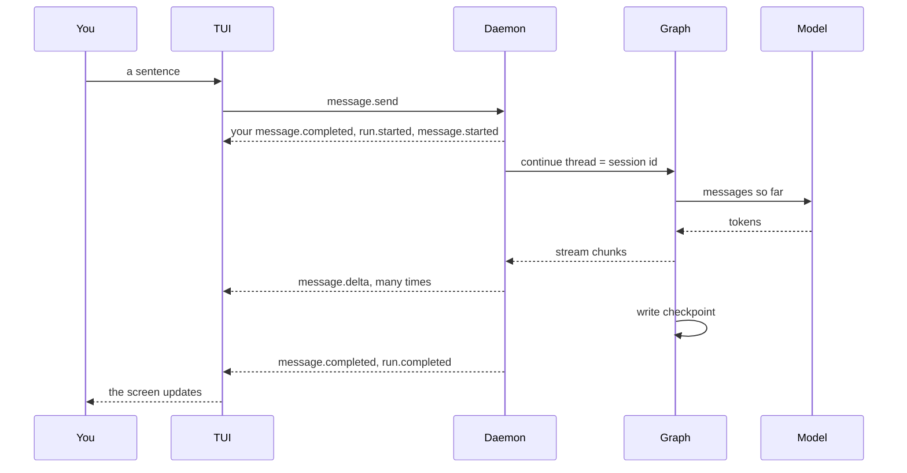

# {{ $frontmatter.title }}

A language model can only do one thing: read some text and write some more. Yet an agent reads your files, runs your tests, and fixes what failed. The trick is a small loop around the model, and almost every agent is built on one. So how does a model run a command it cannot run itself?

## The idea

::: concept In agents generally

A model on its own is a function from text to text. Ask it what is in `notes.txt` and the best it can do is guess. It has no hands.

An agent gives it hands in three steps:

1. **Describe the tools.** Next to the conversation, the program sends a list of tools the model may ask for, each with a name and the arguments it takes: `read_file(path)`, `run(command)`.
2. **Let the model ask.** The model answers in one of two ways. It writes a reply for you, or it writes a *tool call*: "call `read_file` with `notes.txt`". It still only writes text. The program reads that text as a request.
3. **Run it, and ask again.** The program runs the tool, adds the result to the conversation, and calls the model again. Now the model can see the file, so it can answer, or ask for another tool.

That repeats until the model writes a reply with no tool call. One message from you can be many model calls: read a file, run the tests, edit the code, run the tests again, then answer.

The model decides *what* to do. The program decides *whether* it runs, *how*, and *what the model sees* next. Everything else in an agent hangs off that split.


:::

## How agents usually do it

The loop is the same everywhere. What differs is who writes it, and what it does between the steps.

| Approach | How it works | Good at | Costs |
|---|---|---|---|
| A plain loop | A `while` loop around the model's API: call, run the tools it asked for, repeat | Short, easy to read and debug | Pausing, saving, and resuming are yours to build |
| A graph library | The loop is a small graph of steps, and the library saves the state after each one | A run can stop, wait for a person, survive a crash, and resume | You learn the library, and its types try to spread through your code |
| Plan, then act | The model writes a plan first, and a loop works through it | Long tasks stay on track | A wrong plan is costly to change halfway |
| Several agents | One agent hands parts of the work to others, each with its own loop | Splits a big job, and keeps each context small | Harder to follow, and every hand-off costs model calls |

The plain loop is the pattern from the ReAct paper (*reason, then act*), and the most common one. The others are mostly a plain loop with something added.

Every version has to answer the same open questions:

- **When to stop.** A model can keep asking for tools forever. Most agents cap the number of calls in one answer.
- **What to do with many calls.** A model may ask for several tools in one reply. They can run one by one or at once.
- **What the model sees.** Each call sends the whole conversation again, and it grows with every tool result. Keeping it small is the subject of a later chapter, on context.

## How golem does it

::: golem In golem

golem uses a graph library, LangGraph, for the loop itself, and keeps everything around the loop in its own code. The graph has two steps, `call_model` and `tools`, and it runs inside the daemon, the background process that owns your chats.


One message, in the order it runs:

1. **You send it.** The chat sends `message.send`. The daemon stores your message, starts a *run* (one answer, from your message until the model stops), and continues the graph's thread for this session.
2. **`call_model` calls the model.** It builds the system prompt for this call, offers the session's tools, and sends the conversation so far. The reply streams back as `message.delta` events.
3. **The graph picks the next step.** If the reply asks for tools, it goes to `tools`. If not, the run is over.
4. **`tools` runs the calls.** Each one is checked against your rules first, and may wait for your approval ([Tools and permissions](../guide/permissions.md)). Each result is added to the conversation as a *tool message*.
5. **Back to `call_model`,** with the results. This is step 2 again, as often as the model asks, up to 25 model calls in one run.
6. **The run ends** with a reply that asks for nothing. The graph saves its state as a *checkpoint*, and the daemon sends `run.completed`.

LangGraph never talks to the chat. Its stream goes through an adapter, which turns it into golem's own events. Those events are the only thing a screen ever sees.

Here is that loop as the daemon logged it, for the message `read notes` in a folder with a `notes.txt`. It was recorded with a fake model, so each reply arrives in one piece. A real model adds `message.delta` lines before each `message.completed`.

```text
seq  event               data
1    session.created     cwd /tmp/golem-golden
2    message.completed   user       "read notes"
3    run.started
4    message.started     assistant  id-4
5    message.completed   assistant  id-4  ""
6    tool.requested      read_file  {"path": "notes.txt"}
7    tool.started        call_1
8    tool.completed      call_1     1 line: the answer is 42
9    message.started     assistant  id-5
10   message.completed   assistant  id-5  "It is 42."
11   run.completed
```

Two model calls, one tool call, one answer. Lines 4 to 8 are one trip round the loop. The first reply, `id-4`, has no text: it only asks for `read_file`. Line 9 is `call_model` again, now with the file's text in the conversation.

**Where it lives in the code:**

- `packages/daemon/golem/graphs/chat.py`: `open_chat` builds the graph, `call_model` and `route` are its step and its fork, and `MAX_MODEL_CALLS` is the cap.
- `packages/daemon/golem/graphs/tools_node.py`: `tools_node`, the `tools` step.
- `packages/daemon/golem/graphs/state.py`: `AgentState`, what the checkpoint holds.
- `packages/daemon/golem/graphs/adapter.py`: turns LangGraph's stream into facts for the runner.
- `packages/daemon/golem/sessions/runner.py`: `run_turn` runs one answer and writes its events.

:::

## Why this way

**A graph library, but only for the loop** ([ADR-002](../adr/002-langgraph-boundary.md)). A plain loop would mean writing stop, save, and resume by hand, and golem needs all three: an answer must survive a closed window, a restart, and a wait for your approval. LangGraph gives those, through its checkpoints and interrupts. The cost is a library whose message types change between versions. So the line is drawn tight: LangGraph runs the graph, and golem owns the rest. Which model answers, whether a tool may run, and which skills exist are ordinary Python that the graph calls. LangChain's message objects never leave the graph. The protocol, the settings, and the rules don't depend on it, so the library could be replaced without rewriting them.

**The system prompt is built for every call, and never saved** ([ADR-031](../adr/031-system-prompt.md)). `call_model` puts it in front of the history each time and returns only the reply. A change to a pinned skill applies at the next call, and old checkpoints never hold a stale prompt.

**A cap of 25 model calls** stops a loop that never ends. It is a guard, not a budget. Budgets per answer belong to model routing, in Phase 9 of [the plan](../plan.md).

## Try it

1. Open the chat in a project folder with `golem`, and type `/debug wire`. A panel opens with every event as it arrives.
2. Ask: `What is in the README? Read it first.`
3. Watch the panel: `run.started`, a `message.completed` with empty text, then `tool.requested read_file`, `tool.started`, and `tool.completed`. That is one trip round the loop. Then a second `message.started`, the `message.delta` lines of the answer, and `run.completed`.
4. Press **Ctrl-O** to see what the tool returned, which is what the model read.
5. Type `/debug model` to see the conversation exactly as the model gets it, with the tool call and its result in it.

## The details

For contributors: the reference for the turn and the graph.

### What the graph owns, and what it calls

The graph does not own the rest of the product. It calls ordinary Python for three things that have to stay ours:

- **Which model** answers this step, and whether the budget allows it.
- **Whether a tool may run.** Every tool call asks the same permission check before it runs. Flows and skills will ask it too. File tools also refuse any path outside the session's project folder, whatever the rules say.
- **Which skills** exist and which are active. A skill is a `SKILL.md` the model can be given. The registry lives in the daemon, and the graph will only ever hold skill names ([Skills](./skills.md)).

LangChain message objects stay inside the graph. The protocol server never sends them out. An adapter turns the graph's stream into protocol events first. [ADR-002](../adr/002-langgraph-boundary.md) is that boundary.

### One turn

You type in the TUI. The daemon is the only place the model runs.



Every event in that diagram is written to `golem.db` first, then sent. The checkpoint messages carry the same message ids as the events, so the two stores name the same sentence the same way.

A turn can hold more than one model call. When the reply asks for tools, the graph runs them and calls the model again with their results, as in the graph above.

### Messages

Each model call is its own assistant message, with its own `message.started` and `message.completed`. The TUI draws the replies of one turn under a single `golem` label. The first one has the id the turn chose before the run. `call_model` gives each later one a new id and writes it to the graph's custom stream, and the runner opens that message. A reply that only calls tools completes with empty text.

### Failures and the cap

A refused path, bad arguments, or an exception in a tool becomes `tool.failed`, and the model reads the same message as the result. The run goes on. A run that reaches 25 model calls fails with `the run stopped after 25 model calls`.

### The folder

`session.create` takes `cwd`, the TUI's working directory, and the session keeps it (`sessions.cwd`, and in `session.created`). A fork keeps its source's folder. The runner passes it to the graph in `configurable`, so it is not checkpointed. Paths resolve inside it with symlinks followed. A session made before tools has no folder. The TUI sends its working directory with each `message.send`, and such a session takes it once, stored as `session.updated` with `cwd`. After that it keeps it. A session that still has none gets the tools, and each call says it has no project folder.

### Models without tools

A chat model class without `bind_tools` gets no tools. A model whose server refuses tools, such as an Ollama model without the `tools` capability, is asked again without them, and that profile is not offered tools again until the daemon restarts.

### Agents and flows

There will be two kinds of graph, on purpose. In an **agent** session, the model picks the next step. In a **flow**, our Python picks the next step, and each expensive step is saved so a resume does not run it again.

| File | What it does |
|---|---|
| `packages/daemon/golem/graphs/chat.py` | The graph: `open_chat`, `call_model`, `route`, `_ToolBinder`, `MAX_MODEL_CALLS`, and `ChatRuntime`, which streams a turn |
| `packages/daemon/golem/graphs/tools_node.py` | The `tools` step: rules, approvals, running each call, results and state updates |
| `packages/daemon/golem/graphs/state.py` | `AgentState`, the checkpointed state |
| `packages/daemon/golem/graphs/prompt.py` | `SystemPrompt`, built for each model call |
| `packages/daemon/golem/graphs/adapter.py` | LangGraph stream parts to facts |
| `packages/daemon/golem/sessions/runner.py` | `run_turn` and `resume_turn`: one run, its events, and how it ends |

## Read more

- Next: [Talking to models](./models.md), what happens inside `call_model`.
- [The overview](../architecture.md): the whole system on one page.
- [ReAct: Synergizing Reasoning and Acting in Language Models](https://arxiv.org/abs/2210.03629), the paper behind the plain loop.
- [LangGraph's docs](https://langchain-ai.github.io/langgraph/), for the graph, checkpoints, and interrupts.
