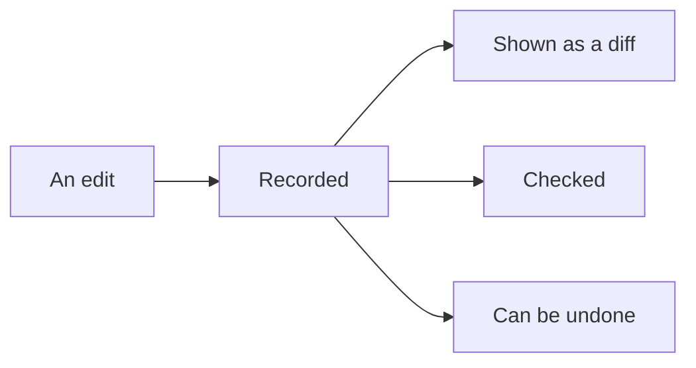
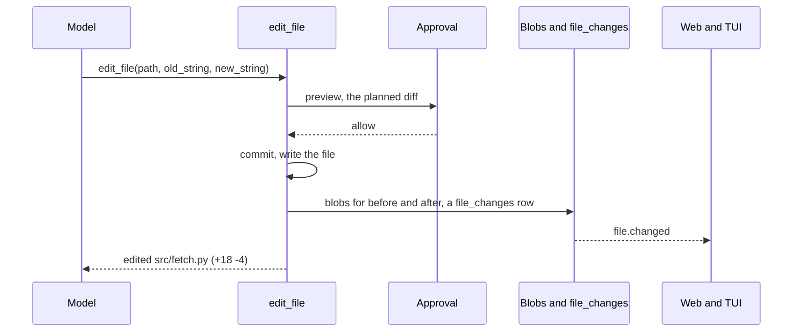
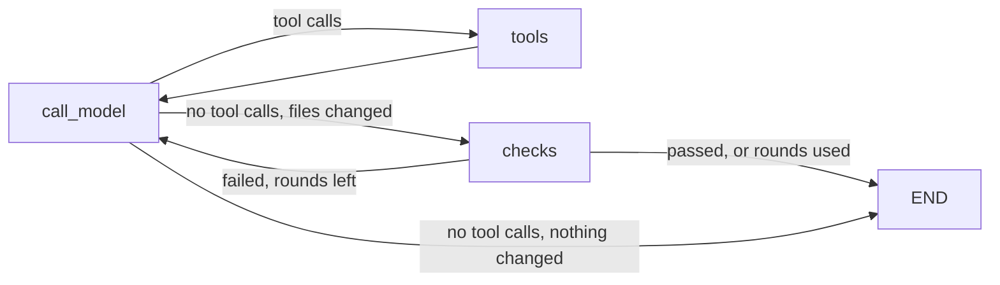

# {{ $frontmatter.title }}

> An agent that edits code does more than write files. It has to show what it changed, check its own work, and let you take a change back. Phase 16 does this in golem around one thing, the change set, and every screen is a view of it. So how does one edit get from the model to the file, the store, and the screens?

::: warning Mostly planned
Phase 16 ([#934](https://github.com/MilanPavel/golem/issues/934)) is not built yet. What exists today is `write_file` and `edit_file`, with the diff in the approval, described in [Tools](./tools.md#write-file-and-edit-file). Every other part below is marked **planned**, with its ticket. When a ticket merges, its mark goes.
:::

## The idea

::: concept In agents generally

A coding agent changes files on your behalf, often many files in one request, and often wrong on the first try. Four things make that safe:

1. **A record.** Every write keeps the text before and after, so the agent, and you, can say what changed.
2. **A view.** The changes show as diffs, as they happen and as a list at the end.
3. **A check.** The agent runs the project's own tests or linter and reads the result, so a mistake shows up before you have to find it.
4. **A way back.** Any change can be taken back, at the size you choose.

Small models need two more things. They miss an exact match by a space, so an edit must tolerate harmless differences. And a diff in every tool result fills their short context, so the model should get a short answer while the screen gets the diff.

:::

## How agents usually do it

| Approach | How it works | Good at | Costs |
|---|---|---|---|
| Git is the record | The agent edits files and you use `git diff` and `git restore` | Nothing new to learn | Needs a git repository. Cannot tell which tool call made a change. Your own edits mix in |
| A shadow repository | The agent keeps a second git repository of its own, and snapshots into it | Works with the git tools, and leaves your history alone | One more repository to keep, and still one snapshot per step, not per tool call |
| Its own snapshots | The agent stores the text before and after each write | Per call, and works with no git | The agent owns the store and its cleanup |
| Language server | The agent asks a language server for errors after an edit | Fast, and exact | One server per language to set up |
| Project commands | The agent runs the project's lint, type check, or tests | Uses what the project already trusts | Slower, and a test suite can take minutes |

Open questions in every agent: what to do when a file changed on disk under the agent, and how much of a diff the model itself needs to read.

## How golem does it

::: golem In golem

golem keeps its own snapshots in its blob store, and runs the project's commands as checks. The decisions are in the phase issue ([#934](https://github.com/MilanPavel/golem/issues/934)) and in ADR 057, the change set. **One thing in the daemon, the change set, and every screen is a view of it.**

### The change set

*Planned: [#948](https://github.com/MilanPavel/golem/issues/948) to [#952](https://github.com/MilanPavel/golem/issues/952).*

A **change** is one write to one file, a `FileChange` record:

| Field | Meaning |
|---|---|
| `change_id`, `session_id` | Its id, and the session |
| `run_id`, `call_id` | The turn and the tool call. Empty for a shell change or an undo made between runs |
| `path` | Relative to the session folder, with `/` |
| `before_sha`, `after_sha` | Blobs of the text before and after. `before_sha` is empty when the file did not exist, `after_sha` when it was deleted |
| `added`, `removed` | Line counts |
| `source` | `tool`, `shell`, or `revert` |
| `reverts` | The change an undo took back |
| `ts` | ISO time, UTC |

The records go in the table `file_changes` in `golem.db`. The texts are blobs of kind `file`, kept once under their sha256 by the blob store (`store/blobs.py`). The event `file.changed` carries the id, the call, the path, the status (`created`, `modified`, `deleted`), the counts, the source, and `reverts`. It never carries file text.

The **net change** of a file in a session is its first `before_sha` against its last `after_sha`. A file whose two ends are equal is not listed. `changes.list` returns the net files with a `stale` flag, and `changes.diff` returns a unified diff in the format of `unified_diff` in `tools/write.py`.

### Undo

*Planned: [#953](https://github.com/MilanPavel/golem/issues/953) to [#956](https://github.com/MilanPavel/golem/issues/956).*

`changes.revert` takes four kinds of target:

| Target | What it does |
|---|---|
| `change` | Writes back the text before that change. On an undo's own change this is a redo |
| `file` | Writes back the text the file had before its first change in the session |
| `hunk` | Takes back one hunk of the file's net diff, by index |
| `run` | Rewinds to before that turn: every file changed in it **or a later turn** goes back |

- **An undo is a change.** It writes the old text and records a change with `source: "revert"`, so it shows in the list and can be undone. Nothing is lost.
- **`stale`.** A file is stale when what is on disk is no longer what golem last wrote. That is a conflict: without `force`, nothing is written for it and the result lists it.
- **Why a turn undo rewinds.** Taking back a middle turn alone could leave a file that no turn ever wrote, because a later turn built on it. So undoing a turn also takes back the turns after it.
- A revert while a run is active is refused. The chat is kept, and the model reads a short note on its next turn saying which files were put back.

### Edits that land

*Planned: [#957](https://github.com/MilanPavel/golem/issues/957) to [#962](https://github.com/MilanPavel/golem/issues/962). Today `edit_file` needs an exact match.*

A small model often gets `old_string` right in substance and wrong by a space. `edit_file` will try three rungs in order, and stop at the first that matches:

| Rung | What it ignores | Example |
|---|---|---|
| 1. Exact | Nothing | `return x` matches `return x` |
| 2. Trailing spaces | Spaces and tabs at the end of a line | `return x` matches `return x   ` |
| 3. Base indentation | The indent shared by all the lines | The model sends `if a:\n    b()` at column 0, and the file has it inside a function at column 4. The new text is indented the same way |

- **More than one match on a rung is an error,** never a guess. The model is told, and adds context.
- **On a miss,** the error says which lines of the file come closest, so the model can copy them.
- **What the model gets back is one line,** `edited src/fetch.py (+18 -4)`. The screen gets the diff from `tool.completed` and `file.changed`. Today the model reads the whole diff, so every edit is paid twice in its context.
- **Progress.** While the model is still writing a `write_file` or `edit_file` call, `tool.writing` says which file and how many lines so far, at most once a second per call, so a slow write never looks like a hang. It is a live signal like `message.delta`: `golem.db` deletes it when the message completes. A provider that sends the whole call at the end sends no `tool.writing`.

### Checks

*Planned: [#972](https://github.com/MilanPavel/golem/issues/972) to [#975](https://github.com/MilanPavel/golem/issues/975).*

- **Where the commands come from.** `[coding] check` entries in config, or what golem finds in the folder: a `check` recipe in a `justfile`, `lint` and `typecheck` scripts in `package.json`, ruff in `pyproject.toml`, `cargo check`, `go vet`. Tests run only when configured, because a suite can take minutes.
- **When.** After the model's last reply of a turn, if a file tool or the shell changed something in that turn. They run in the shell sandbox, with no network.
- **Consent.** `[coding] checks` is `ask`, `auto`, or `off`. The default, `ask`, asks once per session. In autopilot mode `ask` acts like `auto`.
- **The feedback loop.** A failed check goes back to the model as a message and the run continues, at most `fix_rounds` times per turn (default 2). `check.started` and `check.completed` are run-scoped events.

### Plan first

*Planned: [#979](https://github.com/MilanPavel/golem/issues/979) and [#980](https://github.com/MilanPavel/golem/issues/980).*

- **The flag.** `plan_first` is a session flag set with `session.set_plan`. It is not a fourth permission mode, and combines with any of them.
- **The tool filter.** While it is on, the model sees only the read-only and internal tools, plus `propose_plan`. A call to any other tool is refused.
- **`propose_plan`.** Takes `{title, steps: [{text, files}]}` and sends `plan.proposed`. "Build it" turns the flag off and sends `Build it. Follow the plan step by step and keep the todo list current.`

### Screens

Every screen reads the same events and calls. The facts come from steps [#939](https://github.com/MilanPavel/golem/issues/939) and [#940](https://github.com/MilanPavel/golem/issues/940). `packages/view/src/changes.ts` ([#951](https://github.com/MilanPavel/golem/issues/951), planned) folds `file.changed` into the changes of each turn for both.

| What | Web | Terminal |
|---|---|---|
| The diff of an edit | Today: in the approval. Planned: a card in the chat with the path and `+18 −4` that opens the file in Changes ([#965](https://github.com/MilanPavel/golem/issues/965)) | Today: in the approval band. Planned: a short diff under each edit ([#969](https://github.com/MilanPavel/golem/issues/969)) |
| The list of changes | A right panel with tabs **Changes**, **Files**, **Checks**, **Todos**. A tab appears when its ticket ships ([#963](https://github.com/MilanPavel/golem/issues/963)). Changes switches between by file and by turn ([#964](https://github.com/MilanPavel/golem/issues/964), [#968](https://github.com/MilanPavel/golem/issues/968)) | `/changes`, a full-screen review file by file and hunk by hunk, built like `/mcp` and `/skills` ([#971](https://github.com/MilanPavel/golem/issues/971)) |
| A sum of the turn | The by-turn view | `3 files +43 −4 · /changes · /undo` at the end of a turn ([#970](https://github.com/MilanPavel/golem/issues/970)) |
| Any file of the project | The Files tab, through `file.read` ([#966](https://github.com/MilanPavel/golem/issues/966), [#967](https://github.com/MilanPavel/golem/issues/967)) | None planned in this phase |
| Undo | Buttons in Changes ([#954](https://github.com/MilanPavel/golem/issues/954)) | `/undo` and keys in `/changes` ([#955](https://github.com/MilanPavel/golem/issues/955)) |
| Checks | The Checks tab and a strip under the turn ([#975](https://github.com/MilanPavel/golem/issues/975)) | A line under the turn ([#975](https://github.com/MilanPavel/golem/issues/975)) |
| Plan first | A switch beside the mode chip and a plan card ([#980](https://github.com/MilanPavel/golem/issues/980)) | `/plan` |

Today the web has a 20 rem drawer with the todos and the trace inspector, and the TUI has the approval band's diff. The panel replaces the drawer.

**Where it lives in the code** (today):

- `packages/daemon/golem/tools/write.py`: `plan_write`, `plan_edit`, `commit`, `unified_diff`.
- `packages/daemon/golem/store/blobs.py`: `BlobStore`.
- `packages/web/src/features/diff/` and `packages/tui/src/diff-view.ts`: the diff drawn in the approval.
- `packages/view/src/diff.ts`: the diff logic both clients share.

:::

## Why this way

**Own snapshots, not a shadow git repository** (ADR 057, the change set). The text before and after each write goes to golem's blob store. It works in a folder with no git, never writes into your `.git`, and records per tool call, which git cannot. The cost: golem owns the store, and a file with a secret that golem edited stays in `golem.db` until the session is deleted.

**Commands first, a language server later.** The project already trusts its own lint and type check, and they need no extra server. A language server may come later.

**Plan first is a switch, not a mode.** It combines with careful, balanced, and autopilot, and a mode only says what runs without asking.

**One line for the model, the diff for the screen.** The context is small on a local model, and the model has no use for a diff it just wrote.

## Try it

*Planned. Phase 16 is not built, so there is nothing to try yet. When it ships, this section will walk through an edit, its card, a check, and an undo.*

For now, to see what exists: ask golem to change a file and read the diff in the approval, as in [Tools](./tools.md#write-file-and-edit-file).

## The details

The contracts of each part are in the step issues: [#936](https://github.com/MilanPavel/golem/issues/936) the change set, [#937](https://github.com/MilanPavel/golem/issues/937) undo, [#938](https://github.com/MilanPavel/golem/issues/938) edits that land, [#941](https://github.com/MilanPavel/golem/issues/941) checks, and [#943](https://github.com/MilanPavel/golem/issues/943) plan first. This page repeats them in short. Until a ticket ships, its contract is the reference, and the code is the truth for what runs today.

### What is recorded

Every write by `write_file` and `edit_file`; changes a shell command made, as far as golem can see them ([#952](https://github.com/MilanPavel/golem/issues/952), planned); and every undo. Not recorded: binary files, files that are not UTF-8, files over the read limit, and anything outside the session folder. A forked session starts with an empty change set.

### The calls and the event

| Name | Kind | Planned in |
|---|---|---|
| `file.changed` | Event | [#949](https://github.com/MilanPavel/golem/issues/949) |
| `changes.list {session_id}` | Call | [#950](https://github.com/MilanPavel/golem/issues/950) |
| `changes.diff {session_id, path or change_id}` | Call | [#950](https://github.com/MilanPavel/golem/issues/950) |
| `changes.commit {session_id, paths, message}` | Call | [#981](https://github.com/MilanPavel/golem/issues/981) |
| `changes.commit_info {session_id}` | Call | [#981](https://github.com/MilanPavel/golem/issues/981) |
| `changes.suggest_message {session_id, paths}` | Call | [#981](https://github.com/MilanPavel/golem/issues/981) |
| `changes.revert {session_id, target, force}` | Call | [#953](https://github.com/MilanPavel/golem/issues/953) |
| `file.read` | Call | [#966](https://github.com/MilanPavel/golem/issues/966) |
| `session.set_plan` | Call | [#979](https://github.com/MilanPavel/golem/issues/979) |
| `plan.proposed` | Event | [#979](https://github.com/MilanPavel/golem/issues/979) |
| `check.started`, `check.completed` | Events | [#973](https://github.com/MilanPavel/golem/issues/973) |

### Files

| File | What it does |
|---|---|
| `packages/daemon/golem/tools/write.py` | The two write tools: plan, preview, apply, commit |
| `packages/daemon/golem/store/blobs.py` | The blob store, one text under its sha256 |
| `packages/view/src/diff.ts` | The diff logic both clients use |
| `packages/web/src/features/diff/` | The unified and split diff in the web |
| `packages/tui/src/diff-view.ts` | The diff in the terminal |

## Read more

- Before: [Tracing](./tracing.md).
- [Tools](./tools.md#write-file-and-edit-file): the write tools as they are today.
- [Permissions](./permissions.md): the modes that plan first combines with.
- [The overview](../architecture.md): the whole system on one page.
