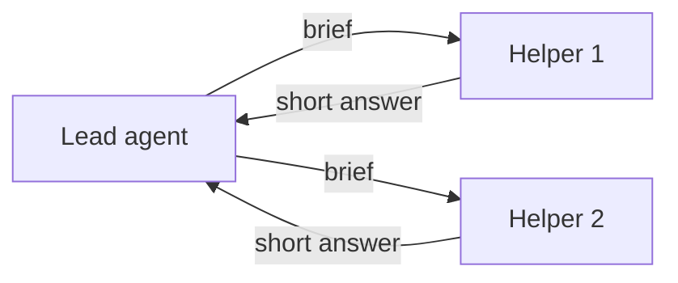
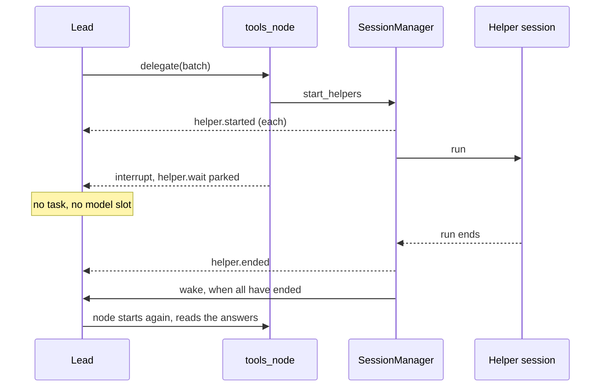

# {{ $frontmatter.title }}

One agent doing everything fills its window, works on one thing at a time and uses one model for every job. A second agent can take a job off it. But a second agent costs time and money, and it can go wrong in new ways. So when is a helper worth starting, and what does the first agent need to know about it?

## The idea

::: concept In agents generally

A **helper** (also called a sub-agent) is an agent that a lead agent starts for one job. It gets a brief, works in its own context and returns an answer. The lead's context holds the brief and a short answer, not the helper's work.

There are three honest reasons to start one:

1. **The reading does not fit.** A big search would fill the lead's window and crowd out the task.
2. **Independent jobs can run at once.** Several changes that do not depend on each other.
3. **Another model fits the job.** A hard question for a stronger model, or a large read for a cheaper one.

Every other use is a habit, and a habit costs. A chain of steps with a fixed order is not a reason. It is a plan, and the lead can follow it.

Four things make helpers safe to use:

- **A helper has less power than its lead.** Never more tools, folders or rights.
- **A helper is bounded.** Model calls, time, cost and tokens each have a limit.
- **Waiting costs nothing.** A lead that waits for its helpers holds no model and no slot.
- **What changes files is kept apart.** A helper that edits works in a copy, and a person or the lead decides whether the diff goes in.



:::

## How agents usually do it

| Approach | How it works | Good at | Costs |
|---|---|---|---|
| A tool call that runs a sub-run | The helper runs inside the lead's tool call, as a function, and returns text | Simple. No new state | It cannot ask you anything, it does not survive a restart, and nothing lists it |
| A separate process or a separate chat | The lead starts another agent as a program and reads its output | Strong isolation | The two do not share cost, privacy or permissions unless you build that |
| A fixed graph of agents | The roles and their order are drawn in advance | Predictable | The lead is not free to decide, and every job pays for every role |
| A queue of tasks | Workers take jobs from a list | Many jobs at once | The lead learns of an answer late, and a failed job needs its own handling |

Common open problems: a lead that delegates when it should not, helpers that fight over the same files, one provider rate-limiting a team of helpers, and a helper's answer used as if it were an instruction.

## How golem does it

::: golem In golem

golem makes a helper a **session with a parent** ([ADR-059](../adr/059-helpers-are-child-sessions.md)). It is a normal headless session, the same kind a routine or a workflow step uses: its own event log, checkpoint thread, runs and pending items. That gives it, with no second mechanism, a question to you, a restart that resumes it, and a chat you can open. It is hidden from the session list and shown as a card in its lead's chat.

The lead **decides** to start helpers. golem tells the lead the three reasons and the agent types it may use, and nudges it twice: when its window is past `fill_share`, and when it is stuck. The thresholds are shares of the window and a price ratio, not token counts, so one setting fits a small local window and a large cloud one.

The `delegate` tool takes one helper or a batch. It does not run anything itself. The tools node starts the helpers through the session manager and **parks** the lead:



The agent types are Markdown files (`explorer`, `reviewer`, `advisor`, `worker`, and yours). A file asks for a **wish** (`cheapest`, `same`, `stronger`, a tier or a model), and a pure function turns it into a model from what you have, so the same file works with local models only, cloud models only or both. The helper session is pinned to that model, and `model.routed` in its log says why.

A **worker** changes files in a git copy of your folder. When it ends, golem takes its diff, runs the project's checks in the copy and tells the lead. You (or the lead) apply, retry or discard the diff.

Where it lives in the code:

- `packages/daemon/golem/sessions/manager.py`: starting, queueing, waiting, ending, applying and cleaning up helpers
- `packages/daemon/golem/graphs/tools_node.py`: the decision pass for `delegate`, the park and the wake
- `packages/view/src/worker-changes.ts`: what the Changes tab and `/changes` show for a worker

:::

## Why this way

A helper is a session so that it gets every property a session has: it can ask you a question, a restart resumes it, and cost and trace follow the same paths as for any chat. The price is more moving parts (a migration, a handful of events, a parked state and a reconcile pass), and the lead's log shows only a thin summary of each helper, with the detail one hop away.

The lead parks so that a helper that waits for you, or for an hour, holds nothing. The cost is the rule that the tools node runs in two passes: the first decides and starts, the second builds the result, and nothing runs before the last answer is in.

The numbers that say when a helper pays off are a first guess. [Measure](../guide/measure.md) plays the same asks with helpers off and on, on your own Mac.

- [ADR-059: A helper is a headless session with a parent](../adr/059-helpers-are-child-sessions.md): the design
- [ADR-060: The dispatcher and the engine profile](../adr/060-dispatcher-and-engine-profile.md): slots, lines and the seven wait reasons
- [ADR-058: Child runs](../adr/058-child-runs.md): what it replaced

## Try it

1. Start the terminal chat in a git project: `golem tui`.
2. Type `/agents` and read the four agents. `Esc` goes back.
3. Ask: "Use two helpers: one to list every place a setting is read, and one to list every test of it." You should see a card with two helpers, each with a model and its steps, and the lead waiting.
4. Open the chat of one helper. It is read-only.
5. Ask for a change that touches two unrelated files, and say a worker should make each. Type `/changes`. The workers are above the files: `v` shows the diff, `a` applies it, `x` discards it.

## The details

### Files and modules

| File | What it does |
|---|---|
| `packages/daemon/golem/sessions/manager.py` | The helper parts of `SessionManager`: `start_helper` and `start_helpers`, the queue (`_queued`, `_turn_free`, `_start_queued`), the budget hold, `_relay_step` and `_relay_wait`, `_helper_ended`, `helper_results`, `apply_helper`, `discard_helper`, `retry_helper`, `cancel_helpers`, `resume_helper`, `reconcile_helpers`, `_remove_copies_of`, and the answers to a batch (`answer_consent`, the scope `batch` of an approval) |
| `packages/daemon/golem/sessions/helpers.py` | What the manager decides at a start, with no I/O of its own: the agent snapshot, the helper's scope, allowances cut to its tools, its permission mode, `unavailable_reason`, `summarize_run`, `stop_reason`, `parked_calls`, and the lines of the paid question (`what_is_sent`) |
| `packages/daemon/golem/sessions/helper_estimate.py` | `estimate_batch`: the dollars a batch on paid models would cost from the briefs, limits and prices, and the `EstimateCard` |
| `packages/daemon/golem/sessions/helper_limits.py` | The limits checked between a helper's model calls: calls, time, cost, tokens, in that order |
| `packages/daemon/golem/sessions/helper_clock.py` | A helper's working time, rebuilt from its events, less the waits for you, a slot, a model load and a provider |
| `packages/daemon/golem/sessions/trim.py` | `HelperTrimmer`: removes the steps of a finished helper after `keep_days` |
| `packages/daemon/golem/sessions/recovery.py` | `recover_runs` at startup, which calls `reconcile_helpers`, and `sweep_copies` |
| `packages/daemon/golem/tools/delegate.py` | The `delegate` tool: its schema (`brief`, `agent`, `batch`, `model`, `label`), its description, and `results_text`. It never runs a helper |
| `packages/daemon/golem/graphs/tools_node.py` | Pass 1 for `delegate`: the refusal checks, the estimate, the `use_helpers` question, starting the helpers, the interrupt. Pass 2 builds the result from the helpers' logs |
| `packages/daemon/golem/graphs/delegate_prompt.py` | The prompt section that says when to delegate and lists the agents. It asks the policy, so no threshold is repeated |
| `packages/daemon/golem/graphs/delegate_policy.py` | `should_delegate`: the three reasons as a pure function of the window, what is used, the job, the prices and the four numbers |
| `packages/daemon/golem/graphs/chat.py` | The fill nudge (`FILL_NUDGE`), the struggle nudge, and the wrap-up at `[chat] max_model_calls` |
| `packages/daemon/golem/graphs/struggle.py` | The signals that mean the lead is stuck |
| `packages/daemon/golem/coding/copies.py` | `create`, `remove`, `prune`, `list_copies` and `diff_since_baseline`: the git worktree of a worker |
| `packages/daemon/golem/coding/worker_result.py` | `files_of` and `run_checks`: what a worker returns |
| `packages/daemon/golem/coding/apply_worker.py` | `plan` and `write`: take the diff into your folder, and name a conflict |
| `packages/daemon/golem/agents/` | `parse.py` reads one agent file and lists its problems. `registry.py` builds the list a folder sees. `limits.py` resolves the limits. `edit.py` changes a wish or a limit in a file. `bundled/` holds the four files |
| `packages/daemon/golem/models/pick_helper.py` | `pick_helper`: a wish becomes a model, and it never fails on an empty tier |
| `packages/daemon/golem/models/dispatcher.py` | The slots. A helper's call is a `Call` of the role `helper` |
| `packages/daemon/golem/config.py` | `AgentSettings`, `DelegateSettings` and the per-agent tables |
| `packages/protocol/golem_protocol/events.py`, `commands.py` | The `helper.*` events and commands |

### Starting a helper

`tools_node` decides every call of a reply before it runs any. For a permitted `delegate` call it checks the batch limit, asks for the estimate card, and, with `use_helpers = "ask"` or an estimate over `estimate_over`, parks the lead on a question (below). Then it calls `SessionManager.start_helpers`, which for each helper:

1. Resolves the agent file as it is now, and keeps it as a **snapshot**. A helper keeps the agent it started with, so editing a file does not change a parked helper.
2. Picks the model from the wish (`pick_helper`), under the privacy and paid rules. A lead may name one helper's model with `model`. A name that is unknown or refused never fails the call: the pick says why in `pick_reason`.
3. Creates the session with `session.created` carrying `parent` (`session_id`, `call_id`, `index`) and `agent` (the snapshot), the origin `agent:<type>`, and the brief as its first user message. A unique index on `(parent_session_id, parent_call_id, helper_index)` makes a start idempotent.
4. For a worker, makes the copy and stores its path and baseline on the row.
5. Stores `helper.started` in the lead's log, and starts the run outside the lead's task. If `at_once` helpers already run, it stores `helper.state` `queued` with the reason `team` instead, and the helper starts when a turn frees. A helper on a paid model that a spent `[budget]` cap holds is stored as `waiting` with the reason `budget`.

A helper's own tool scope never has `delegate`, and the daemon refuses to start a helper for a session that has a parent. Depth is 1.

### Waiting, waking and the answer

The lead's run ends with an interrupt and `helper.wait` `parked`. The projection marks it `waiting` with `wait_reason = team`. Its summary says `running`, not `waiting`, because nothing is asked of you.

When a helper's run ends the manager stores `helper.ended` in the lead's log. When the last helper of a call has ended, it stores `helper.wait` `resumed` and wakes the lead. The tools node starts again from the top. Pass 1 finds each helper already there and ended, so it does not start or park again. Pass 2 builds the result from the helpers' logs: one section per helper in the order of the call, each starting `<agent> finished: <reason>` when it did not end `done`. An answer longer than the agent's `max-answer-chars` is stored as an artifact of the helper's session, and the result names its id. The lead reads it with `read_artifact`, which follows `root_session_id`.

A batch result for a worker adds the files, the lines, and the checks. It tells the lead the diff is waiting, not applied.

### Asking you

A helper's approval and its paid question are ordinary pending items of its own session. They are listed in the lead's `SessionSummary.pending_items`, each with a `helper` field, and `count` for the same question from several helpers. `SessionSummary.pending` is unchanged and is the oldest item, so an older client still works.

Three more `PendingItem` shapes belong to helpers:

- `kind: "batch"` is the question before helpers start. Without `estimate_usd` it is "Ask me first": `call_id`, `helper_count` and `agents`. With `estimate_usd` it is the estimate card, and also carries `allowed_usd`, `ask_over_usd`, `model` and `cheaper_model`. The log has `approval.needed` with the tool `delegate` and the source `use_helpers`. `helpers.respond` answers it.
- A helper's `consent` item carries `sent`, `not_sent`, `brief` and `diff_artifact_id`, so the paid question can say what leaves the machine.
- An approval answered with `scope: "batch"` allows the same call in each unfinished helper of the call.

### Events

All of these are in the **lead's** log with the `delegate` call's id as `call_id`. The helper's own log has everything a session has.

| Event | When | Notable fields |
|---|---|---|
| `helper.started` | A helper session is made | `call_id`, `index`, `helper_id`, `agent`, `label`, `model`, `wish`, `pick_reason` |
| `helper.model` | A "no" to the paid question moved the helper to a local model | `helper_id`, `model`, `pick_reason` |
| `helper.step` | A tool call of the helper starts or ends | `step_id`, `name`, `args` (path, pattern, query, ref only), `status`, `calls`, `summary` (a line, at most 200 characters) |
| `helper.state` | A helper queues, runs, waits or goes on | `state` (`queued`, `running`, `waiting`), `reason` (`you`, `team`, `slot`, `load`, `provider`, `budget`, `stalled`), and `line`, `position`, `holder`, `retry_in_ms`, `spent_usd`, `cap_usd` |
| `helper.wait` | The lead parks or goes on | `state` (`parked`, `resumed`), `helper_ids` |
| `helper.ended` | A helper's run ends | `stopped` (`done`, `calls`, `time`, `cost`, `tokens`, `budget`, `cancelled`, `failed`), `model_calls`, `tokens`, `answer_tokens`, `cost_usd`, `duration_ms`, `working_ms` |
| `helper.applied` | `helper.apply` took a worker's diff in | `helper_id`, `change_ids` |
| `helper.discarded` | `helper.discard` dropped it | `helper_id` |

A worker's `helper.ended` also carries `diff_artifact_id` (its diff, read with `artifact.read`), `files` (`path`, `status`, `added`, `removed`), `added`, `removed`, `checks` (`passed`, `failed`, `none`), `checks_failed` (the names) and `checks_note` (why `checks` is `none`). All of them are null for a helper with no copy. `cost_usd` is on `helper.ended` because the lead's footer sums its own log.

`helper.state` carries no sentence: the view words it. The dispatcher's waits (`slot`, `provider`) reach the lead as `helper.state`, relayed from the helper's `model.waiting` events. `parent_call_id` on `model.*` and `tool.*` events is legacy from child runs. A new helper writes none, and the reducer still folds it so that old logs look as they did.

### Commands

| Method | Does | Notes |
|---|---|---|
| `helper.stop {session_id}` | Cancels the helper's run | The lead goes on with `stopped: cancelled`. `stopped` is false when no run was going |
| `helpers.respond {session_id, call_id, run, cheaper}` | Answers a `batch` item | `run: false` tells the model to do the work in the chat. `cheaper` needs `run` and starts the helpers on `cheaper_model` |
| `helper.apply {session_id, helper_id}` | Takes a worker's diff into the folder | Refused while the lead has a run. A changed file fails with `HELPER_CONFLICT` (-32027), whose data names the `path`. Returns `change_ids` |
| `helper.discard {session_id, helper_id}` | Drops the diff and removes the copy | |
| `helper.retry {session_id, helper_id, model: "stronger"}` | Runs the brief again on a stronger model in a fresh copy | A new sibling in the same `delegate` call. The old copy is discarded. Returns the new `helper_id` |
| `agents.list`, `agents.get`, `agents.set_wish`, `agents.set_limits`, `agents.set_default_limits`, `agents.keep`, `agents.save`, `agents.copy`, `agents.delete` | The agent files and their limits | Your own files live only in `~/.golem/agents`. `agent.registry.changed` mirrors `skill.registry.changed` |
| `approval.respond {…, scope}` | `scope: "batch"` allows the call in each unfinished helper of the call | |
| `route.consent.answer` | Answers a helper's paid question | Addressed to the helper. The answer covers the helpers of the same call that wait on the same question |
| `session.fork` of a helper | "Continue as chat" | The new session is an ordinary chat with no parent. A trimmed helper is refused |

Applying goes through the change set: each file is written and recorded as a change with the source `helper`, all under one run id, with a `file.changed` event for each. One `changes.revert` of that run rewinds the folder to before the apply, so changes made after it are undone too. Before anything is written, `apply_worker.plan` checks that every file in your folder is still what the copy started from.

### Storage

`sessions` has these columns for a helper, all NULL for any other session: `parent_session_id`, `root_session_id`, `parent_call_id`, `helper_index` and `agent`, then `copy_path` and `copy_baseline` for a worker. `runs.wait_reason` holds the reason a run waits. The projection fills the columns from `session.created`, as it does for `origin`. `sessions_helper` is the unique index that makes a start idempotent, and `sessions_root` makes a lead's total cost one query.

A helper's model calls are `model_calls` rows of its own session, with the role `helper`. A lead's usage sums `COALESCE(root_session_id, session_id)`. `recent`, `watch` and `run.list` leave out sessions with a parent, and `session.send` to a helper is refused. A trimmed helper keeps its row, runs, `model_calls` and artifacts. Only its events go, except `session.created`, the brief, the final answer and `session.completed`, followed by `session.trimmed`.

The copies are folders under `~/.golem/copies/<helper id>`, each a `git worktree add --detach` of `HEAD` with the lead's uncommitted state laid on top and one baseline commit by golem, run without your hooks. A worker's diff is taken against that baseline.

### Lifecycle

```text
delegate call
  start     helper.started             session made, copy made (worker)
  wait      helper.state queued/waiting  team, budget, slot, provider, you
  run       the helper's own log       model.*, tool.*, approval.*, route.consent.*
  end       helper.ended               limits, answer, cost; worker: diff + checks
  (lead)    helper.wait resumed        the lead wakes and reads the answers
  decide    helper.applied | helper.discarded | helper.retry (new sibling)
  cleanup   copy removed               on apply, on discard, on the lead's close
  trim      steps removed              after keep_days / keep_problem_days
```

- **Cancel.** Cancelling the lead, or a failed lead run, cancels its running helpers first. Closing the lead cancels and closes them and removes every copy they left. A closed helper on its own keeps its copy, so its diff can still be applied.
- **Restart.** A helper's `running` run resumes from its checkpoint, with no new input. Recovery still closes a `running` lead run, and cancels the helpers of a lead whose run was closed. A parked helper and a parked lead stay parked. After recovery, `reconcile_helpers` writes any `helper.ended` that a crash lost and wakes each lead whose helpers have all ended.
- **The copy sweep.** At startup `sweep_copies` removes each folder under `~/.golem/copies` that no helper record names, or whose lead is closed or gone, and clears records whose folder is gone. A copy whose lead is open is kept whatever state its helper is in. Then `git worktree prune` runs in each lead folder seen. Nothing outside the copies folder is touched.
- **Trim.** A job reads the settings on every pass, runs at start and hourly, and trims at most 20 helpers a pass. The trim is one transaction in `golem.db`, and the checkpoint thread in `checkpoints.db` goes first, so a crash between the two leaves a helper that the next pass trims again.

### The seven invariants

1. A run holds no model slot while it waits.
2. Every wait has a named reason and an event.
3. A helper's tools, folders and allowances are its lead's or fewer.
4. Only golem shortens a context, never the engine.
5. Privacy is never overridden: no wish, step-up or memory brings a hosted model into a local-only chat.
6. A helper never writes memory. It proposes.
7. Nothing requires a local model and nothing requires a hosted one.

Every ticket that touches models states its behaviour and has a test for a setup with local models only and one with cloud models only. A mixed setup is the default.

## Read more

- Next: [Skills](./skills.md), the other kind of file that teaches golem a job.
- Before: [Tools](./tools.md), where `delegate` is one of the tools.
- [Helpers](../guide/helpers.md): the guide for using them, and [Measure](../guide/measure.md).
- [Sessions](./sessions.md) and [Talking to models](./models.md#helpers-and-the-dispatcher): what a helper is built from.
- [The overview](../architecture.md): the whole system on one page.
