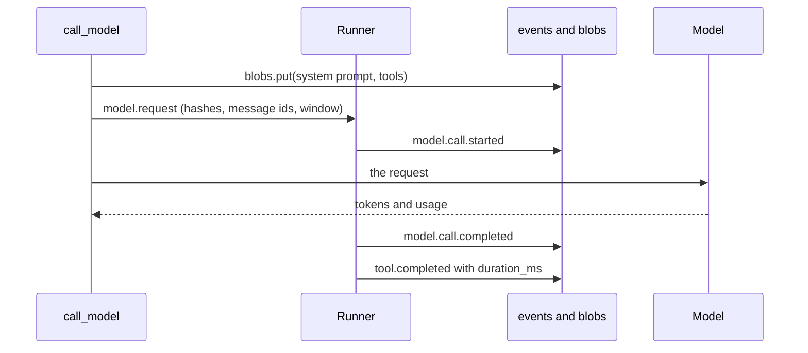

# {{ $frontmatter.title }}

You ask an agent to fix a bug and wait a minute. The answer is wrong, and the answer itself can't tell you why. Was the model slow, or a tool? Did it read the right file, or never see your instruction? So how do you look inside a run after it has finished?

## The idea

::: concept In agents generally

An agent's answer is not one thing. Behind one reply there can be a dozen **model calls**, with **tool calls** between them: the model asks to read a file, the agent reads it, and the model is called again with the result. Each call takes time, costs tokens, and sees different text. The final answer shows none of that.

A **trace** keeps it. Think of an itemised receipt: the answer is only the total. A trace is made in three steps. Watch the figure below as it steps through one run:

1. **Cut the run into spans.** A span is one step with a start, an end, and a status. The run is a span. So is each model call, and so is each tool call.
2. **Record what each span saw.** Its time, its tokens, its exact input, and its exact output. *Exact* is the point: not what you meant to send, but what was sent.
3. **Nest by cause.** A tool call sits under the model call that asked for it. The spans form a tree with the run at the root.

With the tree, three questions become a look. **Slow?** Find the widest span. **Costly?** Find the span with the most input tokens. It is usually a late model call, because every call sends the whole history again. **Wrong?** Open the model call that went astray and read its input. Often the file never made it in, or an old tool result drowned the question.


:::

## How agents usually do it

| Approach | How it works | Good at | Costs |
|---|---|---|---|
| Logs | Print each prompt and reply to a file | Nothing to set up | Flat lines. You rebuild the tree and the timings by eye, and one long prompt floods the log |
| A hosted trace service | The agent sends each span to a service such as LangSmith or Langfuse | Search, comparing runs, a link to share | An account or a server to run, and your prompts leave your machine |
| OpenTelemetry | Spans in the standard format, with its GenAI attribute names, sent to any collector | One format for every tool, and it fits an existing monitoring stack | A collector to run. A generic viewer shows attributes, not a context you can read like a chat |
| Rebuild from history | Keep only the conversation, and work out each call's input when you look | Nothing more to store | Wrong whenever the prompt, the tools, or the config changed since. It shows today's request |
| Keep every request | Store a full copy of each call's input | Exact, and simple to read | The size grows with the square of the calls, because each call repeats the history |

Some problems are open for all of them:

- **Prompts are private.** A prompt can hold a pinned file, a skill, or a secret. A trace that leaves the machine takes them along.
- **Not every provider reports tokens,** and some report them only if asked. A missing count must not read as zero.
- **A provider counts only the total.** It says how many tokens went in, not how many were the system prompt and how many were a tool result. A split is an estimate.
- **A stored time is not a run time.** The gap between two log lines is when they were written, not how long a step took.

## How golem does it

::: golem In golem

golem keeps every request, but once: the history is already in the checkpoint, so a trace stores only what is missing, by hash, and the daemon joins it all when you ask ([ADR-041](../adr/041-session-trace.md)). Nothing leaves `~/.golem`, and there is no trace service to run.

Three things are recorded as a session runs:

1. **Each model call is marked.** `call_model` sends a `model.request` item just before the request goes out. The runner stores `model.call.started` then, and `model.call.completed` when the stream ends, with the tokens, the stop reason, the time to the first token, the latency, and, for a local model, the window it ran with (read after the call and sent by `call_model` as a `model.response` item before its reply). Building the prompt and starting MCP servers come before the mark, so they don't count as model time.
2. **The request is kept by hash.** The system prompt and the tool schemas go in the `blobs` table, keyed by their sha256. `model.call.started` holds the two hashes, the ids of the history messages sent, the model's context window, and the name and size of each part of the system prompt.
3. **Each tool is timed.** `tool.completed` and `tool.failed` carry `duration_ms`, measured around the tool's run. The wait for an approval is not in it.



Nothing is joined while it is written. The tree is built when a client asks, by two methods that only the browser uses today:

- **`trace.get`** returns the tree with summaries only: names, times, tokens, status, and a short preview, so a long session stays small. It reads the events and nothing else.
- **`trace.span`** returns one span in full. A model call gets its system prompt and tools from the blobs, its messages from the checkpoint, and its reply, and a tool call gets its args and its whole result.


`trace.span` also says what filled the call's context. The daemon weighs the system prompt, the tools, your messages, the replies, and the tool results at four characters a token, and scales the five to the input tokens the provider counted. The split is marked estimated, because the provider counted only the total.

A session from before tracing still has a tree. Its model spans are rebuilt from the message events, timed from their `ts`, and marked `recorded: false`. The page shows its tokens, prompt, and tools as "not recorded".

Here is a real session on a throwaway daemon. A script plays the model: it asks for `read_file` once, then answers, and reports its own token counts. This is what `trace.get` returned. Null fields, start and end times, and the tail of each id are cut:

```json
{
  "session_id": "s_98e0…",
  "runs": [{
    "id": "r_35f7…", "kind": "run", "name": "what is in notes.txt?",
    "duration_ms": 951, "status": "ok",
    "children": [
      {
        "id": "m_1855…", "kind": "model", "name": "model 1",
        "model": "deepseek/fake", "duration_ms": 202, "status": "ok",
        "tokens": { "input": 2220, "output": 38 },
        "context_window": 32768,
        "children": [
          { "id": "call_1", "kind": "tool", "name": "read_file",
            "duration_ms": 1, "status": "ok", "preview": "1 line" }
        ]
      },
      {
        "id": "m_3f58…", "kind": "model", "name": "model 2",
        "model": "deepseek/fake", "duration_ms": 732, "status": "ok",
        "tokens": { "input": 2220, "output": 38 }, "first_token_ms": 1,
        "context_window": 32768,
        "preview": "notes.txt says the answer is 42.", "children": []
      }
    ]
  }]
}
```

The tool is under model 1, the call that asked for it. Model 1 has no `first_token_ms`, because it said no words, only a tool call. `trace.span` on model 2 shows why its input is larger than its three messages suggest:

```text
new_from   1                      the user message is old; the next two are new
messages   user       "what is in notes.txt?"          ≈6 tokens
           assistant  → read_file(path="notes.txt")    ≈19
           tool       "     1|the answer is 42"        ≈6
context    used 2220 of 32768
           system 0 · tools 2189 · user 6 · assistant 19 · tool_results 6
```

The 14 tool schemas are 2,189 of the 2,220 tokens. That is the kind of thing a trace is for. In the browser, the same numbers are the context meter under a model call's name, the `ctx 6%` chip in the chat, and the tools folded by the MCP server that offers them.

**Where it lives in the code:**

- `packages/daemon/golem/graphs/chat.py`: `call_model`, which stores the blobs and sends `model.request`.
- `packages/daemon/golem/graphs/adapter.py`: turns that item and the tool timings into facts for the runner.
- `packages/daemon/golem/sessions/runner.py`: times each call and stores `model.call.started` and `model.call.completed`.
- `packages/daemon/golem/store/blobs.py`: `BlobStore`, one row per content.
- `packages/daemon/golem/sessions/trace.py`: `build_trace` and `read_span`, the pure join.
- `packages/daemon/golem/sessions/context.py`: `context_breakdown`, the estimate.
- `packages/daemon/golem/sessions/manager.py`: `trace` and `trace_span`, which load the events, checkpoint, and blobs.
- `packages/web/src/features/trace/`: the page.

:::

## Why this way

**Hashes and message ids, not a copy** ([ADR-041](../adr/041-session-trace.md)). The checkpoint already holds the history with stable ids. Copying it into each call would store the first message once per later call, so a session of 25 calls would hold it 25 times. The system prompt and the tools rarely change in a session, so by hash there is about one copy of each. The cost: a trace is only as good as the checkpoint, so anything that rewrites past messages, such as compaction, has to keep their ids.

**The daemon joins, not the page.** It already has the events, the checkpoint, and the blobs. The browser gets finished numbers, and any later client gets the same ones.

**Record from now, fall back for the past.** Old sessions are not left out. They show less, and say "not recorded" where they show nothing. They never show a zero for a count nobody took.

**Estimates are marked.** The split of the context is a guess scaled to a real total, and a window filled from today's config is marked too. A trace that looks exact and isn't would mislead.

What golem gave up: the page is web only (the TUI keeps `/debug`), it shows finished data and does not stream, and there is no export. Sending these spans to OpenTelemetry or Langfuse is [step 6.1](https://github.com/MilanPavel/golem/issues/91), and it can be built on what is stored now.

- [ADR-041: golem records a trace of each session and shows it in the browser](../adr/041-session-trace.md): the spans, what is recorded, and the fallback

## Try it

1. Run `golem` in a project folder, and ask something that makes golem read a file, such as `What does the README say about installing?`.
2. Press **Trace** next to **Chat** under the session's title. Or press ⌘K and pick *Trace*. A run, its model calls, and the tool it ran are a tree, with a bar for each span's time.
3. Click the last model call. Under its name, the context meter shows how full the window was and what filled it. Open the **Context** tab: the messages are there, with a line where the part new since the last call begins.
4. Click the tool call. **Args** is what the model asked for, and **Result** is what it got back.
5. Open your browser's devtools, the Network tab, and the `/ws` socket. Refresh the trace and one frame is `trace.get`. Click a span and the next frame is `trace.span`. The replies are the examples above.

## The details

For contributors: the reference for the spans, the events and what they hold, the blobs, the times, the tree's rules, the context estimate, and what older sessions show.

### Spans

| Kind | One of these is | Its id | Its parent |
|---|---|---|---|
| `run` | one user turn | `run_id` | none |
| `model` | one assistant reply | the reply's `message_id` | the run |
| `tool` | one tool the model asked for | `call_id` | the model call whose reply asked for it |

A model call has no id of its own. Each call makes exactly one assistant message, and that message's id already joins the event log and the checkpoint. A span's status is `ok`, `failed`, `cancelled`, `denied` (a tool that was refused and never ran), or `running`.

### The events

| Event | Fields |
|---|---|
| `model.call.started` | `message_id`, `index` (1-based within the run), `profile`, `provider`, `model`, `system_prompt_sha`, `tools_sha`, `message_ids`, `context_window`, `num_ctx`, `window_estimated`, `system_sections`, `system_chars`, `system_bytes`, `tools_chars`, `tools_bytes`, `message_chars`, `message_bytes` |
| `model.call.completed` | `message_id`, `usage` (`input`, `output`, `cache_read`, `cache_write`), `stop_reason`, `first_token_ms`, `latency_ms`, `failed`, `context_window`, `text_tool_calls` |
| `tool.completed`, `tool.failed` | `duration_ms`, as well as what they had before |

Every new field is optional, so older events stay valid. A provider that reports no usage leaves `usage` empty, and one that reports only some counts leaves the rest `null`. Neither is ever zero. `model.call.completed` comes before the call's `tool.requested` events.

### What is kept by hash

The `blobs` table is `sha256`, `kind`, `size`, `created_at`, and `text`. `BlobStore.put` inserts a row unless the hash is there, so two calls with the same prompt share one. There are two kinds:

- **`system_prompt`:** the prompt, as sent. golem sends one only when a skill is pinned, so a call with none has `system_prompt_sha` `null`, and the page says so.
- **`tools`:** the tool schemas as compact JSON with sorted keys. A model that is not offered tools has `tools_sha` `null`.

`message_ids` are the checkpoint ids of the history sent, in order, not counting the system prompt. `window_estimated` is true when golem did not send the window and read it from Ollama, from the loaded context or the Modelfile, so a screen shows it with `≈`. An older event has no field and reads as false. `system_sections` lists the non-empty parts of the system prompt as `name` and `chars`. The stored prompt is those parts joined with a blank line, so their lengths split it exactly, and the prompt is not stored twice.

`context_window` is the profile's `ctx`, else the listed model's, else LiteLLM's `max_input_tokens`, and `null` when none is known. `num_ctx` is the Ollama option sent, if any. Both are worked out when the call is made, because the profile, the listing, and the prices change later, so on `model.call.started` the window is a forecast. `model.call.completed` has `context_window`: the window the call ran with, read from the model server (Ollama `/api/ps`) after the call. It is exact, and `null` when it could not be read or the provider is hosted. A span takes the completed value when there is one. An estimated window below the call's input tokens is dropped, so no span shows more than 100% of a guess.

`text_tool_calls` is set when the model wrote a tool call as text in its reply. `recovered` means golem turned the text into tool calls and ran them. `unread` means the reply held a call golem could not read (an unknown tool, a key the tool does not have, a value that is not valid, or an unclosed block), so the turn ended with the text as the answer. `null` when the reply had no such text. The trace shows both on the model span, and the chat shows a notice for `unread`.

### A cut prompt

Ollama cuts a prompt that does not fit its window, and says nothing. `model.call.started` records the characters and the UTF-8 bytes of what was sent: the system text, the tool schemas as compact JSON, and each message (its text and its tool calls as JSON), one number per message in `message_ids` order. From these and the exact window `W` (see above) the trace says whether the prompt was cut. A model span has `prompt_cut` (`no`, `yes`, `likely`, or `null`), `prompt_cut_kind` (`older_messages` or `middle`), `dropped_message_ids`, and `dropped_tokens`. `trace.span` gives the same on the context. Only an Ollama call with an exact window is judged. A hosted model, an estimated or unknown window, or an event with no size fields gives `null`. `C` is the call's input tokens and `B` the bytes sent plus 16 for each message, which is an upper bound on the prompt's tokens.

1. **`no`, proven:** `B < W`.
2. **`yes`, proven, `older_messages`:** an earlier call of this session, with the same model and window, sent a strict prefix of these `message_ids` with the same `system_prompt_sha` and `tools_sha`, and took in more than `C` tokens. The prompt grew and fewer tokens arrived. The latest such call counts, in any run.
3. **`likely`:** not 1 or 2, and the estimate `E` is at least `W`. `E` is the characters sent times a tokens-per-character ratio: `C / chars` of the latest earlier call of this model that rule 1 proved uncut, else 1/4. `middle` when `C <= 0.6 * W` (the system prompt and tools alone did not fit, and Ollama cut to about half the window), else `older_messages`.
4. **Otherwise `null`.** golem shows nothing.

For `older_messages`, `dropped_message_ids` are the oldest messages, never the last one and never the system prompt, marked until the estimate of what is left is at most `C`. `dropped_tokens` is their estimate. Both are estimates, even for `yes`: only the fact of the cut is proven, so a screen shows their size with `≈`.

golem does not send an earlier reply's thinking back to the model ([ADR-045](../adr/045-thinking.md)). It sends Ollama no `think` or `reasoning`, but a thinking model thinks anyway, and `OllamaChat` keeps what comes back as `reasoning_content` on the reply. That text is stored with the reply, in the checkpoint and in `message.completed`, and is sent to the clients. When `call_model` builds the messages of a call, it takes `reasoning_content` off every earlier reply, so the library never turns it into the request's `thinking`. The checkpoint keeps it. A new user message therefore does not shrink a prompt by itself, and rule 2 holds across runs.

### Times

- **A model call** is timed on a monotonic clock from the `model.request` mark. `latency_ms` is the time to the end, and `first_token_ms` is the time to the first text, `null` when no text came.
- **A tool call** has `duration_ms`. `tool.started` is written after approval, so the wait is not counted. It is the gap between `approval.needed` and `approval.resolved`, shown as `approval_wait_ms`.
- **A run** is the time from `run.started` to its end event.
- **A span with no measured time** (a session from before tracing) falls back to the difference of its events' `ts`.

The page shows every duration as minutes and seconds, from `formatDuration` in `packages/view/src/duration.ts`: `0m 00.004s` under a second, then one decimal, such as `2m 30.8s`. There are no hours. The Metadata tab also shows the raw milliseconds.

### How the tree is built

`build_trace` groups the session's events by `run_id`, in order. For each run:

1. **The run.** Its name is the first 80 characters of the user's message. It starts at `run.started` and ends at `run.completed`, `run.failed`, or `run.cancelled`. With no end event it is `running`.
2. **The model calls.** One for each `model.call.started`, numbered from 1, joined to its `model.call.completed` by `message_id`. A call with no end is `running`, or `cancelled` if the run was cancelled. `preview` is the start of the reply.
3. **The tool calls.** One for each `tool.requested`, put under the model call named by its `message_id`. If that id is unknown, it goes under the newest model call that had started by then. The end, status, and preview come from `tool.completed` or `tool.failed`.
4. **Names and previews are short.** A preview is cut at 200 characters.

`trace.get` returns the runs, oldest first, each with its model calls and their tools. A model span carries its `context_window`, and one the event did not record gets today's window with `context_window_estimated` set.

### One span in full

`trace.span` takes `session_id` and `span_id`. It returns the span, without its children, and:

- **For a model call:** `system_prompt` and `tools` from the blobs, `messages` (the context sent, in order, each with `tokens`), `new_from` (the index of the first message the previous call did not have), `reply`, `stop_reason`, `provider`, `system_sections`, and `context`. The context messages are the recorded `message_ids`, else every checkpoint message before the reply.
- **For a tool call:** `args`, the whole `result` text, `artifact_id` when the output was too big for the model (open it with `artifact.read`), and `approval` when one was asked.
- **For a run:** the span alone.

An unknown `span_id` is an error. Neither method calls the model or starts a run, and both answer only a client that may already attach the session.

### What filled the context

`context_breakdown` returns five parts, always in this order: `system`, `tools`, `user`, `assistant`, and `tool_results`. Each has `tokens`, `chars`, and `items`.

- **The weights** are characters: the system prompt's length, the compact JSON of each tool schema, and each message's text plus its tool calls.
- **The total** is the input tokens the provider counted. With none, it is the characters divided by four.
- **The shares** are whole numbers that add up to the total exactly. The tokens left after rounding down go, one each, to the largest remainders.
- **The items** split a part further. The system part has one item for each section. The tools part has one for each tool, with `group` set to the MCP server that offers it, largest first. The messages of a role share that role's part.
- **The window** is the one recorded, or today's, with `window_estimated` set. `estimated` is always true, because of the split.
- **A local model's window** comes from what golem sent, then from Ollama's `/api/ps`, then from the Modelfile, and the last two are estimated ([ADR-043](../adr/043-ollama-context-window.md)).

The web page draws this as the context meter: a bar with a segment for each part, in the order above, and a `Free` row. Each part has its own colour. A line under the bar says when Ollama cut the prompt (see A cut prompt). The Tools disclosure groups the tools by server with each one's cost. The thin bar in the page's summary line is clay, then the `wait` colour from 80% full, then `deny` from 95%. The chat's `ctx 6%` chip is built from the live `model.call.*` events, so it comes back after a reload.

### Older sessions

A session with no `model.call.*` events gets its model spans from each assistant `message.started` and `message.completed` pair, timed from the events' `ts`, with `recorded: false`. Its context is every checkpoint message before the reply. Tool spans are as before. Its tokens, stop reason, system prompt, and tools are missing, and the page says `Not recorded. This session ran before golem kept traces.`

### The page

The trace has its own route, `/s/:id/trace`, with `?span=<id>` for the selected span. It shows finished data with a Refresh button, and does not update while a run streams. The Chat and Trace tabs, the palette's Trace row, the rows, and the colours are in [the guide](../guide/web.md#trace-a-session). The layout is on [the gallery](/gallery/).

### Privacy

Blobs hold prompts, which can hold anything a skill or a pinned file says. They live in `~/.golem/golem.db` next to the events, go into backups with them, and are never sent anywhere. A blob stays when its session is deleted. Pruning them is left for later.

### Files

| File | What it does |
|---|---|
| `packages/daemon/golem/graphs/chat.py` | `call_model`: stores the blobs and sends `model.request` |
| `packages/daemon/golem/graphs/adapter.py` | Turns `model.request` and the tool timings into facts |
| `packages/daemon/golem/sessions/runner.py` | Times each model call, stores `model.call.started` and `model.call.completed` |
| `packages/daemon/golem/store/blobs.py` | `BlobStore`: the `blobs` table, one row for each content |
| `packages/daemon/golem/sessions/trace.py` | `build_trace` and `read_span`: the tree and one span, from events, messages, and hashes |
| `packages/daemon/golem/sessions/context.py` | `context_breakdown`: what filled one call's context |
| `packages/daemon/golem/sessions/manager.py` | `trace` and `trace_span`: load the events, the checkpoint, and the blobs |
| `packages/protocol/golem_protocol/commands.py` | `trace.get` and `trace.span`: their params and results |
| `packages/protocol/golem_protocol/events.py` | `ModelCallStartedData`, `ModelCallCompletedData`, and `duration_ms` on the tool events |
| `packages/view/src/context.ts` | The context's levels, labels, summary, and `foldLiveContext` |
| `packages/view/src/duration.ts` | `formatDuration`: minutes and seconds |
| `packages/web/src/features/trace/` | The page: tree, waterfall, span detail, context meter |
| `packages/web/src/features/composer/context-chip.tsx` | The `ctx` chip in the chat |

## Read more

- Before: [The web UI](./web.md), the page the trace opens in.
- [Trace a session](../guide/web.md#trace-a-session): how to open it and read it.
- [The protocol](./protocol.md): events and commands, and [Sessions](./sessions.md): the event log and the checkpoint that the trace joins.
- [ADR-041](../adr/041-session-trace.md): the choices behind it.
- [OpenTelemetry's GenAI conventions](https://opentelemetry.io/docs/specs/semconv/gen-ai/): the standard names for the same spans.
- [The overview](../architecture.md): the whole system on one page.
