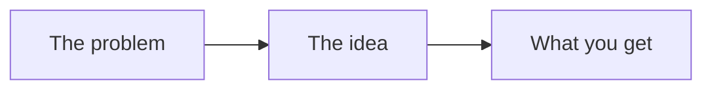
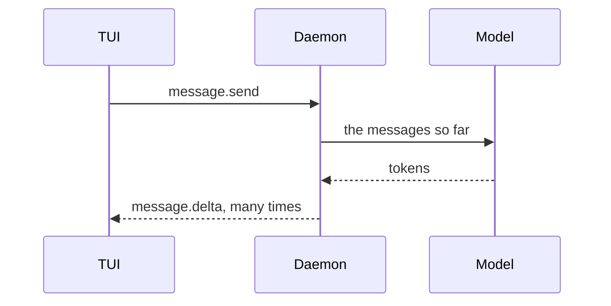

---
# A "How agents work" page. Copy this file to docs/concepts/<slug>.md, fill it in, and delete
# every guidance line (the ones in > quotes and in HTML comments). ADR-034 and Phase 11 of
# docs/plan.md say why the series exists. The 11.6 tickets in #282 list the pages.
title: The idea, as a short noun phrase        # "The agent loop", "Tool calling"
description: One sentence a search result can show. What the reader will understand.
order: 0                                       # its place in the series, from 1
adrs: []                                       # the ADRs this page explains, such as [11, 18]
---

# {{ $frontmatter.title }}

> **One paragraph, at most four sentences.** Say what this idea is for, in words a developer who has never built an agent understands. End with the question the page answers, such as "So how does the model run a command it cannot run itself?"

<!--
Rules for the whole page:
- Plain words and short sentences. Explain a term the first time it is used.
- General first, golem second. The first two sections never mention golem.
- One idea per page. Link to the other concept pages, don't repeat them.
- Show, don't claim: a diagram, a real trace, a real file.
- Aim for 800 to 1 500 words. A reader should finish in about ten minutes.
-->

## The idea

::: concept In agents generally

> **150 to 300 words.** The idea with no tool or product names. Start with the problem it solves. Then give the idea in two or three steps. An everyday comparison helps if it is exact. Leave it out if it is only roughly right.

> End with one small diagram of the general shape, five boxes at most:



:::

## How agents usually do it

> **200 to 400 words.** The common ways real agents do this, and what each one costs. Use a table when there are several ways:

| Approach | How it works | Good at | Costs |
|---|---|---|---|
| A | One line | One line | One line |
| B | One line | One line | One line |

> Name well-known systems only where a reader can check the claim, and keep it neutral. Say which problems are still open.

## How golem does it

::: golem In golem

> **300 to 600 words.** Which of the approaches above golem takes, in one sentence first. Then the parts, in the order they run.

> **A diagram of the real flow**, with golem's own names: processes, protocol methods, events, graph nodes. A `sequenceDiagram` for messages over time, a `flowchart` for structure.



> **One real trace.** Copy it from `/debug wire` in the TUI, or from the daemon's log (`golem daemon logs`). Cut it to the lines that matter. Mark a cut with `…`, and remove ids that add nothing:

```text
run.started        seq 3
message.started    seq 4  assistant
message.completed  seq 5  assistant
tool.requested     seq 6  list_dir  {"path": "."}
tool.completed     seq 7  list_dir  12 entries
message.delta      seq 9  assistant  There are 12 files …
run.completed      seq 12
```

> **Where it lives in the code.** Name files and symbols, not line numbers, so the pointers do not rot:

- `packages/daemon/golem/graphs/…`: what this file does for this idea
- `packages/tui/src/…`: what the user sees

:::

## Why this way

> **100 to 250 words.** The trade-off golem chose and what it gave up, with a link to each ADR in `adrs`. When golem is still learning, say so, and link the plan step that will tell.

- [ADR-NNN: title](../adr/NNN-slug.md): the decision in one line

## Try it

> **A few steps a reader can do on today's golem**, each with what they will see. Use a feature only after it has shipped. If it is only planned, put it in "Why this way" and not here.

1. Open the chat with `golem`, and type `/debug wire`.
2. Ask: `…`
3. Watch for `…` in the wire panel. It is the step from the diagram above.

## Read more

> Two to five links: the next concept page, the section of [architecture.md](../architecture.md), and one outside source worth the time. A specification, a paper, or a good post.

- Next: [The next idea](./next-slug.md)
