# MCP from anywhere: design

This is how golem adds, tests, edits, and removes MCP servers, in the terminal and in the browser. Step 1.12 of [the plan](../plan.md#phase-1--first-run-continued) builds it, and [ADR-037](../adr/037-browser-manages-mcp-and-config.md) says what the browser may do. The terminal screens are drawn the way [the setup window](setup-window.md) draws its own, and the browser screens follow [the web UI's design](web.md).

## The idea

An MCP server should be one pick away, and it should be clear whether it works before it is saved. Nobody has to open `config.toml`. Anybody can, in an editor that checks it.

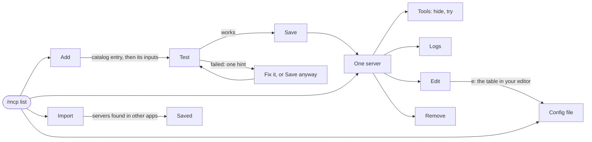

Rules every screen follows:

- **Test before save.** A server is run once, with the values you typed, before anything is written. A server that fails can still be saved, and says so ("Save anyway").
- **One hint, one action.** A failure shows the single most likely cause, and a button for the fix when golem can do it: "Node is missing. golem can install it" has an `Install Node` row.
- **Nothing slow is silent.** Every wait shows a spinner, what is happening, and how long it has taken. A first `npx` run says it downloads the package.
- **The cost is visible.** Each server and each tool shows its token cost, so hiding tools is a choice with a number on it. A server that is `on demand` costs nothing until a chat turns it on.
- **Secrets are never shown.** A token is typed into a hidden field, stored in the Keychain, and shown afterwards only as `stored`. An empty secret field on edit means "keep it".
- **Safe things happen at once. Others ask first.** Turning a server off is instant and can be undone. Removing one asks, and says what else goes with it (its token).
- **The file is one key away, never required.** `e` opens one server's table in `$EDITOR`, and `c` opens the whole file. Both are validated, and a mistake leaves the file as it was.
- **Plain words.** The names the terminal already uses: server, tool, chat, folder, token. No "transport" or "stdio" on a main screen.

## How to read the screens

Each ```` ```screen ```` below is one state, about 62 columns wide. The bar on top names the screen, and the line under it says what leads where. The marks are the setup window's, with a few for servers:

| Mark | Means |
|---|---|
| `✓` `✗` `!` | Running or done, failed, needs you |
| `○` | Off, or on demand and not on in this chat |
| `⠙` `███░░░` | Working, and how far |
| `› ` | The selected row. Enter picks it |
| `[x]` `[ ]` | A box that Space ticks |
| `❯ ••••▏` | A field you type into, hidden for a secret |
| The last line | The keys this screen takes |

## A · The list

`/mcp` opens it. The servers are grouped by the file that names them: **Yours** is `~/.golem/config.toml`, and **This project** is the session folder's `.golem/config.toml`, shown only when the folder is trusted.

```screen A1 · The list | Enter opens a server. a, i, and c work from anywhere on this screen. A server that is on demand and not on in this chat shows ○.
MCP servers                              2 running · 1 failed · 1 needs you

Yours
› ✓ filesystem   running · 14 tools · 2.1k tokens
  ✓ github       running · 29 tools · 4.1k tokens · 12 hidden
  ○ playwright   on demand · 21 tools · off in this chat
  ! linear       needs sign-in

This project · ~/repos/golem
  ✗ docs-search  failed · retry in 12 s

  + Add a server                                           a
  Import from another app                                  i
  Config file                                              c

Enter opens · a add · i import · c config · Esc close
```

```screen A2 · The list, with no servers | Nothing is drawn as an error. The rows say what is found, so one Enter does the most likely thing.
MCP servers

No servers yet. A server gives golem tools, such as GitHub
or a browser. golem asks before every call.

› Add a server                 13 to pick from
  Import from another app      3 found in Claude Desktop
  Config file

↑↓ move · Enter picks · Esc close
```

```screen A3 · The list, while one starts | The row changes by itself, because the daemon tells every window when a server changes.
MCP servers                              1 running · 1 starting

Yours
  ✓ filesystem   running · 14 tools · 2.1k tokens
› ⠼ github       starting… the first run downloads it     8s
  ○ playwright   on demand · 21 tools · off in this chat

  + Add a server                                           a

Enter opens · a add · i import · c config · Esc close
```

| Key | What happens |
|---|---|
| `↑` `↓` | Move the selection |
| `Enter` | Open the selected server (B1), or the selected action |
| `a` | Add a server (C1) |
| `i` | Import from another app (F1) |
| `c` | Config file (G1). On a project row, the project's file |
| `Esc` | Close, back to the chat |

The marks next to a row say more than the state: `on demand`, `12 hidden`, `allow` (its tools run without asking, [ADR-037](../adr/037-browser-manages-mcp-and-config.md)), and `needs sign-in`. The status line of the chat keeps its `mcp ✗ <name>` for a server the chat uses that is down.

## B · One server

```screen B1 · A server that runs | Enter on a row. The numbers 1 to 9 pick the same rows.
github                                              ✓ running
https://api.githubcopilot.com/mcp/
Yours · ~/.golem/config.toml

29 tools on · 12 hidden · about 4.1k tokens a turn
Asks before every call · token stored in the Keychain

› 1 Tools              hide the ones you don't want
  2 Test               check it answers now
  3 Logs               last line 4 s ago
  4 Try a tool         call one from here
  5 Edit               address, token, timeout…
  6 Reconnect
  7 Turn off in this chat
  8 Disable everywhere
  9 Remove…

↑↓ move · Enter picks · Esc back
```

```screen B2 · A server that failed | The reason is what the daemon knows now. Test finds out more, and gives the one hint.
docs-search                                         ✗ failed
npx -y @acme/docs-mcp
This project · ~/repos/golem/.golem/config.toml

✗ command not found: npx
  trying again in 12 s

› 1 Find out why       runs a test now
  2 Logs
  3 Edit
  4 Disable everywhere
  5 Remove…

↑↓ move · Enter picks · Esc back
```

```screen B3 · An on-demand server | It costs nothing until a chat turns it on. "Turn on in this chat" starts it, and a chat that turned it on keeps it after a restart.
playwright                                          ○ on demand
npx -y @playwright/mcp@latest
Yours · ~/.golem/config.toml

Off in this chat. Turning it on adds 21 tools, about
3.4k tokens a turn, and starts it.

› 1 Turn on in this chat
  2 Tools
  3 Test
  4 Logs
  5 Edit
  6 Make it always on
  7 Disable everywhere
  8 Remove…

↑↓ move · Enter picks · Esc back
```

```screen B4 · Remove asks first | The default is Keep. It says what goes with the server.
Remove github?

Its entry is deleted from ~/.golem/config.toml, and its
token is deleted from the Keychain. The tools go from
every chat that has them.

› Keep it
  Remove github

↑↓ move · Enter picks · Esc back
```

| Key | What happens |
|---|---|
| `Enter` or `1`–`9` | Do that row |
| Tools, Test, Logs, Try a tool, Edit | The screens in E and D |
| Reconnect | Stop and start it at once. The row shows `starting…` |
| Turn on or off in this chat | Only for an on-demand server. Instant, no question |
| Make it always on | Writes `enabled = true`, instant |
| Disable everywhere | Writes `enabled = false`, instant, and the row becomes `Enable` |
| Remove… | B4. Enter on `Keep it` or `Esc` leaves it alone |
| `Esc` | Back to the list |

## C · Add a server

`a` in the list, `/mcp add`, or the first row of an empty list. The catalog is the daemon's data ([1.12.6](../plan.md#phase-1--first-run-continued)), so the terminal and the browser always show the same entries.

```screen C1 · Pick from the catalog | By category. Type to search. A row that needs Node or uv says golem installs it. A row you already have is marked.
Add a server                                  13 in the catalog
❯ search▏

Files
› Filesystem    read and write files in a folder
Code
  Git           history and diffs of a repo
  GitHub        repos, issues, pull requests · token
  Sentry        errors and releases · sign-in
Web
  Fetch         read any web page                      added
  Playwright    browse and test web pages · installs Node
  Brave Search  web search · token
  Context7      up-to-date library docs
Other
  Your own      a command, or an address
  ↓ 4 more

↑↓ move · Enter picks · Esc back
```

```screen C2 · A server with an input | Each entry says what it needs and nothing else. A path input starts with a sensible default.
Filesystem

Read and write files in a folder you choose. golem asks
before every write.

Folder
❯ ~/repos/golem▏

Enter tests it · Tab next field · Esc back
```

```screen C3 · A server with a token | The hint says where to get one. The token is stored in the Keychain before the file is written.
GitHub

Repos, issues, and pull requests.

Token
❯ ••••••••••••••••••••▏

Make one at github.com/settings/personal-access-tokens/new:
pick the repos, then add Contents, Issues, and Pull requests.
Stored in your macOS Keychain, never in a file.

Enter tests it · Esc back
```

```screen C4 · The test | Each step shows as it happens, with its time. Nothing is saved yet. Esc stops it, and goes back to the form.
Testing github

✓ find it             api.githubcopilot.com             0.1 s
✓ connect                                               0.4 s
⠹ say hello                                             1.2 s
○ list its tools
○ check it answers

Nothing is saved yet. Esc stops.
```

```screen C5 · It works | One Enter saves with sensible defaults. The summary rows change with Tab. A big tool list shows its cost, and offers to hide some first.
✓ github works
  GitHub MCP Server 0.4 · 41 tools · about 6.3k tokens a turn

  Name    github
  Runs    on demand       a chat turns it on
  For     Yours           all folders
  Asks    before every call

6.3k tokens is a lot. You can hide tools after saving.

› Save
  Hide some tools first
  Back

Enter saves · Tab changes a row · Esc back
```

```screen C6 · It failed, and golem can fix it | The one hint comes first. Install Node runs brew, shows its output, and tests again by itself. Save anyway writes the entry as it is.
✗ playwright didn't start
  npx: command not found

! Node is missing. golem can install it.

› Install Node         brew install node · about 100 MB
  Save anyway
  Edit
  Back

↑↓ move · Enter picks · Esc back
```

```screen C6′ · Installing Node | The same progress as installing Ollama. When it ends, the test runs again with no key pressed.
Installing Node

⠸ brew install node                                    41s
  downloading  ███████████░░░░░░░  58 / 98 MB

Then golem tests playwright again.

Esc stops
```

```screen C7 · It failed, and you can fix it | The hint says one next step. Edit goes to the form with the fields already filled in.
✗ github didn't connect
  401 Unauthorized

! The token was refused. Paste a new one.

› Paste a new token
  Save anyway
  Show the log
  Back

↑↓ move · Enter picks · Esc back
```

```screen C8 · Saved | The server is on in this chat if you want it. Add another returns to the catalog.
✓ playwright added
  on demand · 21 tools · about 3.4k tokens when it is on

› Turn on in this chat
  Add another
  Done

Enter picks · ↑↓ move · Esc back
```

```screen C9 · Your own | One screen for a server that is not in the catalog. A command line makes a local server and an address makes a hosted one.
Your own server

Name
❯ my-server▏

Command line or address
  npx -y my-mcp-server

Token, if it needs one          (optional)
  –

Variables, such as API_KEY=…    (optional)
  –

Enter tests it · Tab next field · Esc back
```

| Key | What happens |
|---|---|
| Typing in C1 | Filter the catalog by name, description, and category |
| `Enter` in C1 | The entry's form (C2, C3), or the test at once when it has no inputs |
| `Enter` in a form | Test (C4). With a required field empty, the field is marked and nothing runs |
| `Tab` | Next field. In C5, the next summary row |
| `Esc` in C4 | Stop the test and go back to the form, with what was typed |
| `Enter` in C5 | Save (C8) |
| Install Node (C6) | Streams brew's output (C6′), then tests again |
| Save anyway (C6, C7) | Writes the entry as typed, and says so in C8: `saved, but it didn't start` |
| `Esc` | Back one screen. Nothing is written until Save |

## D · Edit

Edit has a form with one row per field, so no key has to be remembered. Each field shows its current value, and `Enter` edits it.

```screen D1 · The edit form, a local server | Rows are the fields of the entry. Save sends one update, and the server restarts with the change. e opens the same table in the editor.
Edit playwright                                    Yours

  Command            npx
  Arguments          -y @playwright/mcp@latest
  Folder             –
  Variables          –
  Pass through       –
  Runs               on demand
  Timeout            120 s
  Asks               before every call
  Tools              all on
› Save

↑↓ move · Enter edits · e open in editor · Esc back
```

```screen D2 · A secret field | Hidden as you type, and never shown again. Left empty, it keeps the stored token.
Edit github · Token

stored in the Keychain · mcp/github

Paste a new one to replace it:
❯ ••••••••••••••••••••▏

Leave it empty to keep the one you have.
Changing the address means pasting the token again.

Enter keeps · Esc back
```

```screen D3 · After e: the editor says what is wrong | The table opens in $EDITOR, and the result is checked before it is saved. The file on disk is not touched until it is valid.
✗ playwright was not saved

  line 4   timeout_seconds: must be at most 3600

› Edit again
  Discard my changes

Enter picks · ↑↓ move
```

| Key | What happens |
|---|---|
| `↑` `↓` | Move between rows |
| `Enter` on a row | Edit it: a text field, a choice, or the hidden field (D2). Choices are `Runs` (always on, on demand, off), `Asks` (before every call, never), and `Tools` (goes to E3) |
| `Enter` on Save | One update. The server restarts, and the row in the list says `starting…` |
| `e` | This server's table in `$EDITOR`, then validate, then D3 on a mistake |
| `Esc` | Ask only when something changed: `Discard changes?` |

`Asks` set to never means the server's tools run without an approval card, and the row says so in plain words (`runs without asking`). It is the per-server version of an allow rule, and a project server can only use it when its project is trusted.

## E · Test, logs, tools, and trying a tool

```screen E1 · Test, from the detail | The same steps as C4, now on a saved server. A passing test says how long each step took, and what the server calls itself.
✓ github works
  GitHub MCP Server 0.4 · protocol 2025-06-18

  ✓ find it             api.githubcopilot.com             0.1 s
  ✓ connect                                               0.4 s
  ✓ say hello                                             0.9 s
  ✓ list its tools      41 tools                          0.3 s
  ✓ check it answers                                      0.2 s

› Back
  Test again
  Logs

Enter picks · ↑↓ move · Esc back
```

```screen E2 · Logs | A live tail. Up and Down scroll, which stops following. End follows again. The server's own lines are plain, golem's are marked.
github · logs                                     following
14:02:11  golem  starting
14:02:12  golem  running (41 tools)
14:07:40  golem  ping failed, retry in 1 s
14:07:41  golem  starting
14:07:42  golem  running (41 tools)
14:21:03  stderr rate limit: 4 requests left, resets 14:30

↑↓ scroll · End follow · c copy · Esc back
```

```screen E3 · Tools | Space turns a tool off or on for every chat. Each row has its token cost. Hidden tools never reach the model and cost nothing.
github · tools                         29 of 41 on · 4.1k tokens
  [x] get_me                    120
› [x] list_issues               410
  [x] create_pull_request       640
  [ ] create_gist               380   hidden
  [ ] delete_file               250   hidden
  [x] search_code               330
  ↓ 35 more

Space on or off · Enter tries it · f filter · Esc back
```

```screen E4 · Try a tool | One question per property of the tool's input, in the tool's own words. Strings, numbers, true or false, and choices have fields. Anything else asks for JSON. Nothing is recorded in a chat.
get_me · github

Get the authenticated user's profile. It has no inputs.

› Run

Run calls it once, as you. golem doesn't ask, because you pressed Run.

Enter runs · Esc back
```

```screen E5 · A result | The text, as the server returned it. An error is marked. Run again keeps the inputs.
get_me · github                                    ✓ 0.6 s

{
  "login": "milanpavel",
  "name": "Milan Pavel",
  "public_repos": 31
}

› Run again
  Back

Enter picks · ↑↓ move · Esc back
```

| Key | What happens |
|---|---|
| `Space` in E3 | Hide or show the tool. It writes the tool filter at once and the row's token cost joins the total |
| `f` in E3 | Filter the list by name |
| `Enter` in E3 | Try this tool (E4) |
| `↑` `↓` `End` in E2 | Scroll the log. `End` follows the end again |
| `c` in E2 | Copy what is on screen |
| `Enter` in E4 | Ask for the first input, then the next, then Run |
| Run | Calls the tool once, then E5. The server's answer is shown as text, never run |

## F · Import

`i` in the list, or `golem mcp import`. golem looks in the other apps' own files and only reads them. It never writes to them.

```screen F1 · What was found | Grouped by app. A server golem already has is shown and left unticked. A name that clashes is renamed, and r changes it. A server that needs a value golem lacks says so.
Import servers                              found 5 in 2 apps

Claude Desktop
› [x] github       https://api.githubcopilot.com/mcp/
                   token moves to the Keychain
  [x] playwright   npx -y @playwright/mcp@latest
  [ ] filesystem   golem already has this one
Cursor
  [x] linear-2     renamed, because linear exists
  ! [ ] old-sse    uses the old SSE kind, which golem doesn't speak yet

Space ticks · r rename · p paste JSON · Enter imports 3 · Esc back
```

```screen F2 · Paste JSON | Any of the apps' shapes, or one bare server. Secrets in it go to the Keychain and are not kept.
Paste JSON

Paste a "mcpServers" block, or one server:
❯ {"mcpServers": {"github": {"url": "https://api.…▏

Enter reads it · Esc back
```

```screen F3 · Done | Nothing in the other apps was changed.
✓ imported 3 servers

  github       on demand · token in the Keychain
  playwright   on demand
  linear-2     needs sign-in

Nothing in Claude Desktop or Cursor was changed.

› Open the list
  Test them all

Enter picks · ↑↓ move · Esc back
```

| Key | What happens |
|---|---|
| `Space` | Tick or untick a server |
| `r` | Rename the selected one. The name is checked as you type |
| `p` | Paste JSON (F2) |
| `Enter` | Import the ticked servers (F3). A name that still clashes keeps the row and says why |
| `Esc` | Back to the list. Nothing was written |

A server with a variable that the other app fills at run time (`${input:x}`) becomes a required field in the new server's form, with a warning, so it is asked for once and stored.

## G · The config file

`c` in the list, or `/config`. The whole file opens in `$EDITOR`, and golem checks it before it saves. It is for the things no form covers, and for people who like the file.

```screen G1 · It was not saved | Every problem has its line. Edit again opens the editor with the cursor on the first one, and the text as you left it.
config.toml was not saved                 2 problems

✗ line 14   mcp.github.timeout_seconds: must be at most 3600
✗ line 21   expected "=" after a key

The file on disk is as it was.

› Edit again
  Discard my changes

Enter picks · ↑↓ move
```

```screen G2 · The file changed while you edited | Another window, or another program, saved first.
! config.toml changed on disk while you were editing

› Reload it, and edit again
  Keep mine and overwrite
  Discard my changes

Enter picks · ↑↓ move
```

```screen G3 · It was saved | The servers reload by themselves. A setting that is only read at start says so, with one button.
✓ saved · MCP servers reloaded

! providers changed. It takes effect when the service restarts.

› Restart the service now
  Later

Enter picks · ↑↓ move
```

## H · Signing in

A hosted server that signs in with OAuth ([1.12.10](../plan.md#phase-1--first-run-continued)) shows `needs sign-in` in the list. Sign in opens the browser, and the server starts when the sign-in ends.

```screen H1 · Sign in | The browser is opened with the address. The address is shown too, to copy, for a Mac with no browser open.
linear · sign in

Opened Linear in your browser. Sign in there, and golem
continues on its own.

https://linear.app/oauth/authorize?client_id=…

⠴ waiting for you                                     24s

Enter opens it again · c copy the address · Esc stops
```

```screen H2 · Signed in | The tools are listed, and the token is kept in the Keychain. It renews itself.
✓ signed in to Linear · 9 tools

› Done
  Hide some tools

Enter picks · ↑↓ move
```

Sign out is a row in the server's detail once it is signed in. A token that can no longer be renewed turns the row back to `needs sign-in`, with one band line, and no popup.

## I · The model asks, and servers talk back

These screens belong to [1.12.11](../plan.md#phase-1--first-run-continued) and [1.12.12](../plan.md#phase-1--first-run-continued). They are drawn here so the rest is built to fit them.

```screen I1 · The model asks for a server | An approval, like a tool's. The reason is the model's own. Allow once starts it for this chat, and the tools appear in the same turn.
golem wants to turn on playwright for this chat

  why   you asked to open example.com and read its title
  cost  21 tools · about 3.4k tokens a turn

› Allow once          Enter
  For this session    S
  Deny                D

Enter allows once · s this session · d deny
```

```screen I2 · A server asks you something | A form card, drawn like an approval. Esc declines. It times out the same way.
github asks you

  Which repository should I use?

  Repository
  ❯ MilanPavel/golem▏

Enter sends · Esc declines
```

```screen I3 · Prompts and resources | A prompt is a slash command, /&lt;server&gt;:&lt;name&gt;. A resource is attached with @&lt;server&gt;:&lt;name&gt; in the message.
/github:review-pr
  /github:review-pr   <number>   review a pull request, using the server's prompt
  /github:summarize   <issue>    summarize an issue

❯ /github:review-pr 482▏
```

## J · The browser

Everything in A to I is also in the browser, in one place: **Settings** ([web.md](web.md#the-settings-page)). It is two sections in the Settings list, **MCP servers** (`/settings/mcp`) and **Config file** (`/settings/config`), beside Setup and Appearance. It is the same view with the same words, drawn the way [the web UI](web.md) draws everything: a quiet reading column, one clay accent, and the status words next to every colour.

### Where it opens

- The **Settings button** at the bottom of the sidebar, then the section.
- Settings → Setup: the Tools card's `Manage`.
- `/mcp` and `/config` in the composer. `/mcp add <name>` opens the add dialog on that entry.
- The **⌘K palette**, as two rows in the Tools group: `MCP servers` and `Config file`.
- A link in the drawer's **Session** tab, next to the MCP servers that session uses.
- Leaving Settings goes back to the chat, and the chat is exactly as it was.

### The prototype

The prototype in [mcp-prototype.html](mcp-prototype.html) is a working Settings view in golem's own look. Open it in a browser. Its dark panel jumps to a screen and switches the theme. The Tools, Add, Edit, and Config screens work: switch a tool, add Playwright and install Node, edit the config and watch the error land in the gutter. For a screenshot, add `#kiln` or `#slip` to the address to pick a theme, and `shot` to hide the panel, as in `mcp-prototype.html#kiln,shot,config`. The names are `tools`, `try`, `logs`, `edit`, `failed`, `signin`, `add`, `form`, `testing`, `nodefail`, `works`, `import`, `config`, `shell`, `diff`, `conflict`, and `saved`.

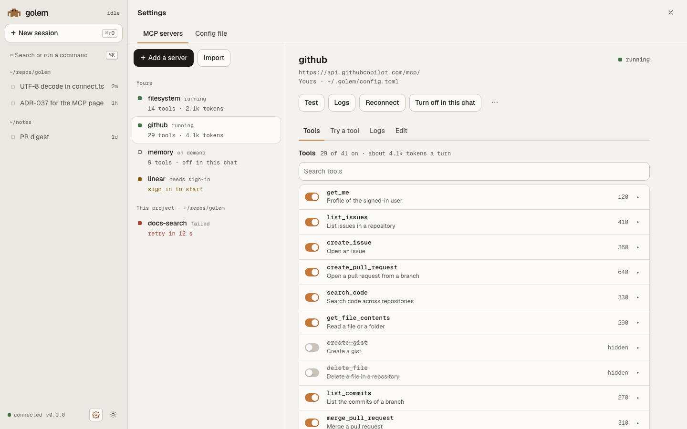

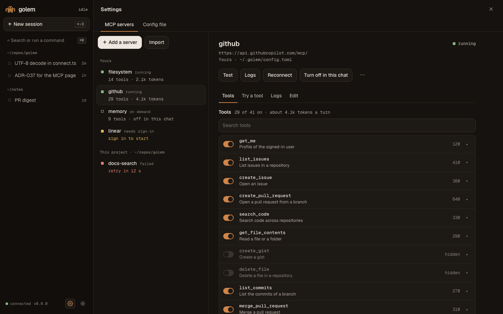

### The layout

```
┌──────────────┬────────────────────────────────────────────────────────┐
│ ▞ golem      │ Settings: Setup · Appearance · MCP servers · Config    │
│ + New        │                                                        │
│ Search  ⌘K   │ MCP servers                                            │
│              │                                                        │
│ ~/repos/golem├───────────────────────┬────────────────────────────────┤
│ ■ UTF-8 …    │ [ Add a server ] Import│ github              ✓ running │
│   ⑂ gateway… │                       │ api.githubcopilot.com/mcp      │
│              │ Yours                 │ ~/.golem/config.toml           │
│              │ ✓ filesystem  14 tools│                                │
│              │ ✓ github      29 tools│ [Test] [Logs] [Reconnect]  ⋯   │
│              │ ○ playwright  on demd │                                │
│              │ ! linear   sign in    │ Tools   Try a tool   Edit      │
│              │                       │ ───────────────────────────    │
│              │ This project          │ 29 of 41 on · about 4.1k tokens│
│ ● connected  │ ✗ docs-search retry 12s│ ☑ get_me                  120 │
│ ⚙ Settings   │                       │ ☑ list_issues             410  │
└──────────────┴───────────────────────┴────────────────────────────────┘
   268 px          320 px list                 detail, at most 46 rem
```

- **Two panes.** The list of servers on the left, grouped Yours and This project, with a status square, the name, and a short fact (`14 tools`, `on demand`, `sign in`, `retry in 12 s`). The detail on the right. A click on a row opens it, and the address keeps it (`/settings/mcp/github`), so a reload and a link work.
- **A server's detail** is a header (name, status word, address, file), a row of actions, then tabs: **Tools**, **Try a tool**, **Logs**, and **Edit**.
- **Narrow windows.** Below 1100 px the list and the detail are one column, with a back arrow. Below 760 px the sidebar becomes a sheet, as everywhere else.
- **Status is a square and a word,** never colour alone: `running`, `starting`, `on demand`, `needs sign-in`, `failed`, `off`. A failed server also shows its reason and a retry countdown that ticks.

### The server detail


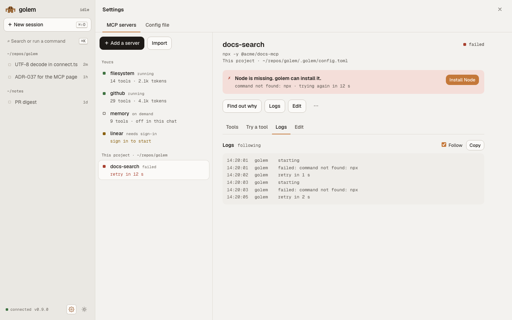

- **The `⋯` menu** holds Make it always on, Disable everywhere, and Remove. Remove opens a confirm dialog that says the token is deleted too.
- **A tool row** has a switch, the name in mono, its description cut to one line, the token cost on the right, and a `▸` that opens Try a tool on it.
- **A failed server** puts one banner above the actions: the reason, the one hint, and its button (`Install Node`, `Paste a new token`, `Sign in`).

### The add dialog

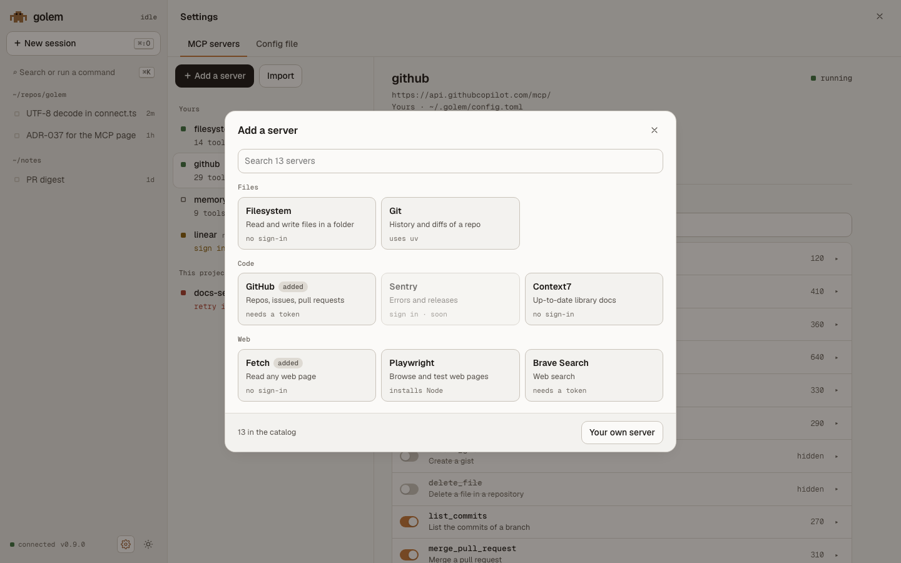

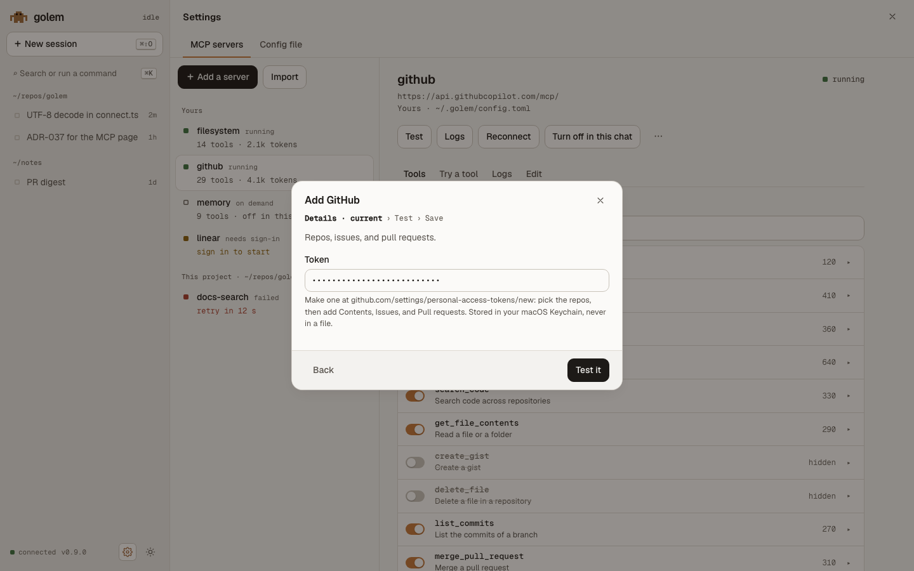

- **Cards by category,** the catalog's own order. A card has the name, one line, and one fact: `needs a token`, `sign in`, `installs Node`, `added`.
- **Picking a card** replaces the dialog's body with the entry's form, then the test, then Save. The steps are a small header, `Details · Test · Save`, with the current one marked and a word for each.
- **The form** is the terminal's C2 and C3: labelled fields, a path input with the [folder browser](web.md#the-folder-browser) for a folder, a choice, and a secret in `<input type="password">` with `autocomplete="off"`. A secret is never prefilled, and is cleared the moment the call returns.
- **`Your own`** is the C9 form.

### The test report

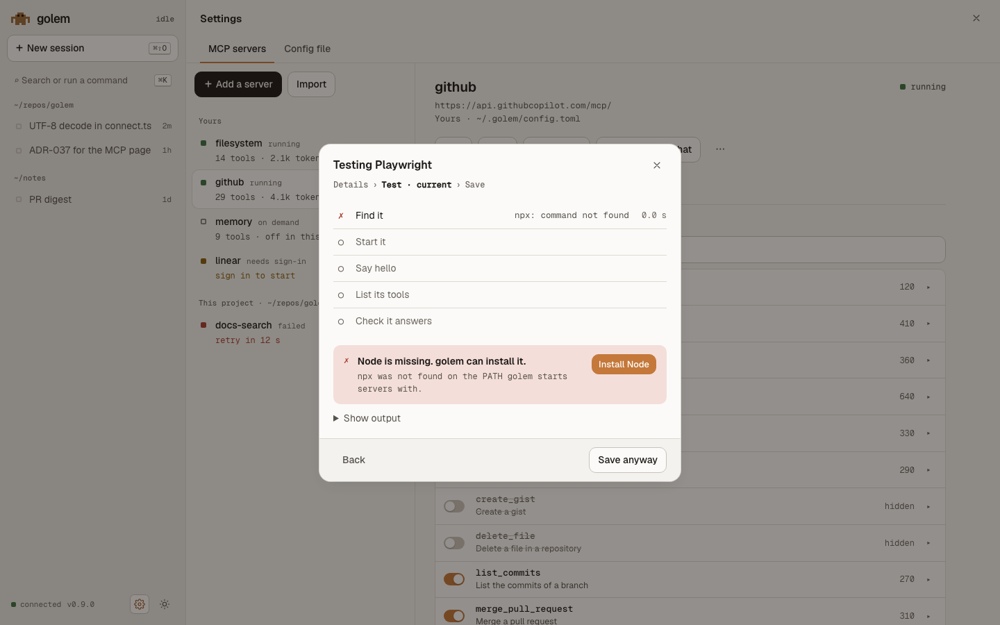

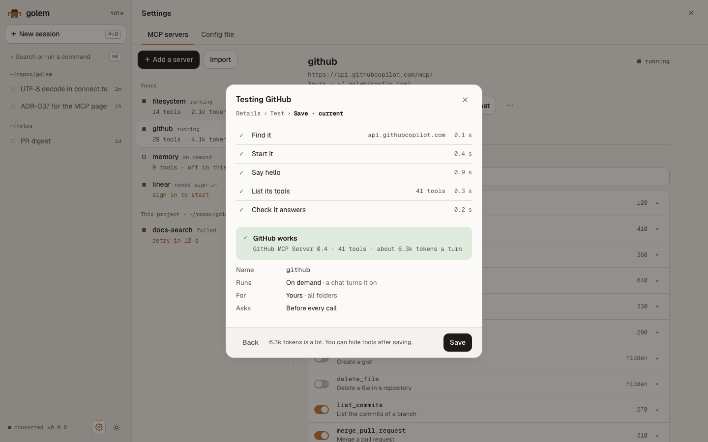

- **Live:** the steps come from `mcp.test.progress`. The working step is a pulsing clay square and a timer, still under reduced motion.
- **When it fails,** the failed step is marked `✗` in brick, the last stderr lines are in a collapsed `Show output` block, and the one hint has its button above: `Install Node`, `Paste a new token`. A `Save anyway` button sits beside Back.
- **When it passes,** it shows the server's name and version, the tool count and token cost, and the C5 summary: Name, Runs, For, Asks, then `Save`.

### The logs panel

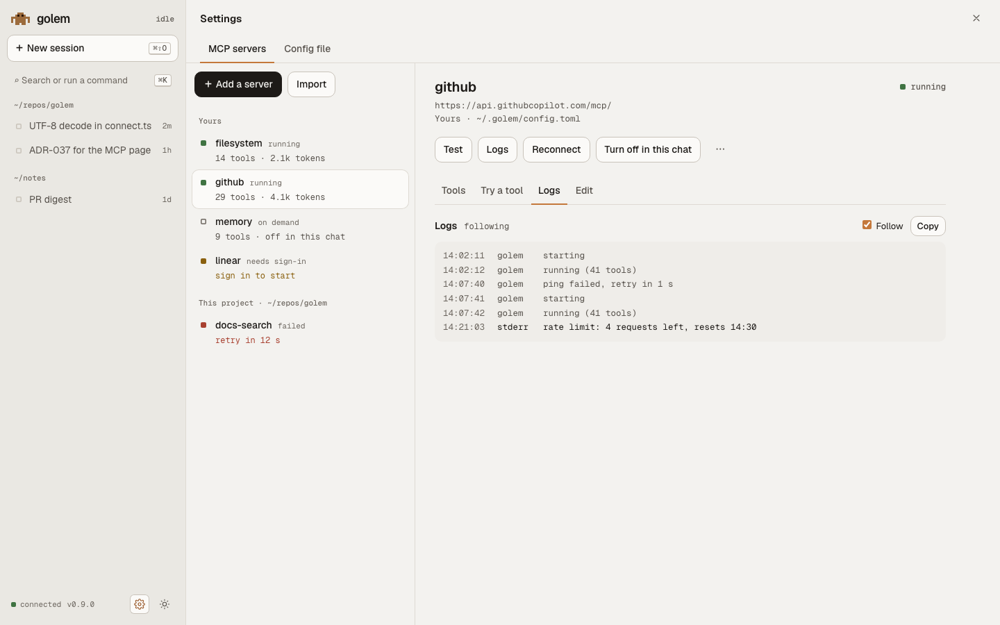

- Geist Mono, newest at the bottom. **Follow** is on by default, and turns off when you scroll up, with a `Jump to the end` button.
- golem's lines are in `muted`, the server's stderr in `ink`. A secret is replaced by `•••` before a line is sent, so nothing to hide here.
- The panel is a live region only for the status line, not for every log line, so a screen reader is not flooded.

### Try a tool

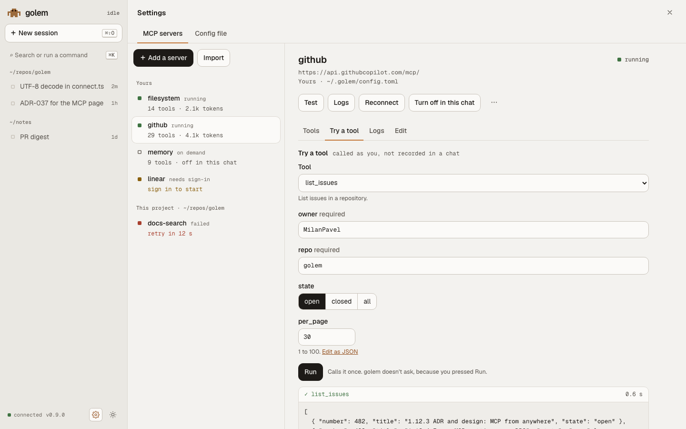

- The form is **built from the tool's JSON schema**: a text input for a string, a number input with its limits, a switch for a boolean, radio buttons or a select for an enum, and a required mark (`*`). Anything the form can't draw, such as nested objects or `oneOf`, is a JSON box with a short error under it.
- `Edit as JSON` shows the same values as JSON, and goes back to the form when it parses.
- The result is text in mono on `code-bg`. An error result has a brick `✗` and the text. Nothing is rendered as HTML.

### The edit form

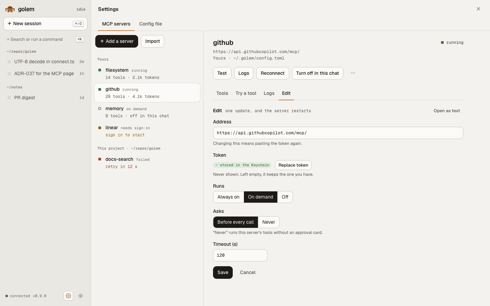

- One labelled field per setting, grouped under **Run**, **Access**, and **Advanced**, with a short help line under each.
- A secret field is `type="password"`, shows a `stored` badge from `mcp.get`, and is empty. An empty field on save means "keep". The **Replace token** button reveals the field.
- A change to the address of a server that has a stored token says, next to the field, `Changing this means pasting the token again`, and Save is off until the token is there ([ADR-037](../adr/037-browser-manages-mcp-and-config.md)).
- **Save** sends one update, and the page shows the row's `starting…` until the server answers. **Open as text** reveals the server's table in the config editor.

### The import dialog

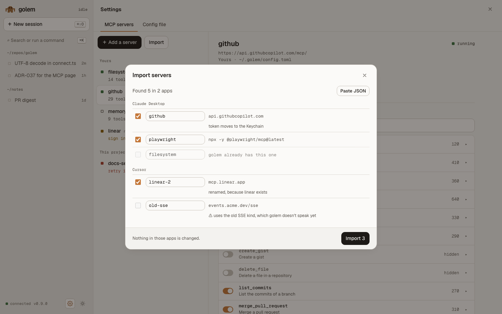

- The name is an input on each row, checked as you type. A warning is a row with `⚠` and its words, never colour alone.
- Paste JSON is a textarea. The same checks run, and the values are not kept.

### The config editor

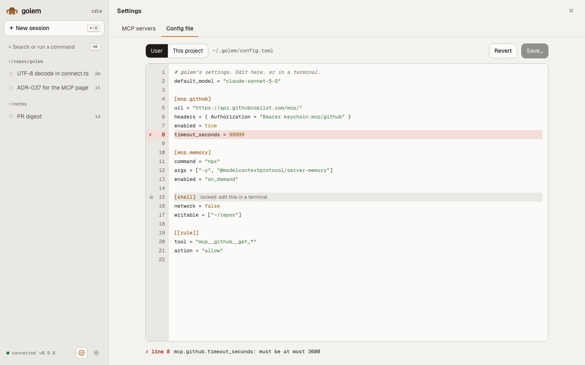

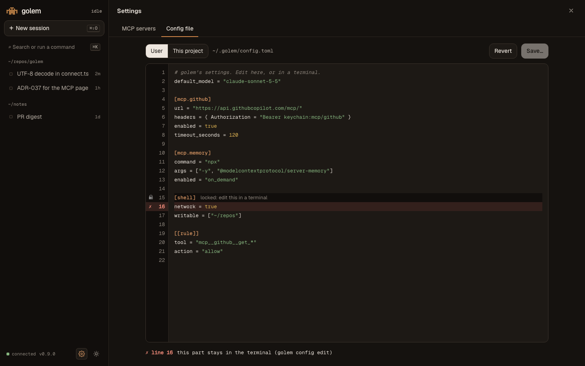

- **A textarea over a highlighted backdrop,** so the text is a real field for the browser, the keyboard, and a screen reader. TOML is highlighted. Line numbers sit in a gutter.
- **Checked as you type,** debounced to 400 ms. An error is listed under the editor, with its line, and marked `✗` in the gutter. A click on the error jumps to the line.
- **Locked parts are shown, not hidden.** The parts that stay in the terminal (`providers`, `trusted_projects`, `shell`, `web`, and the skill folders) have a lock and `edit this in a terminal` beside their headers. A change there is an error with that sentence, so the editor never fails in silence.
- **Save…** opens a diff, the old text against the new, line by line, and then Save sends it.

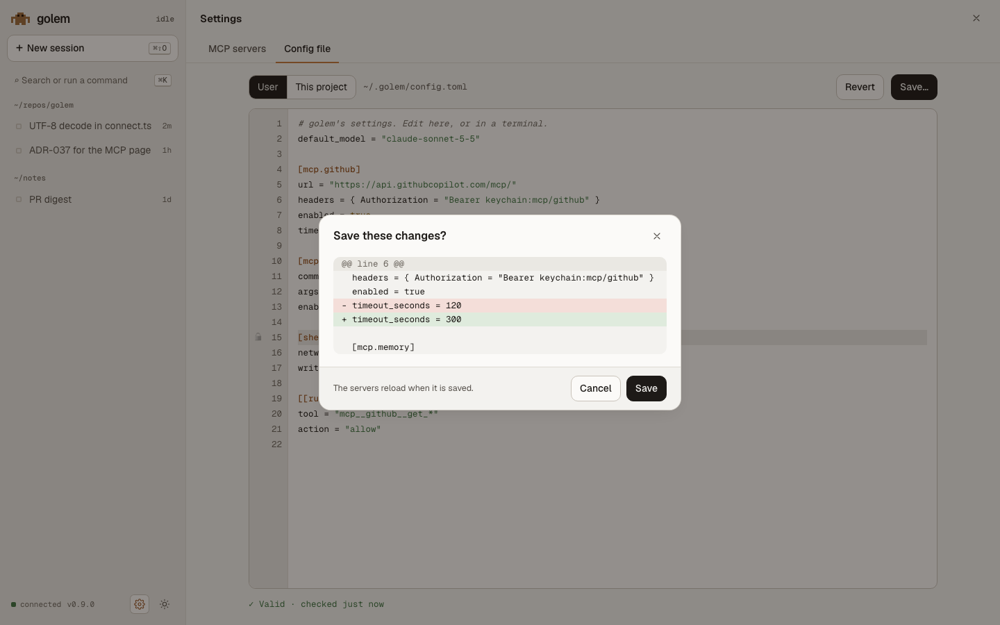

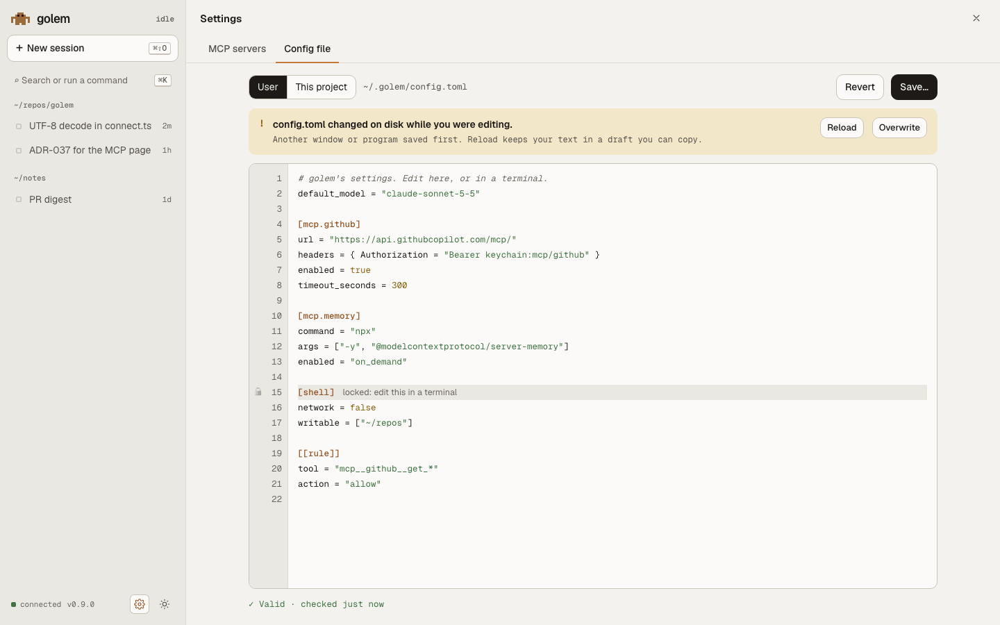

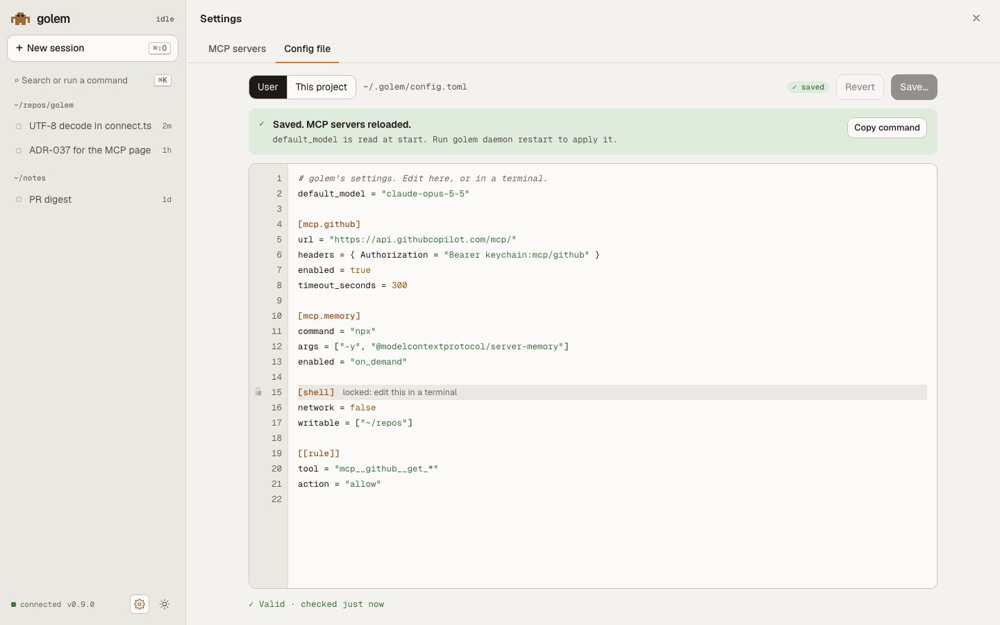

- **A conflict** shows the banner. Reload takes the file's new text, and keeps yours in a draft you can copy. Overwrite saves yours over it.
- **`restart_needed`** shows a banner with the command and a Copy button. The page cannot restart the service, as it cannot install it ([ADR-028](../adr/028-web-gateway.md)).
- **User and This project** is a switch, shown only when the session's folder is trusted.

### In the browser, the rules are the same

- **Keys.** Up and Down move in a list, Enter opens or does the main action, Esc goes back one level, and a dialog's focus returns to what opened it.
- **Words.** Plain, and the same as the terminal's: `Install Node`, `Save anyway`, `Disable everywhere`. A button says what happens.
- **Errors.** One line of what is wrong and the one thing to do. A failed call keeps the form as it was.
- **Motion.** 150 to 200 ms, and none under `prefers-reduced-motion`.
- **Tokens.** Only the tokens of [the web UI's design](web.md#tokens): no new colour is added for MCP. Status uses `allow`, `deny`, `wait`, and `faint`, and the accent stays clay.

## K · What each screen calls

So each ticket can see what its screens need from the daemon.

| Screens | Calls | Built in |
|---|---|---|
| A, B | `mcp.list`, `mcp.get`, `mcp.restart`, `mcp.enable`, `mcp.disable`, `mcp.set_enabled`, `mcp.remove`, and the `mcp.server.status` notification | 1.12.4, 1.12.8, 1.12.9 |
| C | `mcp.catalog`, `mcp.test` and `mcp.test.progress`, `mcp.add` (the catalog form), `runtime.install` | 1.12.5, 1.12.6 |
| D | `mcp.get`, `mcp.update` | 1.12.4 |
| E | `mcp.tools`, `mcp.update` (the tool filter), `mcp.logs` and `mcp.server.log`, `mcp.call`, `mcp.test` | 1.12.5 |
| F | `mcp.import.scan`, `mcp.import.apply` | 1.12.7 |
| G | `config.raw.get`, `config.raw.set`, `config.raw.set_protected` (terminal only) | 1.12.4 |
| H | `mcp.login`, `mcp.logout`, and the `mcp.login.done` notification | 1.12.10 |
| I | `mcp_enable` (a tool), prompts, resources, and elicitation | 1.12.11, 1.12.12 |
| The setup window's Tools panel | `mcp.catalog`, `mcp.add`, `runtime.install` ([setup-window.md](setup-window.md#h-tools)) | 1.12.6 |

## L · Words

The hints are short, one cause each, and say what golem can do. This table is the copy for `test_hint` in step 1.12.5. A row with a button offers it on every screen above.

| What went wrong | The line | Button |
|---|---|---|
| `npx` or `node` not found | Node is missing. golem can install it. | Install Node |
| `uvx` or `uv` not found | uv is missing. golem can install it. | Install uv |
| `docker` not found | Docker isn't installed. Install Docker Desktop or OrbStack. | Open the Docker page |
| HTTP 401 or 403 | The token was refused. Paste a new one. | Paste a new token |
| HTTP 401 with a sign-in address | This server signs in with OAuth. | Sign in |
| No answer to `initialize`, on `npx` or `uvx` | The first run downloads the package. Try again. | Test again |
| The process exited | The last line of its output, as it was. | Show the log |
| The name does not resolve, or the connection is refused | golem can't reach `<host>`. | Test again |
| Nothing else fits | The server didn't answer in time. | Show the log |

A failure that no row names shows the server's own last words and `Show the log`, and never a made-up cause.
