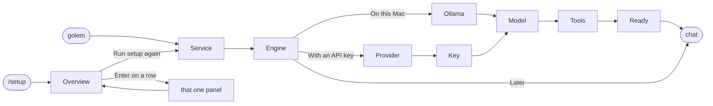

# The setup window: design

This is how golem sets itself up in the terminal, and how it shows later what is set up and what is broken. Step 1.9 of [the roadmap](https://github.com/MilanPavel/golem/issues/343) builds it, and step 1.12 adds the Tools panel (H).

## The idea

golem has **one setup window**. The first start walks through it step by step: that is **guided** mode. Later, `/setup` opens the same window on an **overview**, with one row per part of golem. Enter on a row opens that one step and then goes back. "Run setup again" walks every step once more, with the current choices already filled in.



Rules:

- **Order: Service, then Engine, then Model, then Tools, then Ready.** A step starts only when the one before it is done, so golem never asks for a model before something can run it. Tools is offered once, when no MCP server is set up yet, and `/setup` can open it any time.
- **Nothing slow is silent.** Every wait shows a spinner, what is happening, and how long it has taken.
- **Every panel has a default on Enter.** Esc goes back one step, and `q` quits.
- **No chat chrome while setting up.** The window is centred on an empty screen, with no logo, composer, or status bar, until the chat can actually answer.
- **A broken part says so in one line of the band**, and `/setup` fixes it. There are no popups.

### How to read the screens

Each screen below is one state of the window, about 60 columns wide. The bar on top names the screen, and the line under it says what leads where. In the screens:

| Mark | Means |
|---|---|
| `✓ Service ── ● Engine ── ○ Model` | The stepper, in guided mode only: done, now, to do. `!` needs attention, `–` was skipped |
| `› On this Mac` | The selected row. Enter picks it |
| `✓` `✗` `!` | Done, failed, needs you |
| `⠙` `███░░░` | Working, and how far |
| `❯ ••••▏` | A field you type into, hidden for a key |
| The last line | The keys this screen takes |

## A · First start on a bare Mac, on this Mac

The user has nothing: no service, no Ollama, no model, no key.

```screen A1 · Service: the question | Enter → A2. q quits golem.
● Service ── ○ Engine ── ○ Model ── ○ Tools ── ○ Ready

Welcome to golem.

golem runs a small background service, so your chats
keep going after you close this terminal.

› Start it now and at every login
  Only while this terminal is open

Enter picks · ↑↓ move · q quit
```

```screen A2 · Service: starting | Each sub-step shows as it happens. The service answers → A4.
● Service ── ○ Engine ── ○ Model ── ○ Tools ── ○ Ready

✓ launch agent installed
⠙ starting the service…                             3s
  waiting for it to answer
```

```screen A3 · Service: a slow first start | After about 10 s the wait is explained, so it never looks stuck.
● Service ── ○ Engine ── ○ Model ── ○ Tools ── ○ Ready

✓ launch agent installed
⠼ starting the service…                            12s
  the first start takes longer while macOS checks
  the app. This happens once.
```

```screen A3′ · Service: it didn't start | After about 45 s, or when the service stops. The reason comes from run/last-error.
● Service ── ○ Engine ── ○ Model ── ○ Tools ── ○ Ready

✗ the service didn't start
  data in ~/.golem is from golem 0.6, this is 0.5

› Retry
  Show the log
  Quit · then run: brew upgrade golem

Enter picks · ↑↓ move
```

```screen A4 · Engine | After half a second of "✓ service running". On this Mac → A5, With an API key → B1, Later → C1.
✓ Service ── ● Engine ── ○ Model ── ○ Tools ── ○ Ready

Where should golem think?

› On this Mac      private, free · uses Ollama
  With an API key  Anthropic, OpenAI…
  Later            golem can't answer until you pick

Enter picks · ↑↓ move · Esc back · q quit
```

```screen A5 · Ollama: missing | The panel checks at once. Installed but stopped: it only starts it. Running: guided mode skips this panel.
✓ Service ── ● Engine ── ○ Model ── ○ Tools ── ○ Ready

On this Mac · Ollama

✗ Ollama isn't installed
  Ollama runs the model on your Mac. About 200 MB.

› Install with Homebrew
  Open ollama.com/download instead

Enter picks · ↑↓ move · Esc back
```

```screen A6 · Ollama: installing | The daemon runs brew and streams its output to every window.
✓ Service ── ● Engine ── ○ Model ── ○ Tools ── ○ Ready

On this Mac · Ollama

⠸ brew install ollama                              41s
  downloading  ███████████░░░░░░░  118 / 190 MB

Esc stops
```

```screen A6 · Ollama: starting | Installed → Ollama starts → A7.
✓ Service ── ● Engine ── ○ Model ── ○ Tools ── ○ Ready

On this Mac · Ollama

✓ Ollama 0.12 installed
⠋ starting Ollama…                                  2s
```

```screen A6′ · Ollama: no Homebrew | Or the user picked the website. Ollama appears → A7, on its own.
✓ Service ── ● Engine ── ○ Model ── ○ Tools ── ○ Ready

On this Mac · Ollama

Opened ollama.com/download in your browser.
Install it, and golem continues on its own.

⠴ waiting for Ollama…                           1m 04s

Esc back
```

```screen A7 · Model | The real catalog, sized for this Mac. Enter → A8.
✓ Service ── ✓ Engine ── ● Model ── ○ Tools ── ○ Ready

Pick a model · Ollama · this Mac has 36 GB

› Gemma 4 E4B       6.6 GB   recommended
  Qwen3 8B          5.2 GB   good for code
  Qwen3 14B         9.3 GB   smarter, slower
  Devstral 24B     14.3 GB   heavy for 36 GB
  Show all 23 models

97 GB free on disk

Enter downloads · ↑↓ move · Esc back
```

```screen A8 · Model: downloading | Done → H1, the Tools panel (A9 when MCP servers already exist). Esc → the chat, with the download in the band (A10′).
✓ Service ── ✓ Engine ── ● Model ── ○ Tools ── ○ Ready

⠦ downloading Gemma 4 E4B
  ██████░░░░░░░░░░░░  2.1 / 6.6 GB · 12 MB/s · 6 min

Esc keeps it downloading and opens the chat
```

```screen A9 · Ready | Enter → the chat. The Tools row is there only when Tools ran or servers exist.
✓ Service ── ✓ Engine ── ✓ Model ── ✓ Tools ── ● Ready

✓ golem is ready

  Service   running, starts at login
  Engine    Ollama on this Mac
  Model     Gemma 4 E4B · saved as default
  Tools     Fetch, Context7, Playwright · on demand

/setup brings this back any time.

Enter starts chatting
```

```screen A10 · The chat | Its chrome shows for the first time.
▟█▙ golem 0.5.0
    Gemma 4 E4B
    ~/repos/golem

───────────────────────────────────────────────────────
❯ Ask anything
───────────────────────────────────────────────────────
connected   untitled   Gemma 4 E4B
```

```screen A10′ · The chat, while the model downloads | Opened with Esc in A8. Answers start when the download ends.
⠦ downloading Gemma 4 E4B · 2.4 / 6.6 GB · 5 min · /setup
───────────────────────────────────────────────────────
❯ Ask anything  (answers start when the download finishes)
───────────────────────────────────────────────────────
connected   untitled   Gemma 4 E4B
```

## B · First start, with an API key

From A4, With an API key.

```screen B1 · Provider | Enter → B2.
✓ Service ── ● Engine ── ○ Model ── ○ Tools ── ○ Ready

With an API key · which provider?

› Anthropic     Claude
  OpenAI        GPT

Enter picks · ↑↓ move · Esc back
```

```screen B2 · Key: found in the shell | When the shell has ANTHROPIC_API_KEY. Use it → B3.
✓ Service ── ● Engine ── ○ Model ── ○ Tools ── ○ Ready

Anthropic · API key

Found ANTHROPIC_API_KEY in your shell.

› Use it
  Paste a different key

Stored in your macOS Keychain, never in a file.

Enter picks · ↑↓ move · Esc back
```

```screen B2′ · Key: pasted | Enter → B3.
✓ Service ── ● Engine ── ○ Model ── ○ Tools ── ○ Ready

Anthropic · API key

Paste your key:
❯ ••••••••••••••••••••••••••••▏

Get one at console.anthropic.com/settings/keys
Stored in your macOS Keychain, never in a file.

Enter checks · Esc back
```

```screen B3 · Key: checking | The daemon asks the provider before it stores the key.
✓ Service ── ● Engine ── ○ Model ── ○ Tools ── ○ Ready

Anthropic · API key

⠙ checking the key with Anthropic…
```

```screen B3 · Key: rejected | The provider's own reason. Nothing is stored, and the field stays open.
✓ Service ── ● Engine ── ○ Model ── ○ Tools ── ○ Ready

Anthropic · API key

✗ Anthropic rejected the key (401 · invalid x-api-key)
❯ ▏

Enter checks · Esc back
```

```screen B3 · Key: it works | → B4.
✓ Service ── ● Engine ── ○ Model ── ○ Tools ── ○ Ready

Anthropic · API key

✓ key works · 9 models available
```

```screen B3′ · Key: macOS asks | The first read of a stored key by a new golem shows a system dialog.
✓ Service ── ● Engine ── ○ Model ── ○ Tools ── ○ Ready

Anthropic · API key

⠿ macOS is asking whether golem may use the key.
  Choose "Always Allow" in the dialog.
```

```screen B4 · Model | The same panel as A7, with the provider's models. Enter → Tools (H1), then Ready as in A9.
✓ Service ── ✓ Engine ── ● Model ── ○ Tools ── ○ Ready

Pick a model · Anthropic

› Claude Sonnet 5.5   recommended
  Claude Opus 5.5     smartest, slower, costs more
  Claude Haiku 5.5    fastest, cheapest

Enter picks · ↑↓ move · Esc back
```

## C · Later, and quitting part way

```screen C1 · The chat, with no model | Later in A4: no Ready panel, straight to the chat.
no model yet · /setup to pick one
───────────────────────────────────────────────────────
❯ Ask anything
───────────────────────────────────────────────────────
connected   untitled   no model
```

```screen C2 · Engine, after a send | Sending with no model opens the window on Engine. The message stays in the composer and goes once a model is ready.
– Service ── ● Engine ── ○ Model ── ○ Tools ── ○ Ready

Pick how golem thinks, then Enter sends your message.

› On this Mac      private, free · uses Ollama
  With an API key  Anthropic, OpenAI…

Enter picks · ↑↓ move · Esc back
```

```screen C3 · Quit setup? | q after the service is set up.
✓ Service ── ● Engine ── ○ Model ── ○ Tools ── ○ Ready

Quit setup?
The service stays on. /setup picks up where you left.

› Quit to chat
  Keep going

Enter picks · ↑↓ move
```

## D · Later: `/setup`

```screen D1 · Overview | No stepper. The rows come from setup.status, the same checks as golem doctor.
✓ Service   running · starts at login · 0.5.0
✓ Engine    Ollama 0.12 · running
            Anthropic · key works
✓ Model     Gemma 4 E4B · default
✓ Tools     3 MCP servers · 2 on demand
✓ Skills    4 skills

› Change model
  Add an API key
  Manage tools
  Run setup again

Enter picks · ↑↓ move · r recheck · Esc back to chat
```

```screen D2 · Model, alone | Change model in D1. Every ready engine's models, each labelled. Enter → D1 with "✓ default is now Claude Sonnet 5.5".
Pick a model · Ollama + Anthropic

  Gemma 4 E4B         6.6 GB   current
› Claude Sonnet 5.5            Anthropic
  Qwen3 8B            5.2 GB   download

Enter picks · ↑↓ move · Esc back
```

```screen D3 · Run setup again | Guided mode with today's choices filled in, so Enter on every panel changes nothing. "Stop and remove it" asks again.
● Service ── ○ Engine ── ○ Model ── ○ Tools ── ○ Ready

✓ Service is running and starts at login.

› Keep it
  Only while a terminal is open
  Stop and remove it

Enter picks · ↑↓ move · Esc back
```

## H · Tools

One panel for the MCP servers golem can start. It sits between Model and Ready, so a new user has useful tools on day one, and none of them costs a token until a chat turns it on. The full manager is `/mcp` ([mcp.md](mcp.md)).

```screen H1 · Tools: the offer | Opened from Model, only when no [mcp] table exists. The starter servers come from the catalog data (starter = true). Space ticks, Enter adds the ticked ones.
✓ Service ── ✓ Engine ── ✓ Model ── ● Tools ── ○ Ready

Give golem some tools?
They cost nothing until a chat turns one on.

› [x] Fetch        read any web page
  [x] Context7     up-to-date library docs
  [x] Playwright   browse and test web pages
  [ ] GitHub       repos, issues, pull requests

Space ticks · Enter adds 3 · s skip · Esc back
```

```screen H2 · Tools: GitHub needs a token | Ticking a server with a secret opens its field below the list. Empty means skip that server.
✓ Service ── ✓ Engine ── ✓ Model ── ● Tools ── ○ Ready

GitHub · token

Paste a token:
❯ ••••••••••••••••••••▏

Make one at github.com/settings/personal-access-tokens/new
Stored in your macOS Keychain, never in a file.

Enter keeps it · Esc back
```

```screen H3 · Tools: adding | Node or uv is installed first when a server needs it, the way Ollama is (A6). Each row says what it is doing.
✓ Service ── ✓ Engine ── ✓ Model ── ● Tools ── ○ Ready

Adding 3 tools

✓ Fetch        added · 1 tool
⠸ Node         brew install node                   38s
               downloading  ████████░░░░░░  41 / 98 MB
○ Context7     waiting
○ Playwright   needs Node

Esc stops
```

```screen H4 · Tools: added | Enter → Ready.
✓ Service ── ✓ Engine ── ✓ Model ── ● Tools ── ○ Ready

✓ Fetch        1 tool · on demand
✓ Context7     2 tools · on demand
✓ Playwright   21 tools · on demand

On demand: a chat turns one on with /mcp, or golem asks
you first. /mcp manages them any time.

Enter continues
```

```screen H5 · Tools: one failed | The reason is the one hint mcp.test gives. The others stay added.
✓ Service ── ✓ Engine ── ✓ Model ── ● Tools ── ○ Ready

✓ Fetch        1 tool · on demand
✗ GitHub       the token was refused
✓ Context7     2 tools · on demand

› Paste a new token
  Skip GitHub
  Show the log

Enter picks · ↑↓ move · Esc back
```

```screen H6 · Tools, from /setup | Single mode: the same panel with the servers already added shown as done. More is in /mcp.
Tools · 3 servers

  [x] Fetch        added
  [x] Context7     added
  [x] Playwright   added
› [ ] GitHub       repos, issues, pull requests

More servers: close this and type /mcp

Space ticks · Enter adds 1 · Esc back
```

## E · Something breaks later

```screen E1 · The chat, Ollama stopped | One band line, no popup. /setup → E2.
! Ollama isn't running · /setup
───────────────────────────────────────────────────────
❯ Ask anything
───────────────────────────────────────────────────────
connected   untitled   Gemma 4 E4B
```

```screen E2 · Overview, with a problem | The problem comes first, and so does its fix. Enter starts Ollama, and the rows turn green.
✓ Service   running · starts at login
! Engine    Ollama 0.12 · not running
! Model     Gemma 4 E4B · needs Ollama
✓ Tools     2 MCP servers

› Start Ollama
  Change model
  Run setup again

Enter picks · ↑↓ move · r recheck · Esc back to chat
```

```screen E3 · Model, the default is gone | At start, when the default model was deleted: the Model panel alone, saying which.
! qwen3:8b is no longer installed in Ollama.

› Download qwen3:8b again      5.2 GB
  Gemma 4 E4B                  installed
  Pick another model

Enter picks · Esc chat without a model
```

```screen E4 · A returning user | Everything works: no window at all.
welcome back · Gemma 4 E4B · 12 chats in /sessions
───────────────────────────────────────────────────────
❯ Ask anything
───────────────────────────────────────────────────────
connected   untitled   Gemma 4 E4B
```

When golem has to start Ollama or load the model for the first message, the band shows `starting Ollama…` and then `loading Gemma 4 E4B…` until the first token.

## F · A small terminal

```screen F · Under 60×20 | The window loses its border and goes full width. The stepper becomes "2/5 Engine".
golem setup · 2/5 Engine
Where should golem think?
› On this Mac      Ollama
  With an API key
  Later
Enter · ↑↓ · Esc
```

## G · How it fits together

### The parts

| Part | What it is |
|---|---|
| **Frame** | A centred box about 60 columns wide: the title, the version, the stepper (guided mode only), the panel's body, and the panel's key hints. Under 60×20 it loses its border and goes full width (F). |
| **Panel** | One step. It gets the current state, draws its body, handles its keys, and reports one result. It never knows where it was opened from. |
| **Navigation** | One table in `packages/view` that says which panel comes after which result in which mode. The web UI uses the same table. |
| **`setup.status`** | One daemon call that returns every overview row. `golem doctor` prints the same rows. |

### Panels

| Panel | Screens | Reports |
|---|---|---|
| Service | A1–A3′, D3 | `done`, `cancelled` |
| Engine | A4, C2 | `local`, `key`, `later`, `cancelled` |
| Ollama | A5–A6′ | `done`, `cancelled` |
| Provider | B1 | `provider:<id>`, `cancelled` |
| Key | B2–B3′ | `done`, `cancelled` |
| Model | A7, A8, B4, D2, E3 | `done`, `background`, `cancelled` |
| Tools | H1–H6 | `done`, `skip`, `cancelled` |
| Ready | A9 | `done` |
| Overview | D1, E2 | `open:<panel>`, `guided`, `close` |

### Navigation

| Mode | Result | Next |
|---|---|---|
| guided | Service `done` | Engine |
| guided | Engine `local` | Ollama, or Model when Ollama runs |
| guided | Engine `key` | Provider, then Key |
| guided | Ollama or Key `done` | Model |
| guided | Engine `later` | the chat (C1) |
| guided | Model `done` | Tools when the user config has no `[mcp]` table, else Ready |
| guided | Tools `done` or `skip` | Ready |
| guided | Model `background` | the chat, with the download in the band (A10′) |
| guided | Ready `done` | the chat |
| guided | any `cancelled` | the panel before. On Service, golem quits |
| single | any result | the overview (D2), or the chat when opened at start (E3) |
| overview | `close` | the chat |

### What opens at start

| State | Opens |
|---|---|
| No service | guided, from Service (A1) |
| The service runs, no model chosen | guided, from Engine (A4) |
| The default model is gone | the Model panel alone, with the reason (E3) |
| Everything works | nothing, the `welcome back` line (E4) |
| `/setup` | the overview (D1) |

Tools is offered once. "Offered" is kept with the setup window's other state, and a `[mcp]` table in the user config means there is nothing to offer.

### What the daemon gives

- `setup.status`: every overview row in one call, from the same checks as `golem doctor`.
- An Ollama install that streams progress, like a model pull.
- A key check before the key is stored.
- Pull progress, which exists today.
- `mcp.catalog` for the Tools rows, `mcp.add` with a catalog id for Enter, `runtime.install` for Node and uv, and `mcp.test` for the one-line reason when a server fails. `setup.status` has a `tools` part for the overview row.

The TUI fills the Service row itself, from the launch agent and `run/last-error`, because the daemon can't answer while it is down.

### The web UI

The web uses the same `setup.status`, rows, lines, guided order, and start rule (`setupAtStart`), but draws them as pages, not as this window ([ADR-039](../adr/039-web-setup-as-pages.md), [web.md](web.md#setup-in-settings)):

- **The overview is Settings → Setup,** a form. Its Tools card opens the H6 offer in place, and links to `/settings/mcp`. Each row is a card with its fix in place: a button, a command to copy, or a link. The navigation table does not apply: a page has Tab and buttons.
- **Guided mode is the page `/welcome`,** with Engine, Model, Tools, and Ready. Tools is the H panels as one page step, offered only when no MCP server exists. Service is left out, because the page is connected, so the service runs. When launchd doesn't keep it, Ready and the Service card show `golem daemon install` with a copy button.
- **What opens at the start** is the same decision as the terminal's, but it navigates: a fresh home goes to `/welcome`, a default that is gone goes to `/welcome?step=model`, and a send that fails for no model goes to `/welcome?from=send` with the draft kept. `/setup` opens Settings → Setup.

Two panels differ, since [ADR-028](../adr/028-web-gateway.md) keeps both out of the browser:

- **Service** only shows `golem daemon install` with a copy button. Its row comes from the daemon's launchd check, with the version added.
- **Key** never takes a key. It shows `golem auth set <provider>` with a copy button and `Check again`.

Tools needs no such change, and a token for GitHub may be typed into the page, because [ADR-037](../adr/037-browser-manages-mcp-and-config.md) allows MCP tokens, not model keys. There is no Quit-setup question: `Later` leaves at any step, and a download keeps running.
