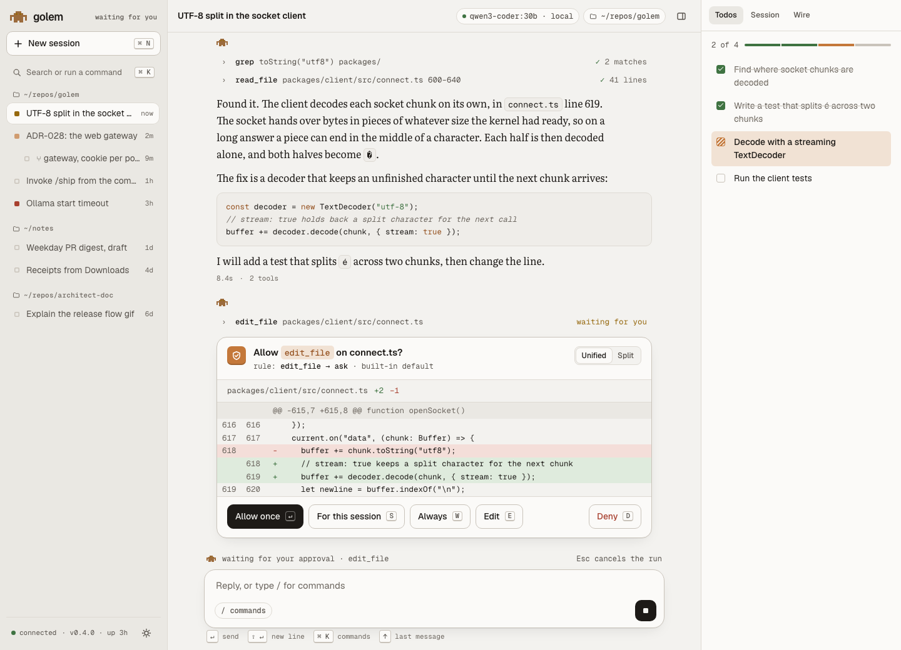
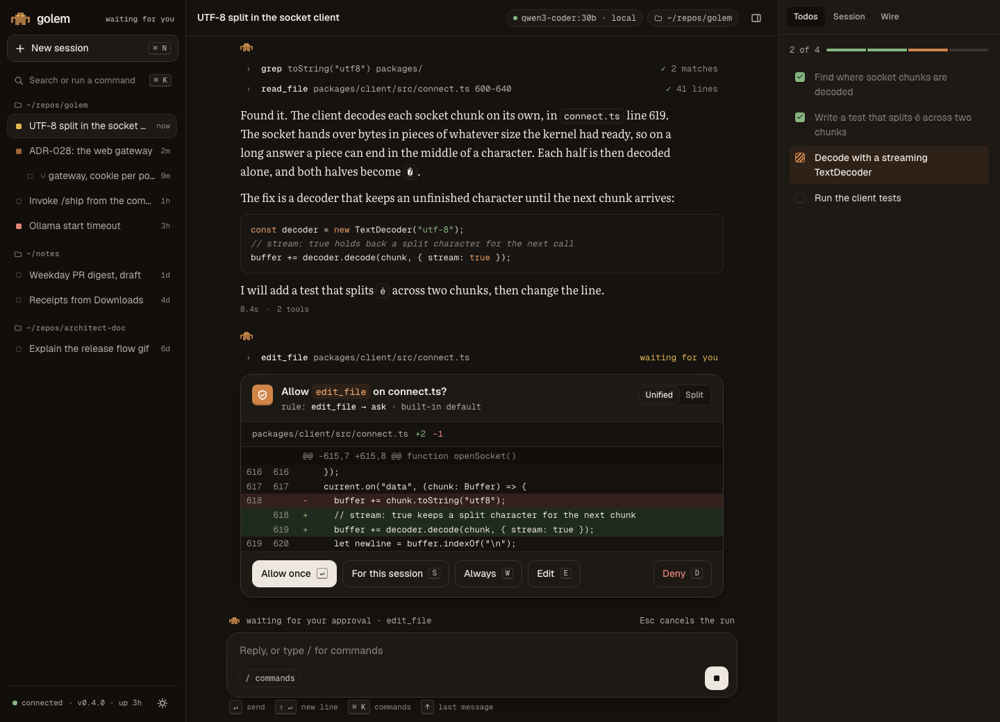

# The web UI: design

This is how golem looks in a browser.

The prototype in [prototype.html](prototype.html) shows every screen below. Open it in a browser. Its dark panel switches screens, golem's state, the wordmark, and the theme. For a screenshot, add `#kiln` or `#slip` to the address to pick a theme, `shot` to hide the panel, and `end` to scroll down to the approval, as in `prototype.html#kiln,shot,end`.

The prototype was approved in step 10.2 ([#155](https://github.com/MilanPavel/golem/issues/155)). How the page is built is in [ADR-029](../adr/029-web-stack.md), and how it reaches the daemon is in [ADR-028](../adr/028-web-gateway.md).





## The idea

The design is minimal: one accent colour, a quiet reading column, and few borders. What makes it golem's is the figure itself.

- **The pixel golem is the status light.** The 9×6 figure from the TUI's logo (`packages/tui/src/logo.ts`) appears in the sidebar, on every answer, in the meter, on the empty screen, and as the favicon. Its eyes say what golem is doing.
- **Clay is the only accent.** It marks what is golem's or what needs you: the send button, the streaming cursor, the seal on an approval, the eyes while golem works.
- **Golem's answers read like a page,** in a book serif. Everything else (the interface, code, tools) is a quiet sans or mono.
- **An approval reads like the shem,** the scroll that tells the golem what it may do. It is a card with a clay seal, the question, the rule that asked, and the diff.

It borrows the calm, centred reading column and generous input from Claude's chat. From opencode it borrows sessions grouped by project, a diff-first approval, and a side drawer.

## Layout

```
┌──────────────┬───────────────────────────────────────┬──────────────┐
│ ▞ golem      │ Session title       model · folder  ▯ │ Todos Session│
│ + New        ├───────────────────────────────────────┤ Wire         │
│ Search  ⌘K   │                                       │              │
│              │           you: a question  ▐          │ 2 of 4 ▬▬▬▭  │
│ ~/repos/golem│  ▞ (hover: 14:02)                     │ ☑ Find …     │
│ ■ UTF-8 …    │  › grep  toString("utf8")    ✓ 2      │ ☑ Write …    │
│ ■ ADR-028 …  │  An answer in Literata, about 65      │ ▨ Decode …   │
│   ⑂ gateway …│  characters wide …                    │ ☐ Run …      │
│ □ Invoke …   │  ┌ shem ─────────────────────────┐    │              │
│              │  │ ▣ Allow edit_file on …?       │    │              │
│ ~/notes      │  │   diff                        │    │              │
│ □ PR digest  │  │ [Allow once] [Session] …[Deny]│    │              │
│              │  └───────────────────────────────┘    │              │
│              │  ▞ waiting for your approval          │              │
│ ● connected  │  ┌ Reply, or type / for commands ──┐  │              │
│ v0.4.0 · ☼   │  └─────────────────────────────  ■ ┘  │              │
└──────────────┴───────────────────────────────────────┴──────────────┘
   268 px            column at most 46 rem                 320 px
```

- **Sidebar** (`sunken`): the wordmark with golem's state, New session, a Search button (`Search or run a command`, with its key, ⌘K or Ctrl K) that opens the palette, then sessions grouped by folder. Each session has a small square for its state, its title, and how long ago it was active. A fork is indented under its parent with `⑂`. At the bottom are the connection, the version, and the theme switch.
- **Top bar:** the session title, the model chip, the folder chip, and the drawer toggle.
- **Column:**
  - Your messages are right-aligned slips in `slip`.
  - Golem's answers are full width: the small golem, then tool lines, then the text, then the duration and tool count.
- **Dock:** the meter (the small golem and what it is doing), the composer (a rounded card that turns clay when focused), and a row of key hints.
- **Drawer:**
  - **Todos:** progress in segments, then the list. A done item is ticked in moss, the current one is hatched in clay, and the rest are empty.
  - **Session:** model, folder, what this session allows, pinned skills, MCP servers.
  - **Wire:** the last protocol lines, as in the TUI's `/debug wire`.

**One composer per screen.** The empty screen has a large centred composer. Once you send, the chat's docked composer takes its place. The full-screen states have none, because nothing can be sent without a connection.

**Narrow windows:**
- Below 1100 px the drawer becomes a sheet from the right.
- Below 760 px the sidebar becomes a sheet from the left, opened from a menu button. The folder chip and the key hints go away.

## The pixel golem

| State | Eyes | Word beside it | When |
|---|---|---|---|
| idle | dark (`golem-eye`) | `idle` | Nothing runs |
| thinking | clay, pulsing | `working` | A run is in progress |
| waiting | amber, a short blink | `waiting for you` | An approval waits |
| failed | brick | `last run failed` | The last run ended in `run.failed` |
| disconnected | grey, and the body grey | `offline` | The link is down |

- **Every state has a word as well as a colour,** so colour is never the only sign.
- **The golem on an answer shows only that answer's state.** It is plain when the answer is done, has clay eyes while it streams, and has amber eyes while a tool call in it waits for you.
- **The favicon and the tab title** follow the sidebar's state, from the same state the TUI's `window-title.ts` uses. They update outside the animation frame, so a hidden tab still shows it.
- **Motion** lasts 150 to 200 ms. `prefers-reduced-motion` turns off every animation: the eyes, the cursor, and the dots.

## Messages and tools

- **You:**
  - Geist 14.5 px, in a `slip` bubble with one sharp corner toward the bottom right.
  - The time sits under the text, in `muted`.
- **Golem:**
  - Literata 16 px with a 1.68 line height, at most 40 rem wide, which is about 65 characters.
  - Inline code is in Geist Mono on `code-bg`. List markers are clay.
- **The streaming cursor** is one clay square, the size of one of the golem's pixels, blinking. There is no spinner anywhere.
- **Tool lines:**
  - One line each, in mono: a chevron, the tool name, its arguments cut to fit, and the result.
  - Results read `✓ 41 lines` or `✓ 2 matches` in moss, `waiting for you` in amber, or `✗ denied` in brick.
  - Clicking a line opens its tablet: the output, in mono on `code-bg`.
- **Below an answer:** the duration and the number of tools, in `faint` mono.

## The approval (the shem)

- **The head:**
  - A clay seal: a 30 px square with a shield and a tick.
  - The question in Geist 600: `Allow edit_file on connect.ts?`, with the tool name in a clay chip.
  - The rule that asked, in mono: `rule: edit_file → ask · built-in default`.
  - A Unified or Split switch.
- **The diff:**
  - Mono 12.5 px on `bg`, with the line numbers of both sides.
  - Added lines on `allow-soft`, removed lines on `deny-soft`, and the hunk header on `sunken`.
  - Split view puts the old file on the left and the new one on the right.
- **The actions:**
  - **Allow once** `↵`, the only filled button, in ink.
  - **For this session** `S`, **Always** `W`, and **Edit** `E`.
  - **Deny** `D`, set apart on the right, with brick text.
  - The same keys work while the composer is empty and not focused.
- **Once answered,** the card collapses to its head and one line: `✓ Allowed once`, or `✗ Denied`. The tool line's result changes to match.

## Full-screen states

The page cannot do anything while the link is down, so each case gets its own screen instead of a banner. Each screen has the golem (grey or failed eyes), a short tag, a heading in Literata, one sentence, and the command to run, with a copy button.

| State | Tag | Heading | Command |
|---|---|---|---|
| unauthorized (code 4401) | `unauthorized` | This page needs a fresh link | `golem web` |
| protocol major differs | `protocol 2.25 · daemon 1.9` | The daemon is older than this page | `golem daemon restart` |
| daemon down | `reconnecting · attempt 4` | golem's daemon is not running | `golem daemon start` |

The page keeps retrying behind "daemon down", and the screen goes away by itself when the link is back.

## The ⌘K palette

- **Opening:** ⌘K on macOS, Ctrl+K elsewhere, from anywhere on the page, also while typing in the message box. It toggles, so the same key closes it. It does not open over another dialog. The sidebar's Search button opens it too. Browsers keep ⌘N for a new window, so the page binds no key for New session.
- A centred dialog with a search field on top, named `Commands`, and a footer line `↵ run · ↑↓ move · esc close`. It is the same combobox and grouped list as the model dialog.
- The commands come from the TUI's slash-command table, grouped as Session, Model, Tools, and View. Each row has the `/name` in clay mono, its arguments in faint mono, a description, and its key on the right when it has one (`/help` has `?`). A command the page lacks says `In the terminal for now` and still runs, which prints where it lives. View also has a `Keys` row, which is not a slash command; it opens the key list.
- Typing filters on the name, the arguments, and the description, ignoring case. Names that start with the text come first. Up and Down move, Enter runs, and Esc closes and gives focus back to what had it.
- **Who runs a command:** the composer on screen, through the same path as typing the line: the session's dock, or the start page's composer. With none (the not-found screen), the commands are listed, the palette says `Open a session or the start page to run commands.`, and Enter does nothing.
- **What Enter does on a command:**
  - No arguments, or only optional ones (`[...]`): it runs at once as `/name`, and the palette closes. `/title` shows the title, `/model` opens the model dialog, `/copy` copies the answer.
  - A required argument (`<provider>`, `run|pin|unpin <name>`): it does not run. The palette closes and puts `/name ` in the message box with focus there, so the slash suggestions take over.
- **Text that matches no command** leaves one row, `Send "<text>"`, in its own group `Message`. Enter sends it through the composer, so on the start page it starts a session. Text that starts with `/` and matches nothing runs too, which shows the unknown-command notice. If a run in progress holds the message back, it goes to the message box instead.

## The key list

- A dialog `Keys`, opened with `?` when focus is not in a field, and from the palette's `Keys` row. It does not open over another dialog. Esc closes it and focus goes back.
- Sections, each key in a `Kbd`:
  - **Page:** ⌘K the palette, ? this list, Esc close a dialog.
  - **Composer:** ↵ send, ⇧↵ new line, ↑↓ earlier messages, / commands, Tab complete a command, Esc stop the answer.
  - **Approval** (while one waits and the message box is empty and not focused): ↵ allow once, S for this session, W always, E edit, D deny. The list reads the same table the keys do.
  - **Model dialog:** ↑↓ move, ↵ use or download, Esc clear the search, then close.
- ⌘ is Ctrl off macOS, everywhere a key is shown.

## The model dialog

- The model chip in the top bar is a button, `Model: <name>`. It opens a centred dialog, `Choose a model`, and focus returns to the chip when it closes.
- A search field over the list, as one combobox: focus stays in the field, Up, Down, Home, End, PageUp, and PageDown move the active row, Enter does its main action, and Esc clears the search, then closes.
- The groups are the TUI picker's: Profiles, Installed, Download, then each provider. A row has the label, the ref in faint mono, and the facts in mono. The session's model has a check, the default a `default` badge.
- A row that is not ready is muted and says why. The page never takes a key, so it names the command: `golem auth set <provider>`, `/setup`, `ollama serve`.
- A download shows a bar, `2.1 / 6.6 GB · 12 MB/s · 6 min`, and it is the same one the terminal shows, because progress reaches every connection.
- The footer acts on the active row: Use for this session, Make default, Download, Stop download, Remove. Download and Remove ask first, in the footer; a model too big for the machine asks twice.

## The setup window

- One centred dialog, `Setup`, drawn from the same panels, lines, and navigation table as the terminal's ([setup-window.md](setup-window.md)). Guided mode shows the stepper, with a word for each step (`done`, `current step`, `to do`, `skipped`) as well as its mark. Marked lines say `done`, `failed`, `needs attention`, or `working` to a screen reader, and `working` is a small clay square that pulses, still under reduced motion.
- It opens from `/setup` and the palette's `/setup` row (the overview), from a send that fails for no model (guided from Engine, with the draft kept in the composer), and by itself at the start, once per page load: a fresh home opens guided from Engine, a default that is gone opens the Model panel alone, and a working setup opens nothing. It never opens over another dialog; a start-time opening waits until none is open.
- Choices are a list of buttons. Up and Down move, Enter chooses, Esc goes back as the table says, and a click is the same as moving there and pressing Enter. Esc on the guided Service panel at the start, and Ready's Enter, close the window. The close button closes it at any point, like Later: the page goes on, and a download keeps running.
- This Mac works from the page: the daemon installs Ollama with Homebrew and streams its output, starts it, and pulls the model, and a download shows the same bar as the model dialog. With no Homebrew, a link opens ollama.com/download in a new tab and the panel waits for Ollama to appear.
- Service and Key are commands, not controls, because the page never installs a service or takes a key ([ADR-028](../adr/028-web-gateway.md)). The page is connected, so the service runs. The Service row says so with the version, and when launchd does not keep it the row needs attention and the panel shows `golem daemon install` with a Copy button. The Key panel shows `golem auth set <provider>` with Copy and a `Check again` button: it is done once the provider no longer needs a key, and says `the key isn't there yet` until then.

## Slash commands in the composer

- Typing `/` at the start of the message opens a list above the composer: the `/name` in clay mono, the description in muted text, at most about eight rows, then it scrolls. Up and Down move, Tab completes, Enter runs (a partial match fills in first), and Esc closes it for that text. Typing again opens it again. `//` is a message and never suggests. The list stays closed while a run is in progress or while you browse the history with Up and Down.
- It is a listbox named `Commands`. The textarea stays a textbox and points at it with `aria-autocomplete="list"`, `aria-controls`, and `aria-activedescendant`, because a role of combobox is not allowed on a textarea. A polite live region says how many suggestions there are when the count changes.
- After `/model ` the list offers model names, and after `/skill run ` skill names. The model and skill lists are fetched only once the text starts with `/`.
- A command answers in one muted line above the key hints, such as `Renamed.` or `Copied the last answer.`. It clears when you type or run the next command. An error stays in the red line. A notice may carry a command for a terminal, such as `golem auth set anthropic`, in mono with a `Copy` button that says `Copied` for two seconds.
- `/help` opens a `Commands` dialog with the table grouped as Session, Model, Tools, and View.
- `/model`, `/close`, `/fork`, `/title`, `/skill`, `/copy`, `/export` (a markdown download), `/time`, and `/todos` act on the page. On the empty screen the ones that need a session say `Start a session first: send a message.`
- The page has no key entry, so `/login` and `/logout` show the `golem auth` command to copy ([ADR-028](../adr/028-web-gateway.md)).
- Not on the page yet, so each says where it lives: `/mcp`, `/skills`, `/permissions`, `/artifact`, and `/debug` are in the terminal (run `golem`, then the command); `/sessions` points at the sidebar. The Commands dialog marks the terminal ones `In the terminal for now`.

## Type

| Role | Face | Size and weight |
|---|---|---|
| Interface | Geist | 14 px / 1.5, 500 for buttons and titles, 600 for the shem's question |
| Wordmark | Geist | 17 px, 600, letter spacing −0.03 em, lowercase `golem` |
| Golem's answers | Literata (optical sizes) | 16 px / 1.68 (15.5 px on a phone) |
| Headings on full screens | Literata | 26 px, 400 |
| Code, tools, labels, times | Geist Mono | 11 to 13.5 px |

The fonts are self-hosted and subset ([ADR-029](../adr/029-web-stack.md)). Silkscreen, a pixel face, is in the prototype only as a wordmark choice to compare, and is not shipped.

## Tokens

These become `packages/web/src/styles/tokens.css` in step 10.6. The names say what a colour is for. **slip** is the light theme, like unfired clay, and **kiln** is the dark one.

### Colour

| Token | slip | kiln | Used for |
|---|---|---|---|
| `bg` | `#F3F2EF` | `#15120F` | The page, the diff |
| `surface` | `#FBFAF8` | `#1D1915` | Cards, the composer, the drawer |
| `sunken` | `#EAE8E3` | `#110E0C` | The sidebar, hunk headers |
| `ink` | `#1D1A17` | `#EEE7DF` | Text, the primary button |
| `muted` | `#57524C` | `#B5ACA2` | Secondary text |
| `faint` | `#6C665F` | `#8F877E` | Times, labels, folder names. Not on `slip` |
| `line` | `#DEDAD3` | `#2C2621` | Borders |
| `line-strong` | `#C9C3BA` | `#3B332C` | Control borders, empty boxes |
| `clay` | `#C4783A` | `#D08549` | The accent as a fill: send, seal, cursor, eyes |
| `clay-ink` | `#94501E` | `#E6A06A` | The accent as text: `/commands`, the tool chip |
| `clay-soft` | `#F1E2D4` | `#2E2118` | The current todo, the tool chip's ground |
| `slip` | `#ECE3D8` | `#2A221B` | Your messages |
| `golem-body` | `#9C6B3C` | `#A8733F` | The figure |
| `golem-eye` | `#2A1408` | `#0E0704` | The figure's eyes at rest |
| `allow` / `allow-soft` | `#3F7342` / `#DFEBDD` | `#86B57F` / `#1F2B1E` | Allowed, added lines, done |
| `deny` / `deny-soft` | `#A8402F` / `#F4DED9` | `#E58474` / `#33201C` | Denied, removed lines, failed |
| `wait` / `wait-soft` | `#8A600E` / `#F3E7C9` | `#E2B655` / `#30271A` | Waiting for you |
| `code-bg` | `#EFEDE9` | `#191512` | Code blocks, tool output |

### Contrast

Checked with the WCAG 2.2 formula. 4.5:1 for text, 3:1 for fills and focus rings that carry meaning.

| Pair | slip | kiln |
|---|---|---|
| `ink` on `bg` / `surface` / `sunken` / `slip` | 15.5 / 16.6 / 14.2 / 13.7 | 15.2 / 14.3 / 15.7 / 12.8 |
| `muted` on `bg` / `sunken` / `slip` | 6.9 / 6.3 / 6.1 | 8.3 / 7.8 / 7.0 |
| `faint` on `bg` / `sunken` / `surface` | 5.1 / 4.6 / 5.4 | 5.3 / 4.9 / 5.4 |
| `clay-ink` on `bg` / `surface` | 5.5 / 5.9 | 8.5 / 8.0 |
| `allow`, `deny`, `wait` on `surface` | 5.4, 5.9, 5.35 | 7.4, 6.6, 9.2 |
| `wait` on `bg` / `sunken` | 4.99 / 4.56 | 9.8 / 10.1 |
| `clay` on `bg` (a fill, and the focus ring) | 3.1 | 6.3 |

`wait` was darkened from `#96690F` so the waiting label passes on `bg` as well.

`faint` reaches only 4.47 on `slip`, so text on your messages uses `muted`. The check in 10.6.2 runs over every pair in this table.

### Shape and space

| Token | Value |
|---|---|
| Radius | 6 px (small), 10 px (controls), 16 px (cards, the shem), 18 px (the composer), round for chips |
| Shadow | One soft shadow, for the composer, the shem, and the palette only |
| Sidebar, drawer, column | 268 px, 320 px, 46 rem |
| Gutter | At least 16 px, and the safe-area insets on a phone |
| Grid | 4 px steps. The empty screen's faint grid is 20 px, one pixel of the golem |

## Copy

- Plain words, and the names the TUI already uses: session, fork, model, folder, rule, approval, todo.
- A button says what happens: `Allow once`, `Deny`, `New session`.
- An error says what is wrong and the one thing to do: `golem's daemon is not running` with `golem daemon start`.
