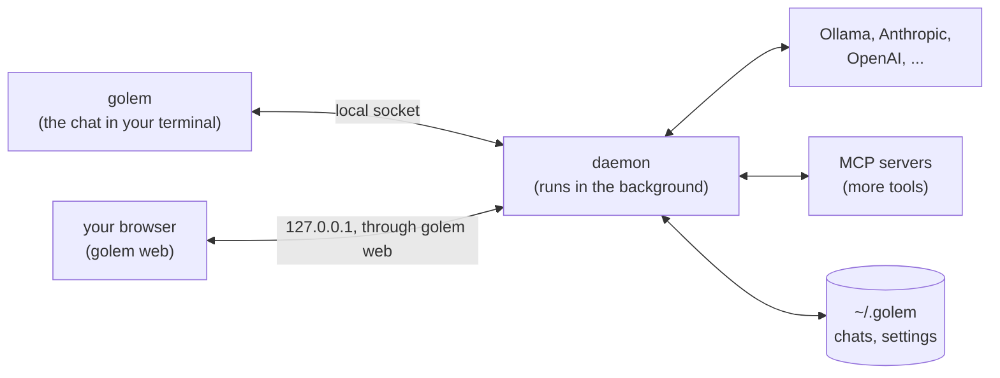

# Introduction

golem is an AI agent that lives on your Mac. You chat with it in your terminal or your browser, and it works in the folder you open it in: it reads and searches your files, edits them, runs commands, and looks things up on the web. It asks you first before it does anything that matters.

## Why golem

**Local models first.** Most agent tools assume a huge hosted model. golem gets real work out of the model on your laptop, and calls a hosted one only when the task needs it. Every answer shows what it cost.

**It asks before it acts.** Files, the shell, git, and the web are built in. Every tool call passes one permission layer, so a change to a file shows as a diff, and a command waits for your yes. Commands run in a sandbox.

**Nothing is lost.** Every chat is written to disk as it happens. Close the terminal in the middle of an answer and the answer keeps going. A crash, a restart, or an upgrade picks up where it left off.

**Built from scratch, to learn.** golem builds the hard parts itself, to find out what a reliable agent really needs. Memory and skills it writes for itself, routing between models, and testing its own answers are the road ahead. [The plan](../plan.md) lists each step.

## How it works

golem has two parts: a **daemon** that does the work, and the **chat** that you see.

- **The daemon** talks to the model, runs the tools, and stores every chat in `~/.golem`. macOS keeps it running and restarts it after a crash.
- **The chat** connects to the daemon. Close it mid-answer and nothing is lost: open it again and the answer is still streaming. You can open the same chat in several terminals, or in the browser, at once.
- **golem asks first.** Before it changes a file, runs a command, or fetches a page, you see exactly what it wants to do. You allow it once, for the session, or always, or you deny it.

The models are yours to choose. A local one runs in [Ollama](https://ollama.com) on your Mac, for free, and nothing leaves the machine. A hosted one (Anthropic, OpenAI, or Google) needs an API key, which golem keeps in the macOS Keychain.

## What you need

- A Mac with Apple Silicon (M1 or newer).
- [Homebrew](https://brew.sh).
- For a local model, a few GB of free disk and memory. For a hosted one, an API key.

## Next

[Install golem](../install.md). It takes about five minutes. Then [First chat](./first-chat.md) walks through your first question.
