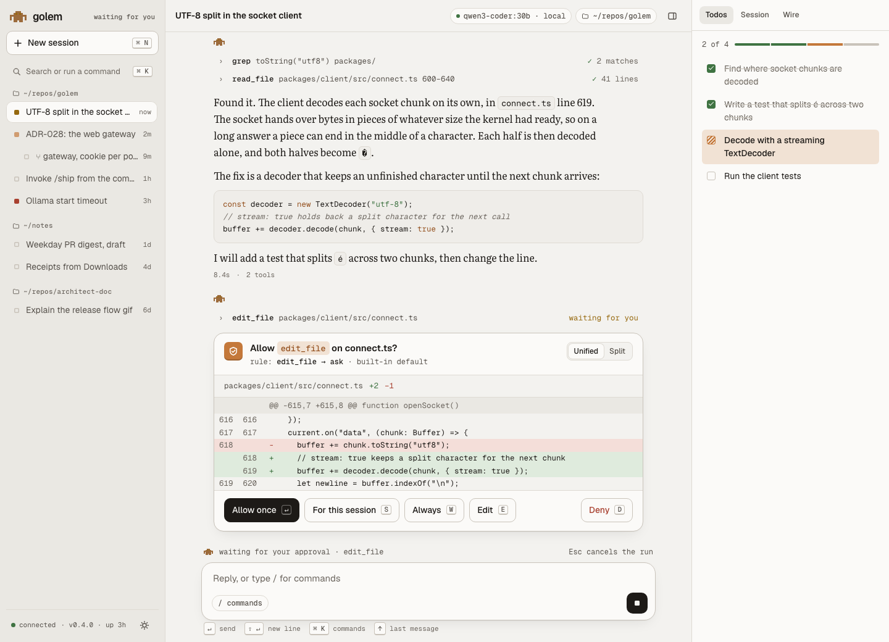
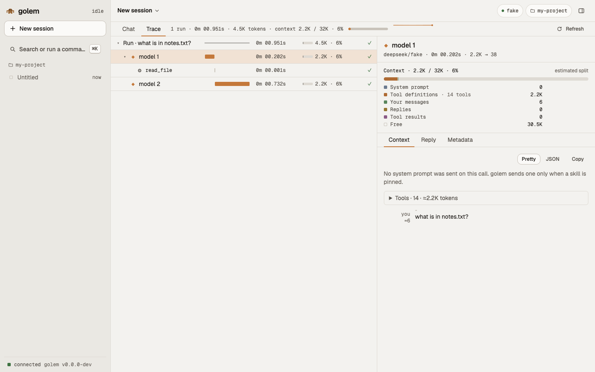
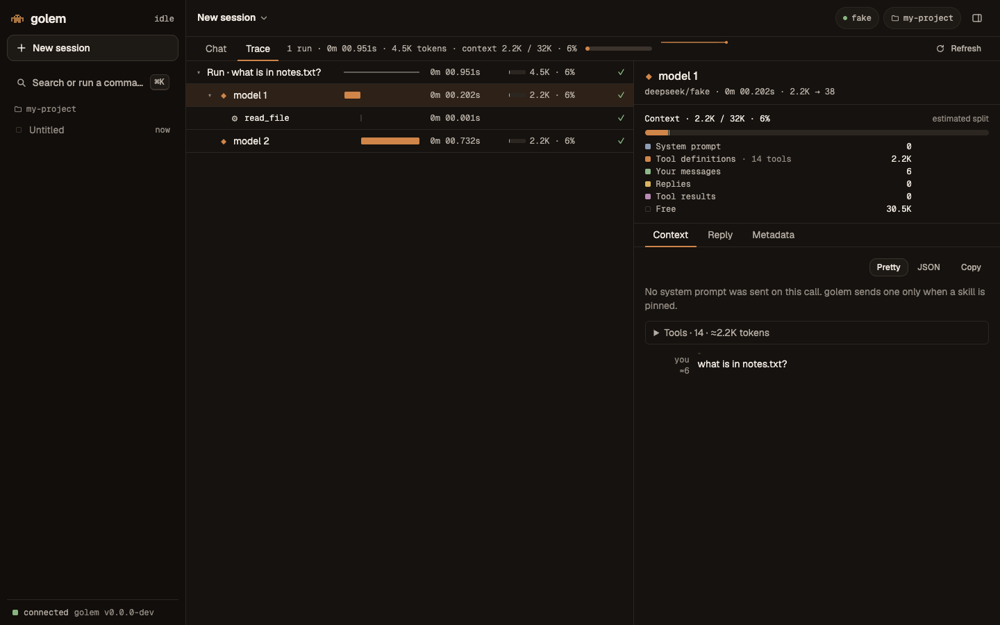

# The web UI

`golem` opens golem's chat in your browser. It talks to the same daemon as the terminal, so every chat is in both: start in the terminal, carry on in the browser, or watch one answer stream in both at once.



## Open it

```bash
golem
```

`golem web` does the same. It is kept as an alias, so older notes and habits still work.

golem starts a small server on `127.0.0.1:7480`, opens the page in your browser, and keeps running until you press **Ctrl-C**. With no daemon running, it first asks to start golem's service. On a first run, that one question in the terminal (keep golem running?) is the only setup there; the page then opens on `/welcome`, where you pick how golem thinks, a model, and some tools. A send with no model sends you back to `/welcome` and keeps your message, and `/setup` opens Settings → Setup. The web has no setup dialog.

| Option | What it does |
|---|---|
| `--port N` | Serve on another port |
| `--no-open` | Print the link instead of opening the browser |
| `--json` | Print the link, the port, and the pid as JSON, for scripts |

When it opens the browser, golem prints `Chat in the terminal: golem tui`. Over SSH, with `SSH_CONNECTION` set, it opens no browser and prints the link.

Run `golem` again while one is running, and it opens the same server instead of starting a second one. If that server runs an older golem than the one you typed, `golem` says so on stderr; stop it with Ctrl-C and run `golem` again.

`golem web serve [--port N]` runs the server in the foreground with no browser, no token in its output, and no question about the service. It is for a background job to run, not for typing. It exits with code 75 when a `golem` already serves the port.

## What you can do today

- **Choose a folder for a new session** from the folder chip: pick one of your earlier folders, or `Choose a folder…` to browse your home folder, filter it, or type a path.
- **Choose a model for a new session** with the chip next to the folder chip on the empty screen, or with `/model`. It shows the default until you pick another. The pick is for that session only, and a refused model shows under the chips.
- **Sessions,** grouped by folder in the sidebar, the same list as `/sessions` in the terminal.
- **Read a chat:** answers in a book serif, with highlighted code. The tools of a turn fold into one line under the answer, such as `searched the web · 3 GitHub calls, 1 failed`, with a dot for each; click it to open the steps, and each step opens into its arguments and output. A failed tool is always on that line, and a tool waiting for you keeps it open. A helper that golem started with `delegate` is one step with one line of its own, such as `explorer · qwen3:27b · read 14 files · 1m 12s · returned 620 tokens` (while it works: `explorer · qwen3:27b · reading src/router.py…`); open it to see the helper's own steps, indented, and its answer. In Quiet it is only the line. The helper's text is never a chat message: its answer is the tool's result. The Quiet, Normal and Verbose switch in the top bar (or `/detail`) sets how much shows, and Settings › Chat sets it for every chat ([below](#settings-›-chat)). The footer under the answer adds the model, `local` for a model on your machine, the tokens the run used, and golem's estimate of its cost, such as `11m 33s · 18 steps · qwen3:27b · local · 4.1K tok · $0.00`, with the helper's tokens and cost counted in and `1 helper` at the end when the turn used one; a session from before golem kept costs shows what it has. A reply that thought first has a line above it, such as `thought for 12s`, that you click to read the thinking. `/thinking` hides that line or brings it back, and the page remembers the choice; it only changes what you see, while `think` in the model dialog's Tune view is what the model is asked to do.
- **Write:** the composer sends a message, keeps your history, takes pastes, and stops an answer.
- **See what golem is doing:** the pixel golem's eyes, the tab's icon, and its title follow the chat's state: idle, working, waiting for you, or failed.
- **See and fix your setup** in Settings → Setup: a card for each part, with a mark and a word (`done`, `needs attention`, `failed`), the detail, and the fix beside it.
  - **Engine:** `Install Ollama` installs it with Homebrew and shows what it prints under the row; `Start Ollama` starts it. With no Homebrew, the row links to ollama.com/download.
  - **Model:** `Change…` opens the model list, where `Make default` picks the model new sessions start on.
  - **Service and keys** are commands to copy, such as `golem daemon install` and `golem auth set anthropic`, with `Check again`. The page never installs a service or takes a key.
  - **Run setup again** walks the steps from the start.
- **Change how golem picks a model** in Settings → Routing. The page explains itself, and every setting saves when you change it; an unusable value shows its reason at the setting and writes nothing. `config.toml` keeps your comments. The parts, top to bottom:
  - **Right now:** one short text that says what golem does with the settings as they are, and rewrites itself on every change.
  - **How a new chat picks its model:** three cards with a picture each, `Auto`, `Local only` and `Pinned`. This is the route of a new chat.
  - **The path of a turn:** `Local`, the gate, `Budget` and `Frontier` as steps that rise from left to right (stacked on a phone). Each step has a price tag, a model picker (`Auto · <model>` means golem picks) and facts: who picked, window, provider. A step with no ready model is dashed and has `Add an API key`, which opens Settings › Models. golem never picks a `Frontier` model by itself: when frontier models are ready but none is chosen, the step says so and has the picker (`Choose a model`). The gate says `asks once`, `asks every time`, `closed`, `closed · local only` or `not used`; clicking it scrolls to the paid gate. On `Local only`, or with `Never pay`, the paid steps are dimmed; on `Pinned` the whole path is, with a note. Under the path, `Try it` has five situations; pressing one lights the steps the turn passes and says in a sentence what golem does. `More` holds the price limit of the budget tier.
  - **The paid gate:** `Ask once per chat`, `Ask every time` or `Never pay`; the limits per day and per chat (empty means no limit), a meter of today's spend against the day limit, and what happens when a limit is reached: stay local, or ask you.
  - **Exceptions and small jobs:** the folders that never leave this Mac (`Add a folder`, remove with the cross), and the model for titles, summaries and the explorer. `Automatic` is the chat's own model on a local chat, and the cheapest ready budget model on a hosted chat.
  - **Context window and long chats:** a dashed card at the end, with chips such as `32K window · auto`, `clear at 70%` and `summarise at 85%`, and a button `Settings › Context →`. The long-chat settings are on their own tab, next to this one.
- **Set how much a model can see** in Settings › Context, the tab after Routing. It opens with a lead, `How much a model can see at once, and how golem keeps a long chat inside it.` Every setting saves when you change it, as on Routing. The parts, top to bottom:
  - **Right now:** one short text that says what golem does with the settings as they are, for example `qwen3:14b gets a 32K window; claude-sonnet-4.5 has 200K, set by Anthropic. On any model, 4K stays free for the reply. At 70% full golem clears old tool results, and at 85% it summarises earlier turns.` Under it: nothing is deleted, and when a local chat still does not fit, the routing path steps up to a hosted model.
  - **Window size** (tagged `Local models only`): how many tokens a model on this Mac can see at once. A hosted model's window is set by its provider. The choices are `Auto` (golem plans it from the model and this Mac's memory), `Fixed` (one number of tokens, 512 to 262144) and `Ollama's` (golem sends no window, so Ollama picks its own). `Fixed` warns that it is one size for every local model, and that golem does not check it against memory. A model's own setting in its model chip wins over this choice. Beside the choice, a table lists the window each local model gets.
  - **When the window fills up** (tagged `All models`): clearing and summarising run on every model with a known window, hosted ones too. When a hosted model is ready, a `Show it on` switch draws the bar for the local model or for that hosted model; the settings are the same for both, because they are shares of each model's window. The bar is the whole window in four parts: room to work, step 1, step 2, and the reply reserve, with a marker where each step starts. Under it are the controls of each part. `Step 1` clears old tool results: a slider for where it starts, and how many of the newest results are kept. `Step 2` summarises earlier turns: a slider for where it starts, and how many of the newest turns are kept. `Always` is the reply reserve, the room kept free for the answer. When no window is known for the model, the bar says so and is not drawn.
  - **How a long chat plays out:** folded away. A chart of how full the window gets, and what each step does to it.
  - **Exact numbers:** folded away. `Clear at`, `clear to`, `summarise at`, the reply reserve in tokens, and how long Ollama keeps the model loaded (local models only). It opens by itself when one of its fields has an error.
- **See what it costs** in Settings → Usage (`/cost` opens it): tiles for today and the last 7 days, and for what running locally saved, with the model whose prices it is measured against. Seven bars, one a day, stack local and paid tokens. A table lists each model with its tier, calls, tokens, and cost. With no calls yet it says `No model calls yet.` Every number comes from the daemon, the same as `golem cost` prints.
- **Tune a local model** from its row in the model dialog (the model chip, or `/model`). An installed local model shows a `Tune` button while you point at it or highlight it. The dialog then shows that model's options in place of the list, with `←`, `Esc`, or `Done` to go back; the list keeps its place, and the row's fit is read again, since the context size changes it. There is one slider for each option, such as temperature and context size, `Keep loaded` is a list of times, and a model that can think also has a `Think` list, `off` and `on` or the levels `low`, `medium`, and `high`, that is left unset until you pick one. Under the rows, the focused option says what it does, in the same words as `/tune` in the terminal, and a row says `model default X` when it is not at the model's own value. The context size of a model with no `num_ctx` of its own says `set by Ollama when it loads` and has no thumb until you move it, which starts it at 8192. The four presets, `Precise`, `Balanced`, `Creative`, and `Long memory`, set several options for this chat at once and light the rows they moved; `Save these for the model` keeps what this chat has changed. Beside the context size, a note such as `+1.1 GB · fits` says what the window costs in memory, and whether it fits, is tight, or is too big for this Mac. `Save for this model` keeps a change in `config.toml` for every chat on the model, and `This session only` keeps it for this chat; for a model this chat does not use, every change is saved. A change is sent a moment after you stop moving the slider and applies from the next message, `Reset` on a row takes one back, the `Reset` at the bottom takes back all of them, and a change made in an attached terminal shows here at once, and the other way round. For the model this chat uses, `Try again with these settings` asks your last question again in a copy of the chat, named `try · <title>`, with the values in use. The new answer streams under the rows with the first line of the old one above it, `Open the try session` opens the copy, and this chat stays as it was. Tuning is for local Ollama models; a hosted model has no button. When a chat's local model runs with options changed from its own, a chip such as `temp 0.2 · top_p 0.9` sits before the `ctx` chip. It names at most three, then `+N`, leaves out the context size, and opens the Tune view of the chat's model.
- **See and change how a chat picks its model** with the route chip, left of the permission chip. It says `pinned`, `local`, or `auto` (the permission mode has its own word `balanced`; the route has none). On `auto` the model chip in the top bar reads `auto · llama3.2:3b`, the model the next turn starts on (the model that wrote the last answer once there is one); its tooltip says `golem picks the model on auto. Choose one to pin this chat.`, and choosing a model there pins the chat, so the route chip then says `pinned`. The new-chat screen shows the same on `auto`, and a model chosen there makes the new chat `pinned`. The route chip opens a popover with a three-way switch, `Pinned`, `Local only`, `Auto`, which applies from the next turn. Under it, on `auto`, `The ladder` lists one row for each tier, `local`, `budget`, and `frontier`, with the model golem uses there and `ready · free`, `ready · $0.28 / M in`, or `needs key`; a row that is not ready is grey, and a missing key has an `Add key` link to Settings. On `local` and `pinned` there is no ladder: `The model` shows one row, the local model on `local` and the chat's own model on `pinned`. Two thin bars show `Today $0.42 of $2.00` and `This session $0.03 of $0.50` against the `[budget]` caps; with no caps they show the amounts only. The spend is read when the popover opens, not while it is open. `Routing settings` opens the config file. When a turn ran on a model other than the chat's own, its footer starts with a note before the model, such as `↑ deepseek-chat · did not fit in 32K`; the arrow means a higher tier. In the trace, the run and its first model call have a `Route` block: `Route: auto · reason: fit` and a table of the models that were considered, with their tier and what happened to each. When a local model will take more than a minute to a first token, a line above the composer says so, such as `≈ 3 min to first token on qwen3:27b`; on `auto` with a ready budget model it adds how long that model would take and about what it would cost. The model dialog tags each model `local`, `budget`, or `frontier`. **Try a weak answer again on a stronger model:** on route `auto`, when the chat is idle and a ready model sits above the one that wrote the last answer, the footer of that answer ends with `↑ stronger model` (its tooltip says `Try again on deepseek-chat`; `/stronger` does the same). It sends the same question again as a new turn, one tier up, for that turn only: the old answer stays above, the chat's own model and route do not change, and the next turn is back on the local model. A paid model asks first, as it does for any paid step. The new answer's footer says `tried again on deepseek-chat`. When no stronger model may run, you see `No stronger model is ready. Add a key in Settings.` and no turn starts.
- **See a model download** in the sidebar, above Settings, on every screen, even when the download began in the terminal. Press it to open the models.
- **Trace a session:** read how an answer was made, model call by model call. See [Trace a session](#trace-a-session).
- **Two themes:** slip (light) and kiln (dark). The switch at the bottom of the sidebar picks one, or follows your system.

The web UI is new, and it grows step by step in [Phase 10](https://github.com/MilanPavel/golem/issues/150). **Approvals, diffs, and the todo drawer** come next. Until then, answer an approval in the terminal: run `golem tui` in the same folder, and the waiting question is there. After that come models and a command palette, then settings, a layout for phones, and installing the page as an app.

## The composer row

The row under the message box holds the chips for the session. From the left:

- **Model:** the model for the next turn. On the empty screen it is the model the new session starts on.
- **Folder:** where golem works. Press it to choose another.
- **Branch:** the git branch of that folder. It shows only when the folder is in a repo.
- **Context, mode and Send:** how full the model's window is, the permission mode, and the send button.

The row stays on one line. On a narrow screen the chips shrink to their icons.

**A session keeps its folder and its branch.** The folder chip of an open session is read only. Its menu offers a new session here, a new session in another folder, and a copy of the path. When golem runs on your Mac, `Open in Finder` shows the folder there.

**Start a new session on another branch.** On the empty screen, press the branch chip and pick a branch, or type a new name to create one. When you send, golem switches the folder to that branch and starts the session there. Changes you have not committed go along to the new branch. If git cannot switch, the session does not start, and the page shows what git said.

In an open session, the branch menu says `This session stays on main.` Each other branch says `New session ↗`. Pick one to start a new session on it, with the same rule.

**Choose a folder.** The folder menu lists your earlier folders and the worktrees of the repo you are in. You can also type a path, such as `~/code/app`, and press `Use ~/code/app`. When golem runs on your Mac, `Choose folder…` opens the macOS dialog. Anywhere else, `Browse…` opens golem's own folder browser, which lists your home folder.

**The branch changed.** If the branch changes under a session, for example when you switch in a terminal, golem adds a note to the chat: `The branch changed from main to feature. Files may differ from what golem read.` The chip follows the new branch.

## Settings › Chat

Settings › Chat, in the General group, holds the defaults for every new chat. A chat that is already open keeps what it has, and the composer changes one chat. Three sections, top to bottom, with a view of the prompt beside the first:

- **Your instructions:** plain lines that golem puts in the system prompt of every chat, word for word, such as `Answer in two short sentences, in plain words.` With no lines, nothing is added and the model answers in its own style. There is no language line: the model answers in the language you write in. Press `+ Write a line` and type; a line is saved when you press Enter or leave the box, and there is no Save button. Drag the handle to move a line, and the cross removes it. You can have 30 lines of up to 300 characters. Under `Write them with golem`, describe how you like answers, such as `I teach maths to 12-year-olds; keep it simple and friendly`, and press `Draft lines`: golem offers a few lines, each with `Add`, and there is `Add all`. `From your chats` lists lines golem suggests from your own chats, each with the reason and `Add` or `Not for me`; it reads your messages, so it needs a local model, and it looks once a day. A helper does not get your lines.
- **What the model reads:** beside the lines, a bar shows the parts of the system prompt the model gets before your message: Basics, Instructions, Memory, Skills, MCP, Helpers, Sources, Plan and the descriptions of the tools, each with its size in tokens. Press a part to read its text, and the total is under it. It is the real prompt, rebuilt on every call and never stored, not a made-up sample answer. Instructions is the part this page changes.
- **How far it goes alone:** `Mode` is the default mode of a new chat, `Careful`, `Balanced` or `Autopilot`, each with a line on what it asks about; Autopilot asks in place first. `Start with a plan` is one switch: a new chat shows a short plan first, and nothing that changes anything happens until you say yes. The chat's mode chip then reads `Plan`.
- **What the chat shows:** `Steps` (Quiet, Normal or Verbose) is the line at the end of each answer, and `Open it when a step fails` keeps a failed step from hiding behind a fold, even in Quiet. `Thinking` (Hidden, Collapsed or Open) is for models that think before they answer. `The line under each answer` lets you pick its parts, Time, Steps, Model, Local or hosted, Tokens, Cost and Helpers, and `Leave out what says nothing` drops an empty one, such as `$0.00` on a local model. `Send with` is Enter or ⌘ Enter; the other key adds a new line. A preview of one turn follows your choices. These screen choices are kept in this browser, so another browser has its own. The instructions, the plan switch and the mode are kept in `config.toml` ([Settings](./settings.md#chat)).

## Settings › Models

Settings › Models, in the Models group, lists the providers golem supports: Ollama, oMLX, OpenAI, Anthropic, DeepSeek, Google, Moonshot and xAI. On the left, `All starred models` comes first, then the providers: on this Mac, hosted ones with a key, and hosted ones that are not set up yet. Each row says how many of its models are starred.

- **Stars decide the model menu.** A model with a star is in the composer's model menu, with the default model and the chat's own model. `Show all models` in the menu lists the rest. Press the star of a row to put a model in the menu or take it out. The models you have installed in Ollama start with a star, and `All starred models` shows what the menu lists.
- **A hosted provider** shows its models with their prices and where its key is: `Key in the Keychain`, or the variable it came from. Keys are set in a terminal, and this page never sees one. `Replace or remove the key` in the `⋯` menu shows both commands, each with a copy button.
- **A provider with no key** says `needs an API key` and shows the steps: get a key from the provider, run `golem auth set moonshot` (with the provider's name) in a terminal and paste the key when asked, then come back, and the page notices the key by itself. Or set the provider's variable in golem's environment; it wins over the Keychain.
- **Ollama** shows its state (`Running`, `Stopped` or `Not installed`), the models on this Mac, `Get models` and `Ollama settings`. `Get models` has three tabs. `For this Mac` is golem's list sized for your memory, recommended first, each with `Download`. `Hugging Face` searches Hugging Face for GGUF models. Open one to see its sizes, each with how well it fits this Mac (the best fit is marked `Recommended`), and `Download` it through Ollama. A repo that needs a Hugging Face token can't be opened yet. `By name` takes a name from the Ollama library, such as `qwen3:8b`, and downloads it with Ollama. A download goes on if you close the sheet, and shows in the sidebar. `Ollama settings` has whether golem starts Ollama when a model needs it, how many minutes unused before it stops, and how many requests run in parallel.
- **oMLX** says that golem cannot use it yet. Support is planned.

## Settings › MCP servers: tokens

A tool server that wants a token shows one sentence under its name:

- `Token · in the Keychain as mcp/github · worked 2 min ago` with `Replace`: the token is stored, and the line says when the server last accepted it.
- `Token missing` with `Add it`: the server names a token that is not stored yet.
- `Token refused` with `Replace`: the server answered 401 or 403 to the last connect or test.
- A server that signs in with a browser says `Signed in` with `Sign out`, or `Not signed in` with `Sign in`.

To enter a token, press `Add it` or `Replace`, or open the **Edit** tab. In Variables or Headers, a stored token shows as a lock and `in the Keychain` with `Replace`; one that is missing shows `not in the Keychain` and `Add token`. Paste the token in the box, which hides it, and press `Save`. golem tests it before it keeps it: a list shows the steps as they pass (`Token ready for the test`, `Connected to …`, `Signed in`, `Listed 3 tools`).

- **The server accepts it.** The token goes into the macOS Keychain and replaces the old one, and the page says `The new token works and is saved.` The token never goes in `config.toml`.
- **The server refuses it.** The page says `The server refused this token.` and that your old token is still in use, or that nothing was saved. `Try again` clears the box. `Keep it anyway` saves the token although the test failed, for a server that is down for now.

## Trace a session

A trace shows how an answer was made. One reply can be several model calls, with tools run between them. The trace lists each step, and what it took in and gave out, so you can see why an answer was slow, costly, or wrong.





### Open it

- Press **Trace** in the row of tabs under the session's title. **Chat** takes you back.
- Or press ⌘K and pick **Trace**. The row is there only while a session is open.
- The address is `/s/<session>/trace`, and `?span=` names the selected row, so a link opens the same one.

The page shows what has finished. It does not move while an answer streams. Press **Refresh** to read again.

### Read the rows

Each row is one step. A run holds its model calls, and a model call holds the tools it asked for. The `delegate` tool holds its helper's model calls, and each of those holds the helper's own tools: two more levels, open by default. A helper's model call opens the same detail as any other, with its own context against its own window.

| Row | What it is | Mark |
|---|---|---|
| Run | One message you sent, and everything golem did for it | The first words of your message |
| Model call | One request to the model, and its reply | A clay diamond, named `model 1`, `model 2` ... |
| Tool call | One tool the model asked for | A grey cog, with the tool's name |

Each row has a bar on its run's time line. Where it starts and how wide it is show when it began and how long it took. Next come the time, as `0m 02.4s`, and the tokens: a model call's input, with how much of its window that fills, such as `21.7K · 17%`.

| Colour or mark | Means |
|---|---|
| Clay bar | A model call |
| Grey bar | A tool call |
| Red bar, and a red `✗` | The step failed |
| Hatched bar before a tool | golem waited for you to approve it |
| `denied` | You refused the tool, so it never ran |
| `running` | The step has not finished yet |

The line above the tree adds up the session: runs, time, tokens (a helper's calls count in them), and how full the context is now, with a thin bar that turns amber from 80% and red from 95%, and a sparkline of the input tokens of each call (the helper's calls are not on it: they have a context of their own). A small dashed tick on the sparkline marks a call that came right after golem cleared old tool results (`cleared`), summarised old turns (`summarised`), or grew the window (`64K`); hover it for the word. The arrow keys move through the tree: Up and Down choose a row, Right opens one, and Left closes it.

### Open a step

Click a row to read it in the panel beside it.

- **A model call** has three tabs. **Context** is what was sent: the system prompt and the tools folded away, then the messages, with a line where the part new since the last call begins. **Reply** is what came back. **Metadata** is the model, the tokens, why it stopped, and the times.
- Above the tabs, the **context meter** shows how full the window was, and what filled it: the system prompt, the tool definitions, your messages, the replies, and the tool results. The split is an estimate, so it says so. A local model's window shows with `≈` when golem did not send it and read it from Ollama instead: it is a good guess, not a number golem set. Tools that come from an MCP server are grouped by server, with the cost of each, so you can see which server's tools use the most. A `Summary` row shows the summary that stands for old turns. A `Reply reserve` row, drawn hatched at the end of the bar, is the room kept free for the answer, and `Free` is what is left outside it, so the parts, `Free` and the reserve add up to the window. A muted row such as `Cleared · 12 tool results · 11.2K not sent` says how many old tool results were sent as one line each at this call; those tokens are not in the window, so they are not in the bar. In the **Context** tab a result sent as a stub is tagged `cleared`, with a `Show original` button for the full result, and the first row of a call that was sent a summary reads `summary of 9 earlier messages`. The `ctx` chip in the chat adds `· 12 cleared` after a clear, until the next turn.

The popover of the `ctx` chip is where you act when the context fills. It shows a thin bar, a line such as `18.6K of 32K · reply reserve 4K`, and where the window came from: `32K · planned by golem for this Mac`, `8K · set by you`, or `≈ 32K · Ollama's default`. Under them are the actions, each with what it costs before you choose it:

- `Clear old tool results`: `frees ≈ 11K · no model call`. It needs more than the newest four tool results.
- `Summarise earlier turns`: `frees ≈ 15K · one call to <model>`. It needs more than the last four turns.
- `Grow the window to 64K`: `+1.9 GB memory · reloads the model`. Only for a local model. It is off, with the reason, when you set the window (`/tune`), when golem did not plan it, or when this Mac cannot hold more.
- `Continue on a larger model`: `<model> · 128K · ≈ $0.02 a turn`. It shows when a ready model has a larger window, and turns the route to `auto`. A paid model asks first, in the card you already know from the paid question.

The sizes are estimates, so they start with `≈`. A click runs the action, shows a spinner on the row, and closes the popover. A refusal, such as a Mac that cannot hold a larger window, is shown in the popover. From 80% full, the first action that can run is marked `suggested`. The `ctx` figure drops as soon as a clear or a summary is done. `Open the trace` at the bottom opens the trace at the latest model call. While an answer is running every action waits.

When the model server cut the prompt of the last call of a local model, a banner above the composer says `The model no longer sees the start of this chat.` and offers the two best actions as buttons.

In the chat, golem says what it did to keep the context small in one quiet line between the messages: `golem cleared 12 old tool results · ctx 71% → 38%`, `golem summarised 9 earlier turns · ctx 84% → 31%`, or `window grew 32K → 64K · reloaded in 8 s`. The percentages are of the room (the window less the reply reserve). In Quiet detail the `cleared` line is hidden; the other two always show. The lines are not messages: the model never sees them and an export leaves them out.
- When Ollama cut a prompt that did not fit, a line under the bar says so, and the messages it dropped are dimmed and tagged. `not seen` means golem proved that Ollama dropped older messages, from the token counts of two calls. `probably not seen` means golem estimated it from the size of the prompt. The size of what was dropped is always an estimate, and a call with no line was not shown to be cut or to fit.
- **A tool call** has **Args** (what the model asked for) and **Result** (what it got back). A long result opens in the full viewer. An **Approval** tab shows when you were asked.

**Pretty** and **JSON** switch how a tab is shown, and **Copy** copies it. In the chat, the `ctx` chip at the end of the meter row shows the same fill and opens a popover. It turns amber at 80% and red at 95%.

### What "not recorded" means

golem keeps a trace only for a session it recorded. A session from before tracing still opens: its steps come from the messages, so you see the tree and the times. The tokens, the stop reason, the system prompt, and the tools were never kept, so those rows say `not recorded`, and the panel says `Not recorded. This session ran before golem kept traces.`

Two cases look alike and are not. A call that sent no system prompt says so: golem sends one only when something needs it, such as a pinned skill or an MCP server you can turn on. A provider that does not report tokens leaves them blank, never zero.

A trace holds your prompts and files exactly as they were sent. They stay in `~/.golem/golem.db` on your Mac and are never sent anywhere.

## Safe by design

The page is only for you, on your Mac.

- **The server listens on `127.0.0.1` only,** never on your network.
- **The link logs you in.** It carries a one-time token after the `#`, which the page trades for a cookie and then removes from the address. You stay signed in for 30 days, even after the server restarts. To sign every browser out, run `golem web logout`. Other websites you have open cannot connect: the server checks every request's origin and refuses the rest.
- **The daemon does not change.** It still listens only on its private socket. The server behind `golem` stands in front of it, and passes on only what a browser may ask for.

## Install as an app

The page can run in its own window with the pixel golem as its Dock icon.

- **Chrome and Edge:** open the page, then use the install button in the address bar, or the menu `Cast, save, and share → Install page as app`.
- **Safari (macOS 14 and later):** open the page, then choose `File → Add to Dock…`. Safari shows no install prompt, so this menu item is the only way.

When the web job keeps the page running, the last step of `/welcome` and Settings → Appearance offer this too: a button in Chrome and Edge, the menu hint in Safari. Nothing is offered inside the app's own window.

The app is tied to the address it was installed from, port included. `golem --port N` is a different app, and it has no login. If the app opens to `This page needs a fresh link`, run `golem` again.

There is no service worker, so the page is never cached by one. After `brew upgrade golem`, run `golem`: the app shows the new page on its next load, never an old copy.

The Dock icon does not show state. It opens the page, and the page shows whether it is connected.

## When the page cannot connect

The page shows a full screen, with the command to run:

| What you see | What to do |
|---|---|
| This page needs a fresh link | The link is old, the sign-in is over 30 days old, or you ran `golem web logout`. Run `golem` again |
| golem's daemon is not running | Run `golem daemon start`. The page reconnects by itself |
| The daemon is older than this page | Run `golem daemon restart` after an upgrade |

How the gateway works is in [ADR-028](../adr/028-web-gateway.md). How the page looks, screen by screen, is on [the gallery](/gallery/).
