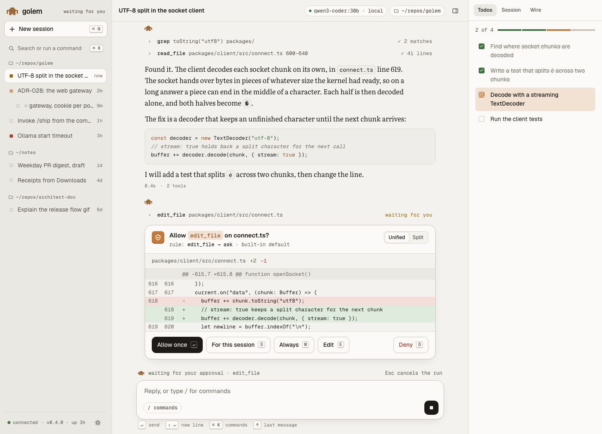
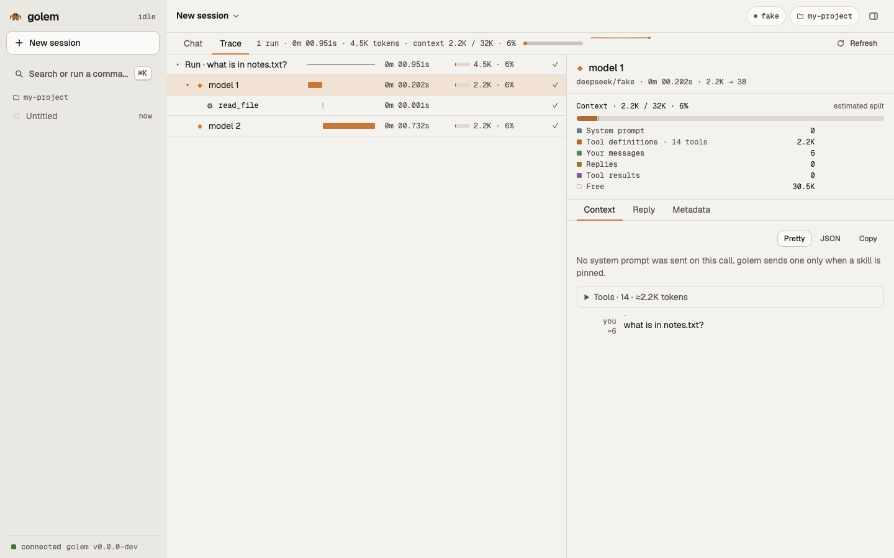
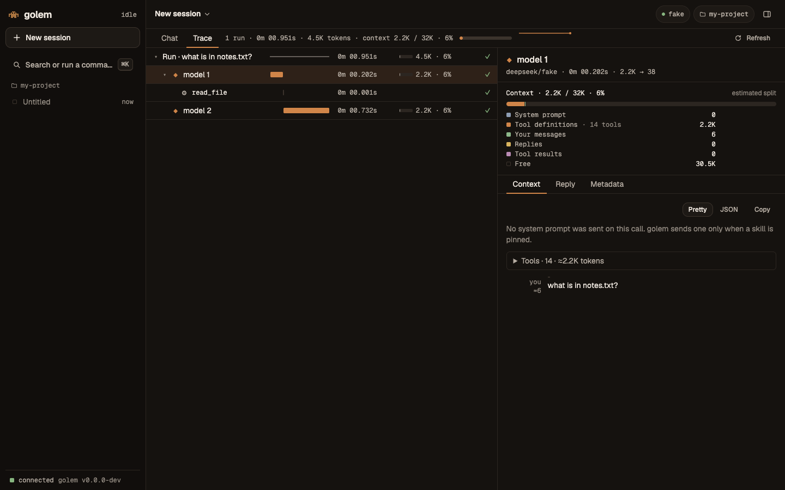

# The web UI

`golem web` opens golem's chat in your browser. It talks to the same daemon as the terminal, so every chat is in both: start in the terminal, carry on in the browser, or watch one answer stream in both at once.



## Open it

```bash
golem web
```

golem starts a small server on `127.0.0.1:7480`, opens the page in your browser, and keeps running until you press **Ctrl-C**. With no daemon running, it first asks to start golem's service.

| Option | What it does |
|---|---|
| `--port N` | Serve on another port |
| `--no-open` | Print the link instead of opening the browser |
| `--json` | Print the link, the port, and the pid as JSON, for scripts |

Run `golem web` again while one is running, and it opens the same server instead of starting a second one.

## What you can do today

- **Choose a folder for a new session** from the folder chip: pick one of your earlier folders, or `Choose a folder…` to browse your home folder, filter it, or type a path.
- **Choose a model for a new session** with the chip next to the folder chip on the empty screen, or with `/model`. It shows the default until you pick another. The pick is for that session only, and a refused model shows under the chips.
- **Sessions,** grouped by folder in the sidebar, the same list as `/sessions` in the terminal.
- **Read a chat:** answers in a book serif, with highlighted code, and each tool line opens into its arguments and output.
- **Write:** the composer sends a message, keeps your history, takes pastes, and stops an answer.
- **See what golem is doing:** the pixel golem's eyes, the tab's icon, and its title follow the chat's state: idle, working, waiting for you, or failed.
- **See and fix your setup** in Settings → Setup: a card for each part, with a mark and a word (`done`, `needs attention`, `failed`), the detail, and the fix beside it.
  - **Engine:** `Install Ollama` installs it with Homebrew and shows what it prints under the row; `Start Ollama` starts it. With no Homebrew, the row links to ollama.com/download.
  - **Model:** `Change…` opens the model list, where `Make default` picks the model new sessions start on.
  - **Service and keys** are commands to copy, such as `golem daemon install` and `golem auth set anthropic`, with `Check again`. The page never installs a service or takes a key.
  - **API keys** lists every provider with `key saved` or `no key`, and the command to store or replace the key of the one you pick. The page knows only that a key is saved, never its value.
  - **Run setup again** walks the steps from the start.
- **See a model download** in the sidebar, above Settings, on every screen, even when the download began in the terminal. Press it to open the models.
- **Trace a session:** read how an answer was made, model call by model call. See [Trace a session](#trace-a-session).
- **Two themes:** slip (light) and kiln (dark). The switch at the bottom of the sidebar picks one, or follows your system.

The web UI is new, and it grows step by step in [Phase 10](../plan.md#phase-10--web-ui). **Approvals, diffs, and the todo drawer** come next. Until then, answer an approval in the terminal: run `golem` in the same folder, and the waiting question is there. After that come models and a command palette, then settings, a layout for phones, and installing the page as an app.

## Trace a session

A trace shows how an answer was made. One reply can be several model calls, with tools run between them. The trace lists each step, and what it took in and gave out, so you can see why an answer was slow, costly, or wrong.





### Open it

- Press **Trace** in the row of tabs under the session's title. **Chat** takes you back.
- Or press ⌘K and pick **Trace**. The row is there only while a session is open.
- The address is `/s/<session>/trace`, and `?span=` names the selected row, so a link opens the same one.

The page shows what has finished. It does not move while an answer streams. Press **Refresh** to read again.

### Read the rows

Each row is one step. A run holds its model calls, and a model call holds the tools it asked for.

| Row | What it is | Mark |
|---|---|---|
| Run | One message you sent, and everything golem did for it | The first words of your message |
| Model call | One request to the model, and its reply | A clay diamond, named `model 1`, `model 2` ... |
| Tool call | One tool the model asked for | A grey cog, with the tool's name |

Each row has a bar on its run's time line. Where it starts and how wide it is show when it began and how long it took. Next come the time, as `0m 02.4s`, and the tokens: a model call's input, with how much of its window that fills, such as `21.7K · 17%`.

| Colour or mark | Means |
|---|---|
| Clay bar | A model call |
| Grey bar | A tool call |
| Red bar, and a red `✗` | The step failed |
| Hatched bar before a tool | golem waited for you to approve it |
| `denied` | You refused the tool, so it never ran |
| `running` | The step has not finished yet |

The line above the tree adds up the session: runs, time, tokens, and how full the context is now, with a thin bar that turns amber from 80% and red from 95%. The arrow keys move through the tree: Up and Down choose a row, Right opens one, and Left closes it.

### Open a step

Click a row to read it in the panel beside it.

- **A model call** has three tabs. **Context** is what was sent: the system prompt and the tools folded away, then the messages, with a line where the part new since the last call begins. **Reply** is what came back. **Metadata** is the model, the tokens, why it stopped, and the times.
- Above the tabs, the **context meter** shows how full the window was, and what filled it: the system prompt, the tool definitions, your messages, the replies, and the tool results. The split is an estimate, so it says so. Tools that come from an MCP server are grouped by server, with the cost of each, so you can see which server's tools use the most.
- **A tool call** has **Args** (what the model asked for) and **Result** (what it got back). A long result opens in the full viewer. An **Approval** tab shows when you were asked.

**Pretty** and **JSON** switch how a tab is shown, and **Copy** copies it. In the chat, the `ctx` chip at the end of the meter row shows the same fill, and opens the trace at the latest model call.

### What "not recorded" means

golem keeps a trace only for a session it recorded. A session from before tracing still opens: its steps come from the messages, so you see the tree and the times. The tokens, the stop reason, the system prompt, and the tools were never kept, so those rows say `not recorded`, and the panel says `Not recorded. This session ran before golem kept traces.`

Two cases look alike and are not. A call that sent no system prompt says so: golem sends one only when a skill is pinned. A provider that does not report tokens leaves them blank, never zero.

A trace holds your prompts and files exactly as they were sent. They stay in `~/.golem/golem.db` on your Mac and are never sent anywhere.

## Safe by design

The page is only for you, on your Mac.

- **The server listens on `127.0.0.1` only,** never on your network.
- **The link logs you in.** It carries a one-time token after the `#`, which the page trades for a cookie and then removes from the address. Other websites you have open cannot connect: the server checks every request's origin and refuses the rest.
- **The daemon does not change.** It still listens only on its private socket. The server in `golem web` stands in front of it, and passes on only what a browser may ask for.

## When the page cannot connect

The page shows a full screen, with the command to run:

| What you see | What to do |
|---|---|
| This page needs a fresh link | The server restarted, or the link is old. Run `golem web` again |
| golem's daemon is not running | Run `golem daemon start`. The page reconnects by itself |
| The daemon is older than this page | Run `golem daemon restart` after an upgrade |

How the gateway works is in [ADR-028](../adr/028-web-gateway.md). How the page looks, screen by screen, is in [the web UI's design](../design/web.md).
