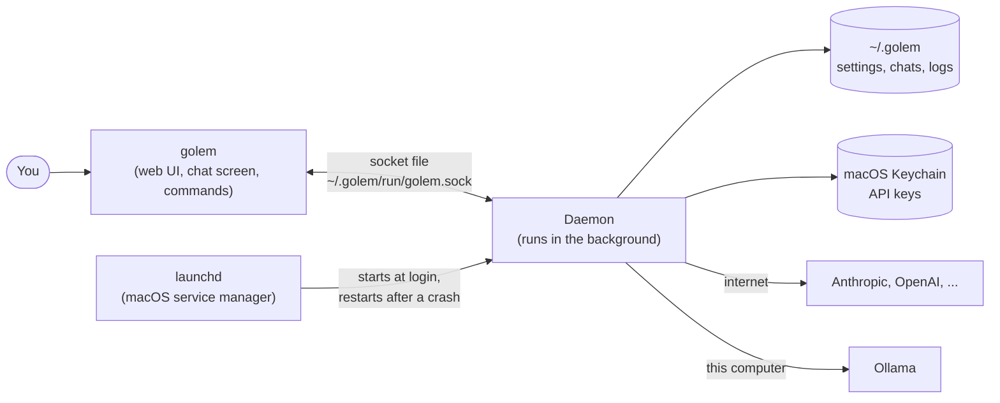
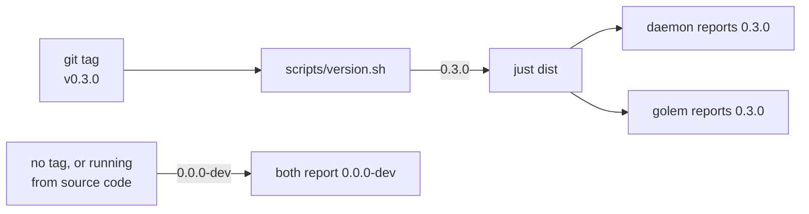
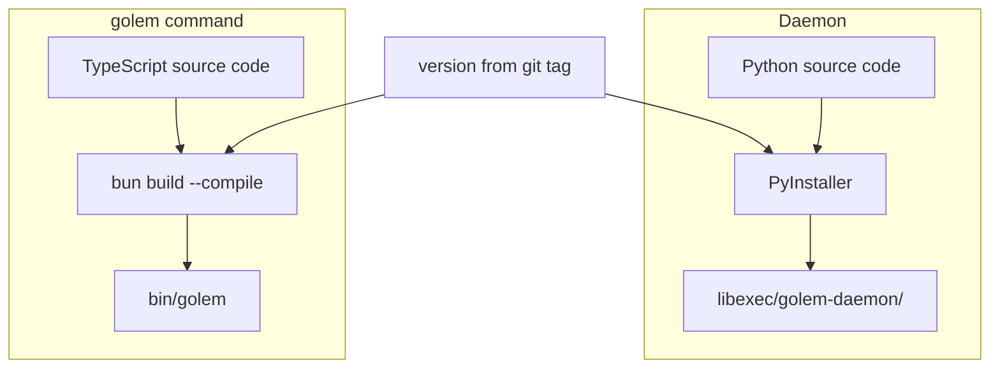
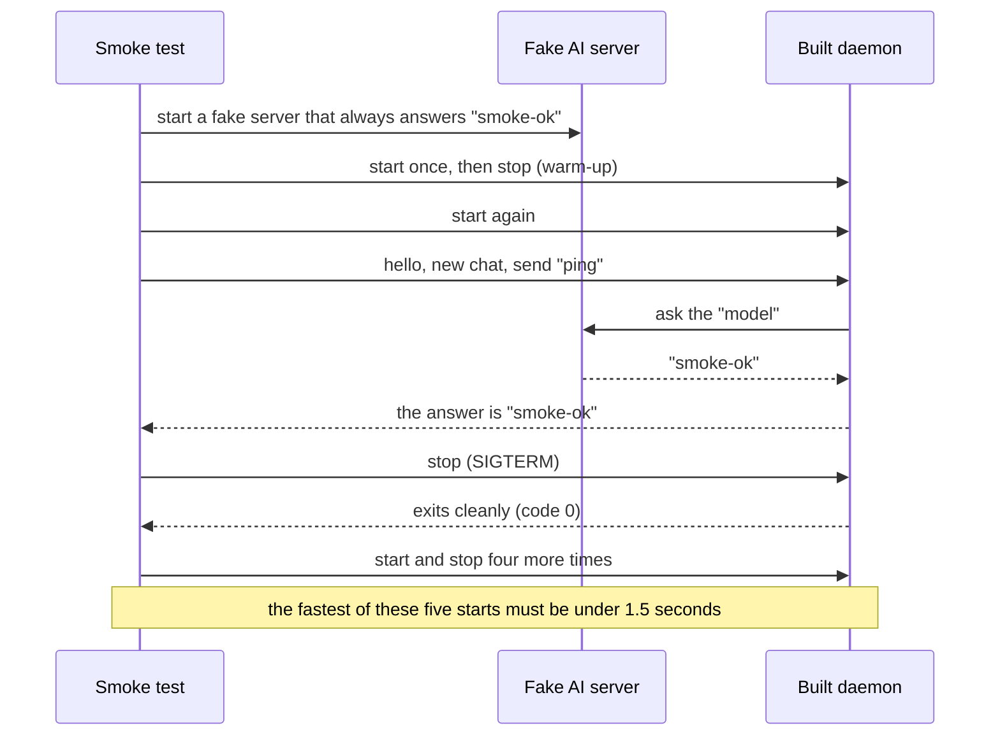
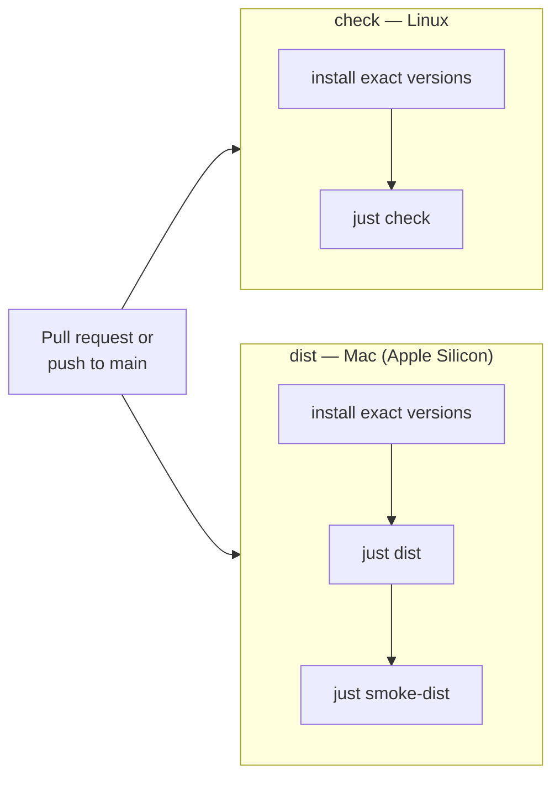
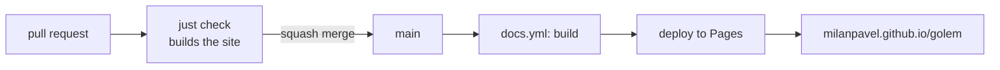
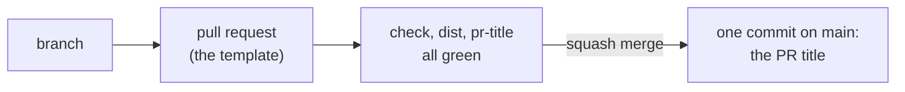
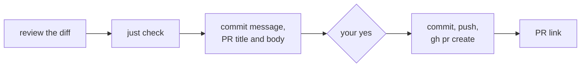

# Building and checking

How golem is built, tested, and checked on every pull request. [Releasing](release.md) covers tags, signing, and the tap. [Running](run.md) covers installing and keeping golem going.

This guide explains how golem is built, tested, installed, and kept running. It is written for someone who runs golem or ships it, not for someone changing its code.

For more detail:
- How the code works inside: [architecture.md](../architecture.md)
- Why it is built this way: the [ADRs](../adr/README.md)
- The roadmap: [roadmap.md](../roadmap.md)

---

## 1. The big picture

Golem has two parts:

- **The daemon** is a program that runs in the background all the time. It talks to the AI models, runs tools, and saves every conversation. It is written in Python.
- **`golem`** is the command you type. With no arguments it opens the web UI. `golem tui` opens the chat screen (the **TUI**). Other arguments do small jobs, such as `golem status`. It is written in TypeScript.

The two talk through a **socket**: a special file on disk, `~/.golem/run/golem.sock`, that works like a private phone line between programs on the same computer. Nothing is open to the network.



Why split it this way? Closing the chat screen does not stop the work. An answer keeps streaming, or a question keeps waiting for your approval, while the screen is closed. Open it again and everything is still there.

**Who can connect?** Only your own user account. The socket file has permissions `0600`: only its owner can read or write it. There is no password. The file permission is the lock on the door.

---

## 2. The code and the tools

Everything is in one repository, with two sets of packages:

| Folder | Language | What it is |
|---|---|---|
| `packages/protocol` | Python | The message formats the daemon and `golem` agree on |
| `packages/daemon` | Python | The daemon |
| `packages/client` | TypeScript | The library that talks to the daemon |
| `packages/cli` | TypeScript | The `golem` command |
| `packages/tui` | TypeScript | The chat screen |
| `packages/web` | TypeScript | The web UI, built with Vite. Phase 10. |

The message formats are written once, in Python. A script (`just gen`) turns them into TypeScript, so the two sides cannot disagree. If someone changes one side and forgets the other, the checks fail.

Tools a developer needs:

| Tool | What it does here |
|---|---|
| **uv** | Installs Python and the Python packages |
| **pnpm** and **Node** | Install and test the TypeScript packages |
| **bun** | Runs `golem` from the source code, and turns it into a single program file |
| **PyInstaller** | Packs the daemon and its own copy of Python into one folder |
| **just** | Runs every task: `just check`, `just dist`, and so on |
| **git-cliff** | Writes the release notes in `CHANGELOG.md` from the commit messages. It comes with the Python dev tools, so `uv sync` installs it |
| **gh** | The GitHub command line. `just release`, `just tag`, and `just protect` use it |

Exact versions are pinned in two lock files, `uv.lock` and `pnpm-lock.yaml`. Everyone, including CI, installs the same versions.

---

## 3. Versions

There is one version number for everything. It comes from git tags.



- Running from the source code always shows `0.0.0-dev`.
- A build shows the tag it was built from.
- You do not type the tag. `just tag` creates it from the merged release commit ([Releasing](release.md#releases)).
- `golem --version` prints its own version and, if the daemon is running, the daemon's version.
- If the two differ, the chat screen shows both in yellow. They still work together. Only a big protocol change (a new **major** version) stops them from connecting.

---

## 4. Building

`just dist` builds golem into one folder that you can copy anywhere:

```
dist/golem-0.3.0-darwin-arm64/
├─ bin/
│  └─ golem                  ← the command you type (one file, about 60 MB)
└─ libexec/
   └─ golem-daemon/          ← the daemon, with its own Python (about 50 MB)
      ├─ golem-daemon        ← the program that runs
      └─ _internal/          ← Python and libraries it needs
```

Neither part needs anything else installed: no Python, no Node, no uv.

How each part is made:



- **The daemon** is packed by PyInstaller as a folder, not a single file. A single file would have to unpack itself every time it starts, which is slow. The recipe is in `packages/daemon/golem-daemon.spec`. It lists a few modules that PyInstaller cannot find on its own, because some libraries load them in a roundabout way.
- **`golem`** is compiled by bun into one file ([ADR-019](../adr/019-single-binary.md)). It also carries the web page, the Vite build of `packages/web`, and `smoke-dist` checks that `golem` serves it.
- **Signing.** Last, `scripts/sign_dist.py` signs every program file in the folder: ad-hoc by default, or with the certificate named by `GOLEM_SIGN_IDENTITY` ([Signing](release.md#signing)). `just check-signature` checks the result, and `just package` packs the folder into the `.tar.gz` and `.sha256` a release ships.

### Developing the web page

- Run `golem` (or `just golem`) once. It starts the gateway.
- Run `pnpm --filter @golem/web dev`, and open the `golem web dev:` link it prints.
- The dev server sends `/ws` and `/auth` to the gateway. It reads the port from `run/web.json` (else `GOLEM_WEB_PORT`, else 7480) when it starts, so restart it after the gateway.
- The proxy sets the `Host` and `Origin` headers the gateway expects. The gateway's checks stay as they are ([ADR-028](../adr/028-web-gateway.md)).
- If no gateway runs, the dev server says so and keeps serving.
- `just e2e` runs the browser tests with the installed Chrome. Each test starts its own daemon and gateway in a temporary `GOLEM_HOME`. It is not in `just check` or CI yet.

### The smoke test

A "smoke test" is a quick check that the build turns on and works. `just smoke-dist` checks the newest build:



Notes:
- It uses a temporary folder for its data, so it never touches your real chats.
- **Why the warm-up start?** The first time a new build runs, macOS checks every library in it, which takes 2–4 seconds. This happens once per copy. After that, the daemon starts in about half a second.
- **Why the fastest of five, under 1.5 seconds?** CI runs on shared Macs, and the same build starts in anything from 0.5 to 1.4 seconds there, depending on the machine. One slow start says more about the machine than about golem. The budget still fails a change that makes every start twice as slow, and every start must exit cleanly.
- The smoke test catches modules PyInstaller missed. Without it, you would only find out when a user starts the program and it crashes.

---

## 5. CI (automatic checks on GitHub)

Every pull request, and every push to `main`, runs two jobs on GitHub:



`just check` runs, in order:
1. Regenerates the TypeScript message types and fails if they changed (someone forgot to run `just gen`).
2. Lint: style and common-mistake checks (ruff, plus the TypeScript linters).
3. Type checks (pyright, tsc).
4. All tests (pytest, plus the TypeScript tests).

The `dist` job also runs `just check-signature`. CI builds are signed ad-hoc, which is enough for the checks.

A pull request also runs `pr-title` (`.github/workflows/pr.yml`). The title becomes the commit on `main`, so it goes through the same check as a local commit message, `.githooks/commit-msg` ([ADR-024](../adr/024-commits-prs-releases.md)). A new push to a pull request cancels that PR's older run.

`just check` also builds the docs site (`just docs-build`), so a dead link in `docs/` fails the check like a test does.

### The docs site

The docs in `docs/` are also a site, built with VitePress and published to GitHub Pages at <https://milanpavel.github.io/golem/> ([ADR-034](../adr/034-docs-site.md)). `just docs` serves it locally and reloads on every edit.



- **When it publishes.** `.github/workflows/docs.yml` runs on a push to `main` that changes `docs/`, `tokens.css` (the site's palette), `pnpm-lock.yaml`, or the workflow itself. **Run workflow** on its Actions page publishes by hand. A pull request never publishes.
- **One deploy at a time.** A newer push waits for the running deploy, so the site never shows half a build.
- **The Pages setting.** Settings → Pages → Source must be **GitHub Actions**. It is set once, outside the repo. If someone switches it to a branch, the deploy job fails and the site stays as it was. `gh api repos/MilanPavel/golem/pages -q .build_type` should print `workflow`.
- **Who may deploy.** The `github-pages` environment only allows deploys from `main`.

### Pull requests

Changes reach `main` only through a pull request:



The `main` ruleset (`scripts/github_ruleset.json`) refuses a direct push, a force-push, and deleting the branch. It needs the three checks to pass, allows squash merge only, and keeps history linear. No review is required, because there is one maintainer. A repository admin can merge a pull request without waiting for the checks, but cannot push to `main` directly.

`just protect` applies the ruleset and the repository's merge settings: squash only, the PR title as the commit title, an empty commit body, and the branch deleted on merge. It needs `gh auth login` as an admin, and it is safe to run again. Run it after changing the JSON, or after renaming a CI job, because a required check is matched by its job name.

`/ship` (`.agents/skills/ship/SKILL.md`) opens the pull request for you:



Up to your yes, nothing leaves your machine. It doesn't merge, force-push, or link issues. Every PR it opens ends with the hidden line `<!-- shipped-by: /ship -->`, so a search for that line finds them.
