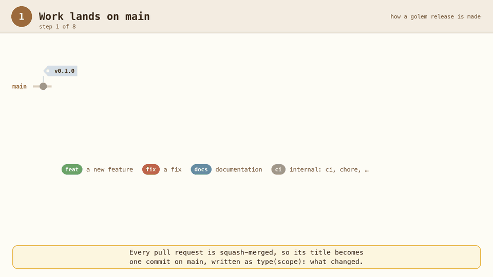
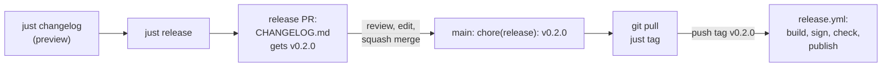
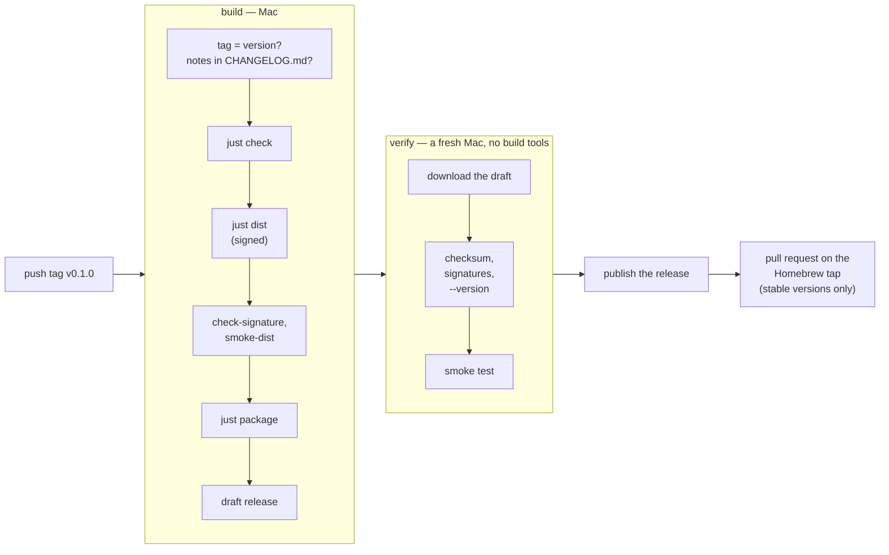

# Releasing

How a version of golem is cut, signed, and published, and how the Homebrew tap is set up. [Building and checking](build.md) covers the code and CI. [Running](run.md) covers installing and keeping golem going.

## Releases

A release is two things: its **notes**, a section in `CHANGELOG.md`, and its **files**, built and published by `release.yml` when a version tag is pushed. The notes come first, because `CHANGELOG.md` is a file on `main`, and `main` changes only through a pull request. The tag then goes on the commit that has the notes ([ADR-024](../adr/024-commits-prs-releases.md)).

Nothing is released when a pull request merges. Merged changes wait on `main` until you decide to release them.

<p align="center">
  
</p>

The animation walks through a release of 0.2.0. The steps below say the same in words.

### Step by step



All of it runs on `main` in your main checkout, up to date with GitHub.

1. **See what is waiting.** `just changelog` prints the notes the next release would get. It changes nothing.
2. **Open the release PR.** `just release` works out the next version from the commits since the last tag (below), or takes one: `just release 0.3.0`, `just release 0.2.0-rc.1`. It creates the branch `release/v0.2.0`, puts a new `## [0.2.0] - <date>` section at the top of `CHANGELOG.md`, commits it as `chore(release): v0.2.0`, pushes, opens the PR, and switches back to `main`. It refuses when `main` has local changes, is behind GitHub, the tag exists, or there is nothing user-facing to release.
3. **Edit the notes if they need it.** The PR is the place. Reword a line, merge two, drop an internal one, or add a sentence on top. Commit on the release branch and push. The commit messages are a first draft, and what is in `CHANGELOG.md` when the PR merges is what users read.
4. **Merge** once the checks are green (squash, like every PR).
5. **Tag.** `git pull`, then `just tag`. It checks that the newest commit on `main` is a `chore(release): vX.Y.Z` commit, that the tag does not exist yet, and that `CHANGELOG.md` has its section. Then it creates the tag `vX.Y.Z`, pushes it, and prints the link to the workflow run.
6. **Watch the workflow** (below). When it ends, the release is on GitHub with the `CHANGELOG.md` section as its notes, and a stable version has a pull request on the Homebrew tap.

If something is merged to `main` between steps 4 and 5, `just tag` refuses, because the newest commit is no longer the release. Release again with `just release`, which writes a new version.

### Which version comes next

`just release` with no version reads the commit types since the last stable tag ([CONTRIBUTING.md](../../CONTRIBUTING.md)):

| Since the last release there is at least one… | 0.x (today) | 1.0 and later |
|---|---|---|
| breaking change (`feat!:`, `BREAKING CHANGE:`) | minor: 0.1.0 → 0.2.0 | major: 1.4.2 → 2.0.0 |
| `feat` | minor: 0.1.0 → 0.2.0 | minor: 1.4.2 → 1.5.0 |
| only `fix`, `perf`, … | patch: 0.1.0 → 0.1.1 | patch: 1.4.2 → 1.4.3 |

Leaving 0.x is a choice: `just release 1.0.0`.

### What goes into the notes

`cliff.toml` decides. Each commit's first line becomes one bullet, with its scope in bold and the PR number as a link, under **Features** (`feat`), **Fixes** (`fix`), **Performance** (`perf`), **Reverts**, or **Docs**. `refactor`, `test`, `build`, `ci`, `chore`, `style`, `docs(plan)`, and the release commits themselves are left out. A commit that is not conventional lands under **Other**. Older `Scope - text` commits are read as `feat(scope): text`.

A section, once written, is never written again. `just release` only adds a new one above it, so an edit in a release PR stays.

### Prereleases

A version with a `-`, such as `0.2.0-rc.1`, makes a prerelease: the same steps, a GitHub release marked as a prerelease, and no Homebrew update. It gets its own `CHANGELOG.md` section. A prerelease tag does not count as "the last release": `0.2.0-rc.2` and then `0.2.0` each list everything since `0.1.0`, and the version worked out next is still `0.2.0`.

### What the workflow does with the tag



- The release has `golem-<version>-darwin-arm64.tar.gz` and `golem-<version>-darwin-arm64.tar.gz.sha256`. The archive unpacks to one folder, `golem-<version>-darwin-arm64/`.
- The notes are the tag's `CHANGELOG.md` section, printed by `scripts/changelog.sh notes`. A tag pushed by hand, without a section, fails in the first step, before anything is built.
- A tag with a `-`, such as `v0.2.0-rc.1`, makes a prerelease.
- Nothing is published until a clean runner has checked the exact files users download. If a job fails, the draft stays. Fix the cause, then re-run the workflow. The build replaces the draft's files, and its notes with the current `CHANGELOG.md` section of the tagged commit. A published release is never replaced; release a new version.

### When something goes wrong

| What happened | What to do |
|---|---|
| The release PR's notes are wrong | Edit `CHANGELOG.md` on the release branch and push, before merging |
| You merged, and want different notes | If the tag is not pushed yet: a normal PR that edits the section, then `just release` again for a new version. If the release is published: edit the notes on GitHub's release page, and fix `CHANGELOG.md` in a normal PR so the two agree |
| `just tag` says the last commit is not a release | Something merged after the release PR. Either run `just release` again for a new version, or `just tag 0.2.0` to tag `main` as it is now with the notes already written for 0.2.0 |
| The workflow failed, and the cause is the runner or a secret | Re-run the failed jobs on GitHub. The tag stays |
| The workflow failed, and the code needs a fix | The draft stays, unpublished. Delete the tag (`git push --delete origin v0.2.0 && git tag -d v0.2.0`) and the draft on GitHub. Merge the fix as a normal PR, then `git pull` and `just tag 0.2.0`. The tag goes on the commit with the fix, and the notes are the same section |
| You want to try the release process | `just release 0.2.0-rc.1`: a prerelease does not reach Homebrew. Delete it on GitHub afterwards |

## Signing

### Why golem is signed

golem keeps its secrets in the macOS Keychain ([API keys and the Keychain](run.md#_9-api-keys-and-the-keychain)): API keys and MCP server tokens today, and later hook tokens. This section says "key" for all of them. The Keychain protects each key from other programs on your Mac:
- The program that saved a key can read it without asking.
- Any other program can read it only after macOS shows a password dialog and you click Allow.

So macOS has to decide one thing every time the daemon asks for a key: *is this the same program that saved it?*

macOS answers this with the program's **code signature**, a seal stamped on the program file. What the seal says depends on how it was made:
- **Without a certificate** (an *ad-hoc* signature), the seal says only "this exact file". Every new build is a slightly different file. So after each upgrade, macOS sees a stranger and asks about every key again.
- **With a certificate**, the seal says "a program called `dev.golem.daemon`, signed by this certificate". Every release carries the same name and the same certificate. So after an upgrade, macOS sees the same program and does not ask.

Without signing, a password dialog would appear after every upgrade, once for every saved key. The daemon runs in the background, so these dialogs would pop up at random times, and the daemon would wait until someone answered. Signing makes upgrades silent.

That is the reason for the certificate. There is one more, smaller reason to sign at all: on Apple Silicon, macOS refuses to run a program file without a valid signature, even an ad-hoc one. `bun build --compile` leaves `bin/golem` with a broken signature, so every build is re-signed just so it starts.

Neither reason is about proving to Apple who made golem. That needs a paid Apple Developer ID and notarization, which come later. Until then, golem uses a **self-signed** certificate: one we made ourselves. macOS does not have to trust it. It only has to recognise it again on the next release. So every release must be signed with the **same** certificate ([ADR-021](../adr/021-release-signing.md)).

### What it means for users

Users never see or install the certificate. There are no extra steps for signing itself. What they notice:

| Situation | What the user sees | What to do |
|---|---|---|
| New user installs a release and saves a key with `golem auth set` | Nothing. The daemon saved the key, so it owns it. | Nothing |
| Upgrade to a newer release | Nothing. The daemon reads keys through `/usr/bin/security`, which does not change between releases ([ADR-021](../adr/021-release-signing.md)). | Nothing |
| First start of a release that keeps keys saved by an older build | One Keychain dialog per key: "golem-daemon wants to use your confidential information" | Enter the Mac password and click **Always Allow**, once. The daemon then stores the key again through `security` ([API keys and the Keychain](run.md#_9-api-keys-and-the-keychain)), so it never asks again. |
| Archive downloaded in a browser instead of `curl` | macOS refuses to open `golem`, because a self-signed program is not notarized | Download with `curl` ([Installing today](run.md#_6-installing-today)), or run `xattr -dr com.apple.quarantine <the unpacked folder>` |
| We ever have to replace the certificate | Nothing for keys, which `security` guards. The certificate still names the daemon | Nothing |

Homebrew downloads with `curl`, so a `brew install` user ([Homebrew](run.md#_10-homebrew)) sees none of the dialogs above, except once, if they kept keys from an older build.

### How the seal decides

For the curious: the rule inside the signature is called the *designated requirement*.

| Signed with | The rule says | After an upgrade |
|---|---|---|
| Nothing, or ad-hoc (`-`) | "the file with this exact hash" | A new hash, so a new program. macOS asks about every key again. |
| golem's certificate | `identifier "dev.golem.daemon" and certificate leaf = H"<sha1>"` | Same identifier, same certificate, so the same program. No prompt. |

**What gets signed.** `scripts/sign_dist.py sign` runs at the end of every `just dist` on macOS:

1. It finds every Mach-O file (compiled program or library) in the tree: 17 today, mostly PyInstaller's libraries under `_internal/`.
2. It signs the libraries first, deepest folder first, then the two programs, each with a fixed identifier:

   | File | Identifier |
   |---|---|
   | `libexec/golem-daemon/golem-daemon` | `dev.golem.daemon` |
   | `bin/golem` | `dev.golem.cli` |

3. It then runs the same checks as `just check-signature`.

Two environment variables choose the certificate:

| Variable | Meaning | Default |
|---|---|---|
| `GOLEM_SIGN_IDENTITY` | The certificate's SHA-1 (or its name) | `-`, which means ad-hoc |
| `GOLEM_SIGN_KEYCHAIN` | Look for the certificate only in this keychain | every keychain in the search list |

A local build is ad-hoc unless you set them. Even then it is re-signed, because `bun build --compile` leaves `bin/golem` with a signature that does not match the file.

**What is left out, on purpose.**
- No *hardened runtime*. Apple needs it only for notarization, and with a certificate that has no Apple team it makes macOS refuse to load PyInstaller's libraries. This is also why golem does not use PyInstaller's own signing option: it turns the hardened runtime on.
- No timestamp (`--timestamp=none`). A timestamp needs Apple's server and only matters for notarization.
- No notarization. Gatekeeper ignores a self-signed certificate. `curl` and Homebrew downloads are not checked by Gatekeeper, but an archive downloaded in a browser is blocked until the user allows it ([Installing today](run.md#_6-installing-today)). Developer ID and notarization come later. Switching changes the signing rule once. Keys do not depend on it, because `security` guards them.

**Checking a tree.** `just check-signature [tree] [--identity-hash <sha1>]` fails if any of these is false:
- every Mach-O file passes `codesign --verify --strict`;
- both programs carry their identifiers;
- with `--identity-hash`, both are signed by that certificate.

It prints one line per program, with the signer or `ad-hoc`:

```
libexec/golem-daemon/golem-daemon: dev.golem.daemon, golem release signing
bin/golem: dev.golem.cli, golem release signing
```

### One-time setup (before the first tag)

1. Make the certificate on your Mac:

   ```bash
   sh scripts/make_signing_cert.sh ~/golem-signing
   ```

   It writes `~/golem-signing/golem-signing.p12`: an RSA 3072 key, valid for code signing only, for 20 years. An expired certificate would force the same re-approval as a new one. The script deletes the loose key file, and prints the certificate's SHA-1 and a random password for the `.p12`.
2. In the golem repository on GitHub, open the **Settings** tab, then **Secrets and variables > Actions** in the left sidebar. Add each secret on the **Secrets** tab with **New repository secret**, and the variable on the **Variables** tab with **New repository variable**. Do not use **Environment secrets**: the release workflow names no environment, so it cannot see them.

   | Kind | Name | Value |
   |---|---|---|
   | Secret | `MACOS_SIGN_P12_BASE64` | `base64 < ~/golem-signing/golem-signing.p12 \| pbcopy`, then paste |
   | Secret | `MACOS_SIGN_P12_PASSWORD` | the printed password |
   | Variable | `MACOS_SIGN_IDENTITY` | the printed SHA-1 (not secret: it is in every signature) |

3. Store the `.p12` and its password in a password manager, then delete `~/golem-signing`.

Without these settings a release fails at "Import the signing certificate". It never falls back to an ad-hoc build.

### What the release does with it

The `build` job decodes the `.p12` into a temporary keychain with a random password, and allows only `codesign` to use the key. It adds that keychain to the search list: codesign does not find a certificate outside the list, even with `--keychain`. It then sets `GOLEM_SIGN_IDENTITY` and `GOLEM_SIGN_KEYCHAIN` for `just dist`. The keychain is deleted at the end, even when the job fails. Both `build` and `verify` run `check-signature --identity-hash "$MACOS_SIGN_IDENTITY"`, so a release signed by any other certificate, or ad-hoc, is never published.

### Signing a local build the same way

Do this when you want a local daemon to keep the Keychain's trust across rebuilds:

```bash
security import golem-signing.p12 -k ~/Library/Keychains/login.keychain-db -P '<password>' -T /usr/bin/codesign
GOLEM_SIGN_IDENTITY=<sha1> just dist
just check-signature "" --identity-hash <sha1>
```

### Losing or replacing the certificate

**Never replace the certificate unless you have to.** A new certificate, a lost `.p12`, or an expired certificate all change the rule. Keys and data are not affected, because the daemon stores keys through `/usr/bin/security`. If you must rotate it, run the one-time setup again and say so in the release notes.


## Setting up the tap (once)

1. **Make the golem repository public.** Homebrew downloads the release and `brew audit` checks the homepage without logging in.
2. **Create the tap repository.** On GitHub: new repository, owner `MilanPavel`, name exactly `homebrew-golem`, **Public**, and tick **Add a README file**. The name must start with `homebrew-`: that is how `brew install milanpavel/golem/golem` finds it. The README gives it a `main` branch. Leave everything else empty: the first release fills it.
3. **Create a token for the release workflow.** GitHub, your profile, **Settings > Developer settings > Personal access tokens > Fine-grained tokens > Generate new token**:

   | Field | Value |
   |---|---|
   | Name | `golem release to homebrew-golem` |
   | Expiration | up to 1 year; put a reminder in your calendar |
   | Repository access | **Only select repositories**: `MilanPavel/homebrew-golem` |
   | Permissions | **Contents**: Read and write. **Pull requests**: Read and write. **Workflows**: Read and write (the release copies the tap's test workflow) |

4. **Store it in the golem repository**, not the tap: open the **Settings** tab, then **Secrets and variables > Actions** in the left sidebar. On the **Secrets** tab, click **New repository secret**, name it `HOMEBREW_TAP_TOKEN`, and paste the token. Use **Repository secrets**, not **Environment secrets**: no environment is needed.
5. **Optional, recommended:** in `homebrew-golem`, under **Settings > Branches**, protect `main` and require the `formula` check before merging.
6. **Release a stable version**, for example `git tag v0.1.0 && git push origin v0.1.0`. When the release is published, the `tap` job opens the pull request `golem 0.1.0` on the tap. The first one also adds the README and the test workflow. Merge it when `test` passes.

If the token is missing or has expired, the release is still published, and only the `tap` job fails. Renew the token, then re-run that job.

## What must be true before a colleague can use it

| Requirement | Why |
|---|---|
| Both repositories are **public** | Homebrew downloads the formula and the archive without logging in |
| The build is **signed with a stable identity** ([Signing](#signing)) | Without it, the Keychain asks again after every upgrade |
| The Mac is **Apple Silicon** (M1 or newer) | Only a `darwin-arm64` build exists. The formula refuses to install on an Intel Mac |
| **Notarization** (Apple's malware scan) is not needed | Homebrew downloads formulae with `curl`, which does not mark files as "downloaded from the internet", so Gatekeeper does not block them |
