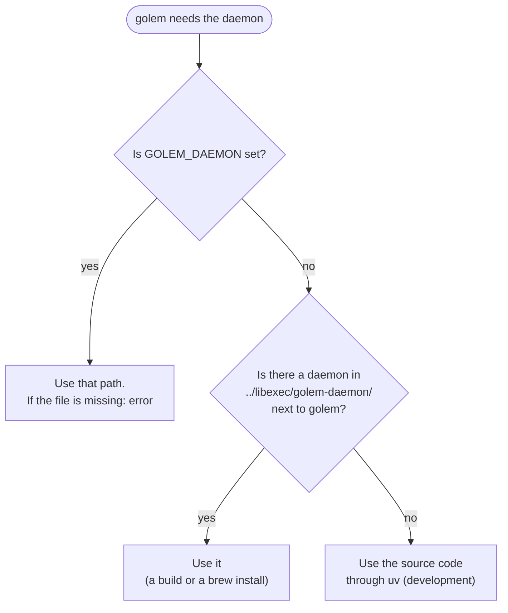
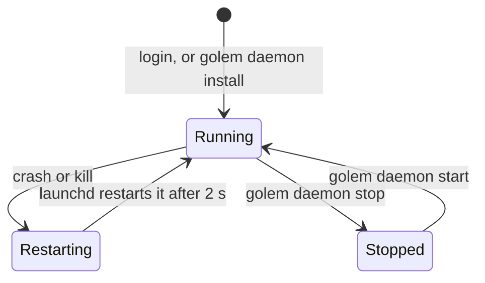
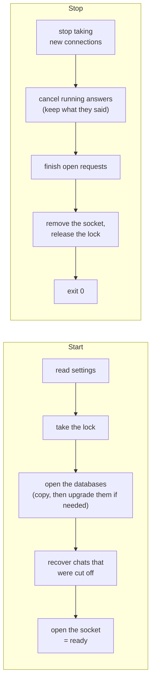
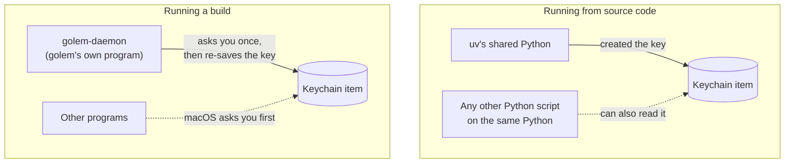
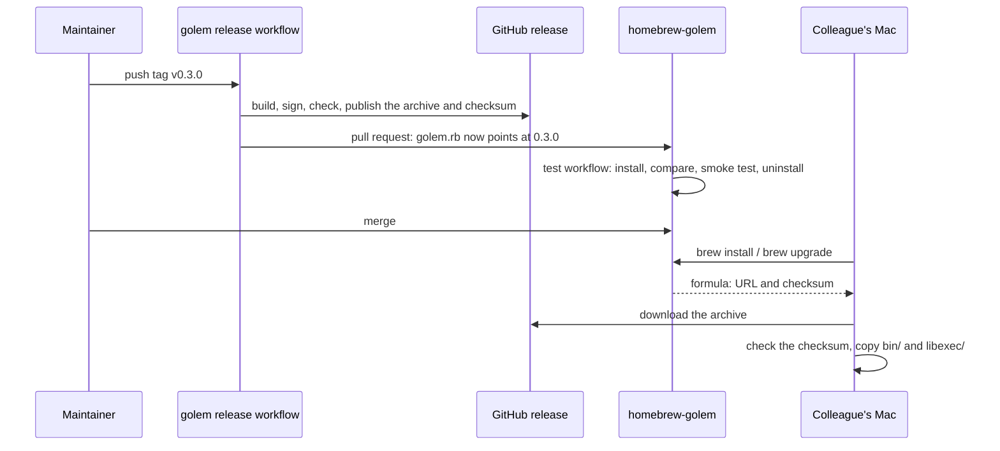
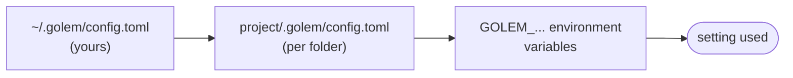

# Running

How to install golem, keep its daemon running, and fix it when something goes wrong. [Building and checking](build.md) covers the code and CI. [Releasing](release.md) covers tags, signing, and the tap.

## 6. Installing today

The user-facing steps are also in [Install golem on a Mac](../install.md).

There are four ways. Homebrew is the one to give a colleague. The others are for working on golem, or for a Mac without Homebrew.

### With Homebrew

```bash
brew install milanpavel/golem/golem
golem daemon install
```

Section 10 explains upgrading, removing, and how the tap is kept up to date.

### From the source code (for developers)

```bash
git clone <repo-url> golem && cd golem
scripts/setup.sh             # tools, packages, and git hooks (or /setup in Claude Code)
just golem daemon install    # set up the background service and start it
just golem                   # open the chat screen
```

`scripts/setup.sh` is safe to run again. It works in two parts:

1. **Tools.** It checks just, uv, Node 24, pnpm, bun, and gh against the versions CI uses (`.github/actions/setup`). Each line is `✓` (ready), `!` (a warning), or `✗` (a problem), with a `fix:` line under a problem. A missing tool stops it here, before anything is installed.
2. **Packages.** It runs `uv sync --all-packages --frozen`, `pnpm install --frozen-lockfile`, and `just hooks`. The lock files are never changed.

| Flag | Adds |
|---|---|
| `--install` | `brew install` for each missing tool, and `corepack enable` for pnpm |
| `--check` | `just check` at the end |

Two warnings don't stop setup:

- **gh not signed in to github.com.** You need gh only to open pull requests and to release. Fix it with `gh auth login`.
- **The checkout's path is too long.** The daemon tests create sockets inside the checkout, and macOS allows a socket path of 103 bytes. That leaves 67 characters for the checkout's own path.

`/setup` in Claude Code (`.agents/skills/setup/SKILL.md`) runs the same script and asks before it installs anything. `.claude/skills` is a symlink to `.agents/skills`, so Claude Code and other agents read the same skills.

### From a build folder

```bash
just dist
dist/golem-<version>-darwin-arm64/bin/golem daemon install
dist/golem-<version>-darwin-arm64/bin/golem
```

The build folder can be moved anywhere on the same Mac. Run `golem daemon install` again after moving it.

**Limitation:** a local build is signed ad-hoc, so it is meant for the Mac that built it. To give golem to someone else, use Homebrew, or a release archive: unpack it anywhere and run `bin/golem daemon install`.

### From a release

```bash
curl -LO https://github.com/MilanPavel/golem/releases/download/v<version>/golem-<version>-darwin-arm64.tar.gz
curl -LO https://github.com/MilanPavel/golem/releases/download/v<version>/golem-<version>-darwin-arm64.tar.gz.sha256
shasum -a 256 -c golem-<version>-darwin-arm64.tar.gz.sha256
tar -xzf golem-<version>-darwin-arm64.tar.gz -C ~/Applications
~/Applications/golem-<version>-darwin-arm64/bin/golem daemon install
```

Download with `curl`, not a browser. A browser marks the files as downloaded, and Gatekeeper blocks a program that is not notarized. If you already used a browser, run `xattr -dr com.apple.quarantine ~/Applications/golem-<version>-darwin-arm64` to remove the mark. To upgrade, unpack the new version, run its `golem daemon install`, and delete the old folder.

### How `golem` finds the daemon

`golem` checks three places, and uses the first one it finds:



---

## 7. Keeping the daemon running

### launchd, the macOS service manager

launchd is the part of macOS that starts background programs. `golem daemon install` writes a small settings file for it, `~/Library/LaunchAgents/dev.golem.daemon.plist`, which says:

- **what to run:** the full path of the daemon, plus `serve`
- **start it at login**, and **start it again whenever it stops**, waiting 2 seconds between tries
- **where its data lives:** `GOLEM_HOME`, as it was at install time
- **where its output goes:** `~/.golem/logs/launchd.stdout.log` and `launchd.stderr.log`



| Command | What it does |
|---|---|
| `golem daemon install` | Writes the launchd file and starts the daemon. Run it again after moving or upgrading golem |
| `golem daemon start` | Starts the daemon, or restarts it if it is running |
| `golem daemon stop` | Stops it and keeps it stopped until `start` |
| `golem daemon restart` | Swaps the running daemon for the one the launchd file names, after an upgrade. Waits until the new one answers and prints its version. Warns when the launchd file names a different golem than the one you ran: then run `install` |
| `golem daemon uninstall` | Stops it and deletes the launchd file. Your data in `~/.golem` stays |
| `golem daemon logs` | Shows the log and follows new lines |
| `golem status` | Shows pid, version, and uptime. Exits with code 1 if the daemon is not running, and prints why it could not start or the one command that starts it. `models`, `config`, `skills list`, and `auth` do the same |
| `golem doctor` | Checks the install and prints a fix under each problem ([section 12](#_12-logs-and-health-checks)). Exits with code 1 if anything failed. `golem doctor --mcp` also starts each MCP server and says what stopped it |

`kill` is not a way to stop it: launchd starts it again within seconds. Use `golem daemon stop`.

**A trap:** launchd does not see the environment variables from your terminal. An API key you `export` in your shell does not reach the daemon. Save keys with `golem auth set`, which puts them in the Keychain.

### Running it by hand

For debugging, run the daemon in a terminal. Ctrl-C stops it.

```bash
uv run python -m golem serve                        # from the source code
dist/golem-*/libexec/golem-daemon/golem-daemon serve # from a build
```

### Only one daemon at a time

The daemon locks the file `~/.golem/run/golem.pid` for as long as it runs ([ADR-004](../adr/004-pid-lock.md)). A second daemon sees the lock and exits with `daemon already running (pid N)`. It also writes the holder's pid and command line to `~/.golem/run/last-error`, which `golem` and `golem status` show. If the daemon crashed, the lock is gone, so the next start knows the old socket file is stale and replaces it.

### Starting and stopping



**After a crash, nothing is lost.** Every message is saved to the database before it is sent anywhere. An answer that was cut off is marked as interrupted at the next start. A question waiting for your approval keeps waiting.

---

## 8. Where the data lives

Everything is in one folder: `~/.golem`, or whatever `GOLEM_HOME` points to.

| Path | What it holds | Back it up? |
|---|---|---|
| `config.toml` | Your settings and tool rules | **Yes** |
| `golem.db` | Every chat and event: the real history | **Yes** |
| `checkpoints.db` | What the model remembers of each chat. Losing it loses the model's memory, not your history ([ADR-006](../adr/006-checkpoint-continuity.md)) | **Yes** |
| `history` | Messages you typed, for Up-arrow recall | Optional |
| `tui.json`, `exports/` | Screen preferences, and chats you exported | Optional |
| `cache/` | Model lists and prices, refreshed daily | No, safe to delete |
| `logs/` | Log files, and `ollama.log` from an Ollama golem started | No |
| `run/` | The socket, the lock, `last-error` from a start that failed, the Keychain record, and `ollama-<port>.pid` for an Ollama golem started | No |

**Backing up:** both `.db` files are SQLite databases. Copy them while the daemon is stopped. While it runs, use `sqlite3 ~/.golem/golem.db ".backup /path/to/copy.db"`.

**Upgrades:** `golem.db` has a schema number. A newer daemon upgrades an older file once, at start, after copying it to `golem.db.bak-<schema>`, for example `golem.db.bak-5`. An older daemon refuses a file from a newer version rather than damaging it, and says which golem it needs and which copy it can still open. `checkpoints.db` is copied to `checkpoints.db.bak-<langgraph version>` when golem starts with different LangGraph packages. The copies are not deleted for you; remove old ones when you no longer need them.

**Going back a version:** stop the daemon, move `golem.db` aside, rename the copy the error names to `golem.db`, and start the older golem. What happened after the upgrade is only in the file you moved aside.

---

## 9. API keys and the Keychain

API keys are kept in the **macOS Keychain**, never in a file.

- Save one with `golem auth set anthropic`, or `/login anthropic` in the chat screen.
- `golem auth list` shows where each key comes from.
- A settings file that contains a key does not load at all, so a key cannot leak through a shared config.
- If both are set, an environment variable such as `ANTHROPIC_API_KEY` wins over the Keychain.

### Which program is allowed to read the key?

The Keychain remembers which **program** created each item, and lets only that program read it without asking.



When a built daemon first reads a key saved by the source-code version, macOS asks once. Choose **Always Allow**. The daemon then deletes the key and saves it again, so from then on only the daemon is trusted. It writes the key's name to `~/.golem/run/keychain-migrated`, so this happens only once per key.

**Releases keep the rule, not the partition.** Releases are signed with one certificate, so every release matches the item's rule. macOS also gives each item a partition list, and a program with no Apple Team ID gets `cdhash:<its hash>` there. Each release has a new hash, so the first read after an upgrade asks again. While a read waits longer than half a second, the daemon sends `keychain.wait`, and the TUI names the key and says to choose Always Allow. Only a Developer ID signature, with a Team ID, ends the prompt. A local build is signed ad-hoc unless you give it the certificate, so macOS treats each rebuild as a new program and asks again.

---

## 10. Homebrew

**Status: built. It is live once the tap repository and its token exist (below), and the first stable tag has been released and its tap pull request merged.** The decisions are in [ADR-022](../adr/022-homebrew-tap.md).

### What it looks like for a user

A colleague with an Apple Silicon Mac runs:

```bash
brew install milanpavel/golem/golem   # download and install
golem daemon install                  # start the background service, now and at every login
golem auth set anthropic              # save an API key (or use Ollama, no key needed)
golem                                 # open the chat screen
```

That's all. They don't need Python, Node, uv, bun, or the source code. After the install, Homebrew prints the three `golem daemon` commands a user needs, so they don't have to remember them.

### What happens behind the scenes

Three things work together:

1. **A GitHub release.** Each version tag (for example `v0.3.0`) makes GitHub Actions build golem and upload `golem-0.3.0-darwin-arm64.tar.gz`, plus its checksum (a fingerprint that proves the file was not changed). See [Releasing](release.md#releases).
2. **A "tap".** A tap is a small extra GitHub repository that Homebrew can read: `MilanPavel/homebrew-golem`. It holds one formula, `Formula/golem.rb`. The formula says: "version 0.3.0 is at this URL, its checksum is this; copy `bin/` and `libexec/` into place."
3. **The tap updates itself.** After each stable release, the release workflow opens a pull request on the tap with the new version and checksum. A workflow in the tap installs that formula on a fresh Mac and tests it. You merge the pull request when it passes. Prereleases (tags with a `-`) never go to the tap.



Nothing is compiled on the user's Mac. Homebrew only downloads, checks, and copies.

**The golem repository owns every file in the tap.** The formula is made from `packaging/homebrew/golem.rb.in` by `scripts/render_formula.sh`. The tap's README and test workflow are copied from `packaging/homebrew/tap/`. Change them there. Every release pull request replaces whatever is in the tap.

### Where the files end up

```
/opt/homebrew/
├─ bin/golem                      → link to the current version
├─ opt/golem/                     → link to the current version (never changes name)
└─ Cellar/golem/0.3.0/
   ├─ bin/golem
   └─ libexec/golem-daemon/...
```

Homebrew keeps each version in its own folder under `Cellar/`, plus two links that always point at the current one. `golem daemon install` writes the `opt/golem/...` path into the launchd file, **not** the `Cellar/golem/0.3.0/...` path. So after an upgrade, launchd starts the new version, and the old folder can be deleted safely.

**The files are exactly the released ones.** By default, Homebrew edits programs after installing them: it rewrites each library's name to an absolute path and signs it again, ad-hoc. It also deletes some Python package metadata. golem's formula turns both off (`preserve_rpath` and `skip_clean "libexec"`). So the libraries keep golem's signature, and the tap's test checks that the installed `bin/` and `libexec/` are identical to the archive.

### Upgrading and removing

```bash
brew upgrade golem          # download the new version
golem daemon restart        # switch the running daemon to it
```

The running daemon keeps using the old version's files until you restart it. `brew upgrade` may delete the old folder straight away. The daemon then fails on the next thing it loads from disk, and launchd starts the new version. So restart right after the upgrade. The chat screen also shows a yellow notice when the daemon's version differs from its own.

```bash
golem daemon uninstall      # first: remove the launchd service
brew uninstall golem        # then: remove the program
```

Your chats and settings in `~/.golem` stay, on purpose. Delete that folder yourself if you want them gone.

**The order matters.** After `brew uninstall`, the `golem` command is gone, so `golem daemon uninstall` can no longer run. The daemon that was running keeps running from deleted files, or launchd keeps trying to start a program that does not exist. A newer `golem` repairs this when it opens: a launch agent that launchd doesn't run, or whose program is gone, is installed again. A daemon whose socket file was deleted, for example with `rm -rf ~/.golem`, stops within 5 seconds, so launchd starts a fresh one. To clean up by hand:

```bash
launchctl bootout gui/$(id -u)/dev.golem.daemon
rm ~/Library/LaunchAgents/dev.golem.daemon.plist
```

### Why Homebrew does not start the daemon itself

Homebrew can run background services (`brew services`). golem's formula does **not** use that. If both Homebrew and `golem daemon install` started a daemon, the second would hit the lock and exit, launchd would start it again, and it would fail forever. So only `golem daemon install` manages the service, and it works the same way whether golem came from Homebrew or from a downloaded archive. For the same reason, `brew upgrade` does not restart the daemon. It would cut off an answer in progress whenever someone upgrades all their Homebrew packages.

### Linux and Windows later

The same formula will work on Linux (plan step 8.2), with a systemd service instead of launchd. Windows will use **Scoop**, a similar tool for Windows, from its own "bucket" repository (plan step 8.4).

---

## 11. Settings that matter for running golem

All settings are listed in [Models and API keys](../guide/models.md#settings). For running golem, you mostly need to know where settings come from and when they take effect.

**Where they come from.** If the same setting is in more than one place, the last one wins:



A project's file cannot loosen safety settings (`[shell]`, `[web]`), and cannot allow tools unless you listed that folder in `trusted_projects`.

**When changes take effect:**

| Takes effect at once | Needs a restart (`golem daemon start`) |
|---|---|
| Models, providers, `default_model`, tool rules | Everything else, such as `log_level`, `session_titles`, `[shell]`, `[web]` |

If you break the file, golem keeps using the last version that worked and writes a warning to the log.

Remember: under launchd, `GOLEM_...` variables from your terminal do not apply. Put settings in `config.toml`.

| Setting | Default | What to know |
|---|---|---|
| `log_level` | `INFO` | `DEBUG` writes more detail to the log |
| `session_titles` | `true` | Costs one extra model call per new chat |
| `[shell] network` | `false` | Commands the AI runs cannot use the internet |
| `[shell] timeout_seconds` | `120` | The longest a command can run |
| `[web] allow_private` | `false` | `web_fetch` cannot reach your own computer or home network |

---

## 12. Logs and health checks

- **Logs:** `golem daemon logs`. The log file is `~/.golem/logs/golem.jsonl`, one JSON record per line. If the daemon fails before it can write its log, look in `~/.golem/logs/launchd.stderr.log`. An Ollama that golem started writes to `~/.golem/logs/ollama.log`.
- **Is it running?** `golem status` shows the pid, version, uptime, state (`running`, or `draining` while it shuts down), the default model, and each local model server golem has used: started by golem with its pid and memory, or running without golem.
- **Is the install healthy?** `golem doctor` prints a checklist, with a fix under each line that is not ok. It exits with code 1 when a check fails, and 0 when there are only warnings.

| Check | Fails when | Fix it prints |
|---|---|---|
| `daemon` | `golem` cannot find the daemon program ([section 6](#_6-installing-today)) | `brew reinstall golem`, or set `GOLEM_DAEMON` |
| `service` | launchd has no golem job, runs another copy of golem, or the job is stopped | `golem daemon install`, or `golem daemon start` |
| `running` | The daemon does not answer, or runs another version than `golem` | `golem daemon start`, or `golem daemon restart` |
| `socket` | Someone other than you could open the socket | `golem daemon restart` |
| `config` | `config.toml` does not load. The line names the setting | Edit the file |
| `model` | No model is chosen yet (a warning), or the default does not resolve | `/model` in the chat |
| `ollama` | Ollama is not installed, a remote Ollama does not answer, `[ollama] start = false` and it does not answer, or a profile's model is not downloaded. One line, however many profiles use it. A stopped local Ollama is ok, because golem starts it | Pick a local model in `/model` (golem installs Ollama), `brew install ollama`, or `ollama pull <model>` |
| A hosted provider, such as `anthropic` | Its API key is not in the Keychain. A key only in your shell is a warning, because launchd does not pass it to the daemon | `golem auth set <provider>` |
| `disk` | Less than 1 GB is free | Free some space |

`golem` checks the first and the third itself. The daemon program checks the rest (`golem-daemon doctor` prints them as JSON), because it reads the same launchd file, settings, Keychain items, and model servers that the running daemon does. That also works when the daemon is down.
- **What is it doing?** In the chat screen, `/debug wire` shows every message between `golem` and the daemon, and `/debug model` shows what the model sees.
- **Not there yet:** log rotation (the log grows forever), metrics, tracing, and cost tracking.

---

## 13. Safety limits

| Area | Limit |
|---|---|
| Socket | Only your user can open it (`0600`). It is created under a strict file mask, so it is never readable by others, not even for a moment |
| File tools | Work only inside the folder the chat was started in. Never change `.golem/` or `.git/` |
| Approvals | Anything that changes something asks you first, unless a rule says otherwise ([ADR-012](../adr/012-permission-rules.md)) |
| Shell | Every command runs in a macOS sandbox (`sandbox-exec`): no internet, no writing outside the folder. Without the sandbox, commands do not run at all ([ADR-014](../adr/014-shell-sandbox.md)) |
| Web | Asks per website, refuses addresses on your own network, and marks page text as untrusted ([ADR-017](../adr/017-web-fetch.md)) |

---

## 14. When something goes wrong

| What you see | What to do |
|---|---|
| Anything | Run `golem doctor` first. It prints a fix under each problem it finds |
| The chat screen says `reconnecting` | Run `golem status`. If it is down, run `golem daemon start`, then look at `~/.golem/logs/launchd.stderr.log` |
| `daemon already running (pid N)` | The background copy is running. Run `golem daemon stop` before starting one by hand |
| The daemon keeps restarting | Read `launchd.stderr.log`. Common causes: the database is from a newer golem version (the message names the golem it needs and the copy that still opens); `GOLEM_HOME` is too long (a socket path must be under 104 characters on macOS); golem was moved (run `golem daemon install` again) |
| `needs key` | `golem auth set <provider>`, or `/login <provider>` in the chat screen |
| `/mcp` shows a server as `failed: command not found` | The daemon runs under launchd, with a short `PATH`. Golem also looks in `/opt/homebrew/bin`, `/usr/local/bin`, and `~/.local/bin`. Anywhere else, give `command` as a full path |
| `/mcp` shows a server as `failed: the server exited with code N: …` | The text after the code is the last line the server printed. Golem keeps trying, waiting longer each time, up to a minute. Run its command in a terminal to see more. `golem daemon logs` has everything it printed, at `DEBUG` |
| An MCP server's tools are missing | Run `/mcp`. `idle` means it is on demand: `/mcp enable <name>`. A project's server needs its folder in `trusted_projects`. Changes to `[mcp.*]` apply within a few seconds; a file that does not validate keeps the last good servers, and the log says why |
| `/mcp` shows `no secret mcp/<name> in the Keychain` | Run `golem auth set mcp/<name>`. The server starts again with it |
| An HTTP MCP server shows `HTTP 401` | The token is wrong or expired. Store a new one with `golem auth set mcp/<name>` |
| macOS asks about the Keychain on every start | A local build is signed ad-hoc, so every rebuild asks. Choose Always Allow, or sign local builds with the release certificate ([Signing](release.md#signing)). A release asks once, after the first upgrade from a local or ad-hoc build |
| A release workflow fails at "Import the signing certificate" | The secrets or the `MACOS_SIGN_IDENTITY` variable are missing. See [Signing](release.md#signing) |
| The release's `tap` job fails | The `HOMEBREW_TAP_TOKEN` secret is missing or expired, or `homebrew-golem` does not exist. The release itself is published. Fix the token ([Setting up the tap](release.md#setting-up-the-tap-once)), then re-run the job |
| The tap's `test` workflow fails at "Homebrew installed the archive unchanged" | Homebrew edited a file after install. A new library in the daemon may have a non-`@rpath` install name (`otool -D`), or a newer Homebrew may edit kegs in a new way. Do not merge |
| `brew upgrade golem` does not offer the new version | The tap pull request is not merged yet. Then run `brew update` |
| launchd keeps failing to start golem after `brew uninstall` | The service was not removed first. See "The order matters" in [section 10](#_10-homebrew) |
| A build crashes with `ModuleNotFoundError` | PyInstaller missed a module. Add it to `golem-daemon.spec`, then run `just dist && just smoke-dist` |
| The first start of a new build is slow | Expected: macOS checks the new files once |

**Building behind a company proxy:** `just dist` and `just smoke-dist` work offline once the packages are installed. `just check` tries to update packages first, and fails if it can't download them. If everything is already installed, run `UV_NO_SYNC=1 just check`.
