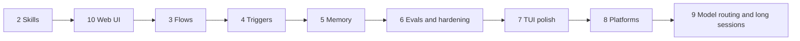
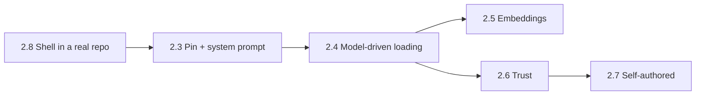
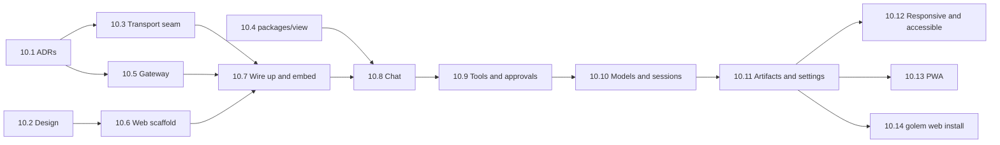
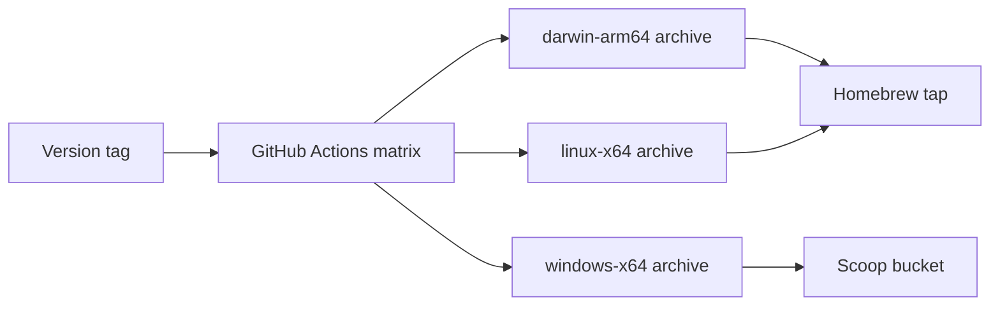

# Golem — plan

> Name: `golem`, after the clay servant of the Prague legend — brought to life to do work on its maker's behalf.

## Read this first

Golem is a background program on your computer (macOS today, Linux and Windows in Phase 8), the **daemon**, that talks to language models for you. You talk to it through a chat screen in the terminal, the **TUI**. Closing the screen does not stop the work. Open it again and the conversation is still there, including an answer that kept streaming while you were away.

This file is about what comes next. How the existing pieces are built is in [architecture.md](architecture.md), and why they are built that way is in the [ADRs](adr/README.md).

### Next, in order

| Phase | What you get | Milestone |
|---|---|---|
| 2. Skills | Claude Code compatible `SKILL.md` skills | M4 — Skilled |
| 10. Web UI | The chat in your browser, served by `golem web` | M7 — In the browser |
| 3. Flows | Durable workflows written in Python, resumable after a crash | M5 — Works alone |
| 4. Triggers | Schedules, file watchers, and notifications | M5 — Works alone |
| 5. Memory | Long-term memory that you can see and edit | M6 — Remembers |
| 6. Evals and hardening | Tracing, eval suites, crash tests, backups, a security pass | M6 — Remembers |
| 7. TUI polish | A render cache for long sessions, themes, and search in the transcript | Later |
| 8. Platforms | One interface for everything OS-specific, then Linux and Windows | Later |
| 9. Model routing and long sessions | Token and cost display, a cheap profile for small jobs, budgets, escalation, compaction | Later |

What is built is in [architecture.md](architecture.md) and the ADRs, and how to install, run, and release it is in [sre.md](sre.md). Phase 1, the first run and the terminal UX, is built ([#62](https://github.com/MilanPavel/golem/issues/62)), so skills are next, then the web UI.



### How to read a phase

A phase is split into numbered steps (1.1, 1.2, …). A step is small enough for an evening or a weekend, and it leaves golem working and usable. Do the steps top to bottom unless a step says otherwise.

Every step has the same parts:

- **Goal** — the one thing the step is for.
- **You can** — what you can do afterwards that you could not do before.
- **Build** — the work.
- **Done when** — the check that ends the step.
- **Watch out** — only where there is a known trap.

A step that changes the wire bumps the protocol minor version and regenerates the TypeScript types (`just check` fails if they drift). A non-obvious choice gets an ADR in `docs/adr/`.

---

## Ground rules

These hold for every phase.

1. **The protocol is the contract.** LangGraph, LangChain, and provider message types never reach a client.
2. **LangGraph runs graphs, the daemon owns the rest.** Sessions, permissions, skills, router policy, the event log, and the protocol are golem code.
3. **Graph state stays small.** It is checkpointed every superstep. Big things (tool output, files, transcripts) go into golem's own tables, and state holds their IDs.
4. **Every step ships something usable.** No step ends in a broken build.
5. **Decisions get written down.** One short ADR per non-obvious choice.

### Where LangGraph fits

| Use LangGraph for | Feature |
|---|---|
| The agent loop (model, then tools, then model) | `StateGraph` with a conditional edge |
| Persistence and resume | `AsyncSqliteSaver`, keyed by `thread_id` |
| Human approval | `interrupt(payload)` in a node, resumed with `Command(resume=value)` |
| Streaming tokens and progress | `astream(..., stream_mode=["messages", "updates", "custom"])` and `get_stream_writer()` |
| Durable deterministic flows | Functional API: `@entrypoint` and `@task` |
| Retries | `RetryPolicy` per node or task |
| Long-term memory | `BaseStore` with namespaces |

Keep outside LangGraph: the protocol and the event log, the permission engine, the router policy, the skill registry, cost accounting, and triggers. The graph calls into them. They are not graph features.

Agents use the Graph API, where the model decides control flow. Flows use the Functional API, where your code decides control flow.

### Pitfalls to design around

- **Resume re-runs the interrupted node from its start.** Anything before `interrupt()` in that node runs again. Put side effects after the interrupt, or in their own node or task.
- **State schema changes.** Adding a field with a default is safe. Renaming or retyping breaks old checkpoints. Chat checkpoints are disposable, because the event log is the real history. In-flight flows may have to finish on the old code.
- **Checkpoint growth.** Large tool output goes to an artifact table, and state keeps `artifact_id` plus a short summary.
- **Message types leaking out.** LangChain `BaseMessage`s live only in graph state, and the stream adapter converts them to protocol events.

### Protocol, what is left to add

JSON-RPC 2.0, one JSON object per line, over `~/.golem/run/golem.sock`. Protocol 2.27 is on the wire today (see [architecture.md](architecture.md#what-is-on-the-wire-today)). The phases below add the rest.

| Group | New events | Phase |
|---|---|---|
| Models | `usage.reported` (tokens, cost) | 9.1 |
| System | `warning`, `error` | 9.4 |
| Skills | `skill.activated`, `skill.deactivated` | 2.3 |
| Runs and flows | `run.step.started`, `run.step.completed`, `run.interrupted` | 3.2, 3.4 |

New commands: `session.set_skills` (2.3), `skill.trust | untrust` (2.6), `flow.list | start | status` (3.1), and `daemon.shutdown` (8.1).

Rules:

- A breaking change bumps `protocol_major`, and the daemon refuses a mismatched client with a clear error.
- Events are append-only facts. Clients derive all UI state from them, so replaying equals rebuilding.
- Every event is stored before it is sent. `message.delta` is coalesced into `message.completed` in the log.

---

## Phase 2 — Skills

Agent Skills (`SKILL.md`) compatible with Claude Code, loaded by progressive disclosure. The details and the use cases are in the milestone, tracked by [#10](https://github.com/MilanPavel/golem/issues/10). Each step is one PR, and each of its tickets is one commit in it. This section keeps the why.

A skill becomes active in one of three ways:

| Way | Who | Where the body goes | How long |
|---|---|---|---|
| **Invoke** `/ship fix the mcp restart` | You | The turn's user message, arguments substituted | That turn |
| **Pin** `/skill pin <name>` | You | The system prompt, re-read every model call | Until unpinned. Survives a restart, and a fork copies it |
| **Load** `load_skill(name)` | The model | A tool result in history | The rest of the session |

Choices that hold for the whole phase:

- **The daemon owns the registry, and graph state holds only skill names.** Bodies are read from disk when the prompt is built.
- **The system prompt is built per model call and never checkpointed.** golem has none today, so 2.3 adds it.
- **`allowed-tools` pre-approves, as in Claude Code, but only for a trusted skill**, and a deny rule always wins. The earlier plan said it only narrows.
- **A skill from an untrusted project works like a user skill.** Only its scripts and `` !`cmd` `` always ask, and its `allowed-tools` is ignored until the project is trusted ([ADR-012](adr/012-permission-rules.md)).
- **`~/.claude/skills` and `<project>/.claude/skills` are read by default.** Legacy `.claude/commands/*.md` is not.
- **Invoking comes before pinning.** It is the most-used Claude Code feature, and it needs no system prompt.

The registry, `/skills`, and `golem skills` are built ([#4](https://github.com/MilanPavel/golem/issues/4)). So is running a skill once with `/name` ([#21](https://github.com/MilanPavel/golem/issues/21)): the arguments are filled in, the transcript shows the line you typed, and the model may read the skill's folder. Running `/ship` in golem showed that the shell cannot yet do its work in a git worktree or with `gh`, so 2.8 comes next.



### 2.8 The shell works in a real repo — [#204](https://github.com/MilanPavel/golem/issues/204)

- **Goal:** `/ship` in golem opens a pull request, from a clone or a git worktree.
- **You can:** run `git` and `gh` from golem's shell, in a worktree too, and see when golem's sandbox refused something and how to allow it.
- **Build:** the sandbox may write a worktree's git folders, `gh` and `git push` reach GitHub with your credentials after an approval, a sandbox refusal says it was the sandbox, and a command that fails is not marked `✓`.
- **Done when:** `/ship` in golem on this repo, from a git worktree, opens a pull request.
- **Watch out:** it is numbered 2.8 so that 2.3 to 2.7 keep their issues, but it comes right after 2.2. How a command gets your credentials needs an ADR: one shell line can run several programs, so a rule keyed on the first word is easy to get around.

### 2.3 Pinned skills and the system prompt — [#5](https://github.com/MilanPavel/golem/issues/5)

- **Goal:** you can turn a skill on for the whole session.
- **You can:** `/skill pin <name>`, `/skill unpin <name>`, and see active skills in the status line and the system prompt in `/debug model`.
- **Build:** a system prompt builder, `active_skills` in graph state with `session.set_skills`, `skill.activated` and `skill.deactivated`, handling of a pinned skill that is edited or deleted, and a fork that copies pins.
- **Done when:** a pinned skill changes the answer, and is still pinned after `kill -9` and a reattach.

### 2.4 Model-driven loading — [#6](https://github.com/MilanPavel/golem/issues/6)

- **Goal:** the model picks up a skill when it needs one.
- **You can:** ask for a task a skill covers, and see it activate on its own.
- **Build:** an index of descriptions in the system prompt, within a size budget and without `disable-model-invocation` skills, and a `load_skill(name)` tool.
- **Done when:** an existing Claude Code skill that reads a reference file works unchanged, triggered by the model.

### 2.5 Pre-selection by embeddings — [#7](https://github.com/MilanPavel/golem/issues/7)

- **Goal:** local models, which are bad at picking from a long list, still get the right skill.
- **You can:** use skills reliably on a local model.
- **Build:** embeddings through the router, and a `select_skills` node before `call_model`, on per profile.
- **Done when:** the hand-check list from 2.4 scores better or equal on a local model. The skill-trigger eval (6.2) replaces it later.

### 2.6 Trust and scoped permissions — [#8](https://github.com/MilanPavel/golem/issues/8)

- **Goal:** a skill can pre-approve only what you trusted, and never past a deny rule.
- **You can:** see which skills are trusted, and approve a skill's script once.
- **Build:** a trust store keyed by a hash of the skill folder, approvals for scripts, `allowed-tools`, and `` !`cmd` `` dynamic context.
- **Done when:** editing a trusted skill's script triggers a new approval.

### 2.7 Self-authored skills — [#9](https://github.com/MilanPavel/golem/issues/9)

- **Goal:** golem can turn a repeated task into a skill.
- **You can:** ask golem to write or improve a skill, review the draft, and accept it.
- **Build:** bundled skills (with a skill-authoring skill), a `propose_skill` tool that writes into `~/.golem/skills/_proposed/`, and edits to a skill shown as a diff.
- **Done when:** a proposed skill is accepted and then triggers in a new session.

Later phases pick up the rest: `model:` frontmatter (9.3), `context: fork` (3.6), and compaction (9.5), which keeps pinned skills for free because they live in the system prompt.

---

## Phase 10 — Web UI

The chat in your browser, served by the `golem` command. `golem web` starts a gateway on `127.0.0.1` inside the `golem` binary. It serves a page built from a new `packages/web` and bridges each browser WebSocket to its own connection on the daemon's socket. The daemon does not change. The details are in [#150](https://github.com/MilanPavel/golem/issues/150), and the why is in [vision.md, chapter 1](vision.md#1-web-ui). It runs after Skills. Each ticket is one commit and one pull request.

Choices that hold for the whole phase:

- **The daemon keeps only its Unix socket.** Everything that faces a network is the gateway, in the `golem` binary ([ADR-028](adr/028-web-gateway.md)).
- **The gateway is a strict bridge.** One WebSocket message is exactly one JSON object, the browser may call only methods on an allowlist that `just gen` writes, and payloads are never rewritten.
- **Login trades a token for a cookie.** A token from a `0600` file opens `/#t=<token>`. The page trades it for a random session cookie named `golem_<port>` (`HttpOnly`, `SameSite=Strict`). `Origin` and `Host` are checked exactly on every request and upgrade. A refused upgrade closes with code 4401.
- **One gateway per user, on a stable port** (`run/web.json`), so the origin, the cookie, and an installed PWA survive a restart.
- **`@golem/client` gets a transport seam** (`Dial` and `Link`), with a Unix link and a WebSocket link. The heartbeat runs from the browser to the daemon.
- **`packages/view` holds the pure code that turns events into a transcript.** The TUI and the browser share it.
- **The stack is React 19, Vite, Tailwind v4 with semantic `@theme` tokens, Radix, `cva`, and TanStack Query.** The default palette is reset and arbitrary values are banned ([ADR-029](adr/029-web-stack.md)).
- **Pushed events and pulled answers live apart.** The `@golem/view` reducer folds a session's events into one small store per attached session, with deltas batched per frame. Answers to requests (`model.list`, `config.get`, `mcp.list`, `skill.list`, …) live in TanStack Query, and the pushed events that change them refresh them. Commands have no optimistic updates: what you see comes from the daemon's events, as in the TUI.
- **The design is minimal and golem's own.** A light theme, slip, and a dark theme, kiln, with one clay accent. Type is Geist, Literata, and Geist Mono. Messages are marked by the pixel golem, whose eyes show the state. An approval reads like the shem.
- **Model output is untrusted.** Markdown goes through DOMPurify, a strict CSP applies, and Shiki uses its JavaScript engine, with no WASM.



10.1 and 10.2 come first, side by side. Then 10.3 to 10.6 can run side by side, each in its own worktree. 10.1 to 10.8 are the first usable web UI.

### 10.1 ADRs: the web gateway and the web stack — [#151](https://github.com/MilanPavel/golem/issues/151)

- **Goal:** every choice the code in 10.3 to 10.7 depends on is written down and agreed before that code is written.
- **You can:** read why the gateway is shaped as it is, what it refuses, and which libraries the page uses.
- **Build:** ADR-028 (framing, the allowlist, login, the run file and port, headers and CSP, backpressure, the threat model, and the full security test list), [ADR-029](adr/029-web-stack.md) (the stack, styling, and state), the `Dial` and `Link` interfaces, and this section.
- **Done when:** both ADRs are merged, and the security test list in ADR-028 is reviewed by hand.

### 10.2 A design for the web UI — [#155](https://github.com/MilanPavel/golem/issues/155)

- **Goal:** agree how the web UI looks before any of it is built.
- **You can:** open a clickable prototype in both themes and at phone width, and read the design in `docs/design/web.md`.
- **Build:** an HTML prototype of the empty state, a chat with a streamed answer and a tool call, an approval with a diff, the session sidebar, the todo drawer, the ⌘K palette, and the failure states. Clay accent, the pixel golem with eyes for idle, thinking, waiting, failed, and disconnected (each with a text label), a clay pixel block as the streaming cursor, slip and kiln themes, Geist, Literata, and Geist Mono, and 150 to 200 ms motion that honours `prefers-reduced-motion`.
- **Done when:** the prototype is approved, and the tokens in `docs/design/web.md` pass the contrast check.

### 10.3 A transport seam in `@golem/client` — [#158](https://github.com/MilanPavel/golem/issues/158)

- **Goal:** the client's core (hello, heartbeat, reconnect, re-attach from `seq`, dropping repeats) runs in a browser as well as in Node.
- **You can:** nothing new on screen. A browser can use `@golem/client` over a WebSocket.
- **Build:** `Dial = () => Link` injected into the core, `unix-link.ts` with a streaming UTF-8 decoder (this fixes a multi-byte character split across chunks), `ws-link.ts` with an `unauthorized` state on close code 4401, and two entry points, `@golem/client` (no `node:`) and `@golem/client/node`.
- **Done when:** `connect.test.ts` passes unchanged, a contract suite passes for both links, and the core typechecks with no Node types.
- **Watch out:** `connect.test.ts` runs on a real socket. It is the safety net, so it is not rewritten.

### 10.4 `packages/view`: one reducer for the TUI and the browser — [#162](https://github.com/MilanPavel/golem/issues/162)

- **Goal:** the code that turns events into a chat lives in one package that both screens use.
- **You can:** nothing new on screen. The TUI is unchanged.
- **Build:** a pure TypeScript `packages/view` with no React, Ink, or Node. It takes only the reducer core: `chat-state`, `todos`, `sanitize`, the diff parser, and the parts of `status-label` and `window-title` about meaning. The command table, suggestions, and pickers stay in the TUI until 10.10.
- **Done when:** `just check` is green, the TUI is unchanged, and golden event logs give the same state live, replayed, and replayed with repeats.
- **Watch out:** Skills 2.2 added `skill` to `ChatMessage` in `chat-state.ts`. Move it with the rest, and keep the move mechanical.

### 10.5 The gateway and `golem web` — [#166](https://github.com/MilanPavel/golem/issues/166)

- **Goal:** a safe local door between a browser and the daemon.
- **You can:** run `golem web` and get a link that opens a page, which can speak the golem protocol through the gateway.
- **Build:** a new `packages/gateway` with pure functions over `Request` and strings (`checkUpgrade`, `exchangeToken`, `filterMessage`) and a thin `Bun.serve` adapter, everything in ADR-028, `golem web [--port N] [--no-open] [--json]`, and a spike that serves a file embedded by `bun build --compile`.
- **Done when:** every test in ADR-028's list passes, a bridged `hello` works, and the compiled binary serves an embedded file.

### 10.6 The web package: scaffold, tokens, and primitives — [#173](https://github.com/MilanPavel/golem/issues/173)

- **Goal:** a foundation for the page, which needs neither the gateway nor the client yet.
- **You can:** run the page in dev mode and see a gallery of buttons, inputs, cards, menus, and the pixel golem, in both themes.
- **Build:** `packages/web` as decided in ADR-029 and run by `just check`, `tokens.css` from 10.2, the contrast validator, the ban on arbitrary values, and the primitives in `src/ui/` on Radix and `cva`, with a `/gallery` route in dev mode.
- **Done when:** `just check` runs the package, the validator passes, and axe finds nothing in the gallery.

### 10.7 `golem web` serves the real page, connected — [#177](https://github.com/MilanPavel/golem/issues/177)

- **Goal:** the built page, inside the binary, talks to the daemon.
- **You can:** run `golem web` from a release build and see "connected · golem vX", or a clear screen that says what is wrong.
- **Build:** a connection provider over the WebSocket link, a screen for each state (connecting, unauthorized, version mismatch, daemon down, gateway down), the Vite dev proxy that rewrites `Origin`, a `just e2e` harness (daemon, gateway, a fake model, and Chromium), and `dist.sh` embedding the page, checked by `smoke_dist`.
- **Done when:** the compiled `golem web` connects, and an expired cookie and a version mismatch show their screens.

### 10.8 Chat in the browser — [#181](https://github.com/MilanPavel/golem/issues/181)

- **Goal:** the web UI is good enough to use every day for plain chats.
- **You can:** pick a session, send a message, watch the answer stream, stop it, start a new session, and reload in the middle of an answer without losing anything.
- **Build:** one store per attached session fed by `@golem/view`, with deltas applied once per animation frame and the title, favicon, and approval state updated outside it. A live store for the connection and the session list, and a TanStack Query client with ADR-029's table of which pushed event refreshes which answer. The sidebar from `session.list` with `watch`, grouped by folder. The transcript with markdown through DOMPurify, Shiki, and the clay pixel cursor. The composer with several lines, `[Pasted text #N]` tokens, history, and stop. The pixel golem's eyes and the favicon show the state.
- **Done when:** e2e passes: reload mid-stream, two tabs, a hidden tab that comes back, a daemon restart, an expired cookie, and the XSS corpus.

### 10.9 Tools and approvals in the browser — [#182](https://github.com/MilanPavel/golem/issues/182)

- **Goal:** the part where the browser beats the terminal.
- **You can:** see each tool call as one line that opens into its output, approve a file change from a side-by-side diff, edit a call's arguments before allowing it, and follow the todo list in a drawer.
- **Build:** tool lines with live `tool.output`, split and unified diffs, the approval card (Allow once, Allow for this session, Always allow, Edit arguments, Deny), the todo drawer, and cancel.
- **Done when:** an `edit_file` is approved from its diff, and an approval answered in the TUI closes the card in the page.

### 10.10 Models, session actions, and a command palette — [#183](https://github.com/MilanPavel/golem/issues/183)

- **Goal:** every command used daily in the TUI has a place in the browser.
- **Build:** the model picker with downloads and progress (`model.list` in TanStack Query, refreshed by `model.pull.done`), rename, fork, and close with forks shown as a tree, and a ⌘K palette and `/` suggestions from the slash-command table, which moves to `@golem/view` in this step.
- **Done when:** every daily TUI command has a web equivalent.

### 10.11 Artifacts and settings — [#184](https://github.com/MilanPavel/golem/issues/184)

- **Goal:** the rest of what the TUI can show.
- **Build:** an artifact viewer, the tool rules, MCP servers, and skills (each a query, refreshed by `mcp.server.status` and `skill.registry.changed`), where each API key is stored (read-only, from `auth.list`), and the wire view with secrets redacted as in the TUI.
- **Done when:** each view matches its TUI command.

### 10.12 Phone-sized screens and accessibility — [#185](https://github.com/MilanPavel/golem/issues/185)

- **Goal:** the web UI works at any width, from the keyboard, and with a screen reader.
- **Build:** the sidebar and the drawer become sheets at phone width, a keyboard and screen-reader pass, e2e in WebKit too, screenshots in both themes on macOS runners only, and a README section.
- **Done when:** Lighthouse accessibility scores 95 or more, in both themes.

### 10.13 Install the web UI as an app (PWA) — [#186](https://github.com/MilanPavel/golem/issues/186)

- **Goal:** the web UI in its own window, with a Dock icon, and nothing to notarize.
- **Build:** a manifest and icons from the pixel golem, and no service worker that caches the app shell, so an upgrade never shows an old page.
- **Done when:** the page installs from Chrome and Safari, and shows the new version right after `brew upgrade`.

### 10.14 `golem web install` keeps the gateway running — [#187](https://github.com/MilanPavel/golem/issues/187)

- **Goal:** the web UI is always there, like the daemon.
- **Build:** `golem web install|uninstall` writes a second launchd job, like `golem daemon install`, and `run/web.json` makes `golem web` reuse the job's gateway: one owner, as in ADR-020.
- **Done when:** after a reboot, `golem web` opens the page at once, through the running job.

---

## Phase 3 — Flows

Durable, inspectable, resumable workflows written as plain Python with the Functional API.

```python
from langgraph.func import entrypoint, task
from golem.flows import flow

@task
async def fetch_prs(repo: str) -> list[dict]: ...

@task
async def summarize(pr: dict) -> str:            # LLM call, through the router
    ...

@task
async def post_digest(text: str) -> str:         # side effect: idempotency key
    ...

@flow(name="pr-digest", schedule="0 9 * * 1-5", inputs={"repo": str})
@entrypoint(checkpointer=CHECKPOINTER)
async def pr_digest(inputs: dict) -> dict:
    prs = await fetch_prs(inputs["repo"])
    summaries = [await f for f in [summarize(p) for p in prs]]   # parallel
    approved = interrupt({"kind": "review", "draft": "\n".join(summaries)})
    url = await post_digest(approved["text"])
    return {"url": url}
```

The exact `@entrypoint` and `@task` signatures change between versions, so check the docs. The structure is the point.

### 3.1 Registry and `golem run`

- **Goal:** golem can find and run a flow.
- **You can:** `golem run hello --name x` for a flow with no LLM calls.
- **Build:**
  - Discover flows in `flows/` and `~/.golem/flows/`. Metadata: name, input schema, schedule, model profile, allowed tools, concurrency limit.
  - `flow.list` and `flow.start`. A run uses `thread_id = run_id`, and the `runs` table gains inputs, outputs, and error.
  - `golem runs` lists runs.
- **Done when:** a trivial flow runs from the CLI, and its result is in `golem runs`.

### 3.2 Step events and the runs view

- **Goal:** you can watch a flow work.
- **You can:** open `/runs` in the TUI and see each step's status and duration.
- **Build:** a stream writer inside tasks, mapped to `run.step.started` and `run.step.completed`. A runs view in the TUI, and `golem runs show <id>`.
- **Done when:** a three-step flow shows three steps, live.

### 3.3 Resume after a restart

- **Goal:** a crash does not lose a flow.
- **You can:** kill the daemon mid-flow and see the run continue after it restarts.
- **Build:**
  - On start, find runs in `running` and resume them from their checkpoint, with a policy per flow: `resume`, `fail`, or `ask`.
  - Completed tasks are not re-run. Side-effecting flows use the strongest checkpoint durability mode.
  - `golem runs resume <id>`.
- **Done when:** after `kill -9` mid-flow, the run finishes without repeating completed steps.
- **Watch out:** code in the entrypoint body re-runs on resume, so keep it pure.

### 3.4 Review interrupts

- **Goal:** a flow can stop and wait for you, for days if needed.
- **You can:** review a draft in the TUI and approve or edit it.
- **Build:** `interrupt()` in a flow emits `run.interrupted`, and answering reuses the approval band ([ADR-013](adr/013-approvals.md)) with an editable text field, like editing a call's arguments. Pending reviews show in `/runs`.
- **Done when:** a flow waits overnight on a review and finishes after you answer.

### 3.5 Idempotency and retries

- **Goal:** no step does a real-world action twice.
- **You can:** trust a flow that posts somewhere to post once.
- **Build:**
  - Every side-effecting task gets an idempotency key from `(run_id, step_name, args_hash)`, and external writes check it first.
  - A retry policy per task with backoff for transient errors. The final failure emits `run.failed` with the step and the error.
- **Done when:** a crash test between "write" and "checkpoint" produces exactly one write.

### 3.6 An agent as a step

- **Goal:** deterministic flows can contain agentic steps.
- **You can:** write a flow step that says "fix this" and let the agent do it with a restricted tool set.
- **Build:** a task invokes the agent graph on its own thread (`thread_id = f"{run_id}:{step}"`) with the flow's allowed tools. `/runs` can jump into that thread.
- **Done when:** a flow step runs a tool-using agent, and its tool calls go through the permission engine.

### 3.7 Flow versioning

- **Goal:** changing a flow's code does not corrupt runs in flight.
- **You can:** edit a flow while an old run waits on a review.
- **Build:** `@flow(version=2)`. Resume refuses a mismatched version unless the flow declares compatibility.
- **Done when:** a version bump with a waiting run gives a clear message, not a broken resume.

---

## Phase 4 — Triggers and notifications

The golem acts without you sitting in the terminal.

### 4.1 Notifications

- **Goal:** you hear about what needs you.
- **You can:** get a macOS notification for `approval.needed` and `run.failed`, and click it to open the TUI on that session or run.
- **Build:** notifications through `terminal-notifier` or `osascript`. `run.completed` notifications are opt-in per flow. A `golem open <id>` deep link.
- **Done when:** an approval in a detached session produces a notification that opens the right screen.

### 4.2 Scheduler

- **Goal:** flows run on a schedule.
- **You can:** have `pr-digest` run every weekday at 9:00.
- **Build:** APScheduler (async) with schedules from flow metadata, and a missed-run policy per flow.
- **Done when:** a scheduled flow runs at 9:00, needs approval, notifies you, and you approve from a TUI opened later.

### 4.3 File watchers

- **Goal:** files arriving can start work.
- **You can:** say "on a new PDF in `~/Downloads`, run `file-receipt`".
- **Build:** `watchfiles` rules in config, debounced, each starting a flow with the path as input.
- **Done when:** dropping a file starts exactly one run.

### 4.4 Pause and quiet hours

- **Goal:** golem stays quiet when you want it to.
- **You can:** `golem pause` and `golem resume`, and set quiet hours.
- **Build:** a global pause that holds triggers (not running chats), and quiet hours that delay notifications. The TUI status line shows `paused`.
- **Done when:** a scheduled run during pause waits and runs once after resume.

### 4.5 Hook endpoint (optional)

- **Goal:** git hooks, Raycast, and Shortcuts can start flows.
- **You can:** start a flow from a keyboard shortcut.
- **Build:** a localhost-only HTTP endpoint with a token from the Keychain.
- **Done when:** a Shortcut starts a flow, and a request without the token is refused.

---

## Phase 5 — Memory

Useful long-term memory that you can inspect and edit, and that never surprises you.

### 5.1 Explicit memory and a browser

- **Goal:** golem can remember what you tell it to.
- **You can:** say "remember that I prefer pnpm", and see it later in `/memory`.
- **Build:** a SQLite-backed `BaseStore` in `memory.db`, with namespaces such as `("user","prefs")` and `("project", <name>)`. `remember` and `recall` tools. A TUI browser to view, edit, delete, and export.
- **Done when:** every stored item is visible and deletable, and a new session uses a remembered preference.

### 5.2 Semantic recall

- **Goal:** relevant memories show up without being asked for.
- **You can:** get answers that use what you said weeks ago.
- **Build:** a `recall` node before `call_model`, using `sqlite-vec` and a local embedding model, limited to relevant namespaces, with a token cap.
- **Done when:** the repeat-task eval (6.2) improves with memory on.

### 5.3 Confirmed extraction

- **Goal:** golem proposes what to remember, and you decide.
- **You can:** accept or reject proposed memories at the end of a session.
- **Build:** an end-of-session node that proposes memories. They need confirmation in the TUI by default.
- **Done when:** nothing is stored without a confirmation unless the namespace is configured otherwise.

### 5.4 Searchable session summaries

- **Goal:** you can ask what you decided last week.
- **You can:** ask "what did we decide about the protocol bump?" and get the answer with a link to the session.
- **Build:** compaction summaries (9.5) and session titles are indexed in the memory store.
- **Done when:** a question about an old session finds it.

---

## Phase 6 — Evals and hardening

This runs alongside the other phases. It gets a dedicated pass after Phase 4.

### 6.1 Tracing

- **Goal:** you can answer what happened, why, and what it cost.
- **Build:** OpenTelemetry spans per run, node or task, model call, and tool call. Export to self-hosted Langfuse, or to JSONL for zero infrastructure. A cost dashboard in the TUI by model and by flow.
- **Done when:** one slow answer can be broken down into its spans.

### 6.2 Eval harness

- **Goal:** prove that a change did not make things worse.
- **Build:** `evals/`, run with `just eval` (`pytest -m eval`):

  | Suite | What it checks |
  |---|---|
  | Routing | Inputs → expected profile |
  | Skill triggering | Prompts → expected skill or none, precision and recall per model |
  | Tool-call validity | Local-model tool-call success rate per tool set |
  | Flow goldens | Recorded inputs → expected step outputs, with fake LLMs and recorded tool I/O |
  | Agent tasks | Real tasks in throwaway git repos, LLM-judged plus deterministic checks |

- **Done when:** a model swap or prompt change produces a comparable scorecard diff.

### 6.3 Replay

- **Goal:** debug a run without paying for it again.
- **Build:** record a run's model and tool I/O, and replay it deterministically.
- **Done when:** a recorded run replays to the same events.

### 6.4 Hardening

- Crash tests: `kill -9` at random points in flows, then check there are no duplicate side effects and runs resume.
- A nightly backup of `~/.golem/*.db` with the SQLite backup API.
- Performance: daemon start under 1 s, first-token latency per profile, and TUI rendering with 10 streams.
- Security review: socket permissions, which programs the Keychain trusts with the golem items (only the signed daemon, see [ADR-021](adr/021-release-signing.md)), that no key reaches a log, the event log, or the wire view, sandbox profile coverage, policy defaults (shell has no network by default), skill and MCP trust, and prompt injection through `web_fetch`, files, and MCP output. Content never auto-approves anything.
- Upgrade discipline: pinned LangGraph and LangChain versions, a smoke suite before each bump, and the changelogs read.

---

## Phase 7 — TUI polish

A long session is already usable. These steps wait until scrolling feels slow, or until themes and search start to matter.

### 7.1 Render cache

- **Goal:** a long session stays smooth.
- **You can:** scroll and stream in a session with hundreds of messages without the screen lagging.
- **Build:**
  - Cache the wrapped rows of each finished message, keyed by message id, text length, and width.
  - Only the streaming message is re-wrapped on each paint. A resize clears the cache.
- **Done when:** a test session with 500 messages paints in under 16 ms per tick on your machine.

### 7.2 Themes

- **Goal:** the screen is readable on a light terminal as well as a dark one.
- **You can:** run `/theme light`, `/theme dark`, or `/theme auto`, and have the choice remembered.
- **Build:**
  - Turn the color constants in [theme.ts](../packages/tui/src/theme.ts) into a `Theme` object with named roles (accent, user background, user text, dim, warning, error), and one dark and one light palette.
  - Components read colors from the theme in a React context, never from constants.
  - `auto` picks a palette from `COLORFGBG` when the terminal sets it, and otherwise uses dark.
  - The choice is saved in `~/.golem/tui.json`.
- **Done when:** both palettes look right in a light and a dark terminal, and no component imports a color constant directly.

### 7.3 Search in the transcript

- **Goal:** find something said earlier without scrolling for it.
- **You can:** press Ctrl-F, type a word, and jump between matches with Enter and Shift-Enter (or Ctrl-N and Ctrl-P).
- **Build:**
  - A search bar takes the composer row while it is open. It shows `3/12` for the current match and the total.
  - Matches are found in the message text, then mapped to wrapped rows through the render cache (7.1), so a match scrolls into view in the right place.
  - Matches are highlighted in the transcript. The current one has a stronger color from the theme (7.2).
  - Search is case-insensitive unless the query has a capital letter. Esc closes it and returns to where you were scrolled.
  - Finding matches and mapping them to rows are pure functions, with unit tests.
- **Done when:** in a 500-message session, Ctrl-F finds a word from the first message and scrolls it into view, and Esc puts the view back.
- **Watch out:** a match inside a streaming message moves as text arrives. Search finished messages only, and say so in the bar while a reply is streaming.

---

## Phase 8 — Platforms

golem installs with `brew install` on macOS, upgrades without losing data, and `golem doctor` says what is wrong. This phase puts everything that depends on the operating system behind one interface, proves it on Linux, then adds Windows. Each platform gets the same archive as macOS:

```
golem-<version>-<os>-<arch>.tar.gz   (.zip on Windows)
├─ bin/golem                 # one executable: the CLI and the TUI
└─ libexec/golem-daemon/     # the daemon with its own Python, no system Python needed
```



### 8.1 Platform seams

- **Goal:** everything that depends on the operating system sits behind one small interface, so Linux and Windows are additions, not rewrites.
- **You can:** nothing new yet. This step makes the next three cheap.
- **Build:** a `platform` module in the daemon and one in `@golem/client`, each with one implementation per OS:
  - **Endpoint:** where the daemon listens (`unix:` path or `pipe:` name). `resolveSocketPath` becomes `resolveEndpoint`.
  - **Service manager:** launchd, systemd user units, or Task Scheduler, behind `golem daemon install|uninstall|start|stop|restart|logs`. The `Platform` protocol in `golem/doctor.py` folds into it, so `golem doctor` checks whichever service the OS uses, and its Ollama fix stops assuming Homebrew.
  - **Paths:** `~/.golem` on macOS and Linux, `%LOCALAPPDATA%\golem` on Windows, and `GOLEM_HOME` everywhere.
  - **Clipboard:** `clipboardCommand` in `clipboard.ts` returns `pbcopy` on a Mac. Add `wl-copy` or `xclip`, and `clip.exe`. OSC 52 already covers SSH.
  - **Local model server ([ADR-026](adr/026-local-model-server.md)):** the Ollama binary paths and `brew install` become per-OS.
  - **Notifications (4.1):** `terminal-notifier`, `notify-send`, or Windows toasts.
  - **Sandbox** ([ADR-014](adr/014-shell-sandbox.md)): a capability, `sandbox-exec` or none. `daemon.status` reports it. Without a sandbox, a shell rule that says `allow` is treated as `ask`, and the TUI shows `no sandbox`.
  - **Stopping the daemon:** a `daemon.shutdown` request, so stopping does not depend on Unix signals.
- **Done when:** no code outside the `platform` modules checks the OS, and the tests run against a fake platform.

### 8.2 Linux

- **Goal:** prove the seams on the easiest second platform.
- **You can:** install golem on Linux with the same Homebrew formula, or by unpacking the archive.
- **Build:**
  - `linux-x64` and `linux-arm64` archives in the release matrix. CI runs the tests and `just smoke-dist` on Ubuntu.
  - A systemd user unit, written by `golem daemon install`.
  - No sandbox at first. `bubblewrap` can come later behind the same capability.
- **Done when:** on a fresh Ubuntu VM, install, chat, log out and back in, and reattach all work.

### 8.3 Windows: transport and service

- **Goal:** the daemon runs on Windows and the TUI can reach it.
- **You can:** run the daemon and the TUI on Windows 11, from the archive.
- **Build:**
  - Python's asyncio has no Unix socket server on Windows. The daemon serves a named pipe, `\\.\pipe\golem-<user>`, readable only by the current user. Node's `net.connect` already accepts that path, so the client only changes in `resolveEndpoint`.
  - A Task Scheduler task that starts the daemon at logon and restarts it on failure, written by `golem daemon install`.
  - The pid lock uses a Windows file lock.
  - CI runs the tests on `windows-latest`.
- **Done when:** on Windows 11, `golem daemon install`, chat, reboot, and reattach all work.
- **Watch out:** the named pipe server in asyncio is not a public API. If it proves fragile, the fallback is loopback TCP with a random port and a token in a file only you can read. That choice gets an ADR.

### 8.4 Windows: packaging

- **Goal:** installing on Windows is one command, like on a Mac.
- **You can:** run `scoop install golem`.
- **Build:**
  - A `windows-x64` zip in the release matrix, and a Scoop bucket updated by the release workflow. A winget manifest comes later.
  - Check the TUI in Windows Terminal: the alternate screen, the mouse wheel, and colors.
  - The shell tool runs without a sandbox (8.1), and the approval modal says so.
- **Done when:** on a clean Windows 11 machine, `scoop install golem`, `golem daemon install`, and `golem` give a working chat.

---

## Phase 9 — Model routing and long sessions

These steps were the second half of the model work, after `/model`. Tools and approvals exist now, and routing, escalation, and compaction matter most once the agent runs long, tool-heavy tasks every day.

### 9.1 Tokens and cost

- **Goal:** you always know what a session has cost.
- **You can:** see tokens and cost per answer, and `/cost` for today, this week, and this session.
- **Build:**
  - `usage.reported` per model call, and a `costs` table. Prices come from `model.list`, and a profile's `price` overrides them.
  - The meter shows tokens while writing. The finished answer shows `1.2k tok · $0.004` next to its duration.
  - `/cost` prints a short table.
- **Done when:** the cost of a day of use matches the provider's dashboard within a few percent.

### 9.2 Cheap profile and structured outputs

- **Goal:** small jobs (titles, classification) stop using the expensive model.
- **You can:** set `titles = "qwen"` (a profile or a ref) and never pay a remote call for a title again.
- **Build:**
  - Task-to-profile settings for internal jobs, starting with titles ([titles.py](../packages/daemon/golem/sessions/titles.py)).
  - Structured outputs for anything parsed, with `with_structured_output`, or grammar-constrained decoding where the local server supports it.
- **Done when:** titles come from the cheap profile, and a malformed structured answer is retried, not crashed on.

### 9.3 Router and budgets

- **Goal:** the right model is picked automatically, and spending has a ceiling.
- **You can:** set daily and per-session caps, and see why a model was picked.
- **Build:**
  - `router.pick(profile_hint, task_traits)`, with traits `needs_tools`, `est_tokens`, `privacy` (`local_only`), and `difficulty`. Policy order:
    1. Session or flow pin.
    2. Privacy constraint.
    3. Budget remaining.
    4. Traits.
  - `model.selected` carries the reason, and the TUI shows it in the answer footer.
  - Over a cap, the router forces local, or asks for approval ([ADR-013](adr/013-approvals.md)).
- **Done when:** a day of mixed use stays under budget, and each routing choice is visible.

### 9.4 Escalation

- **Goal:** a weak local model does not stall a task.
- **You can:** start on a local model and let golem step up when it fails.
- **Build:** a node wrapper that retries once on a remote profile after N invalid tool calls or failed structured outputs, and logs the escalation as a `warning` event.
- **Done when:** a recorded failing local tool call escalates once and succeeds.

### 9.5 Compaction and context gauge

- **Goal:** long sessions keep working.
- **You can:** see how full the context is in the status line (`ctx 62%`), and keep chatting past the limit.
- **Build:**
  - Token counting per profile, against the context size from `model.list` (for Ollama, the `num_ctx` actually sent).
  - A `compact` node that runs over a threshold. It summarizes old turns with the cheap profile and keeps pinned items: the system prompt, active skills, the last N turns, and open todos. It replaces history in state with `RemoveMessage`.
  - The screen keeps the full transcript. The model tab in `/debug` shows the compacted one, as [ADR-006](adr/006-checkpoint-continuity.md) intends.
  - `session.fork` may need a `before` bound on history reads here ([ADR-010](adr/010-fork.md)).
- **Done when:** a 200-turn session keeps working after compaction.

---

## Cross-cutting

### Testing

| Layer | Approach |
|---|---|
| Protocol | Schema round-trip tests, generated TS compiles, contract tests from recorded event streams |
| Graph nodes | Unit tests with fake chat models |
| Graphs and flows | In-memory checkpointer, with interrupt and resume paths tested explicitly |
| Permissions | Table-driven tests over the policy matrix |
| Daemon | Integration tests over a real socket in a temporary `GOLEM_HOME` |
| TUI | Pure functions: reducer, layout, commands, suggestions, line editing. Ink 8 has no working `ink-testing-library` |

### Configuration

Built-in defaults, then `~/.golem/config.toml`, then `<project>/.golem/config.toml`, then session overrides. Everything is validated by Pydantic, and `golem config show --resolved` prints the settings and the tool rules for the current folder ([ADR-012](adr/012-permission-rules.md)). The tool rules come from the session folder's `.golem/policy.toml`, not its `config.toml`.

### Concurrency

- One asyncio loop runs all graph executions as tasks.
- A semaphore per model profile, sized for local servers that handle one or two generations at a time.
- CPU-heavy work (embeddings, parsing) goes to a thread or process pool.
- SQLite in WAL mode, with one writer connection per database.

### Security

- The socket is readable only by your user.
- Every side effect passes the permission engine, with no bypass for flows, skills, or MCP.
- Shell is sandboxed by default, and network is denied unless a rule allows it. Where no sandbox exists (Windows, Linux at first), every shell command needs approval.
- Secrets live in the OS credential store (the macOS Keychain, Windows Credential Manager, or the Secret Service on Linux).
- Content from tools and the web is data, never instructions about permissions.

---

## Risks

| Risk | Impact | Mitigation |
|---|---|---|
| LangGraph API churn | Rework | A thin adapter boundary, pinned versions, a smoke suite before upgrades |
| Local models are unreliable with tools | A flaky agent | Pre-selected skills and tools, structured outputs, escalation, the tool-validity eval |
| Checkpoint schema breaks | Lost sessions or runs | `schema_version`, additive changes only, the event log as the real history, flow versioning |
| Duplicate side effects on resume | Real-world damage | Effects after interrupts, idempotency keys, crash tests |
| Remote cost creep | Money | Hard budget caps, the router forced to local over the cap |
| Scope explosion | Never finishing | Small steps with exit checks, daily use of what already ships |
| Prompt injection through tools or MCP | Unsafe actions | No auto-approve from content, the sandbox, minimal default permissions |
| A frozen daemon misses a dynamic import | A release that does not start | `just smoke-dist` on every platform in CI, before upload |
| macOS-only code spreads before Phase 8 | A costly Windows port | New OS-specific code goes behind a small function from the start, so 8.1 only moves it |

## Open questions

Each one gets an ADR when it is decided.

1. ACP or AG-UI compatibility for the protocol: adopt it, mirror it, or ignore it?
2. Are memory writes always confirmed, or auto-saved for some namespaces? (Needed by 5.3.)
3. Flows in Python only, or also a YAML format for simple ones? (Recommendation: Python only until it hurts.)
4. Windows transport: a named pipe or loopback TCP with a token file? (Needed by 8.3. Named pipe first, TCP if asyncio's pipe server proves fragile.)
5. `bun build --compile` or Node's single executable feature for `bin/golem`? Decided in [ADR-019](adr/019-single-binary.md): bun.
