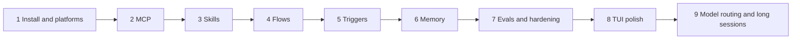
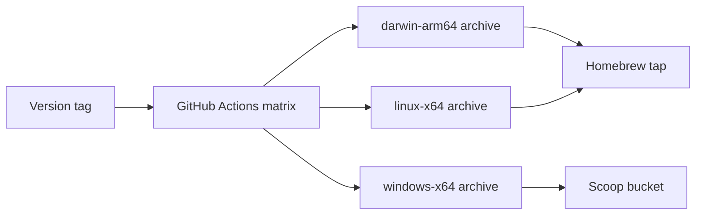

# Golem — plan

> Name: `golem`, after the clay servant of the Prague legend — brought to life to do work on its maker's behalf.

## Read this first

Golem is a background program on your computer (macOS today, Linux and Windows from Phase 1), the **daemon**, that talks to language models for you. You talk to it through a chat screen in the terminal, the **TUI**. Closing the screen does not stop the work. Open it again and the conversation is still there, including an answer that kept streaming while you were away.

This file is about what comes next. How the existing pieces are built is in [architecture.md](architecture.md), and why they are built that way is in the [ADRs](adr/README.md).

### Works today

- Streaming chat with named model profiles and `provider/model` refs: Ollama through its native API, Anthropic, OpenAI, and OpenAI-compatible hosts such as OpenRouter.
- API keys in the macOS Keychain, through `golem auth` or `/login` in the TUI. Every secret golem keeps goes in that one store, named `provider/<name>`, `mcp/<server>`, or `hook/<name>`, and a config file that holds a key does not load.
- `/model` picks from installed, downloadable, and hosted models with prices and RAM fit, and switches a session mid-conversation. `golem models` prints the same list.
- Downloading and removing Ollama models from the picker or with `/model pull` and `/model rm`, with live progress that survives closing the TUI.
- Sessions, runs, and every event are stored in `~/.golem/golem.db`. They survive a daemon restart and a crash.
- Detach and reattach. Close the TUI mid-answer, reopen it, and see the text so far plus the rest. Any number of screens can follow one session.
- Ctrl-C cancels the answer and keeps what it said. Pressing it twice exits.
- Automatic titles, a live switcher (`/sessions`), `/new`, `/title <name>`, and `/fork`.
- A debug panel (`/debug`) that shows the wire and the conversation the model sees.
- Read-only tools: the model reads files, lists folders, and searches with `glob` and `grep`, only inside the folder the session was started in. Each call is one line in the transcript, and Ctrl-O shows its output.
- Tool rules in `~/.golem/config.toml` and a project's `.golem/policy.toml` allow, ask, or deny a call by tool, subject, and path. `golem config show` lists them in the order they are checked.
- A sandboxed shell: the model runs commands in the session folder with no network and no writes outside it, after you approve each one. Output streams into the tool line. `git_status`, `git_diff`, and `git_log` read the repository.
- "Always allow" (`w`) writes a rule for one exact call, and `/permissions` changes or deletes rules and revokes what a session allows.
- `web_fetch` reads a page as text, asks per host, and refuses private addresses unless `[web] allow_private` is set ([ADR-017](adr/017-web-fetch.md)).
- An agent todo list: `todo_write` keeps the plan in the session, `todos.updated` carries it, and a band above the composer shows it, `/todos` to hide it ([ADR-018](adr/018-tool-state-updates.md)).
- Artifacts: tool output over 20 000 characters is stored in `golem.db`, the model gets its head and tail and reads more with `read_artifact`, and `/artifact` opens all of it ([ADR-016](adr/016-artifacts.md)).
- Write tools: `write_file` and `edit_file` change files in the session folder, never under `.golem/` or `.git/`. The approval shows the diff, only that change is applied, and `e` edits a call's arguments before allowing it once ([ADR-015](adr/015-write-tools.md)).
- Approvals: a call a rule asks about waits for `a` (once), `s` (for the session), or `d` (deny), across closing the TUI and restarting the daemon. A waiting session shows `?` in the switcher.
- Slash commands with suggestions, a line editor, recalling a sent message with Up, copy and export, and closing a session from the switcher.
- It runs from a checkout of this repository (`just golem daemon install`, then `just tui`). Phase 1 makes it installable.

### Next, in order

| Phase | What you get | Milestone |
|---|---|---|
| 1. Install and platforms | `brew install`, safe upgrades, `golem doctor`, then Linux and Windows | M3 — Installable |
| 2. MCP | MCP servers as tool providers, under the same permissions | M2 — Acts |
| 3. Skills | Claude Code compatible `SKILL.md` skills | M4 — Skilled |
| 4. Flows | Durable workflows written in Python, resumable after a crash | M5 — Works alone |
| 5. Triggers | Schedules, file watchers, and notifications | M5 — Works alone |
| 6. Memory | Long-term memory that you can see and edit | M6 — Remembers |
| 7. Evals and hardening | Tracing, eval suites, crash tests, backups, a security pass | M6 — Remembers |
| 8. TUI polish | A render cache for long sessions, themes, and search in the transcript | Later |
| 9. Model routing and long sessions | Token and cost display, a cheap profile for small jobs, budgets, escalation, compaction | Later |

Tools and approvals, the first phase, is built: the agent reads and edits files, runs commands in a sandbox, fetches web pages, and keeps a todo list, and asks first. What it does is under "Works today", and how it works is in [architecture.md](architecture.md) and ADRs 011 to 018. MCP finishes milestone M2 after the install work.



### How to read a phase

A phase is split into numbered steps (1.1, 1.2, …). A step is small enough for an evening or a weekend, and it leaves golem working and usable. Do the steps top to bottom unless a step says otherwise.

Every step has the same parts:

- **Goal** — the one thing the step is for.
- **You can** — what you can do afterwards that you could not do before.
- **Build** — the work.
- **Done when** — the check that ends the step.
- **Watch out** — only where there is a known trap.

A step that changes the wire bumps the protocol minor version and regenerates the TypeScript types (`just check` fails if they drift). A non-obvious choice gets an ADR in `docs/adr/`.

---

## Ground rules

These hold for every phase.

1. **The protocol is the contract.** LangGraph, LangChain, and provider message types never reach a client.
2. **LangGraph runs graphs, the daemon owns the rest.** Sessions, permissions, skills, router policy, the event log, and the protocol are golem code.
3. **Graph state stays small.** It is checkpointed every superstep. Big things (tool output, files, transcripts) go into golem's own tables, and state holds their IDs.
4. **Every step ships something usable.** No step ends in a broken build.
5. **Decisions get written down.** One short ADR per non-obvious choice.

### Where LangGraph fits

| Use LangGraph for | Feature |
|---|---|
| The agent loop (model, then tools, then model) | `StateGraph` with a conditional edge |
| Persistence and resume | `AsyncSqliteSaver`, keyed by `thread_id` |
| Human approval | `interrupt(payload)` in a node, resumed with `Command(resume=value)` |
| Streaming tokens and progress | `astream(..., stream_mode=["messages", "updates", "custom"])` and `get_stream_writer()` |
| Durable deterministic flows | Functional API: `@entrypoint` and `@task` |
| Retries | `RetryPolicy` per node or task |
| Long-term memory | `BaseStore` with namespaces |

Keep outside LangGraph: the protocol and the event log, the permission engine, the router policy, the skill registry, cost accounting, and triggers. The graph calls into them. They are not graph features.

Agents use the Graph API, where the model decides control flow. Flows use the Functional API, where your code decides control flow.

### Pitfalls to design around

- **Resume re-runs the interrupted node from its start.** Anything before `interrupt()` in that node runs again. Put side effects after the interrupt, or in their own node or task.
- **State schema changes.** Adding a field with a default is safe. Renaming or retyping breaks old checkpoints. Chat checkpoints are disposable, because the event log is the real history. In-flight flows may have to finish on the old code.
- **Checkpoint growth.** Large tool output goes to an artifact table, and state keeps `artifact_id` plus a short summary.
- **Message types leaking out.** LangChain `BaseMessage`s live only in graph state, and the stream adapter converts them to protocol events.

### Protocol, what is left to add

JSON-RPC 2.0, one JSON object per line, over `~/.golem/run/golem.sock`. Protocol 2.18 is on the wire today (see [architecture.md](architecture.md#what-is-on-the-wire-today)). The phases below add the rest.

| Group | New events | Phase |
|---|---|---|
| Models | `usage.reported` (tokens, cost) | 9.1 |
| System | `mcp.server.status`, `warning`, `error` | 2.1 |
| Skills | `skill.activated`, `skill.deactivated` | 3.2 |
| Runs and flows | `run.step.started`, `run.step.completed`, `run.interrupted` | 4.2, 4.4 |

New commands: `mcp.list` (2.1), `skill.list | pin | unpin` (3.1, 3.2), `flow.list | start | status` (4.1), and `daemon.shutdown` (1.8).

Rules:

- A breaking change bumps `protocol_major`, and the daemon refuses a mismatched client with a clear error.
- Events are append-only facts. Clients derive all UI state from them, so replaying equals rebuilding.
- Every event is stored before it is sent. `message.delta` is coalesced into `message.completed` in the log.

---

## Phase 1 — Install and platforms

Today golem runs only from a checkout of this repository. `golem daemon …` looks for the repository root and calls `uv run python -m golem daemon`, the TUI starts through `tsx`, and the launchd job points into the checkout. This phase makes golem something you install with `brew install`, upgrade without losing data, and, at the end of the phase, run on Linux and Windows.

The shape of a release:

```
golem-<version>-<os>-<arch>.tar.gz   (.zip on Windows)
├─ bin/golem                 # one executable: the CLI and the TUI
└─ libexec/golem-daemon/     # the daemon with its own Python, no system Python needed
```

GitHub Actions builds one archive per platform on each version tag. Homebrew (and later Scoop) only downloads an archive. Nothing is compiled on your machine.



Steps 1.1 to 1.7 are macOS only and end with `brew install`. Steps 1.8 to 1.11 add the platform seams, prove them on Linux, then add Windows.

### 1.1 One version, no repository needed

- **Goal:** golem runs from any folder on disk, not only from the checkout.
- **You can:** copy a built tree somewhere else and use it, with `golem daemon install` pointing launchd at that copy.
- **Build:**
  - One version for the whole project, taken from the git tag and stamped into the Python package, the CLI, and the TUI at build time. The header already shows it.
  - The CLI finds the daemon in this order: `GOLEM_DAEMON` if set, then `../libexec/golem-daemon/` next to its own executable, then the checkout (`uv run`), which keeps development working.
  - `golem daemon install` writes the launchd plist with the absolute path it found, not `uv run`. Running it again after a move or an upgrade rewrites the plist.
- **Done when:** a built tree outside the repository installs the launchd job, survives a reboot, and chats.

### 1.2 One `golem` executable

- **Goal:** the CLI and the TUI are one file with no Node install needed.
- **You can:** type `golem` to open the TUI, and `golem status`, `golem daemon …`, or `golem --version` for the rest.
- **Build:**
  - Merge the CLI and TUI entry points. No arguments opens the TUI.
  - Compile with `bun build --compile`. If that fails, fall back to Node's single executable application feature.
  - `just dist` builds `bin/golem` for the current platform.
- **Done when:** `bin/golem` runs on a Mac without Node or pnpm installed.
- **Watch out:** Ink's layout engine ships as WebAssembly, and some dependencies are ESM only. Try the compile on day one, before the rest of the step.

### 1.3 Self-contained daemon

- **Goal:** the daemon runs without uv or a system Python.
- **You can:** start `libexec/golem-daemon/golem-daemon` on a Mac that has never seen Python.
- **Build:**
  - PyInstaller in one-folder mode (one-file mode unpacks on every start, which is slow). The fallback is a standalone Python build with a ready-made virtual environment.
  - `just smoke-dist` starts the built daemon with a temporary `GOLEM_HOME`, sends `hello`, runs one chat against a fake model, and stops it.
- **Done when:** `just smoke-dist` passes, and the daemon from the archive starts in under 1 s.
- **Watch out:**
  - LangChain and Pydantic import some modules dynamically, and PyInstaller misses them. The smoke test is what catches it, so it runs in CI from the start.
  - Keychain trust. The daemon executable must be golem's own binary, not a shared Python, so only golem is trusted to read the stored keys. Keys stored by a checkout's Python move over once: the new daemon reads them after one Always Allow, then rewrites each item so it owns it.

### 1.4 Migrations and safe upgrades

- **Goal:** a new release never breaks the data of an old one.
- **You can:** upgrade golem and keep every session.
- **Build:**
  - Numbered SQL migrations for `golem.db`, with the current version in a `schema_version` table. This moves forward from 7.4, because installed users need it first.
  - Before migrating, the daemon copies the database to `golem.db.bak-<version>` with the SQLite backup API.
  - The daemon refuses to start on a database newer than it knows, and says which version it needs.
  - `checkpoints.db` is backed up before a LangGraph upgrade. Chats can survive losing it, because the event log is the real history ([ADR-006](adr/006-checkpoint-continuity.md)).
  - `golem daemon restart`. Its version mismatch with the TUI already shows as a yellow notice, and the notice now says to run it.
- **Done when:** a test upgrades a database made by the previous release and every session is still there.

### 1.5 Release pipeline

- **Goal:** a version tag produces a downloadable release with no manual steps.
- **You can:** push `v0.1.0` and get a GitHub release with the macOS archive and its checksum.
- **Build:**
  - A GitHub Actions workflow on `v*` tags: `just check`, `just dist`, `just smoke-dist`, then upload `golem-<version>-darwin-arm64.tar.gz` and a `sha256` file.
  - Code signing with a stable identity, a self-signed certificate at first and Developer ID later. An ad-hoc signature changes with every build, so the Keychain would ask again after each upgrade. Notarization only matters for direct downloads, so it waits until someone needs it.
- **Done when:** a tag produces a release, and the archive from it passes `just smoke-dist` on a clean runner.

### 1.6 Homebrew tap

- **Goal:** `brew install` is the way to get golem on a Mac.
- **You can:** run `brew install <you>/golem/golem`, then `golem daemon install`, then `golem`.
- **Build:**
  - A `homebrew-golem` tap repository with a `golem.rb` formula that downloads the release archive and installs `bin/` and `libexec/`. `brew test` runs `golem --version`.
  - The release workflow (1.5) opens a pull request to the tap with the new version and checksum.
  - The formula has no `service` block. `golem daemon install` stays the one owner of the launchd job, so a non-brew install works the same way. The formula's caveats print the command.
  - `golem daemon install` points at the stable `opt` path (`$(brew --prefix)/opt/golem/...`), so `brew upgrade` does not leave the plist on an old version folder.
- **Done when:** on a clean macOS user account, install, chat, `brew upgrade` plus `golem daemon restart`, and `brew uninstall` plus `golem daemon uninstall` all work, and only `~/.golem` is left.
- **Watch out:** if both `brew services` and `golem daemon install` started the daemon, the second copy would fail on the pid lock and launchd would keep restarting it. One owner prevents that.

### 1.7 `golem doctor`

- **Goal:** when something is wrong after an install, one command says what.
- **You can:** run `golem doctor` and get a checklist with a fix for each failure.
- **Build:** checks that the daemon executable was found, that the service is installed and points at it, that the running daemon has the same version, socket permissions, that the config is valid, that each model profile is reachable (Ollama up, API key present in the credential store), and free disk space.
- **Done when:** each check has a test with a fake platform, and a stopped Ollama shows as one failed line with a fix.

### 1.8 Platform seams

- **Goal:** everything that depends on the operating system sits behind one small interface, so Linux and Windows are additions, not rewrites.
- **You can:** nothing new yet. This step makes the next three cheap.
- **Build:** a `platform` module in the daemon and one in `@golem/client`, each with one implementation per OS:
  - **Endpoint:** where the daemon listens (`unix:` path or `pipe:` name). `resolveSocketPath` becomes `resolveEndpoint`.
  - **Service manager:** launchd, systemd user units, or Task Scheduler, behind `golem daemon install|uninstall|start|stop|restart|logs`.
  - **Paths:** `~/.golem` on macOS and Linux, `%LOCALAPPDATA%\golem` on Windows, and `GOLEM_HOME` everywhere.
  - **Clipboard:** OSC 52 first, which works in most terminals on all three systems, then `pbcopy`, `wl-copy` or `xclip`, or `clip.exe`. `/copy` already uses `pbcopy`.
  - **Notifications (5.1):** `terminal-notifier`, `notify-send`, or Windows toasts.
  - **Sandbox** ([ADR-014](adr/014-shell-sandbox.md)): a capability, `sandbox-exec` or none. `daemon.status` reports it. Without a sandbox, a shell rule that says `allow` is treated as `ask`, and the TUI shows `no sandbox`.
  - **Stopping the daemon:** a `daemon.shutdown` request, so stopping does not depend on Unix signals.
- **Done when:** no code outside the `platform` modules checks the OS, and the tests run against a fake platform.

### 1.9 Linux

- **Goal:** prove the seams on the easiest second platform.
- **You can:** install golem on Linux with the same Homebrew formula, or by unpacking the archive.
- **Build:**
  - `linux-x64` and `linux-arm64` archives in the release matrix. CI runs the tests and `just smoke-dist` on Ubuntu.
  - A systemd user unit, written by `golem daemon install`.
  - No sandbox at first. `bubblewrap` can come later behind the same capability.
- **Done when:** on a fresh Ubuntu VM, install, chat, log out and back in, and reattach all work.

### 1.10 Windows: transport and service

- **Goal:** the daemon runs on Windows and the TUI can reach it.
- **You can:** run the daemon and the TUI on Windows 11, from the archive.
- **Build:**
  - Python's asyncio has no Unix socket server on Windows. The daemon serves a named pipe, `\\.\pipe\golem-<user>`, readable only by the current user. Node's `net.connect` already accepts that path, so the client only changes in `resolveEndpoint`.
  - A Task Scheduler task that starts the daemon at logon and restarts it on failure, written by `golem daemon install`.
  - The pid lock uses a Windows file lock.
  - CI runs the tests on `windows-latest`.
- **Done when:** on Windows 11, `golem daemon install`, chat, reboot, and reattach all work.
- **Watch out:** the named pipe server in asyncio is not a public API. If it proves fragile, the fallback is loopback TCP with a random port and a token in a file only you can read. That choice gets an ADR.

### 1.11 Windows: packaging

- **Goal:** installing on Windows is one command, like on a Mac.
- **You can:** run `scoop install golem`.
- **Build:**
  - A `windows-x64` zip in the release matrix, and a Scoop bucket updated by the release workflow. A winget manifest comes later.
  - Check the TUI in Windows Terminal: the alternate screen, the mouse wheel, and colors.
  - The shell tool runs without a sandbox (1.8), and the approval modal says so.
- **Done when:** on a clean Windows 11 machine, `scoop install golem`, `golem daemon install`, and `golem` give a working chat.

---

## Phase 2 — MCP

MCP servers become tool providers, under the same permission engine.

### 2.1 One stdio server

- **Goal:** golem can use an MCP server.
- **You can:** configure one stdio server (for example git) and use its tools in chat. `/mcp` shows its status.
- **Build:**
  - An MCP supervisor that starts stdio servers from config, through `langchain-mcp-adapters` or the `mcp` SDK.
  - Every MCP call goes through the `tools` node ([ADR-011](adr/011-tools.md)), so the rules and approvals apply.
  - `mcp.server.status` events, `mcp.list`, and `/mcp` in the TUI.
- **Done when:** a tool from the server runs from chat after an approval.

### 2.2 Namespaces and scoping

- **Goal:** many servers without flooding every prompt.
- **You can:** enable a server for one session or one project, and write policy rules for it.
- **Build:**
  - Tool names become `mcp.<server>.<tool>`, and policy rules can match on them.
  - Servers are enabled per session (`/mcp enable <name>`) or per project config. Nothing is on by default.
- **Done when:** two servers are configured, only the enabled one's tools reach the model.

### 2.3 Health and HTTP servers

- **Goal:** servers stay up, and their cost in prompt tokens is visible.
- **You can:** connect HTTP servers, and see a crashed server come back on its own.
- **Build:**
  - HTTP transport. Health checks, and restart with backoff.
  - The TUI status line shows a red marker when an enabled server is down.
  - `/mcp` shows how many prompt tokens each server's tool schemas cost.
- **Done when:** killing a server process makes it restart, and the TUI shows the outage and the recovery.
- **Watch out:** tool-schema bloat hurts local models badly.

---

## Phase 3 — Skills

Agent Skills (`SKILL.md`) compatible with Claude Code, loaded by progressive disclosure.

### 3.1 Registry and `/skills`

- **Goal:** golem knows which skills exist.
- **You can:** run `/skills` and see each skill with its source and description.
- **Build:**
  - Scan `~/.golem/skills`, `<project>/.golem/skills`, and optionally `~/.claude/skills`. On a name collision, project wins, then user, then bundled.
  - Parse and validate frontmatter: `name`, `description`, optional `allowed-tools`, and golem's own `model`.
  - Hot reload with `watchfiles`. `skill.list` on the wire.
- **Done when:** an existing Claude Code skill shows up, and editing it updates the list without a restart.

### 3.2 Pinned skills

- **Goal:** you can turn a skill on by hand.
- **You can:** `/skill <name>` (with suggestions) and `/skill off <name>`.
- **Build:**
  - `active_skills: list[str]` in graph state, with a deduping reducer.
  - Active skill bodies go into the system prompt. Compaction (9.5) always keeps them.
  - `skill.activated` and `skill.deactivated`. The header shows active skills.
- **Done when:** a pinned skill changes the answer in the expected way.

### 3.3 Model-driven loading

- **Goal:** the model picks up a skill when it needs one.
- **You can:** ask for a task a skill covers, and see it activate on its own.
- **Build:** a short index of skill descriptions in the system prompt, and a `load_skill(name)` tool. Files bundled with a skill resolve inside its folder.
- **Done when:** an existing Claude Code skill works unchanged, triggered by the model.

### 3.4 Pre-selection by embeddings

- **Goal:** local models, which are bad at picking from a long list, still get the right skill.
- **You can:** use skills reliably on a local model.
- **Build:** a `select_skills` node before `call_model` that embeds the user turn and puts only the top-k descriptions above a threshold into the index.
- **Done when:** the skill-trigger eval (7.2) passes for your top 10 skills on a local and a remote model.

### 3.5 Trust and scoped permissions

- **Goal:** a skill can never widen what golem is allowed to do.
- **You can:** see which skills are trusted, and approve a skill's script once.
- **Build:**
  - The first run of a script from an untrusted skill needs approval. A content hash is stored per trusted skill, and a change asks again.
  - `allowed-tools` narrows the tool set while the skill is active. It never widens global policy.
  - `model: remote` in frontmatter makes the router escalate while the skill is active.
- **Done when:** editing a trusted skill's script triggers a new approval.

### 3.6 Self-authored skills

- **Goal:** golem can turn a repeated task into a skill.
- **You can:** ask golem to write a skill, review the draft, and accept it.
- **Build:** a `propose_skill` tool that writes into `~/.golem/skills/_proposed/`. Accepting moves it into place.
- **Done when:** a proposed skill is accepted and then triggers in a new session.

---

## Phase 4 — Flows

Durable, inspectable, resumable workflows written as plain Python with the Functional API.

```python
from langgraph.func import entrypoint, task
from golem.flows import flow

@task
async def fetch_prs(repo: str) -> list[dict]: ...

@task
async def summarize(pr: dict) -> str:            # LLM call, through the router
    ...

@task
async def post_digest(text: str) -> str:         # side effect: idempotency key
    ...

@flow(name="pr-digest", schedule="0 9 * * 1-5", inputs={"repo": str})
@entrypoint(checkpointer=CHECKPOINTER)
async def pr_digest(inputs: dict) -> dict:
    prs = await fetch_prs(inputs["repo"])
    summaries = [await f for f in [summarize(p) for p in prs]]   # parallel
    approved = interrupt({"kind": "review", "draft": "\n".join(summaries)})
    url = await post_digest(approved["text"])
    return {"url": url}
```

The exact `@entrypoint` and `@task` signatures change between versions, so check the docs. The structure is the point.

### 4.1 Registry and `golem run`

- **Goal:** golem can find and run a flow.
- **You can:** `golem run hello --name x` for a flow with no LLM calls.
- **Build:**
  - Discover flows in `flows/` and `~/.golem/flows/`. Metadata: name, input schema, schedule, model profile, allowed tools, concurrency limit.
  - `flow.list` and `flow.start`. A run uses `thread_id = run_id`, and the `runs` table gains inputs, outputs, and error.
  - `golem runs` lists runs.
- **Done when:** a trivial flow runs from the CLI, and its result is in `golem runs`.

### 4.2 Step events and the runs view

- **Goal:** you can watch a flow work.
- **You can:** open `/runs` in the TUI and see each step's status and duration.
- **Build:** a stream writer inside tasks, mapped to `run.step.started` and `run.step.completed`. A runs view in the TUI, and `golem runs show <id>`.
- **Done when:** a three-step flow shows three steps, live.

### 4.3 Resume after a restart

- **Goal:** a crash does not lose a flow.
- **You can:** kill the daemon mid-flow and see the run continue after it restarts.
- **Build:**
  - On start, find runs in `running` and resume them from their checkpoint, with a policy per flow: `resume`, `fail`, or `ask`.
  - Completed tasks are not re-run. Side-effecting flows use the strongest checkpoint durability mode.
  - `golem runs resume <id>`.
- **Done when:** after `kill -9` mid-flow, the run finishes without repeating completed steps.
- **Watch out:** code in the entrypoint body re-runs on resume, so keep it pure.

### 4.4 Review interrupts

- **Goal:** a flow can stop and wait for you, for days if needed.
- **You can:** review a draft in the TUI and approve or edit it.
- **Build:** `interrupt()` in a flow emits `run.interrupted`, and answering reuses the approval band ([ADR-013](adr/013-approvals.md)) with an editable text field, like editing a call's arguments. Pending reviews show in `/runs`.
- **Done when:** a flow waits overnight on a review and finishes after you answer.

### 4.5 Idempotency and retries

- **Goal:** no step does a real-world action twice.
- **You can:** trust a flow that posts somewhere to post once.
- **Build:**
  - Every side-effecting task gets an idempotency key from `(run_id, step_name, args_hash)`, and external writes check it first.
  - A retry policy per task with backoff for transient errors. The final failure emits `run.failed` with the step and the error.
- **Done when:** a crash test between "write" and "checkpoint" produces exactly one write.

### 4.6 An agent as a step

- **Goal:** deterministic flows can contain agentic steps.
- **You can:** write a flow step that says "fix this" and let the agent do it with a restricted tool set.
- **Build:** a task invokes the agent graph on its own thread (`thread_id = f"{run_id}:{step}"`) with the flow's allowed tools. `/runs` can jump into that thread.
- **Done when:** a flow step runs a tool-using agent, and its tool calls go through the permission engine.

### 4.7 Flow versioning

- **Goal:** changing a flow's code does not corrupt runs in flight.
- **You can:** edit a flow while an old run waits on a review.
- **Build:** `@flow(version=2)`. Resume refuses a mismatched version unless the flow declares compatibility.
- **Done when:** a version bump with a waiting run gives a clear message, not a broken resume.

---

## Phase 5 — Triggers and notifications

The golem acts without you sitting in the terminal.

### 5.1 Notifications

- **Goal:** you hear about what needs you.
- **You can:** get a macOS notification for `approval.needed` and `run.failed`, and click it to open the TUI on that session or run.
- **Build:** notifications through `terminal-notifier` or `osascript`. `run.completed` notifications are opt-in per flow. A `golem open <id>` deep link.
- **Done when:** an approval in a detached session produces a notification that opens the right screen.

### 5.2 Scheduler

- **Goal:** flows run on a schedule.
- **You can:** have `pr-digest` run every weekday at 9:00.
- **Build:** APScheduler (async) with schedules from flow metadata, and a missed-run policy per flow.
- **Done when:** a scheduled flow runs at 9:00, needs approval, notifies you, and you approve from a TUI opened later.

### 5.3 File watchers

- **Goal:** files arriving can start work.
- **You can:** say "on a new PDF in `~/Downloads`, run `file-receipt`".
- **Build:** `watchfiles` rules in config, debounced, each starting a flow with the path as input.
- **Done when:** dropping a file starts exactly one run.

### 5.4 Pause and quiet hours

- **Goal:** golem stays quiet when you want it to.
- **You can:** `golem pause` and `golem resume`, and set quiet hours.
- **Build:** a global pause that holds triggers (not running chats), and quiet hours that delay notifications. The TUI status line shows `paused`.
- **Done when:** a scheduled run during pause waits and runs once after resume.

### 5.5 Hook endpoint (optional)

- **Goal:** git hooks, Raycast, and Shortcuts can start flows.
- **You can:** start a flow from a keyboard shortcut.
- **Build:** a localhost-only HTTP endpoint with a token from the Keychain.
- **Done when:** a Shortcut starts a flow, and a request without the token is refused.

---

## Phase 6 — Memory

Useful long-term memory that you can inspect and edit, and that never surprises you.

### 6.1 Explicit memory and a browser

- **Goal:** golem can remember what you tell it to.
- **You can:** say "remember that I prefer pnpm", and see it later in `/memory`.
- **Build:** a SQLite-backed `BaseStore` in `memory.db`, with namespaces such as `("user","prefs")` and `("project", <name>)`. `remember` and `recall` tools. A TUI browser to view, edit, delete, and export.
- **Done when:** every stored item is visible and deletable, and a new session uses a remembered preference.

### 6.2 Semantic recall

- **Goal:** relevant memories show up without being asked for.
- **You can:** get answers that use what you said weeks ago.
- **Build:** a `recall` node before `call_model`, using `sqlite-vec` and a local embedding model, limited to relevant namespaces, with a token cap.
- **Done when:** the repeat-task eval (7.2) improves with memory on.

### 6.3 Confirmed extraction

- **Goal:** golem proposes what to remember, and you decide.
- **You can:** accept or reject proposed memories at the end of a session.
- **Build:** an end-of-session node that proposes memories. They need confirmation in the TUI by default.
- **Done when:** nothing is stored without a confirmation unless the namespace is configured otherwise.

### 6.4 Searchable session summaries

- **Goal:** you can ask what you decided last week.
- **You can:** ask "what did we decide about the protocol bump?" and get the answer with a link to the session.
- **Build:** compaction summaries (9.5) and session titles are indexed in the memory store.
- **Done when:** a question about an old session finds it.

---

## Phase 7 — Evals and hardening

This runs alongside the other phases. It gets a dedicated pass after Phase 5.

### 7.1 Tracing

- **Goal:** you can answer what happened, why, and what it cost.
- **Build:** OpenTelemetry spans per run, node or task, model call, and tool call. Export to self-hosted Langfuse, or to JSONL for zero infrastructure. A cost dashboard in the TUI by model and by flow.
- **Done when:** one slow answer can be broken down into its spans.

### 7.2 Eval harness

- **Goal:** prove that a change did not make things worse.
- **Build:** `evals/`, run with `just eval` (`pytest -m eval`):

  | Suite | What it checks |
  |---|---|
  | Routing | Inputs → expected profile |
  | Skill triggering | Prompts → expected skill or none, precision and recall per model |
  | Tool-call validity | Local-model tool-call success rate per tool set |
  | Flow goldens | Recorded inputs → expected step outputs, with fake LLMs and recorded tool I/O |
  | Agent tasks | Real tasks in throwaway git repos, LLM-judged plus deterministic checks |

- **Done when:** a model swap or prompt change produces a comparable scorecard diff.

### 7.3 Replay

- **Goal:** debug a run without paying for it again.
- **Build:** record a run's model and tool I/O, and replay it deterministically.
- **Done when:** a recorded run replays to the same events.

### 7.4 Hardening

- Crash tests: `kill -9` at random points in flows, then check there are no duplicate side effects and runs resume.
- A nightly backup of `~/.golem/*.db` with the SQLite backup API.
- Performance: daemon start under 1 s, first-token latency per profile, and TUI rendering with 10 streams.
- Security review: socket permissions, which programs the Keychain trusts with the golem items (only the signed daemon, see 1.3), that no key reaches a log, the event log, or the wire view, sandbox profile coverage, policy defaults (shell has no network by default), skill and MCP trust, and prompt injection through `web_fetch`, files, and MCP output. Content never auto-approves anything.
- Upgrade discipline: pinned LangGraph and LangChain versions, a smoke suite before each bump, and the changelogs read.

---

## Phase 8 — TUI polish

A long session is already usable. These steps wait until scrolling feels slow, or until themes and search start to matter.

### 8.1 Render cache

- **Goal:** a long session stays smooth.
- **You can:** scroll and stream in a session with hundreds of messages without the screen lagging.
- **Build:**
  - Cache the wrapped rows of each finished message, keyed by message id, text length, and width.
  - Only the streaming message is re-wrapped on each paint. A resize clears the cache.
- **Done when:** a test session with 500 messages paints in under 16 ms per tick on your machine.

### 8.2 Themes

- **Goal:** the screen is readable on a light terminal as well as a dark one.
- **You can:** run `/theme light`, `/theme dark`, or `/theme auto`, and have the choice remembered.
- **Build:**
  - Turn the color constants in [theme.ts](../packages/tui/src/theme.ts) into a `Theme` object with named roles (accent, user background, user text, dim, warning, error), and one dark and one light palette.
  - Components read colors from the theme in a React context, never from constants.
  - `auto` picks a palette from `COLORFGBG` when the terminal sets it, and otherwise uses dark.
  - The choice is saved in `~/.golem/tui.json`.
- **Done when:** both palettes look right in a light and a dark terminal, and no component imports a color constant directly.

### 8.3 Search in the transcript

- **Goal:** find something said earlier without scrolling for it.
- **You can:** press Ctrl-F, type a word, and jump between matches with Enter and Shift-Enter (or Ctrl-N and Ctrl-P).
- **Build:**
  - A search bar takes the composer row while it is open. It shows `3/12` for the current match and the total.
  - Matches are found in the message text, then mapped to wrapped rows through the render cache (8.1), so a match scrolls into view in the right place.
  - Matches are highlighted in the transcript. The current one has a stronger color from the theme (8.2).
  - Search is case-insensitive unless the query has a capital letter. Esc closes it and returns to where you were scrolled.
  - Finding matches and mapping them to rows are pure functions, with unit tests.
- **Done when:** in a 500-message session, Ctrl-F finds a word from the first message and scrolls it into view, and Esc puts the view back.
- **Watch out:** a match inside a streaming message moves as text arrives. Search finished messages only, and say so in the bar while a reply is streaming.

---

## Phase 9 — Model routing and long sessions

These steps were the second half of the model work, after `/model`. Tools and approvals exist now, and routing, escalation, and compaction matter most once the agent runs long, tool-heavy tasks every day.

### 9.1 Tokens and cost

- **Goal:** you always know what a session has cost.
- **You can:** see tokens and cost per answer, and `/cost` for today, this week, and this session.
- **Build:**
  - `usage.reported` per model call, and a `costs` table. Prices come from `model.list`, and a profile's `price` overrides them.
  - The meter shows tokens while writing. The finished answer shows `1.2k tok · $0.004` next to its duration.
  - `/cost` prints a short table.
- **Done when:** the cost of a day of use matches the provider's dashboard within a few percent.

### 9.2 Cheap profile and structured outputs

- **Goal:** small jobs (titles, classification) stop using the expensive model.
- **You can:** set `titles = "qwen"` (a profile or a ref) and never pay a remote call for a title again.
- **Build:**
  - Task-to-profile settings for internal jobs, starting with titles ([titles.py](../packages/daemon/golem/sessions/titles.py)).
  - Structured outputs for anything parsed, with `with_structured_output`, or grammar-constrained decoding where the local server supports it.
- **Done when:** titles come from the cheap profile, and a malformed structured answer is retried, not crashed on.

### 9.3 Router and budgets

- **Goal:** the right model is picked automatically, and spending has a ceiling.
- **You can:** set daily and per-session caps, and see why a model was picked.
- **Build:**
  - `router.pick(profile_hint, task_traits)`, with traits `needs_tools`, `est_tokens`, `privacy` (`local_only`), and `difficulty`. Policy order:
    1. Session or flow pin.
    2. Privacy constraint.
    3. Budget remaining.
    4. Traits.
  - `model.selected` carries the reason, and the TUI shows it in the answer footer.
  - Over a cap, the router forces local, or asks for approval ([ADR-013](adr/013-approvals.md)).
- **Done when:** a day of mixed use stays under budget, and each routing choice is visible.

### 9.4 Escalation

- **Goal:** a weak local model does not stall a task.
- **You can:** start on a local model and let golem step up when it fails.
- **Build:** a node wrapper that retries once on a remote profile after N invalid tool calls or failed structured outputs, and logs the escalation as a `warning` event.
- **Done when:** a recorded failing local tool call escalates once and succeeds.

### 9.5 Compaction and context gauge

- **Goal:** long sessions keep working.
- **You can:** see how full the context is in the status line (`ctx 62%`), and keep chatting past the limit.
- **Build:**
  - Token counting per profile, against the context size from `model.list` (for Ollama, the `num_ctx` actually sent).
  - A `compact` node that runs over a threshold. It summarizes old turns with the cheap profile and keeps pinned items: the system prompt, active skills, the last N turns, and open todos. It replaces history in state with `RemoveMessage`.
  - The screen keeps the full transcript. The model tab in `/debug` shows the compacted one, as [ADR-006](adr/006-checkpoint-continuity.md) intends.
  - `session.fork` may need a `before` bound on history reads here ([ADR-010](adr/010-fork.md)).
- **Done when:** a 200-turn session keeps working after compaction.

### 9.6 Local server management (optional)

- **Goal:** the local model is running when you need it, and not otherwise.
- **You can:** forget about starting Ollama.
- **Build:** the daemon starts and stops the local server on demand, and `daemon.status` reports its memory use.
- **Done when:** the first local request after a reboot works without a manual start.
- **Watch out:** on 36 GB, a large chat model, an embedding model, and an IDE are tight. Prefer one resident chat model.

---

## Cross-cutting

### Testing

| Layer | Approach |
|---|---|
| Protocol | Schema round-trip tests, generated TS compiles, contract tests from recorded event streams |
| Graph nodes | Unit tests with fake chat models |
| Graphs and flows | In-memory checkpointer, with interrupt and resume paths tested explicitly |
| Permissions | Table-driven tests over the policy matrix |
| Daemon | Integration tests over a real socket in a temporary `GOLEM_HOME` |
| TUI | Pure functions: reducer, layout, commands, suggestions, line editing. Ink 8 has no working `ink-testing-library` |

### Configuration

Built-in defaults, then `~/.golem/config.toml`, then `<project>/.golem/config.toml`, then session overrides. Everything is validated by Pydantic, and `golem config show --resolved` prints the settings and the tool rules for the current folder ([ADR-012](adr/012-permission-rules.md)). The tool rules come from the session folder's `.golem/policy.toml`, not its `config.toml`.

### Concurrency

- One asyncio loop runs all graph executions as tasks.
- A semaphore per model profile, sized for local servers that handle one or two generations at a time.
- CPU-heavy work (embeddings, parsing) goes to a thread or process pool.
- SQLite in WAL mode, with one writer connection per database.

### Security

- The socket is readable only by your user.
- Every side effect passes the permission engine, with no bypass for flows, skills, or MCP.
- Shell is sandboxed by default, and network is denied unless a rule allows it. Where no sandbox exists (Windows, Linux at first), every shell command needs approval.
- Secrets live in the OS credential store (the macOS Keychain, Windows Credential Manager, or the Secret Service on Linux).
- Content from tools and the web is data, never instructions about permissions.

---

## Risks

| Risk | Impact | Mitigation |
|---|---|---|
| LangGraph API churn | Rework | A thin adapter boundary, pinned versions, a smoke suite before upgrades |
| Local models are unreliable with tools | A flaky agent | Pre-selected skills and tools, structured outputs, escalation, the tool-validity eval |
| Checkpoint schema breaks | Lost sessions or runs | `schema_version`, additive changes only, the event log as the real history, flow versioning |
| Duplicate side effects on resume | Real-world damage | Effects after interrupts, idempotency keys, crash tests |
| Remote cost creep | Money | Hard budget caps, the router forced to local over the cap |
| Scope explosion | Never finishing | Small steps with exit checks, daily use of what already ships |
| Prompt injection through tools or MCP | Unsafe actions | No auto-approve from content, the sandbox, minimal default permissions |
| A frozen daemon misses a dynamic import | A release that does not start | `just smoke-dist` on every platform in CI, before upload |
| macOS-only code spreads before Phase 1 | A costly Windows port | New OS-specific code goes behind a small function from the start, so 1.8 only moves it |

## Open questions

Each one gets an ADR when it is decided.

1. ACP or AG-UI compatibility for the protocol: adopt it, mirror it, or ignore it?
2. Are memory writes always confirmed, or auto-saved for some namespaces? (Needed by 6.3.)
3. Flows in Python only, or also a YAML format for simple ones? (Recommendation: Python only until it hurts.)
4. Windows transport: a named pipe or loopback TCP with a token file? (Needed by 1.10. Named pipe first, TCP if asyncio's pipe server proves fragile.)
5. `bun build --compile` or Node's single executable feature for `bin/golem`? Decided in [ADR-019](adr/019-single-binary.md): bun.
