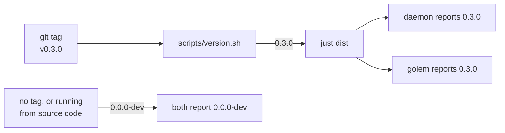
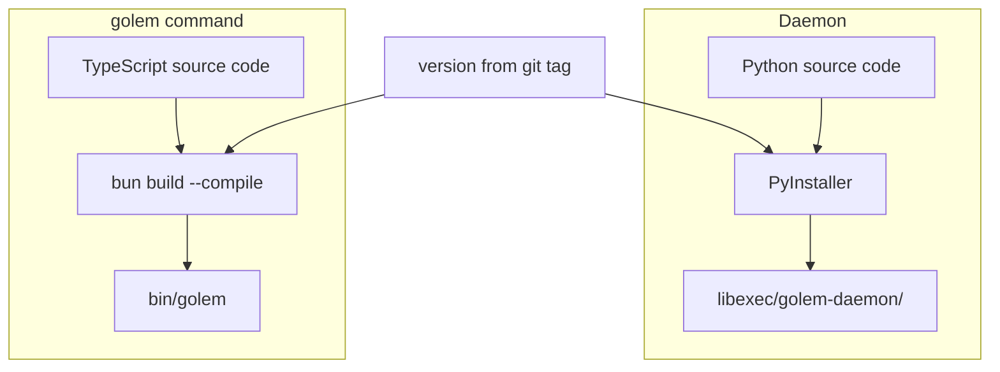
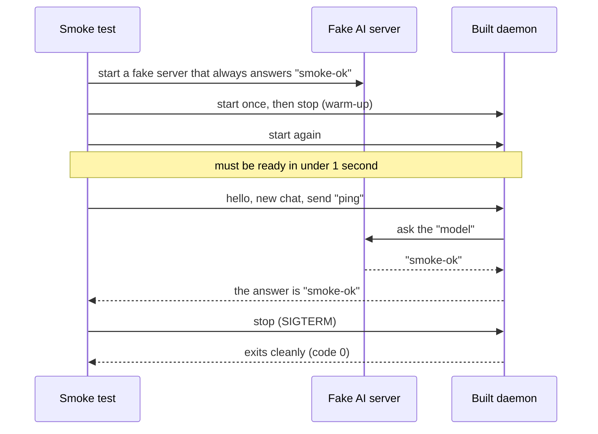
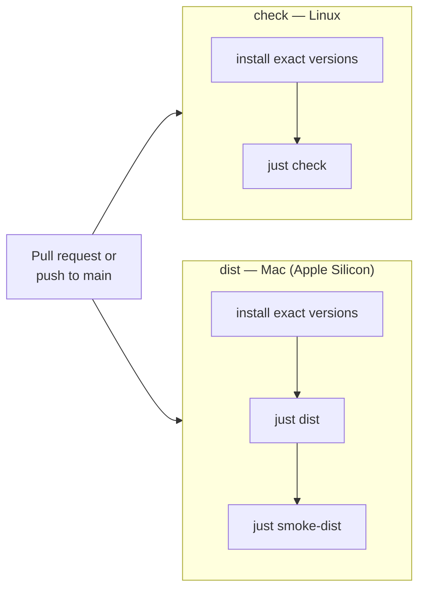
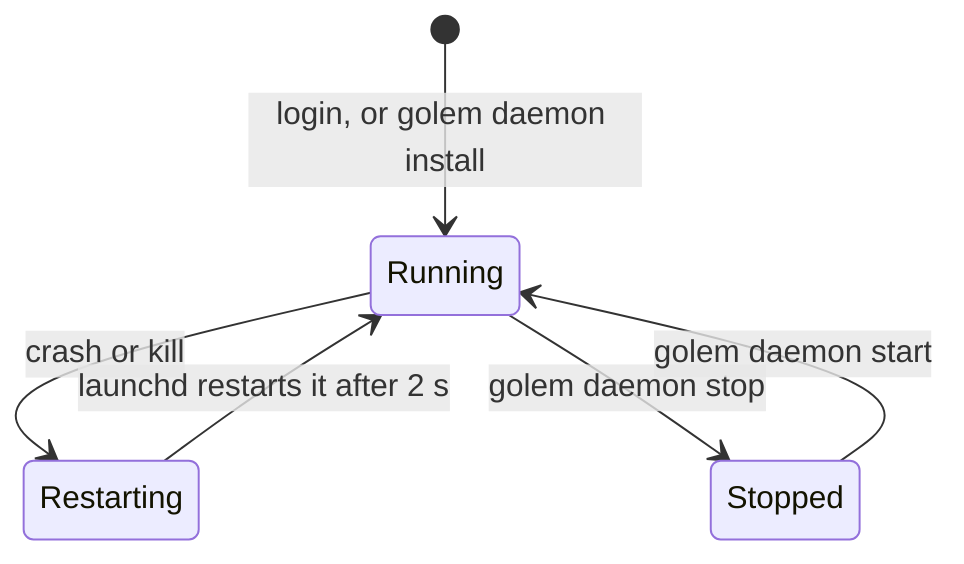
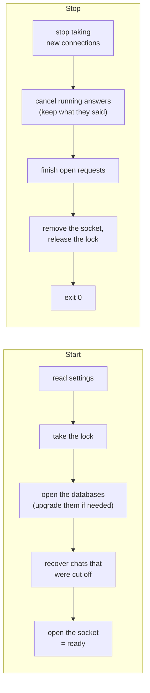
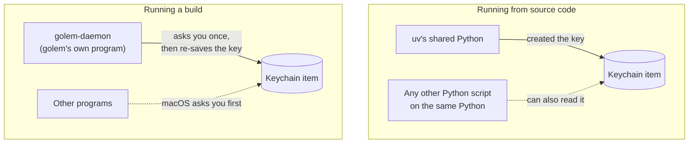
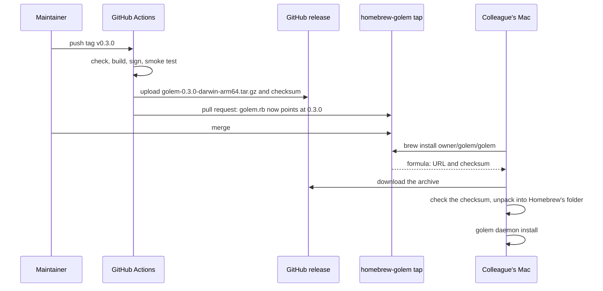
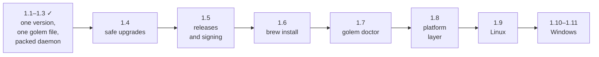

# Golem — operations guide

This guide explains how golem is built, tested, installed, and kept running, and what is still to come. It is written for someone who runs golem or ships it, not for someone changing its code.

For more detail:
- How the code works inside: [architecture.md](architecture.md)
- Why it is built this way: the [ADRs](adr/README.md)
- The roadmap, step by step: [plan.md](plan.md)

---

## 1. The big picture

Golem has two parts:

- **The daemon** is a program that runs in the background all the time. It talks to the AI models, runs tools, and saves every conversation. It is written in Python.
- **`golem`** is the command you type. With no arguments it opens the chat screen (the **TUI**). With arguments it does small jobs, such as `golem status`. It is written in TypeScript.

The two talk through a **socket**: a special file on disk, `~/.golem/run/golem.sock`, that works like a private phone line between programs on the same computer. Nothing is open to the network.


Why split it this way? Closing the chat screen does not stop the work. An answer keeps streaming, or a question keeps waiting for your approval, while the screen is closed. Open it again and everything is still there.

**Who can connect?** Only your own user account. The socket file has permissions `0600`: only its owner can read or write it. There is no password. The file permission is the lock on the door.

---

## 2. The code and the tools

Everything is in one repository, with two sets of packages:

| Folder | Language | What it is |
|---|---|---|
| `packages/protocol` | Python | The message formats the daemon and `golem` agree on |
| `packages/daemon` | Python | The daemon |
| `packages/client` | TypeScript | The library that talks to the daemon |
| `packages/cli` | TypeScript | The `golem` command |
| `packages/tui` | TypeScript | The chat screen |

The message formats are written once, in Python. A script (`just gen`) turns them into TypeScript, so the two sides cannot disagree. If someone changes one side and forgets the other, the checks fail.

Tools a developer needs:

| Tool | What it does here |
|---|---|
| **uv** | Installs Python and the Python packages |
| **pnpm** and **Node** | Install and test the TypeScript packages |
| **bun** | Runs `golem` from the source code, and turns it into a single program file |
| **PyInstaller** | Packs the daemon and its own copy of Python into one folder |
| **just** | Runs every task: `just check`, `just dist`, and so on |

Exact versions are pinned in two lock files, `uv.lock` and `pnpm-lock.yaml`. Everyone, including CI, installs the same versions.

---

## 3. Versions

There is one version number for everything. It comes from git tags.



- Running from the source code always shows `0.0.0-dev`.
- A build shows the tag it was built from.
- `golem --version` prints its own version and, if the daemon is running, the daemon's version.
- If the two differ, the chat screen shows both in yellow. They still work together. Only a big protocol change (a new **major** version) stops them from connecting.

---

## 4. Building

`just dist` builds golem into one folder that you can copy anywhere:

```
dist/golem-0.3.0-darwin-arm64/
├─ bin/
│  └─ golem                  ← the command you type (one file, about 60 MB)
└─ libexec/
   └─ golem-daemon/          ← the daemon, with its own Python (about 50 MB)
      ├─ golem-daemon        ← the program that runs
      └─ _internal/          ← Python and libraries it needs
```

Neither part needs anything else installed: no Python, no Node, no uv.

How each part is made:



- **The daemon** is packed by PyInstaller as a folder, not a single file. A single file would have to unpack itself every time it starts, which is slow. The recipe is in `packages/daemon/golem-daemon.spec`. It lists a few modules that PyInstaller cannot find on its own, because some libraries load them in a roundabout way.
- **`golem`** is compiled by bun into one file ([ADR-019](adr/019-single-binary.md)).

### The smoke test

A "smoke test" is a quick check that the build turns on and works. `just smoke-dist` checks the newest build:



Notes:
- It uses a temporary folder for its data, so it never touches your real chats.
- **Why the warm-up start?** The first time a new build runs, macOS checks every library in it, which takes 2–4 seconds. This happens once per copy. After that, the daemon starts in about half a second.
- The smoke test catches modules PyInstaller missed. Without it, you would only find out when a user starts the program and it crashes.

---

## 5. CI (automatic checks on GitHub)

Every pull request, and every push to `main`, runs two jobs on GitHub:



`just check` runs, in order:
1. Regenerates the TypeScript message types and fails if they changed (someone forgot to run `just gen`).
2. Lint: style and common-mistake checks (ruff, plus the TypeScript linters).
3. Type checks (pyright, tsc).
4. All tests (pytest, plus the TypeScript tests).

**Not there yet:** CI does not publish anything. There is no release download. That comes in step 1.5 (section 11).

---

## 6. Installing today

There are two ways today. `brew install` is not ready yet (see section 10).

### From the source code (for developers)

```bash
git clone <repo-url> golem && cd golem
uv sync --all-packages       # Python packages
pnpm install                 # TypeScript packages
just golem daemon install    # set up the background service and start it
just golem                   # open the chat screen
```

### From a build folder

```bash
just dist
dist/golem-<version>-darwin-arm64/bin/golem daemon install
dist/golem-<version>-darwin-arm64/bin/golem
```

The build folder can be moved anywhere on the same Mac. Run `golem daemon install` again after moving it.

**Limitation:** today's builds have only a temporary signature, so they are meant for the Mac that built them. Giving one to someone else needs proper signing (step 1.5).

### How `golem` finds the daemon

`golem` checks three places, and uses the first one it finds:


---

## 7. Keeping the daemon running

### launchd, the macOS service manager

launchd is the part of macOS that starts background programs. `golem daemon install` writes a small settings file for it, `~/Library/LaunchAgents/dev.golem.daemon.plist`, which says:

- **what to run:** the full path of the daemon, plus `serve`
- **start it at login**, and **start it again whenever it stops**, waiting 2 seconds between tries
- **where its data lives:** `GOLEM_HOME`, as it was at install time
- **where its output goes:** `~/.golem/logs/launchd.stdout.log` and `launchd.stderr.log`



| Command | What it does |
|---|---|
| `golem daemon install` | Writes the launchd file and starts the daemon. Run it again after moving or upgrading golem |
| `golem daemon start` | Starts the daemon, or restarts it if it is running |
| `golem daemon stop` | Stops it and keeps it stopped until `start` |
| `golem daemon logs` | Shows the log and follows new lines |
| `golem status` | Shows pid, version, and uptime. Exits with code 1 if the daemon is not running |

`kill` is not a way to stop it: launchd starts it again within seconds. Use `golem daemon stop`.

**A trap:** launchd does not see the environment variables from your terminal. An API key you `export` in your shell does not reach the daemon. Save keys with `golem auth set`, which puts them in the Keychain.

### Running it by hand

For debugging, run the daemon in a terminal. Ctrl-C stops it.

```bash
uv run python -m golem serve                        # from the source code
dist/golem-*/libexec/golem-daemon/golem-daemon serve # from a build
```

### Only one daemon at a time

The daemon locks the file `~/.golem/run/golem.pid` for as long as it runs ([ADR-004](adr/004-pid-lock.md)). A second daemon sees the lock and exits with `daemon already running (pid N)`. If the daemon crashed, the lock is gone, so the next start knows the old socket file is stale and replaces it.

### Starting and stopping



**After a crash, nothing is lost.** Every message is saved to the database before it is sent anywhere. An answer that was cut off is marked as interrupted at the next start. A question waiting for your approval keeps waiting.

---

## 8. Where the data lives

Everything is in one folder: `~/.golem`, or whatever `GOLEM_HOME` points to.

| Path | What it holds | Back it up? |
|---|---|---|
| `config.toml` | Your settings and tool rules | **Yes** |
| `golem.db` | Every chat and event: the real history | **Yes** |
| `checkpoints.db` | What the model remembers of each chat. Losing it loses the model's memory, not your history ([ADR-006](adr/006-checkpoint-continuity.md)) | **Yes** |
| `history` | Messages you typed, for Up-arrow recall | Optional |
| `tui.json`, `exports/` | Screen preferences, and chats you exported | Optional |
| `cache/` | Model lists and prices, refreshed daily | No, safe to delete |
| `logs/` | Log files | No |
| `run/` | The socket, the lock, and the Keychain record | No |

**Backing up:** both `.db` files are SQLite databases. Copy them while the daemon is stopped. While it runs, use `sqlite3 ~/.golem/golem.db ".backup /path/to/copy.db"`.

**Upgrades:** each database has a version number. A newer daemon upgrades an older database once, at start. An older daemon refuses a database from a newer version and says which version it needs, rather than damaging it. Automatic backups before an upgrade come in step 1.4.

---

## 9. API keys and the Keychain

API keys are kept in the **macOS Keychain**, never in a file.

- Save one with `golem auth set anthropic`, or `/login anthropic` in the chat screen.
- `golem auth list` shows where each key comes from.
- A settings file that contains a key does not load at all, so a key cannot leak through a shared config.
- If both are set, an environment variable such as `ANTHROPIC_API_KEY` wins over the Keychain.

### Which program is allowed to read the key?

The Keychain remembers which **program** created each item, and lets only that program read it without asking.



When a built daemon first reads a key saved by the source-code version, macOS asks once. Choose **Always Allow**. The daemon then deletes the key and saves it again, so from then on only the daemon is trusted. It writes the key's name to `~/.golem/run/keychain-migrated`, so this happens only once per key.

**Today's limitation:** each build has a new temporary signature, so macOS treats each rebuild as a new program and asks again. Proper signing (step 1.5) fixes this.

---

## 10. How `brew install` will work

**Status: planned for steps 1.5 and 1.6. Not built yet.**

### What it will look like for a user

Say a colleague wants golem on their Mac. They will run:

```bash
brew install <owner>/golem/golem     # download and install
golem daemon install                 # start the background service
golem auth set anthropic             # save an API key (or use Ollama, no key needed)
golem                                # open the chat screen
```

That's all. They don't need Python, Node, uv, bun, or the source code.

### What happens behind the scenes

Three things have to exist:

1. **A GitHub release.** Each version tag (for example `v0.3.0`) makes GitHub Actions build golem and upload a ready-made archive, `golem-0.3.0-darwin-arm64.tar.gz`, plus its checksum (a fingerprint that proves the file was not changed).
2. **A "tap".** A tap is a small extra GitHub repository that Homebrew can read, named `homebrew-golem`. It holds one file, `golem.rb`, called a **formula**. The formula says: "version 0.3.0 is at this URL, its checksum is this; copy `bin/` and `libexec/` into place."
3. **The formula updates itself.** After each release, the release workflow opens a pull request on the tap with the new version and checksum.



Nothing is compiled on the user's Mac. Homebrew only downloads, checks, and copies.

### Where the files end up

```
/opt/homebrew/
├─ bin/golem                      → link to the current version
├─ opt/golem/                     → link to the current version (never changes name)
└─ Cellar/golem/0.3.0/
   ├─ bin/golem
   └─ libexec/golem-daemon/...
```

Homebrew keeps each version in its own folder under `Cellar/`, and keeps two links that always point at the current one. `golem daemon install` writes the `opt/golem/...` path into the launchd file, **not** the `Cellar/golem/0.3.0/...` path. So after an upgrade, launchd automatically uses the new version, and the old folder can be deleted safely.

### Upgrading and removing

```bash
brew upgrade golem          # download the new version
golem daemon restart        # switch the running daemon to it (restart comes in step 1.4)
```

```bash
golem daemon uninstall      # remove the launchd service (comes in step 1.4)
brew uninstall golem        # remove the program
```

Your chats and settings in `~/.golem` stay, on purpose. Delete that folder yourself if you want them gone.

### Why Homebrew does not start the daemon itself

Homebrew can run background services (`brew services`). Golem's formula will **not** use that. If both Homebrew and `golem daemon install` started a daemon, the second would hit the lock and exit, launchd would start it again, and it would fail forever. So only `golem daemon install` manages the service, and it works the same way whether golem came from Homebrew or from a downloaded archive. After install, Homebrew prints a short note telling the user to run it.

### What must be true before a colleague can use it

| Requirement | Why |
|---|---|
| The GitHub repository and its releases are **public** | Homebrew downloads the archive without logging in. A private repository needs a token on every Mac, which is awkward |
| The build is **signed with a stable identity** (step 1.5) | Without it, the Keychain asks again after every upgrade |
| The Mac is **Apple Silicon** (M1 or newer) | Only a `darwin-arm64` build is planned. An Intel Mac needs a separate `darwin-x64` build, which is not planned yet |
| **Notarization** (Apple's malware scan) is not needed for Homebrew | Homebrew downloads with `curl`, which does not mark files as "downloaded from the internet", so Gatekeeper does not block them. Notarization only matters for people who download the archive in a browser |

### Linux and Windows later

The same Homebrew formula will work on Linux (step 1.9), with a systemd service instead of launchd. Windows will use **Scoop**, a similar tool for Windows, from its own "bucket" repository (step 1.11).

---

## 11. Settings that matter for running golem

All settings are listed in the [README](../README.md#all-settings). For running golem, you mostly need to know where settings come from and when they take effect.

**Where they come from.** If the same setting is in more than one place, the last one wins:


A project's file cannot loosen safety settings (`[shell]`, `[web]`), and cannot allow tools unless you listed that folder in `trusted_projects`.

**When changes take effect:**

| Takes effect at once | Needs a restart (`golem daemon start`) |
|---|---|
| Models, providers, `default_model`, tool rules | Everything else, such as `log_level`, `session_titles`, `[shell]`, `[web]` |

If you break the file, golem keeps using the last version that worked and writes a warning to the log.

Remember: under launchd, `GOLEM_...` variables from your terminal do not apply. Put settings in `config.toml`.

| Setting | Default | What to know |
|---|---|---|
| `log_level` | `INFO` | `DEBUG` writes more detail to the log |
| `session_titles` | `true` | Costs one extra model call per new chat |
| `[shell] network` | `false` | Commands the AI runs cannot use the internet |
| `[shell] timeout_seconds` | `120` | The longest a command can run |
| `[web] allow_private` | `false` | `web_fetch` cannot reach your own computer or home network |

---

## 12. Logs and health checks

- **Logs:** `golem daemon logs`. The log file is `~/.golem/logs/golem.jsonl`, one JSON record per line. If the daemon fails before it can write its log, look in `~/.golem/logs/launchd.stderr.log`.
- **Is it running?** `golem status` shows the pid, version, uptime, state (`running`, or `draining` while it shuts down), and the default model.
- **What is it doing?** In the chat screen, `/debug wire` shows every message between `golem` and the daemon, and `/debug model` shows what the model sees.
- **Not there yet:** log rotation (the log grows forever), metrics, tracing, and cost tracking.

---

## 13. Safety limits

| Area | Limit |
|---|---|
| Socket | Only your user can open it (`0600`). It is created under a strict file mask, so it is never readable by others, not even for a moment |
| File tools | Work only inside the folder the chat was started in. Never change `.golem/` or `.git/` |
| Approvals | Anything that changes something asks you first, unless a rule says otherwise ([ADR-012](adr/012-permission-rules.md)) |
| Shell | Every command runs in a macOS sandbox (`sandbox-exec`): no internet, no writing outside the folder. Without the sandbox, commands do not run at all ([ADR-014](adr/014-shell-sandbox.md)) |
| Web | Asks per website, refuses addresses on your own network, and marks page text as untrusted ([ADR-017](adr/017-web-fetch.md)) |

---

## 14. When something goes wrong

| What you see | What to do |
|---|---|
| The chat screen says `reconnecting` | Run `golem status`. If it is down, run `golem daemon start`, then look at `~/.golem/logs/launchd.stderr.log` |
| `daemon already running (pid N)` | The background copy is running. Run `golem daemon stop` before starting one by hand |
| The daemon keeps restarting | Read `launchd.stderr.log`. Common causes: the database is from a newer golem version; `GOLEM_HOME` is too long (a socket path must be under 104 characters on macOS); golem was moved (run `golem daemon install` again) |
| `needs key` | `golem auth set <provider>`, or `/login <provider>` in the chat screen |
| macOS asks about the Keychain on every start | The daemon was rebuilt or moved. Choose Always Allow. Proper signing (step 1.5) fixes this for good |
| A build crashes with `ModuleNotFoundError` | PyInstaller missed a module. Add it to `golem-daemon.spec`, then run `just dist && just smoke-dist` |
| The first start of a new build is slow | Expected: macOS checks the new files once |

**Building behind a company proxy:** `just dist` and `just smoke-dist` work offline once the packages are installed. `just check` tries to update packages first, and fails if it can't download them. If everything is already installed, run `UV_NO_SYNC=1 just check`.

---

## 15. What is planned

The rest of Phase 1, in order:



| Step | What you will get |
|---|---|
| **1.4 Safe upgrades** | Before upgrading a database, golem copies it to `golem.db.bak-<version>`. New `golem daemon restart` and `golem daemon uninstall`. A test proves the previous release's data survives an upgrade |
| **1.5 Releases** | Pushing a tag such as `v0.3.0` makes GitHub check, build, sign, and smoke-test golem, then publish the archive and its checksum. Signed with a stable identity, so the Keychain stops asking after upgrades |
| **1.6 Homebrew** | `brew install <owner>/golem/golem`, as described in section 10 |
| **1.7 `golem doctor`** | One command that checks everything (daemon found, service set up, versions match, settings valid, models reachable, disk space) and says how to fix each problem |
| **1.8 Platform layer** | Everything that differs between macOS, Linux, and Windows moves behind one interface, so the next steps are additions, not rewrites |
| **1.9 Linux** | Linux builds, a systemd service, CI on Ubuntu. No shell sandbox at first, so shell commands always ask |
| **1.10 Windows: running** | A Windows "named pipe" instead of the socket file, Task Scheduler instead of launchd, CI on Windows |
| **1.11 Windows: installing** | `scoop install golem` |

Later phases that matter for running golem:

- **Phase 2, MCP:** the daemon starts and watches extra tool programs (MCP servers).
- **Phase 5, Triggers:** the daemon does work on a schedule or when files change, with no chat screen open.
- **Phase 7, Hardening:** tracing (a timeline of where each answer spent its time), nightly database backups, crash tests, speed checks, and a security review.
- **Phase 9:** token and cost display, and spending limits.

**Not planned yet:** log rotation, metrics export, Intel Mac builds, and access from other computers or other users. Golem is meant to run for one person, on one computer.
