# Golem — operations guide

This guide explains how golem is built, tested, installed, and kept running, and what is still to come. It is written for someone who runs golem or ships it, not for someone changing its code.

For more detail:
- How the code works inside: [architecture.md](architecture.md)
- Why it is built this way: the [ADRs](adr/README.md)
- The roadmap, step by step: [plan.md](plan.md)

---

## 1. The big picture

Golem has two parts:

- **The daemon** is a program that runs in the background all the time. It talks to the AI models, runs tools, and saves every conversation. It is written in Python.
- **`golem`** is the command you type. With no arguments it opens the chat screen (the **TUI**). With arguments it does small jobs, such as `golem status`. It is written in TypeScript.

The two talk through a **socket**: a special file on disk, `~/.golem/run/golem.sock`, that works like a private phone line between programs on the same computer. Nothing is open to the network.

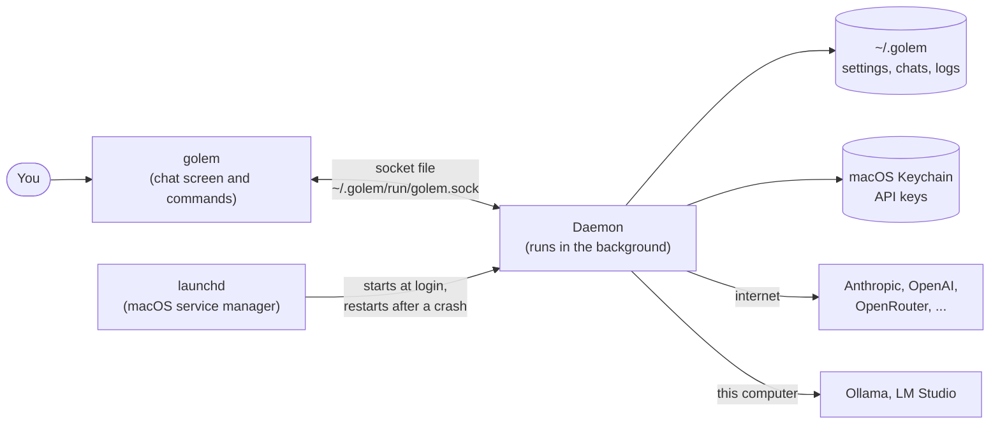

Why split it this way? Closing the chat screen does not stop the work. An answer keeps streaming, or a question keeps waiting for your approval, while the screen is closed. Open it again and everything is still there.

**Who can connect?** Only your own user account. The socket file has permissions `0600`: only its owner can read or write it. There is no password. The file permission is the lock on the door.

---

## 2. The code and the tools

Everything is in one repository, with two sets of packages:

| Folder | Language | What it is |
|---|---|---|
| `packages/protocol` | Python | The message formats the daemon and `golem` agree on |
| `packages/daemon` | Python | The daemon |
| `packages/client` | TypeScript | The library that talks to the daemon |
| `packages/cli` | TypeScript | The `golem` command |
| `packages/tui` | TypeScript | The chat screen |

The message formats are written once, in Python. A script (`just gen`) turns them into TypeScript, so the two sides cannot disagree. If someone changes one side and forgets the other, the checks fail.

Tools a developer needs:

| Tool | What it does here |
|---|---|
| **uv** | Installs Python and the Python packages |
| **pnpm** and **Node** | Install and test the TypeScript packages |
| **bun** | Runs `golem` from the source code, and turns it into a single program file |
| **PyInstaller** | Packs the daemon and its own copy of Python into one folder |
| **just** | Runs every task: `just check`, `just dist`, and so on |

Exact versions are pinned in two lock files, `uv.lock` and `pnpm-lock.yaml`. Everyone, including CI, installs the same versions.

---

## 3. Versions

There is one version number for everything. It comes from git tags.

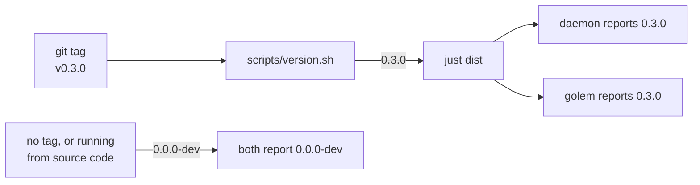

- Running from the source code always shows `0.0.0-dev`.
- A build shows the tag it was built from.
- `golem --version` prints its own version and, if the daemon is running, the daemon's version.
- If the two differ, the chat screen shows both in yellow. They still work together. Only a big protocol change (a new **major** version) stops them from connecting.

---

## 4. Building

`just dist` builds golem into one folder that you can copy anywhere:

```
dist/golem-0.3.0-darwin-arm64/
├─ bin/
│  └─ golem                  ← the command you type (one file, about 60 MB)
└─ libexec/
   └─ golem-daemon/          ← the daemon, with its own Python (about 50 MB)
      ├─ golem-daemon        ← the program that runs
      └─ _internal/          ← Python and libraries it needs
```

Neither part needs anything else installed: no Python, no Node, no uv.

How each part is made:

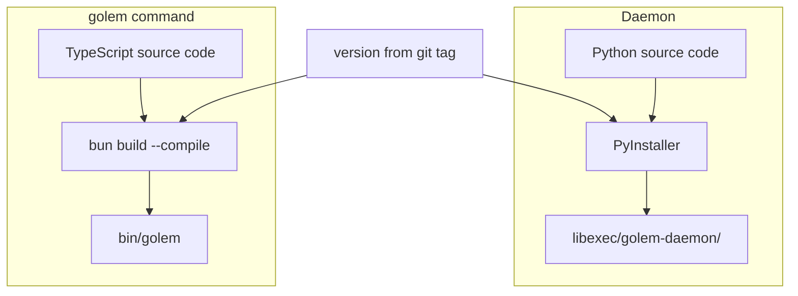

- **The daemon** is packed by PyInstaller as a folder, not a single file. A single file would have to unpack itself every time it starts, which is slow. The recipe is in `packages/daemon/golem-daemon.spec`. It lists a few modules that PyInstaller cannot find on its own, because some libraries load them in a roundabout way.
- **`golem`** is compiled by bun into one file ([ADR-019](adr/019-single-binary.md)).
- **Signing.** Last, `scripts/sign_dist.py` signs every program file in the folder: ad-hoc by default, or with the certificate named by `GOLEM_SIGN_IDENTITY` (section 5). `just check-signature` checks the result, and `just package` packs the folder into the `.tar.gz` and `.sha256` a release ships.

### The smoke test

A "smoke test" is a quick check that the build turns on and works. `just smoke-dist` checks the newest build:

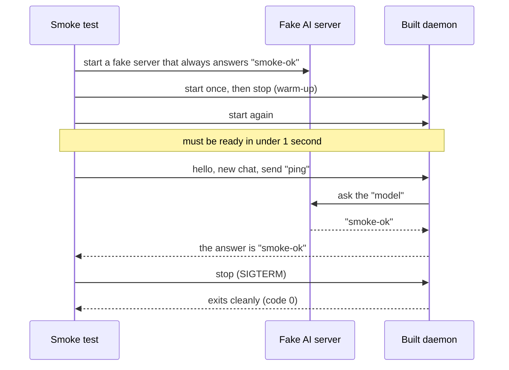

Notes:
- It uses a temporary folder for its data, so it never touches your real chats.
- **Why the warm-up start?** The first time a new build runs, macOS checks every library in it, which takes 2–4 seconds. This happens once per copy. After that, the daemon starts in about half a second.
- The smoke test catches modules PyInstaller missed. Without it, you would only find out when a user starts the program and it crashes.

---

## 5. CI (automatic checks on GitHub)

Every pull request, and every push to `main`, runs two jobs on GitHub:

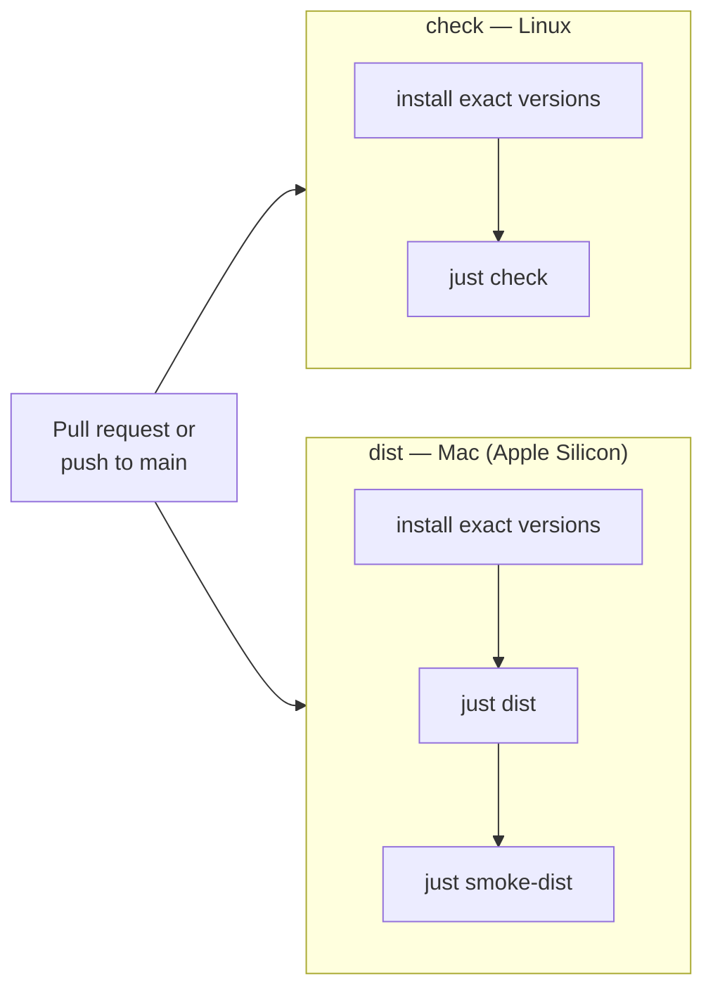

`just check` runs, in order:
1. Regenerates the TypeScript message types and fails if they changed (someone forgot to run `just gen`).
2. Lint: style and common-mistake checks (ruff, plus the TypeScript linters).
3. Type checks (pyright, tsc).
4. All tests (pytest, plus the TypeScript tests).

The `dist` job also runs `just check-signature`. CI builds are signed ad-hoc, which is enough for the checks.

### Releases

Pushing a version tag publishes a release ([ADR-021](adr/021-release-signing.md)):

```bash
git tag v0.1.0 && git push origin v0.1.0
```

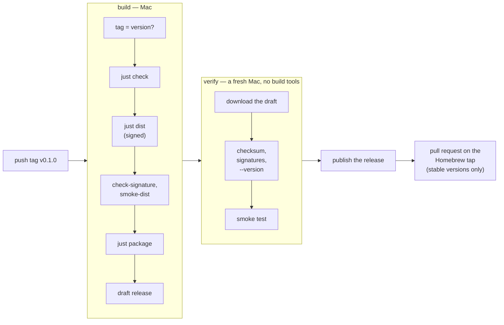

- The release has `golem-<version>-darwin-arm64.tar.gz` and `golem-<version>-darwin-arm64.tar.gz.sha256`. The archive unpacks to one folder, `golem-<version>-darwin-arm64/`.
- A tag with a `-`, such as `v0.2.0-rc.1`, makes a prerelease.
- Nothing is published until a clean runner has checked the exact files users download. If a job fails, the draft stays. Fix the cause, then re-run the workflow: the build replaces the draft's files. A published release is never replaced; tag a new version.

### Signing

#### Why golem is signed

golem keeps its secrets in the macOS Keychain (section 9): API keys today, and later MCP server and hook tokens. This section says "key" for all of them. The Keychain protects each key from other programs on your Mac:
- The program that saved a key can read it without asking.
- Any other program can read it only after macOS shows a password dialog and you click Allow.

So macOS has to decide one thing every time the daemon asks for a key: *is this the same program that saved it?*

macOS answers this with the program's **code signature**, a seal stamped on the program file. What the seal says depends on how it was made:
- **Without a certificate** (an *ad-hoc* signature), the seal says only "this exact file". Every new build is a slightly different file. So after each upgrade, macOS sees a stranger and asks about every key again.
- **With a certificate**, the seal says "a program called `dev.golem.daemon`, signed by this certificate". Every release carries the same name and the same certificate. So after an upgrade, macOS sees the same program and does not ask.

Without signing, a password dialog would appear after every upgrade, once for every saved key. The daemon runs in the background, so these dialogs would pop up at random times, and the daemon would wait until someone answered. Signing makes upgrades silent.

That is the reason for the certificate. There is one more, smaller reason to sign at all: on Apple Silicon, macOS refuses to run a program file without a valid signature, even an ad-hoc one. `bun build --compile` leaves `bin/golem` with a broken signature, so every build is re-signed just so it starts.

Neither reason is about proving to Apple who made golem. That needs a paid Apple Developer ID and notarization, which come later. Until then, golem uses a **self-signed** certificate: one we made ourselves. macOS does not have to trust it. It only has to recognise it again on the next release. So every release must be signed with the **same** certificate ([ADR-021](adr/021-release-signing.md)).

#### What it means for users

Users never see or install the certificate. There are no extra steps for signing itself. What they notice:

| Situation | What the user sees | What to do |
|---|---|---|
| New user installs a release and saves a key with `golem auth set` | Nothing. The daemon saved the key, so it owns it. | Nothing |
| Upgrade to a newer release | Nothing. Same name, same certificate. | Nothing |
| First start of a release, with keys saved earlier by a source-code run or a local ad-hoc build | One Keychain dialog per key: "golem-daemon wants to use your confidential information" | Enter the Mac password and click **Always Allow**, once. The daemon then saves the key again as its own (section 9), so it never asks again. |
| Archive downloaded in a browser instead of `curl` | macOS refuses to open `golem`, because a self-signed program is not notarized | Download with `curl` (section 6), or run `xattr -dr com.apple.quarantine <the unpacked folder>` |
| We ever have to replace the certificate | One Keychain dialog per key after that upgrade | **Always Allow** once, as above |

Homebrew downloads with `curl`, so a `brew install` user (section 10) sees none of the dialogs above, except after a certificate change.

#### How the seal decides

For the curious: the rule inside the signature is called the *designated requirement*.

| Signed with | The rule says | After an upgrade |
|---|---|---|
| Nothing, or ad-hoc (`-`) | "the file with this exact hash" | A new hash, so a new program. macOS asks about every key again. |
| golem's certificate | `identifier "dev.golem.daemon" and certificate leaf = H"<sha1>"` | Same identifier, same certificate, so the same program. No prompt. |

**What gets signed.** `scripts/sign_dist.py sign` runs at the end of every `just dist` on macOS:

1. It finds every Mach-O file (compiled program or library) in the tree: 17 today, mostly PyInstaller's libraries under `_internal/`.
2. It signs the libraries first, deepest folder first, then the two programs, each with a fixed identifier:

   | File | Identifier |
   |---|---|
   | `libexec/golem-daemon/golem-daemon` | `dev.golem.daemon` |
   | `bin/golem` | `dev.golem.cli` |

3. It then runs the same checks as `just check-signature`.

Two environment variables choose the certificate:

| Variable | Meaning | Default |
|---|---|---|
| `GOLEM_SIGN_IDENTITY` | The certificate's SHA-1 (or its name) | `-`, which means ad-hoc |
| `GOLEM_SIGN_KEYCHAIN` | Look for the certificate only in this keychain | every keychain in the search list |

A local build is ad-hoc unless you set them. Even then it is re-signed, because `bun build --compile` leaves `bin/golem` with a signature that does not match the file.

**What is left out, on purpose.**
- No *hardened runtime*. Apple needs it only for notarization, and with a certificate that has no Apple team it makes macOS refuse to load PyInstaller's libraries. This is also why golem does not use PyInstaller's own signing option: it turns the hardened runtime on.
- No timestamp (`--timestamp=none`). A timestamp needs Apple's server and only matters for notarization.
- No notarization. Gatekeeper ignores a self-signed certificate. `curl` and Homebrew downloads are not checked by Gatekeeper, but an archive downloaded in a browser is blocked until the user allows it (section 6). Developer ID and notarization come later. Switching changes the rule once, so users approve the daemon once more.

**Checking a tree.** `just check-signature [tree] [--identity-hash <sha1>]` fails if any of these is false:
- every Mach-O file passes `codesign --verify --strict`;
- both programs carry their identifiers;
- with `--identity-hash`, both are signed by that certificate.

It prints one line per program, with the signer or `ad-hoc`:

```
libexec/golem-daemon/golem-daemon: dev.golem.daemon, golem release signing
bin/golem: dev.golem.cli, golem release signing
```

#### One-time setup (before the first tag)

1. Make the certificate on your Mac:

   ```bash
   sh scripts/make_signing_cert.sh ~/golem-signing
   ```

   It writes `~/golem-signing/golem-signing.p12`: an RSA 3072 key, valid for code signing only, for 20 years. An expired certificate would force the same re-approval as a new one. The script deletes the loose key file, and prints the certificate's SHA-1 and a random password for the `.p12`.
2. In the golem repository on GitHub, open the **Settings** tab, then **Secrets and variables > Actions** in the left sidebar. Add each secret on the **Secrets** tab with **New repository secret**, and the variable on the **Variables** tab with **New repository variable**. Do not use **Environment secrets**: the release workflow names no environment, so it cannot see them.

   | Kind | Name | Value |
   |---|---|---|
   | Secret | `MACOS_SIGN_P12_BASE64` | `base64 < ~/golem-signing/golem-signing.p12 \| pbcopy`, then paste |
   | Secret | `MACOS_SIGN_P12_PASSWORD` | the printed password |
   | Variable | `MACOS_SIGN_IDENTITY` | the printed SHA-1 (not secret: it is in every signature) |

3. Store the `.p12` and its password in a password manager, then delete `~/golem-signing`.

Without these settings a release fails at "Import the signing certificate". It never falls back to an ad-hoc build.

#### What the release does with it

The `build` job decodes the `.p12` into a temporary keychain with a random password, and allows only `codesign` to use the key. It adds that keychain to the search list: codesign does not find a certificate outside the list, even with `--keychain`. It then sets `GOLEM_SIGN_IDENTITY` and `GOLEM_SIGN_KEYCHAIN` for `just dist`. The keychain is deleted at the end, even when the job fails. Both `build` and `verify` run `check-signature --identity-hash "$MACOS_SIGN_IDENTITY"`, so a release signed by any other certificate, or ad-hoc, is never published.

#### Signing a local build the same way

Do this when you want a local daemon to keep the Keychain's trust across rebuilds:

```bash
security import golem-signing.p12 -k ~/Library/Keychains/login.keychain-db -P '<password>' -T /usr/bin/codesign
GOLEM_SIGN_IDENTITY=<sha1> just dist
just check-signature "" --identity-hash <sha1>
```

#### Losing or replacing the certificate

**Never replace the certificate unless you have to.** A new certificate, a lost `.p12`, or an expired certificate all change the rule. Every user then gets a Keychain prompt for each key after their next upgrade, and must choose Always Allow again. Data is not lost, only the trust. If you must rotate it, run the one-time setup again and say so in the release notes.

---

## 6. Installing today

There are four ways. Homebrew is the one to give a colleague. The others are for working on golem, or for a Mac without Homebrew.

### With Homebrew

```bash
brew install milanpavel/golem/golem
golem daemon install
```

Section 10 explains upgrading, removing, and how the tap is kept up to date.

### From the source code (for developers)

```bash
git clone <repo-url> golem && cd golem
uv sync --all-packages       # Python packages
pnpm install                 # TypeScript packages
just golem daemon install    # set up the background service and start it
just golem                   # open the chat screen
```

### From a build folder

```bash
just dist
dist/golem-<version>-darwin-arm64/bin/golem daemon install
dist/golem-<version>-darwin-arm64/bin/golem
```

The build folder can be moved anywhere on the same Mac. Run `golem daemon install` again after moving it.

**Limitation:** a local build is signed ad-hoc, so it is meant for the Mac that built it. To give golem to someone else, use Homebrew, or a release archive: unpack it anywhere and run `bin/golem daemon install`.

### From a release

```bash
curl -LO https://github.com/MilanPavel/golem/releases/download/v<version>/golem-<version>-darwin-arm64.tar.gz
curl -LO https://github.com/MilanPavel/golem/releases/download/v<version>/golem-<version>-darwin-arm64.tar.gz.sha256
shasum -a 256 -c golem-<version>-darwin-arm64.tar.gz.sha256
tar -xzf golem-<version>-darwin-arm64.tar.gz -C ~/Applications
~/Applications/golem-<version>-darwin-arm64/bin/golem daemon install
```

Download with `curl`, not a browser. A browser marks the files as downloaded, and Gatekeeper blocks a program that is not notarized. If you already used a browser, run `xattr -dr com.apple.quarantine ~/Applications/golem-<version>-darwin-arm64` to remove the mark. To upgrade, unpack the new version, run its `golem daemon install`, and delete the old folder.

### How `golem` finds the daemon

`golem` checks three places, and uses the first one it finds:

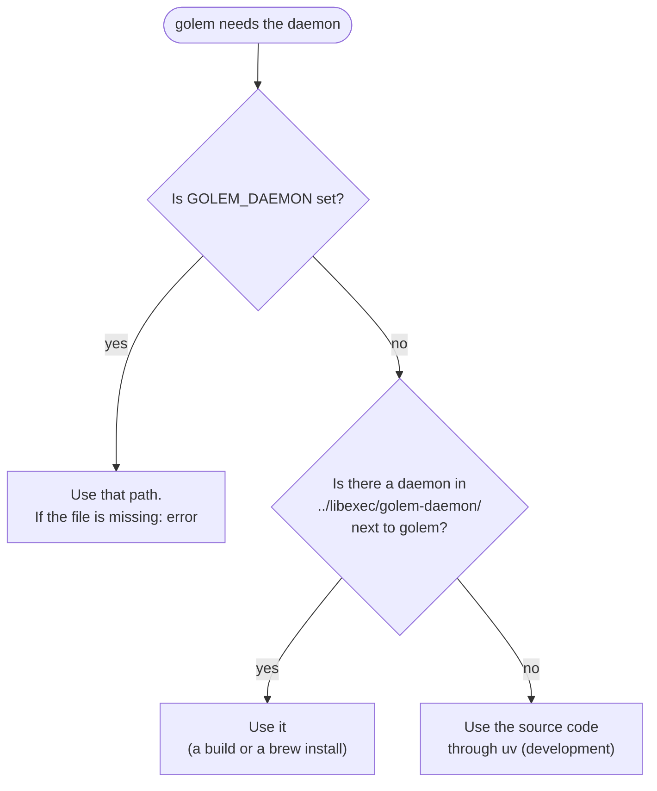

---

## 7. Keeping the daemon running

### launchd, the macOS service manager

launchd is the part of macOS that starts background programs. `golem daemon install` writes a small settings file for it, `~/Library/LaunchAgents/dev.golem.daemon.plist`, which says:

- **what to run:** the full path of the daemon, plus `serve`
- **start it at login**, and **start it again whenever it stops**, waiting 2 seconds between tries
- **where its data lives:** `GOLEM_HOME`, as it was at install time
- **where its output goes:** `~/.golem/logs/launchd.stdout.log` and `launchd.stderr.log`

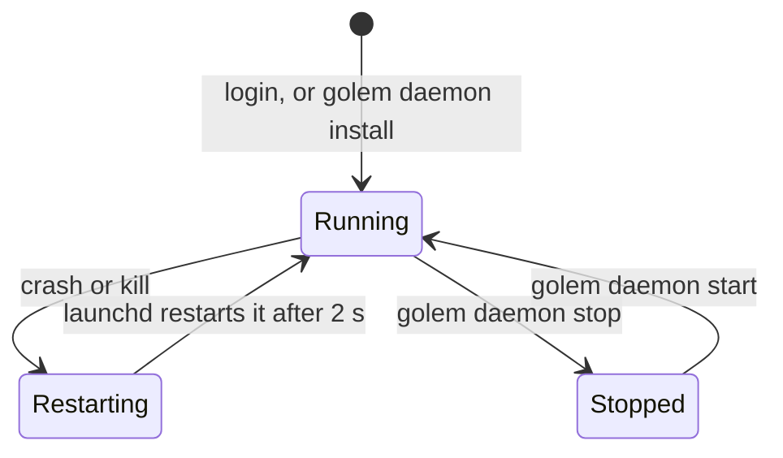

| Command | What it does |
|---|---|
| `golem daemon install` | Writes the launchd file and starts the daemon. Run it again after moving or upgrading golem |
| `golem daemon start` | Starts the daemon, or restarts it if it is running |
| `golem daemon stop` | Stops it and keeps it stopped until `start` |
| `golem daemon restart` | Swaps the running daemon for the one the launchd file names, after an upgrade. Waits until the new one answers and prints its version. Warns when the launchd file names a different golem than the one you ran: then run `install` |
| `golem daemon uninstall` | Stops it and deletes the launchd file. Your data in `~/.golem` stays |
| `golem daemon logs` | Shows the log and follows new lines |
| `golem status` | Shows pid, version, and uptime. Exits with code 1 if the daemon is not running |

`kill` is not a way to stop it: launchd starts it again within seconds. Use `golem daemon stop`.

**A trap:** launchd does not see the environment variables from your terminal. An API key you `export` in your shell does not reach the daemon. Save keys with `golem auth set`, which puts them in the Keychain.

### Running it by hand

For debugging, run the daemon in a terminal. Ctrl-C stops it.

```bash
uv run python -m golem serve                        # from the source code
dist/golem-*/libexec/golem-daemon/golem-daemon serve # from a build
```

### Only one daemon at a time

The daemon locks the file `~/.golem/run/golem.pid` for as long as it runs ([ADR-004](adr/004-pid-lock.md)). A second daemon sees the lock and exits with `daemon already running (pid N)`. If the daemon crashed, the lock is gone, so the next start knows the old socket file is stale and replaces it.

### Starting and stopping

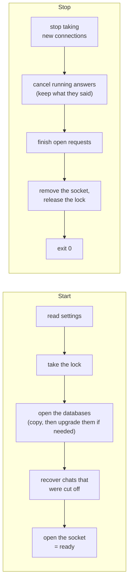

**After a crash, nothing is lost.** Every message is saved to the database before it is sent anywhere. An answer that was cut off is marked as interrupted at the next start. A question waiting for your approval keeps waiting.

---

## 8. Where the data lives

Everything is in one folder: `~/.golem`, or whatever `GOLEM_HOME` points to.

| Path | What it holds | Back it up? |
|---|---|---|
| `config.toml` | Your settings and tool rules | **Yes** |
| `golem.db` | Every chat and event: the real history | **Yes** |
| `checkpoints.db` | What the model remembers of each chat. Losing it loses the model's memory, not your history ([ADR-006](adr/006-checkpoint-continuity.md)) | **Yes** |
| `history` | Messages you typed, for Up-arrow recall | Optional |
| `tui.json`, `exports/` | Screen preferences, and chats you exported | Optional |
| `cache/` | Model lists and prices, refreshed daily | No, safe to delete |
| `logs/` | Log files | No |
| `run/` | The socket, the lock, and the Keychain record | No |

**Backing up:** both `.db` files are SQLite databases. Copy them while the daemon is stopped. While it runs, use `sqlite3 ~/.golem/golem.db ".backup /path/to/copy.db"`.

**Upgrades:** `golem.db` has a schema number. A newer daemon upgrades an older file once, at start, after copying it to `golem.db.bak-<schema>`, for example `golem.db.bak-5`. An older daemon refuses a file from a newer version rather than damaging it, and says which golem it needs and which copy it can still open. `checkpoints.db` is copied to `checkpoints.db.bak-<langgraph version>` when golem starts with different LangGraph packages. The copies are not deleted for you; remove old ones when you no longer need them.

**Going back a version:** stop the daemon, move `golem.db` aside, rename the copy the error names to `golem.db`, and start the older golem. What happened after the upgrade is only in the file you moved aside.

---

## 9. API keys and the Keychain

API keys are kept in the **macOS Keychain**, never in a file.

- Save one with `golem auth set anthropic`, or `/login anthropic` in the chat screen.
- `golem auth list` shows where each key comes from.
- A settings file that contains a key does not load at all, so a key cannot leak through a shared config.
- If both are set, an environment variable such as `ANTHROPIC_API_KEY` wins over the Keychain.

### Which program is allowed to read the key?

The Keychain remembers which **program** created each item, and lets only that program read it without asking.

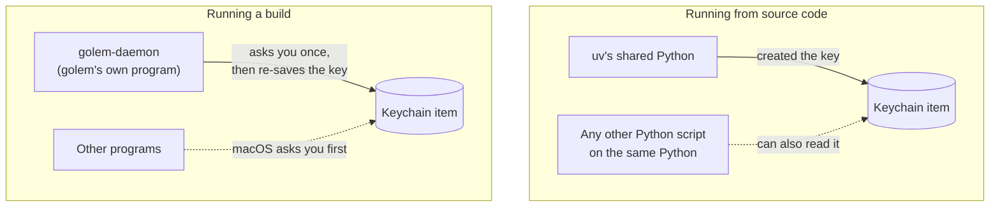

When a built daemon first reads a key saved by the source-code version, macOS asks once. Choose **Always Allow**. The daemon then deletes the key and saves it again, so from then on only the daemon is trusted. It writes the key's name to `~/.golem/run/keychain-migrated`, so this happens only once per key.

**Releases keep the trust.** Releases are signed with one certificate, so after you choose Always Allow once, later releases read the keys without asking. A local build is signed ad-hoc unless you give it the certificate, so macOS treats each rebuild as a new program and asks again.

---

## 10. Homebrew

**Status: built (step 1.6). It is live once the tap repository and its token exist (below), and the first stable tag has been released and its tap pull request merged.** The decisions are in [ADR-022](adr/022-homebrew-tap.md).

### What it looks like for a user

A colleague with an Apple Silicon Mac runs:

```bash
brew install milanpavel/golem/golem   # download and install
golem daemon install                  # start the background service, now and at every login
golem auth set anthropic              # save an API key (or use Ollama, no key needed)
golem                                 # open the chat screen
```

That's all. They don't need Python, Node, uv, bun, or the source code. After the install, Homebrew prints the three `golem daemon` commands a user needs, so they don't have to remember them.

### What happens behind the scenes

Three things work together:

1. **A GitHub release.** Each version tag (for example `v0.3.0`) makes GitHub Actions build golem and upload `golem-0.3.0-darwin-arm64.tar.gz`, plus its checksum (a fingerprint that proves the file was not changed). See section 5.
2. **A "tap".** A tap is a small extra GitHub repository that Homebrew can read: `MilanPavel/homebrew-golem`. It holds one formula, `Formula/golem.rb`. The formula says: "version 0.3.0 is at this URL, its checksum is this; copy `bin/` and `libexec/` into place."
3. **The tap updates itself.** After each stable release, the release workflow opens a pull request on the tap with the new version and checksum. A workflow in the tap installs that formula on a fresh Mac and tests it. You merge the pull request when it passes. Prereleases (tags with a `-`) never go to the tap.

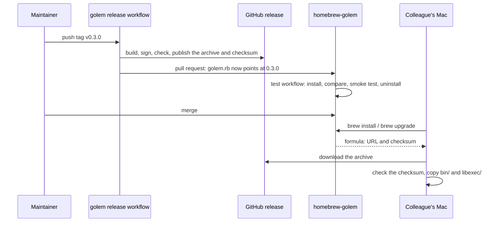

Nothing is compiled on the user's Mac. Homebrew only downloads, checks, and copies.

**The golem repository owns every file in the tap.** The formula is made from `packaging/homebrew/golem.rb.in` by `scripts/render_formula.sh`. The tap's README and test workflow are copied from `packaging/homebrew/tap/`. Change them there. Every release pull request replaces whatever is in the tap.

### Where the files end up

```
/opt/homebrew/
├─ bin/golem                      → link to the current version
├─ opt/golem/                     → link to the current version (never changes name)
└─ Cellar/golem/0.3.0/
   ├─ bin/golem
   └─ libexec/golem-daemon/...
```

Homebrew keeps each version in its own folder under `Cellar/`, plus two links that always point at the current one. `golem daemon install` writes the `opt/golem/...` path into the launchd file, **not** the `Cellar/golem/0.3.0/...` path. So after an upgrade, launchd starts the new version, and the old folder can be deleted safely.

**The files are exactly the released ones.** By default, Homebrew edits programs after installing them: it rewrites each library's name to an absolute path and signs it again, ad-hoc. It also deletes some Python package metadata. golem's formula turns both off (`preserve_rpath` and `skip_clean "libexec"`). So the libraries keep golem's signature, and the tap's test checks that the installed `bin/` and `libexec/` are identical to the archive.

### Upgrading and removing

```bash
brew upgrade golem          # download the new version
golem daemon restart        # switch the running daemon to it
```

The running daemon keeps using the old version's files until you restart it. `brew upgrade` may delete the old folder straight away. The daemon then fails on the next thing it loads from disk, and launchd starts the new version. So restart right after the upgrade. The chat screen also shows a yellow notice when the daemon's version differs from its own.

```bash
golem daemon uninstall      # first: remove the launchd service
brew uninstall golem        # then: remove the program
```

Your chats and settings in `~/.golem` stay, on purpose. Delete that folder yourself if you want them gone.

**The order matters.** After `brew uninstall`, the `golem` command is gone, so `golem daemon uninstall` can no longer run. launchd keeps trying to start a program that does not exist. To clean up by hand:

```bash
launchctl bootout gui/$(id -u)/dev.golem.daemon
rm ~/Library/LaunchAgents/dev.golem.daemon.plist
```

### Why Homebrew does not start the daemon itself

Homebrew can run background services (`brew services`). golem's formula does **not** use that. If both Homebrew and `golem daemon install` started a daemon, the second would hit the lock and exit, launchd would start it again, and it would fail forever. So only `golem daemon install` manages the service, and it works the same way whether golem came from Homebrew or from a downloaded archive. For the same reason, `brew upgrade` does not restart the daemon. It would cut off an answer in progress whenever someone upgrades all their Homebrew packages.

### Setting up the tap (once)

1. **Make the golem repository public.** Homebrew downloads the release and `brew audit` checks the homepage without logging in.
2. **Create the tap repository.** On GitHub: new repository, owner `MilanPavel`, name exactly `homebrew-golem`, **Public**, and tick **Add a README file**. The name must start with `homebrew-`: that is how `brew install milanpavel/golem/golem` finds it. The README gives it a `main` branch. Leave everything else empty: the first release fills it.
3. **Create a token for the release workflow.** GitHub, your profile, **Settings > Developer settings > Personal access tokens > Fine-grained tokens > Generate new token**:

   | Field | Value |
   |---|---|
   | Name | `golem release to homebrew-golem` |
   | Expiration | up to 1 year; put a reminder in your calendar |
   | Repository access | **Only select repositories**: `MilanPavel/homebrew-golem` |
   | Permissions | **Contents**: Read and write. **Pull requests**: Read and write. **Workflows**: Read and write (the release copies the tap's test workflow) |

4. **Store it in the golem repository**, not the tap: open the **Settings** tab, then **Secrets and variables > Actions** in the left sidebar. On the **Secrets** tab, click **New repository secret**, name it `HOMEBREW_TAP_TOKEN`, and paste the token. Use **Repository secrets**, not **Environment secrets**: no environment is needed.
5. **Optional, recommended:** in `homebrew-golem`, under **Settings > Branches**, protect `main` and require the `formula` check before merging.
6. **Release a stable version**, for example `git tag v0.1.0 && git push origin v0.1.0`. When the release is published, the `tap` job opens the pull request `golem 0.1.0` on the tap. The first one also adds the README and the test workflow. Merge it when `test` passes.

If the token is missing or has expired, the release is still published, and only the `tap` job fails. Renew the token, then re-run that job.

### What must be true before a colleague can use it

| Requirement | Why |
|---|---|
| Both repositories are **public** | Homebrew downloads the formula and the archive without logging in |
| The build is **signed with a stable identity** (section 5) | Without it, the Keychain asks again after every upgrade |
| The Mac is **Apple Silicon** (M1 or newer) | Only a `darwin-arm64` build exists. The formula refuses to install on an Intel Mac |
| **Notarization** (Apple's malware scan) is not needed | Homebrew downloads formulae with `curl`, which does not mark files as "downloaded from the internet", so Gatekeeper does not block them |

### Linux and Windows later

The same formula will work on Linux (step 1.9), with a systemd service instead of launchd. Windows will use **Scoop**, a similar tool for Windows, from its own "bucket" repository (step 1.11).

---

## 11. Settings that matter for running golem

All settings are listed in the [README](../README.md#all-settings). For running golem, you mostly need to know where settings come from and when they take effect.

**Where they come from.** If the same setting is in more than one place, the last one wins:

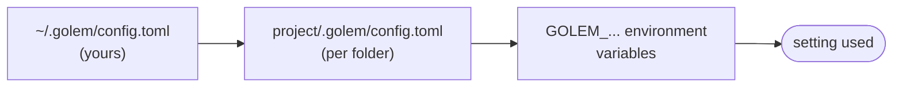

A project's file cannot loosen safety settings (`[shell]`, `[web]`), and cannot allow tools unless you listed that folder in `trusted_projects`.

**When changes take effect:**

| Takes effect at once | Needs a restart (`golem daemon start`) |
|---|---|
| Models, providers, `default_model`, tool rules | Everything else, such as `log_level`, `session_titles`, `[shell]`, `[web]` |

If you break the file, golem keeps using the last version that worked and writes a warning to the log.

Remember: under launchd, `GOLEM_...` variables from your terminal do not apply. Put settings in `config.toml`.

| Setting | Default | What to know |
|---|---|---|
| `log_level` | `INFO` | `DEBUG` writes more detail to the log |
| `session_titles` | `true` | Costs one extra model call per new chat |
| `[shell] network` | `false` | Commands the AI runs cannot use the internet |
| `[shell] timeout_seconds` | `120` | The longest a command can run |
| `[web] allow_private` | `false` | `web_fetch` cannot reach your own computer or home network |

---

## 12. Logs and health checks

- **Logs:** `golem daemon logs`. The log file is `~/.golem/logs/golem.jsonl`, one JSON record per line. If the daemon fails before it can write its log, look in `~/.golem/logs/launchd.stderr.log`.
- **Is it running?** `golem status` shows the pid, version, uptime, state (`running`, or `draining` while it shuts down), and the default model.
- **What is it doing?** In the chat screen, `/debug wire` shows every message between `golem` and the daemon, and `/debug model` shows what the model sees.
- **Not there yet:** log rotation (the log grows forever), metrics, tracing, and cost tracking.

---

## 13. Safety limits

| Area | Limit |
|---|---|
| Socket | Only your user can open it (`0600`). It is created under a strict file mask, so it is never readable by others, not even for a moment |
| File tools | Work only inside the folder the chat was started in. Never change `.golem/` or `.git/` |
| Approvals | Anything that changes something asks you first, unless a rule says otherwise ([ADR-012](adr/012-permission-rules.md)) |
| Shell | Every command runs in a macOS sandbox (`sandbox-exec`): no internet, no writing outside the folder. Without the sandbox, commands do not run at all ([ADR-014](adr/014-shell-sandbox.md)) |
| Web | Asks per website, refuses addresses on your own network, and marks page text as untrusted ([ADR-017](adr/017-web-fetch.md)) |

---

## 14. When something goes wrong

| What you see | What to do |
|---|---|
| The chat screen says `reconnecting` | Run `golem status`. If it is down, run `golem daemon start`, then look at `~/.golem/logs/launchd.stderr.log` |
| `daemon already running (pid N)` | The background copy is running. Run `golem daemon stop` before starting one by hand |
| The daemon keeps restarting | Read `launchd.stderr.log`. Common causes: the database is from a newer golem version (the message names the golem it needs and the copy that still opens); `GOLEM_HOME` is too long (a socket path must be under 104 characters on macOS); golem was moved (run `golem daemon install` again) |
| `needs key` | `golem auth set <provider>`, or `/login <provider>` in the chat screen |
| macOS asks about the Keychain on every start | A local build is signed ad-hoc, so every rebuild asks. Choose Always Allow, or sign local builds with the release certificate (section 5). A release asks once, after the first upgrade from a local or ad-hoc build |
| A release workflow fails at "Import the signing certificate" | The secrets or the `MACOS_SIGN_IDENTITY` variable are missing. See section 5 |
| The release's `tap` job fails | The `HOMEBREW_TAP_TOKEN` secret is missing or expired, or `homebrew-golem` does not exist. The release itself is published. Fix the token (section 10), then re-run the job |
| The tap's `test` workflow fails at "Homebrew installed the archive unchanged" | Homebrew edited a file after install. A new library in the daemon may have a non-`@rpath` install name (`otool -D`), or a newer Homebrew may edit kegs in a new way. Do not merge |
| `brew upgrade golem` does not offer the new version | The tap pull request is not merged yet. Then run `brew update` |
| launchd keeps failing to start golem after `brew uninstall` | The service was not removed first. See "The order matters" in section 10 |
| A build crashes with `ModuleNotFoundError` | PyInstaller missed a module. Add it to `golem-daemon.spec`, then run `just dist && just smoke-dist` |
| The first start of a new build is slow | Expected: macOS checks the new files once |

**Building behind a company proxy:** `just dist` and `just smoke-dist` work offline once the packages are installed. `just check` tries to update packages first, and fails if it can't download them. If everything is already installed, run `UV_NO_SYNC=1 just check`.

---

## 15. What is planned

The rest of Phase 1, in order:

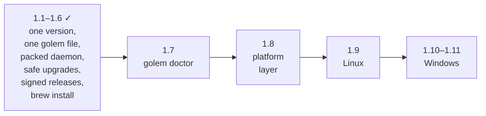

| Step | What you will get |
|---|---|
| **1.7 `golem doctor`** | One command that checks everything (daemon found, service set up, versions match, settings valid, models reachable, disk space) and says how to fix each problem |
| **1.8 Platform layer** | Everything that differs between macOS, Linux, and Windows moves behind one interface, so the next steps are additions, not rewrites |
| **1.9 Linux** | Linux builds, a systemd service, CI on Ubuntu. No shell sandbox at first, so shell commands always ask |
| **1.10 Windows: running** | A Windows "named pipe" instead of the socket file, Task Scheduler instead of launchd, CI on Windows |
| **1.11 Windows: installing** | `scoop install golem` |

Later phases that matter for running golem:

- **Phase 2, MCP:** the daemon starts and watches extra tool programs (MCP servers).
- **Phase 5, Triggers:** the daemon does work on a schedule or when files change, with no chat screen open.
- **Phase 7, Hardening:** tracing (a timeline of where each answer spent its time), nightly database backups, crash tests, speed checks, and a security review.
- **Phase 9:** token and cost display, and spending limits.

**Not planned yet:** log rotation, metrics export, Intel Mac builds, and access from other computers or other users. Golem is meant to run for one person, on one computer.
