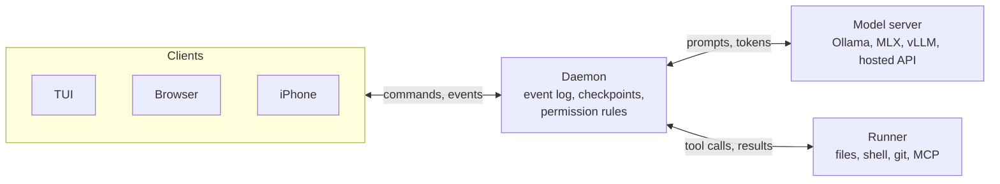
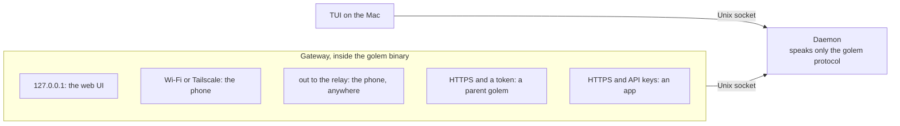
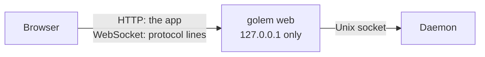
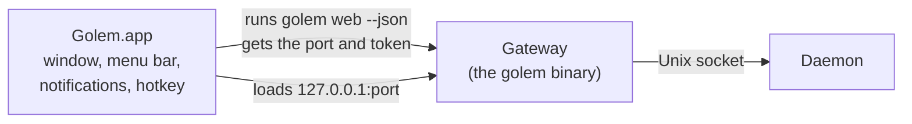
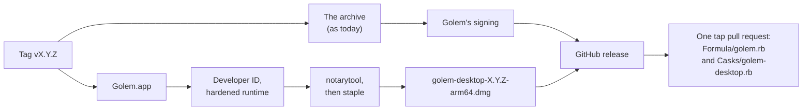
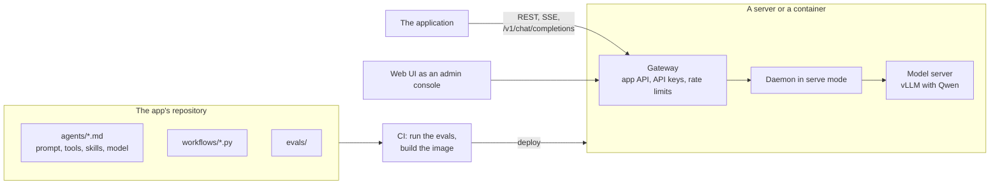
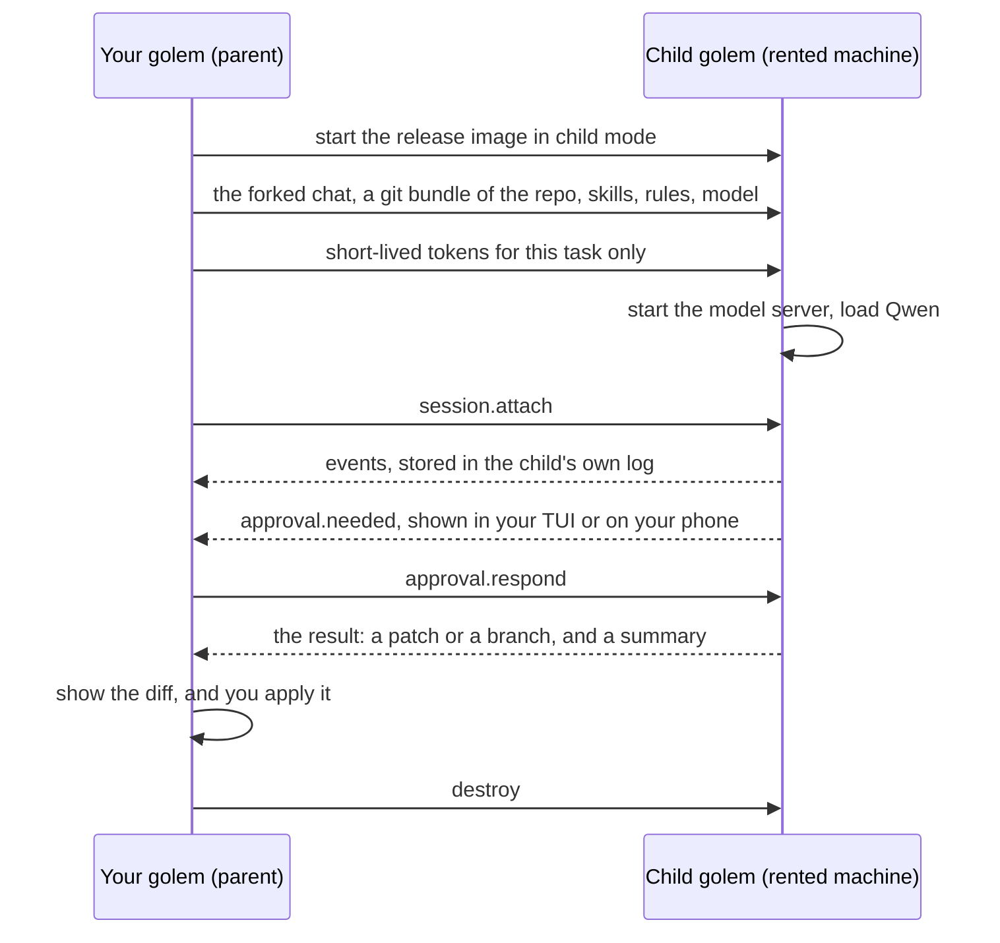
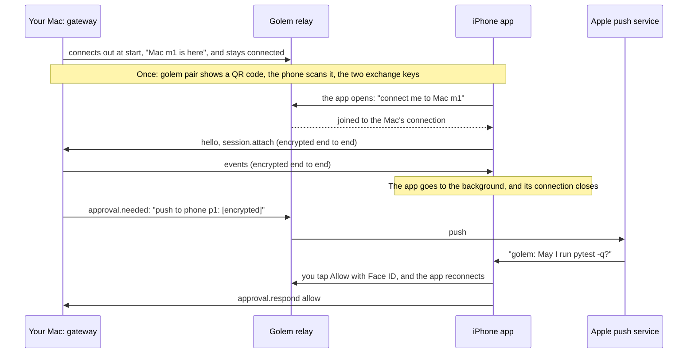
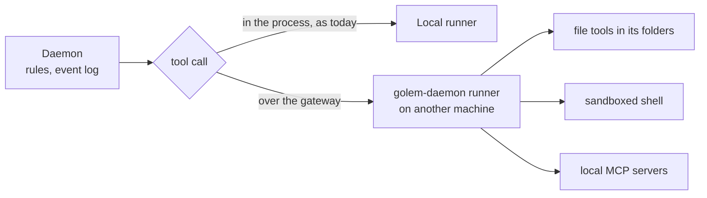
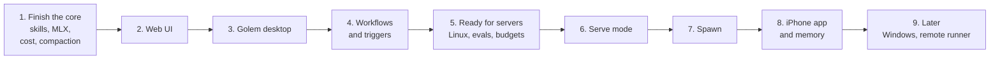

# Vision

Golem today is one daemon on your Mac and a chat in your terminal. This file is where it could go next: a chat in the browser and in a desktop app, an agent that serves your applications, copies of golem that work on rented machines, an iPhone app, and the core work that all of them stand on.

**This is a vision, not a plan.** Nothing here is built, and only the choices marked *decided* are made. [plan.md](plan.md) lists the planned work, step by step. When a part of this file becomes work, it moves there, and its choices get an ADR in [adr/](adr/README.md).

## At a glance

| Chapter | What you get | When |
|---|---|---|
| [1. Web UI](#1-web-ui) | The chat in your browser, served by the `golem` command | Stage 2, right after skills |
| [2. Golem desktop](#2-golem-desktop) | A Mac app around the web UI: a menu bar icon, notifications you can answer, a global hotkey | Stage 3 |
| [3. Serve mode](#3-serve-mode) | A golem deployed on a server, as the agent behind an application | Stage 6 |
| [4. Spawn](#4-spawn) | Your golem starts a copy of itself on a rented machine, with a small open model, for one task | Stage 7 |
| [5. iPhone app](#5-iphone-app) | Approve, watch, and start work from your phone | Stage 8 |
| [6. Remote runner](#6-remote-runner) | Tool calls that run on another machine than the daemon | Later, maybe never |
| [7. The core keeps growing](#7-the-core-keeps-growing) | Skills, workflows, MLX, Linux and Windows, memory, evals, routing | Spread across every stage |
| [8. Roadmap](#8-roadmap) | The order, and why | |

Before the chapters, two short sections explain the ideas they all share: [golem in one picture](#golem-in-one-picture) and [one daemon, one protocol, one door](#one-daemon-one-protocol-one-door).

---

## Golem in one picture

Golem has four roles. Three of them already have names in [architecture.md](architecture.md). The fourth, the **runner**, is new.

| Role | What it is | Today |
|---|---|---|
| **Daemon** | The state: the event log, checkpoints, settings, and the permission rules. It decides what may happen | One per user, on the Mac |
| **Model server** | Where tokens are made: Ollama, MLX, vLLM, or a hosted API | On the Mac, or a hosted API |
| **Runner** | Where tool calls run: file tools, the sandboxed shell, git, MCP servers | Inside the daemon |
| **Clients** | Where you look and decide: the TUI, the `golem` command, later a browser and a phone | On the Mac |



Every chapter moves or adds one role. The web UI and the iPhone add clients. Serve mode and spawn start more daemons, on other machines. A remote runner moves tool calls.

One rule holds everywhere: **one writer per session.** A session's event log and the rules that guard it live in exactly one daemon. There can be many clients, and there is never a second copy of the state to keep in sync.

### What is already in place

The hard parts of a golem you can reach from anywhere were built for the terminal, but none of them depend on it:

| Built today | Why it matters later |
|---|---|
| The daemon owns the state, and clients only attach ([ADR-001](adr/001-process-split.md)) | A browser, a phone, or a parent golem is just one more client |
| Every event has a `seq`, and `session.attach` replays from `after_seq` ([ADR-007](adr/007-attach-and-fan-out.md)) | A flaky network or a closed tab costs nothing: reconnect, replay, carry on |
| The screen is a function of the events ([ADR-003](adr/003-protocol.md)) | Every client reads the same facts |
| An approval waits for an answer across disconnects and restarts ([ADR-013](adr/013-approvals.md)) | Approving from a phone, or from another machine, needs no change to the run |
| Message shapes are written once in Python, and generated ([ADR-003](adr/003-protocol.md)) | The same `just gen` can write Swift types and an OpenAPI spec |
| `session.fork` copies a chat up to one message ([ADR-010](adr/010-fork.md)) | A chat can be cloned and sent to another machine |

---

## One daemon, one protocol, one door

Web, phone, spawn, and serve all need golem to be reachable over a network. The question is how to do that without making golem complicated.

**Decided: the socket stays.** The socket is only a transport. The protocol is the contract, and it can travel over more than one transport. So the daemon keeps doing exactly what it does today. It listens on a Unix socket, and only there.

**Everything that faces a network is the gateway.** The gateway is a part of the `golem` bun binary ([ADR-019](adr/019-single-binary.md)). It opens the doors a given setup needs, and passes each connection on to the daemon's socket.



Why this keeps golem simple:

- **The daemon does not change.** It has no ports, no TLS, no browser rules, and no login code. "The file's mode is the login" stays true inside every machine.
- **All network security lives in one place.** Tokens, pairing, `Origin` checks, and rate limits are one TypeScript program, next to `@golem/client`.
- **In a container, the socket is an inside detail.** A gateway in front of a process on a local socket is the usual sidecar pattern, and the extra hop costs microseconds.
- **The simplest remote link needs no gateway at all.** OpenSSH can forward a Unix socket, so a golem can attach to another golem's socket over `ssh`.

### The same release in different modes

| Mode | Who starts it | Doors it opens | Rules by default |
|---|---|---|---|
| **Personal** (today) | launchd on your Mac | The socket. Later: `127.0.0.1` for the browser, and the phone's doors | As today |
| **Serve** | A deploy, in a container | The app API, and an admin door | Nobody answers, so `ask` becomes `deny` |
| **Child** (spawn) | A parent golem, in a container | One HTTPS door with a token for that spawn | A wider shell, because the container is the wall |

A mode is a setting, not a new code path.

### Two APIs, on purpose

| API | Who uses it | Shape |
|---|---|---|
| **The golem protocol** | Golem's own clients: the TUI, the web UI, the iPhone app, a parent golem | JSON-RPC lines, complete, a new minor version with most features. Never public |
| **The app API** | Applications, in serve mode | Small and stable: start a run, follow its events, answer an owner approval, and `/v1/chat/completions`. REST and SSE, with an OpenAPI spec |

The gateway turns app API calls into protocol calls. Keeping the two apart is what lets the protocol keep changing without breaking anyone's app.

**When to revisit this:** if serve mode ever needs more than one container per app, or the gateway hop shows up when profiling. Even then, the change in the daemon would be small: a WebSocket listener that reuses `Connection` in `golem/server/connection.py`.

---

## 1. Web UI

*First, because it is cheap, you would use it every day, and it builds the network door everything after it needs.*

The chat in your browser, like Claude on the web.

### What the browser does better than the terminal

- Diffs side by side in an approval.
- Long tool output and artifacts as real documents.
- The todo list as a sidebar, and sessions and their forks as a tree.
- Images and PDFs as input.
- Later: the runs view for workflows, and a browser for memory.
- And for serve mode: the same UI, logged in as an admin, becomes the console of a deployed golem.

### How it works (decided: a gateway in the `golem` binary)



- `golem web` starts `Bun.serve` on `127.0.0.1`. It serves the page, and bridges each browser WebSocket to its own connection on the daemon's socket.
- The page is built from a new `packages/web` (React and Vite), and embedded in the binary by `bun build --compile`.
- **The Homebrew formula does not change** ([ADR-022](adr/022-homebrew-tap.md)). The page and the daemon come from the same release, so their protocol versions always match.
- `golem web install` keeps the gateway running as a second launchd job, like `golem daemon install`.
- A PWA manifest lets Chrome or Safari "install" the page, with its own window and a Dock icon, and nothing to notarize.

### What it needs first

- **A transport seam in `@golem/client`.** Its core is hello, ping, attach, re-attach from the last `seq`, and dropping repeats. That core moves away from the socket code, and gets one Unix-socket transport and one WebSocket transport. This also gives `golem --connect <url>`: the TUI can attach to any golem, not only the local one.
- **A shared `packages/view`.** The code that turns events into a transcript moves out of the TUI, so the TUI and the browser show the same state.

### Keeping the page private

Any website you visit can try to open a WebSocket to `127.0.0.1`. The gateway refuses it:

- It listens on `127.0.0.1` only.
- `golem web` opens `http://127.0.0.1:<port>/#t=<token>`. The token comes from a file in `~/.golem/run/` with mode `0600`, so file permissions stay the root of trust. The page trades it for an `HttpOnly`, `SameSite=Strict` cookie.
- The `Origin` and `Host` headers must match exactly. That stops other sites, and DNS rebinding.
- Commands that carry secrets, such as `auth.set`, stay in the TUI.
- The hook endpoint planned in [Phase 4.5](plan.md#phase-4--triggers-and-notifications) becomes one more door on the same gateway.

### Other shapes that were considered

| Shape | Why not |
|---|---|
| The daemon serves the page | A web server inside the frozen daemon, a network port in the process that holds the state, and login code far from the client |
| A hosted website that talks to `127.0.0.1` | Browsers block or prompt when a public site reaches a local address, and the site drifts from the daemon's version |
| A desktop app instead of the web UI | It needs Apple notarization and a second release artifact. It comes next, as a wrapper on top of the gateway ([Golem desktop](#2-golem-desktop)) |

---

## 2. Golem desktop

*Second, because it is a thin wrapper around the web UI, so most of its work is already done.*

A Mac app that shows the same web UI in its own window, and adds what only a native app can do.

### What it adds to the web UI

The PWA already gives the web UI its own window and a Dock icon. A desktop app adds:

- **A menu bar icon:** is the daemon up, which model runs, what the session has cost.
- **Notifications you can answer:** Allow and Deny buttons on an approval, without opening anything. This can replace `terminal-notifier` in [Phase 4.1](plan.md#phase-4--triggers-and-notifications).
- **A global hotkey** for a quick "ask golem" window, like Spotlight.
- **Start at login**, `golem://` links that open a session, and files dropped on the Dock icon.

### How it works



- **The app is only a client.** It does not contain the daemon or the gateway. It finds `golem` on `PATH`, starts the gateway or finds one that runs, and loads the page from it.
- **It has no copy of the web UI.** The page always comes from the gateway, so the app and the daemon can never disagree about the protocol, even when the app is older.
- **The native extras** (the menu bar, notifications, the hotkey) are clients of the same gateway. They read `daemon.status` and the events, like any other client.
- **Test the web UI in the engine the app uses** from the start, and the app costs almost nothing extra.

### Electron or Tauri

Both wrap the same `packages/web`. The choice is open, and gets an ADR when the work starts.

| | Electron | Tauri |
|---|---|---|
| App size | 150 MB or more, because it ships its own Chromium | About 10 MB, because it uses the Mac's WKWebView |
| Rendering | The same Chromium on every OS | Safari's engine on a Mac, and each OS's own web view elsewhere |
| Signing and notarization | `electron-builder`, widely used | `tauri build` |
| Fits best | A desktop app on Linux and Windows too, later | A Mac-first golem |

A native SwiftUI app is not on this list. It would be a second UI, written screen by screen. It only pays off together with the iPhone app, because SwiftUI shares most of its code between iOS and macOS.

### How both are delivered

Both come from the Homebrew tap golem already has: the formula as today, and one new cask.

| Piece | Homebrew | What it holds | Install |
|---|---|---|---|
| **golem** | Formula, as today | `bin/golem` (the CLI, the TUI, the gateway, and the web UI inside it) and `libexec/golem-daemon` | `brew install milanpavel/golem/golem` |
| **golem desktop** | Cask, new | `Golem.app` | `brew install --cask milanpavel/golem/golem-desktop` |

- **The web UI needs nothing new.** It is inside the `golem` binary, so the formula and the tap's checks stay as they are ([ADR-022](adr/022-homebrew-tap.md)).
- **The cask depends on the formula** (`depends_on formula: "milanpavel/golem/golem"`), so installing the app also installs the daemon and the gateway. The cask is called `golem-desktop`, so two things named `golem` never share one tap.
- **Only the app is notarized.** Homebrew quarantines what a cask downloads, and Gatekeeper refuses an app that Apple has not notarized. That needs an Apple Developer ID, at $99 a year. The formula keeps its own signing ([ADR-021](adr/021-release-signing.md)).

The release workflow builds both from one tag:



- **The same version, in the same tap pull request.** The tap's test workflow installs both, and checks that the app finds the gateway.
- **CI signs and notarizes** with the Apple certificate and an App Store Connect API key, kept as secrets next to `HOMEBREW_TAP_TOKEN`.

### Updates: one owner only

The same lesson as the launchd job in ADR-022: two owners of one thing fight.

- **Installed with Homebrew:** `brew upgrade` updates both, and the app's own updater is **off**.
- **Downloaded as a DMG** from the GitHub release: the app's own updater can be on. The app still needs the formula for the daemon, so on first start it says "Install golem first: `brew install milanpavel/golem/golem`".

### The effort

About two or three weekends on top of the web UI. Signing and notarization are the biggest unknown.

| Work | Estimate |
|---|---|
| The app shell: start or find the gateway, pass the token, load the page | 1 to 2 evenings |
| The menu bar, status, and notifications you can answer | 2 to 4 evenings |
| The global hotkey and the quick-ask window | 1 to 2 evenings, optional |
| Signing, notarization, the DMG, and the cask in the release workflow | 2 to 4 evenings, plus waiting on Apple |

It also costs a little every year: the Developer ID and its certificate, and a second artifact and a second Homebrew file on every release.

---

## 3. Serve mode

*Third, because it turns golem from a personal tool into something an application can use.*

Golem deployed on a server, as the agent behind an application. **It has nothing to do with your Mac.** It has no Keychain, no personal chats, and no files of yours. The people who send it requests are the app's users.

### What an app gets

- An agent that answers through an API, with tools, skills, and a model the app's team picked.
- **Workflows** ([below](#workflows)) that run in the background: triage, extraction, review queues.
- A session per app user and conversation, with streams that resume after a dropped connection.
- Rules that hold with nobody watching, and a queue where a person on the app's team approves the risky steps.
- Open models on its own GPU, or hosted ones, with a budget.

### How it works



- **The app's repository holds the agent.** An agent is a markdown file with a frontmatter header: name, model, tools, skills, and rules, with the system prompt as its body. That is the same shape as `SKILL.md`, and as Claude Code's agent files. Workflows and evals sit next to it.
- **CI builds and deploys it.** The image starts `FROM` golem's release image and adds the app's folder. The evals must pass before a deploy.
- **`golem serve` runs the same thing on your Mac** while you build the app. The app talks to `127.0.0.1`, and you watch every run in the TUI or the web UI.
- **The app API** has two shapes:
  - Golem's own: start a run, and follow its events over SSE, resuming from `after_seq`.
  - **The OpenAI chat completions API, where `model` is an agent's name.** Every app framework already speaks it, and golem's router picks the real model behind it.
- **A session per app user.** An app user's id and a conversation id name one golem session. Memory has a separate space per app user.
- **Rules with nobody watching.** In serve mode a rule can be `allow`, `deny`, or `owner`. `owner` puts the call in a queue, such as "issue a refund", for someone on the app's team to approve in the admin console or through a webhook.
- **Throughput.** Ollama and MLX are good for one person, but weak at many requests at once. A server uses vLLM or SGLang, which batch requests. Qwen3 8B on one L4-class GPU is enough for a small app. Hard requests escalate to a bigger hosted model, under a budget per API key.
- **One container per app** at first, with SQLite. Postgres and more containers come only when one container is not enough.

### Where golem can stand out

LangGraph Platform, OpenAI's Responses API, Letta, and Mastra already do agent backends. Golem's case:
- the same agent and workflows you shaped in the terminal ship as they are;
- it runs on open models, and is cheap to host yourself;
- approvals survive a restart;
- a bad production run can be replayed in your local TUI.

### What it needs first

- Pinned skills and a system prompt ([Phase 2.3](plan.md#phase-2--skills)), so an agent definition has something to pin.
- Workflows ([Phase 3](plan.md#phase-3--flows)).
- The Linux build ([Phase 8.2](plan.md#phase-8--platforms)), because servers and containers run Linux.
- Tracing and evals ([Phase 6](plan.md#phase-6--evals-and-hardening)).
- Cost per call, structured outputs, and budgets ([Phase 9](plan.md#phase-9--model-routing-and-long-sessions)).

### The risk

Serve mode is close to a second product, and [plan.md](plan.md#risks) already names scope explosion as a risk. The cheap first version is one agent behind `/v1/chat/completions`, in one container, for your own small apps.

---

## 4. Spawn

*Fourth, because it reuses what serve mode builds: the Linux image and the container deploy.*

From the golem on your Mac, start a copy of it on a rented machine for one task. The copy runs a small open model such as Qwen. Your Mac watches it, takes the result back as a diff, and the copy is destroyed.

```
/spawn modal --model ollama/qwen3:8b --gpu l4 "fix the flaky test in test_runner.py"
```

### What you get

- Work that keeps going while your laptop is closed.
- Several tasks at once, one child each.
- A bigger model than your Mac can hold.
- A container where the agent may do more than on your Mac, such as use the network.

### How it works



- **The child is a full daemon,** and the one writer of its session. Your Mac keeps a *remote session* that attaches and mirrors the events. `/sessions` shows it with a cloud mark and its cost so far.
- **Attaching is the same as today.** Over `ssh` the parent forwards the child's socket. On Modal or E2B, it connects to the child's gateway with a token made for that spawn. The child connects to nothing on your Mac. When the Mac sleeps, it catches up from `after_seq` when it wakes ([ADR-007](adr/007-attach-and-fan-out.md)).
- **What crosses, and what never does.** The forked chat ([ADR-010](adr/010-fork.md)), a git bundle with uncommitted changes, the skills, the rules, and the model cross. Your Keychain, the rest of `~/.golem`, and your other chats never do. Tokens are for one repository and one task, and are revoked at the end.
- **A small open model fits here best.** There is no API key to hand over, no bill per token, and the prompts stay on a machine you rent.
- **Results come back as a diff,** never as a write to your files. You review and apply it like any `edit_file` approval ([ADR-015](adr/015-write-tools.md)).
- **Every child has limits:** a longest time, a most money, and destroy when idle. A forgotten GPU machine is the main risk to money.
- **Many children** fit "an agent as a step" in [Phase 3.6](plan.md#phase-3--flows): a workflow can start one per issue.

### Where a child can run

| Target | Good for |
|---|---|
| `ssh` to a machine you own | The first version. No vendor, and the socket forwards as it is |
| Docker on your Mac | Testing the whole path offline, and a contained "do anything" mode |
| Modal | A GPU child with Qwen, paid per second. Its SDK is Python, like the daemon |
| E2B or Daytona | Fast CPU sandboxes, paired with a hosted open model |
| RunPod, Lambda, a cloud VM | Long or heavy runs |

### Which Qwen

A rough guide, to check when this is built:

| Model | Runs on | Good for |
|---|---|---|
| qwen3:4b or smaller | CPU only, slowly | Summaries, small edits |
| qwen3:8b (about 5 GB at 4 bits) | A small GPU, L4 or A10G class | A general agent with tools |
| Qwen3-Coder-30B-A3B | A 24 GB GPU | Coding. Only about 3B parameters run per token, so it is fast |

Most of a cold start is downloading the weights. Build them into the image, or keep them on a volume.

---

## 5. iPhone app

*Fifth, because it needs a relay and push notifications, the first service someone has to run.*

### What the phone is for

The phone is not a small terminal. It is where you **watch and decide** while you are away:

- **Approve from a notification:** "May I run `pytest -q`?", with the command or the diff, and Face ID.
- **Watch a run** in a Live Activity on the lock screen: "golem · running tests · step 4 of 9".
- **Start work:** pick a recent project, type or dictate a task, or start a workflow.
- **Send things to golem** from the share sheet: a link, a PDF, a photo.
- **Shortcuts and Siri:** "Ask golem for my PR digest."

The app is native Swift, because Live Activities, the Secure Enclave, and notification extensions need native code. `just gen` writes Swift types from the same schemas.

### How the phone reaches the Mac

**The first problem: the phone cannot call the Mac.** The phone is on 5G or someone else's Wi-Fi. The Mac is behind a router that drops every connection that starts outside, and it has no public address. There are only two ways around that:

1. **Put both on one private network:** the same Wi-Fi, or Tailscale.
2. **Both connect out to a meeting point** on the internet, a relay. Every router lets outgoing connections through.

**The second problem: iOS freezes apps in the background.** An app keeps its connection only while it is on screen. The only way to reach a phone in a pocket is an Apple push notification, and only a server that holds the app's Apple push key can send one. So **an app other people install needs a small server for pushes anyway.**

Three ways to connect, from the least work to the most:

| Way | How | Limits |
|---|---|---|
| **Same Wi-Fi** | The gateway announces itself with Bonjour (`_golem._tcp`), and the app connects to it | Only at home |
| **Tailscale** | Both devices join your private network and get stable names, such as `my-mac.tail1234.ts.net`. The gateway listens there too | Everyone installs Tailscale. iOS runs one VPN at a time, so it clashes with a work VPN. No pushes |
| **A golem relay** | Both sides connect out to the relay, which joins them and sends the pushes | Someone runs the relay |

How the relay works:



- **The relay sees only noise.** Pairing gives the phone and the Mac each other's keys, and everything it forwards is encrypted with them. A notification extension on the phone decrypts the text of a push.
- **It keeps no data.** If it is down, nothing is lost: the event log replays when the phone gets through.
- **It is small:** a Cloudflare Worker with one Durable Object per Mac, a few hundred lines.

**Suggested path:** Tailscale to build and test the app on your own devices. The relay before anyone else installs it.

### When the Mac sleeps

A closed lid freezes the daemon. While a run is active or waiting for an approval, the daemon can hold a power assertion (what `caffeinate -i` does), so work in progress finishes. For a golem that never sleeps, use a Mac mini, or spawn the work.

### What the protocol needs for a phone

- **Attach from the end:** `session.attach` with `tail: N`, and older history on demand.
- **A project list,** so the phone can start a session in a sensible folder.
- **Approvals per device:** the device that answers is part of `approval.respond`. For example, "always allow" is off on the phone by default, and `shell` needs Face ID.
- **Less output:** a device can ask for summaries of `tool.output`.

---

## 6. Remote runner

*Last, and optional. Spawn and serve do not need it.*

### What it is

A small program that runs golem's own tools on another machine, for a daemon that lives somewhere else. It is not a new codebase. It is the daemon's own Python started in another mode, for example `golem-daemon runner --connect <url> --root ~/repos`.



1. It connects **out** to a daemon, so it works behind a router, and says which folders and tools it serves.
2. It receives `tool.execute` with the tool, its arguments, the folder, and the call id.
3. It runs the call with the same `golem/tools/` code as today, inside its own floor: only its folders, and the sandbox always.
4. It streams `tool.output` back, and returns the result. A repeated call id returns the earlier result instead of running twice.

It has no model, no sessions, and no rules beyond its floor. To the daemon it is one more kind of connection, one that runs tools instead of drawing them.

**When it matters:** a daemon on a server that should still work on your Mac's files, or a daemon on your Mac that should run tools on a Linux box or a dev VM.

### How it differs from MCP

MCP is about **which tools exist**: tools from third parties. The runner is about **where golem's own tools run**.

| | MCP server | Remote runner |
|---|---|---|
| Tools | Someone else's. Golem asks before every call, and marks the output as data ([ADR-023](adr/023-mcp-client.md)) | Golem's own, with the same trust and rules as when they run locally |
| Who connects | The daemon starts it or connects to it | The runner connects out to the daemon |
| Edits | One call, one result | Two steps, as `edit_file` does today: plan the diff on the runner, approve it in the daemon, apply exactly that diff on the runner |
| Sandbox | Whatever the server does | Golem's sandbox, enforced on the runner's side |

They work together: a runner can host MCP servers that need that machine's paths, and pass them through. The runner could be built as an MCP server, but MCP would have to bend for the two-step edit, the sandbox, and the reversed connection. And golem's "ask before every MCP call" would then cover golem's own tools.

---

## 7. The core keeps growing

The chapters above stand on work already in [plan.md](plan.md). This chapter says what each part of that work adds to the vision, and the [roadmap](#8-roadmap) says when.

### Skills

[Phase 2](plan.md#phase-2--skills) is underway. Golem finds, checks, and lists skills today. The steps left are: run one with `/name`, pin one into the system prompt, let the model load one, pick them by embeddings, trust and scoped permissions, and skills golem writes for itself.

For the vision, skills matter twice. They are how a small local model does a job well. And they are what a serve-mode agent pins.

### Workflows

[Phase 3](plan.md#phase-3--flows) calls them flows. **Workflows** is the clearer name, and `golem run` and `/runs` stay as they are. The rename can happen when Phase 3 starts.

**What a workflow is.** Steps that your code puts in order, where any step can call a model, a tool, or a whole agent. Every finished step is saved, so a crash or a restart continues where it stopped. A workflow can wait for your review for days, and never does a real-world action twice.

**Skill, agent, or workflow?**

| | Who decides what happens next | Good for |
|---|---|---|
| Skill | The model, following written instructions | "Open a pull request the way this project likes it" |
| Agent | The model, choosing tools | "Fix the failing test" |
| Workflow | Your code. The model does the steps | "Every weekday at 9:00, summarize yesterday's pull requests and post the digest after I approve it" |

**What workflows are for:**

| For you | For an app (serve mode) |
|---|---|
| A pull-request digest every weekday at 9:00, posted after you approve it | Support triage: classify a ticket, draft a reply, a person approves, send |
| A new PDF in `~/Downloads`: read the receipt, file it, add it to a sheet | Document intake: pull fields out of a PDF into JSON, check them, store them |
| A nightly test run on `main`. When it is red, an agent finds the cause and opens an issue | A review queue: an agent prepares, a person decides, the workflow carries it out |
| Release notes from the merged pull requests | Enrichment: look up a company, summarize it, update the CRM |
| A weekly dependency review, with an agent step per update | Long jobs that must survive a deploy, a crash, or a slow person |

**Which language.**

| Language | Verdict | Why |
|---|---|---|
| **Python** | **Yes, first** | The durable engine is LangGraph's Functional API, which is Python, and so is the daemon. A workflow gets the full language: loops, branches, libraries, tests |
| **YAML or markdown** | **Later, for simple ones** | A straight list of steps (agent, tool, review, notify, another workflow), for people who do not want to write code. It compiles to the same engine, so it is not a second engine |
| **TypeScript** | **No, for writing them** | A second language would need a second durable engine, and durability is the hard part. A TypeScript app *starts and watches* workflows through the app API instead |

This follows open question 3 in plan.md: Python only, until it hurts.

[Phase 4](plan.md#phase-4--triggers-and-notifications), triggers and notifications, is what makes workflows run without you: schedules, file watchers, and macOS notifications. The iPhone app later adds a second place for notifications to land.

### Local models: Ollama and MLX

Golem starts and stops Ollama for you today. **MLX** is Apple's machine-learning framework for Apple Silicon. It is often faster on a Mac than llama.cpp-based servers, and the `mlx-community` organization on Hugging Face publishes ready MLX versions of most open models, Qwen among them.

How MLX would fit:

- **A local model server, like Ollama.** `mlx_lm.server` (from the `mlx-lm` package) serves an OpenAI-compatible API. Golem's `openai_compat` provider can already talk to it. What is missing is golem starting and stopping it, as it does for Ollama, with `owner` `golem` in `local_servers`.
- **In its own process, with its own Python.** MLX does not go inside the frozen daemon. Golem installs it with `uv` on first use and runs it as a child. A crash or memory pressure then stays in that process.
- **In the model picker.** `/model` lists MLX models next to Ollama ones, with their size, and downloads them from `mlx-community`.
- **LM Studio** has an MLX engine too, and is already a provider for people who use it.
- **Watch out:** tool calling depends on each model's chat template and on the server's support for it. A tool-calling eval per model (Phase 6.2) answers "does this one work as an agent?".

MLX is for one person on a Mac. Servers (serve mode, spawn) use vLLM.

### Linux and Windows

[Phase 8](plan.md#phase-8--platforms) puts everything that depends on the OS behind one small interface, then adds Linux and Windows.

- **Linux moves earlier,** because serve mode and spawn run in Linux containers. A sandbox for the shell on Linux (bubblewrap, nsjail, or gVisor) comes with it. In a container, the container is the outer wall.
- **Windows stays later,** for people who want the personal golem there. The gateway gives plan.md's open question 4 one more answer: loopback with a token in a file only you can read, if asyncio's named-pipe server proves fragile.

### Memory

[Phase 5](plan.md#phase-5--memory): memory you can see and edit, recall by meaning, and saving only what you confirm. In serve mode, memory has a separate space per app user. That is one more reason to design memory spaces from the start.

### Evals and hardening

[Phase 6](plan.md#phase-6--evals-and-hardening): tracing, eval suites, replay, crash tests, backups, and a security pass. In serve mode these stop being nice to have. Evals gate a deploy, and replay turns a bad production run into a local debugging session.

### Model routing and long sessions

[Phase 9](plan.md#phase-9--model-routing-and-long-sessions): tokens and cost, a cheap profile, budgets, escalation, and compaction.

- **Tokens and cost** (9.1) are wanted everywhere: in the TUI, on a spawned child's meter, and per API key in serve mode.
- **Compaction** (9.5) is daily pain today. Small local models have small contexts, and a long session hits the limit.
- **Budgets and escalation** (9.3, 9.4) are what make serve mode and spawn safe with money.

### TUI polish

[Phase 7](plan.md#phase-7--tui-polish): a render cache, themes, and search. It fits wherever there is a gap. With a web UI, some of it may matter less.

---

## 8. Roadmap

Each stage is useful on its own. A stage is a group of plan.md phases and new chapters, not a promise of dates.



| Stage | What | From plan.md | Why here |
|---|---|---|---|
| **1. Finish the core** | Skills 2.2 to 2.7. MLX as a local model server. Tokens and cost. Compaction | 2, 9.1, 9.5 | Skills are underway. MLX is small. Cost and compaction help every day |
| **2. Web UI** | The client's transport seam, `packages/view`, the gateway, `packages/web` | New | Cheap and safe. Builds the network door |
| **3. Golem desktop** | The app around the web UI, the menu bar, notifications you can answer, the cask, and notarization | New | A thin wrapper, once the web UI is in daily use. Its notifications are ready for the workflows that come next |
| **4. Workflows and triggers** | Workflows, schedules, file watchers, notifications | 3, 4 | Golem starts working alone. The web UI gets the runs view. Serve mode needs workflows |
| **5. Ready for servers** | Platform seams and Linux. Tracing and evals. Structured outputs and budgets | 8.1, 8.2, 6.1, 6.2, 9.2, 9.3 | Servers run Linux, and nobody watches them |
| **6. Serve mode** | Agent files, `golem serve`, the app API, the release image, the admin console | New, plus 6.3, 6.4 | Everything it stands on is in place |
| **7. Spawn** | `ssh` and Docker targets first, then Modal with Qwen. Remote sessions, diffs back | New, plus 9.4 | Reuses the image and the Linux build |
| **8. iPhone app and memory** | The relay, pairing, pushes, the app. Memory | New, plus 5 | Golem as a personal assistant, everywhere |
| **9. Later** | Windows, the remote runner, TUI polish | 8.3, 8.4, 7 | When someone needs them |

This order is not the one in plan.md today. Agents, workflows, and Linux move ahead of memory and Windows. When this vision is agreed, plan.md's "Next, in order" table follows it.

---

## Threat model

- **The browser and the desktop app.** Loopback only, a token from a `0600` file, a strict cookie, and exact `Origin` and `Host` checks. The desktop app is a client of the same gateway, signed and notarized, and holds no secrets of its own.
- **An app's users.** Their input is never trusted. Serve-mode agents get a few declared tools, never a shell. `ask` becomes `deny`, and risky steps go to an owner. Each app user's sessions and memory are kept apart.
- **A deployed golem** holds API keys, so it gets only what it needs: no personal secrets, and keys with budgets.
- **Children.** Tokens for one task, no Keychain, a budget and a time limit, and results that come back as a diff you review.
- **A stolen phone.** A phone that can approve `shell` can run code on your Mac. Its key lives in the Secure Enclave, each approval asks for Face ID, "always allow" is off by default, and `golem devices revoke` cuts it off at once.
- **The relay.** It forwards only encrypted bytes. If someone breaks into it, they learn which devices talk, and when, but not what they say.
- **A remote runner** enforces its own floor, so a daemon someone has broken into still cannot leave the runner's folders or sandbox.
- **Content is data.** As [plan.md](plan.md) says under Security, what tools, the web, children, and app users send is never an instruction about permissions.
